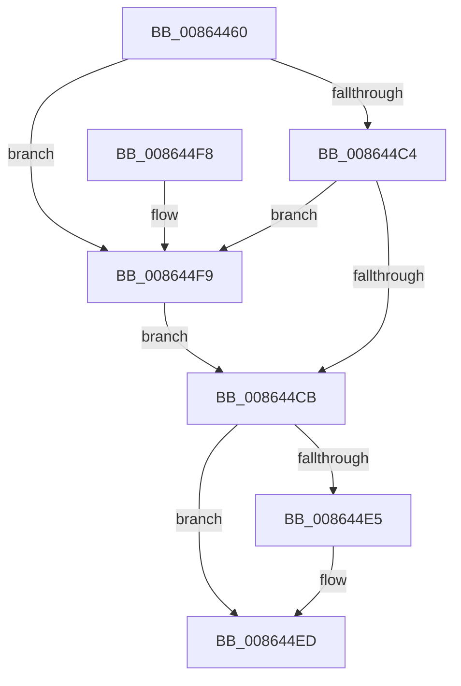

# CmpUnlockHashEntry

- RVA: `0x00864460`–`0x00864503` (길이 `163` bytes)
- VA: `0x0000000140864460`
- 실행 섹션: `PAGE`
- PDB 이름 있음: `예`; PDB Function 태그: `아니요`
- unwind 정보 RVA: `0x0006B95C`
- 디코드: `47`개 명령, `163/163` bytes 표시
- 미해석 바이트: `0` (있으면 어셈블리에 `.byte`로 보존)

> 이 문서는 커널 이미지의 기계어와 PDB 기호를 분석해 생성했습니다. 4번과 5번은 함수 원형과 자료형을 바이너리 사용 방식에서 추정한 C 해석이며 원본 소스 복구 결과는 아닙니다.

## 1. Dependencies

- 직접 호출 지점: **3**; 고유 호출 대상: **3**
- 직접 호출자로 확인된 함수: **3**
- RIP 상대 이미지 참조: **0**

### Outgoing calls
- `0x008644CE` → [KeAbPostRelease](../../text/2E/KeAbPostRelease_function_002E1600.md) (function, `0x002E1600`)
- `0x008644E8` → [CmpDeleteHive](CmpDeleteHive_function_0086450C.md) (function, `0x0086450C`)
- `0x008644FC` → [ExfReleasePushLock](../../text/26/ExfReleasePushLock_function_002638D0.md) (function, `0x002638D0`)

### Direct callers
- [sub_0041B9B6](../../text/41/Unknown_function_0041B9B6.md) at `0x0041BA55`
- [CmpWalkOneLevel](../85/CmpWalkOneLevel_function_00852BA0.md) at `0x00853346`
- [CmpWalkOneLevel](../85/CmpWalkOneLevel_function_00852BA0.md) at `0x00853997`
- [CmpDoParseKey](../85/CmpDoParseKey_function_0085F750.md) at `0x00860DC3`
- [CmpDoParseKey](../85/CmpDoParseKey_function_0085F750.md) at `0x00861789`

### Static image references
- 디코드된 RIP-relative 메모리 참조가 없습니다.

## 2. Other-region calls and transfers

- 다른 실행 섹션으로 향하는 call: **2**
  - `0x008644CE` → [KeAbPostRelease](../../text/2E/KeAbPostRelease_function_002E1600.md) (`PAGE` → `.text`)
  - `0x008644FC` → [ExfReleasePushLock](../../text/26/ExfReleasePushLock_function_002638D0.md) (`PAGE` → `.text`)
- 별도 외부 분기/꼬리 이동을 확인하지 못했습니다.

## 3. Assembly (complete function range)

```asm
00864460  48 89 5C 24 08                  mov qword ptr [rsp + 8], rbx
00864465  57                              push rdi
00864466  48 83 EC 20                     sub rsp, 0x20
0086446A  8B C2                           mov eax, edx
0086446C  48 8B F9                        mov rdi, rcx
0086446F  C1 E8 09                        shr eax, 9
00864472  33 C2                           xor eax, edx
00864474  69 C0 A3 8A 01 00               imul eax, eax, 0x18aa3
0086447A  8B D0                           mov edx, eax
0086447C  44 8B C0                        mov r8d, eax
0086447F  48 8B 87 70 06 00 00            mov rax, qword ptr [rdi + 0x670]
00864486  49 C1 E8 09                     shr r8, 9
0086448A  4C 33 C2                        xor r8, rdx
0086448D  8B 91 78 06 00 00               mov edx, dword ptr [rcx + 0x678]
00864493  FF CA                           dec edx
00864495  4C 23 C2                        and r8, rdx
00864498  4B 8D 0C 40                     lea rcx, [r8 + r8*2]
0086449C  45 33 C0                        xor r8d, r8d
0086449F  48 8D 1C C8                     lea rbx, [rax + rcx*8]
008644A3  4C 89 43 08                     mov qword ptr [rbx + 8], r8
008644A7  0F 0D 0B                        prefetchw byte ptr [rbx]
008644AA  48 8B 03                        mov rax, qword ptr [rbx]
008644AD  48 8B C8                        mov rcx, rax
008644B0  48 83 E1 F0                     and rcx, 0xfffffffffffffff0
008644B4  48 83 F9 10                     cmp rcx, 0x10
008644B8  48 8D 50 F0                     lea rdx, [rax - 0x10]
008644BC  49 0F 46 D0                     cmovbe rdx, r8
008644C0  A8 02                           test al, 2
008644C2  75 35                           jne 0x1408644f9
008644C4  F0 48 0F B1 13                  lock cmpxchg qword ptr [rbx], rdx
008644C9  75 2E                           jne 0x1408644f9
008644CB  48 8B CB                        mov rcx, rbx
008644CE  E8 2D D1 A7 FF                  call 0x1402e1600
008644D3  B8 FF FF FF FF                  mov eax, 0xffffffff
008644D8  F0 0F C1 87 88 10 00 00         lock xadd dword ptr [rdi + 0x1088], eax
008644E0  83 F8 01                        cmp eax, 1
008644E3  75 08                           jne 0x1408644ed
008644E5  48 8B CF                        mov rcx, rdi
008644E8  E8 1F 00 00 00                  call 0x14086450c
008644ED  48 8B 5C 24 30                  mov rbx, qword ptr [rsp + 0x30]
008644F2  48 83 C4 20                     add rsp, 0x20
008644F6  5F                              pop rdi
008644F7  C3                              ret
008644F8  CC                              int3
008644F9  48 8B CB                        mov rcx, rbx
008644FC  E8 CF F3 9F FF                  call 0x1402638d0
00864501  EB C8                           jmp 0x1408644cb
```

## 4. C-style interpretation (structured pseudocode)

```c
__int64 __fastcall CmpUnlockHashEntry(__int64 a1, int a2)
{
    __int64 result;
    __int64 v_rsp;
    unsigned __int64 v_stack_p8;

    v_stack_p8 = v_rbx;
    v_rsp = (v_rsp) - (32);
    result = (unsigned int)(((unsigned int)(a2)) >> (9));
    result = (unsigned int)((result) ^ (a2));
    result = (unsigned int)((result) * ((unsigned int)(result)));
    a3 = ((unsigned int)((unsigned int)(result))) >> (9);
    a3 = (a3) ^ ((unsigned int)((unsigned int)(result)));
    a2 = (unsigned int)(((unsigned int)(*(unsigned int *)(a1 + 1656))) - 1);
    a3 = (a3) & (a2);
    a3 = 0;
    *(unsigned __int64 *)(*(unsigned __int64 *)(a1 + 1648) + a3 + a3 * 2 * 8 + 8) = 0;
    a1 = (*(unsigned __int64 *)(*(unsigned __int64 *)(a1 + 1648) + a3 + a3 * 2 * 8)) & (-16);
    a2 = *(unsigned __int64 *)(*(unsigned __int64 *)(a1 + 1648) + a3 + a3 * 2 * 8) - 16;
    if (a1 <= 16) { a2 = 0; }
    if ((((unsigned __int8)(*(unsigned __int64 *)(*(unsigned __int64 *)(a1 + 1648) + a3 + a3 * 2 * 8))) & (2)) != 0) goto loc_008644F9;
    if ((((unsigned __int8)(*(unsigned __int64 *)(*(unsigned __int64 *)(a1 + 1648) + a3 + a3 * 2 * 8))) & (2)) != 0) goto loc_008644F9;
loc_008644CB:
    result = KeAbPostRelease(*(unsigned __int64 *)(a1 + 1648) + a3 + a3 * 2 * 8, a2, a3, a4);
    result = (unsigned int)(0xFFFFFFFFULL);
    if (((unsigned int)((unsigned int)(0xFFFFFFFFULL))) == 1) {
        a1 = a1;
        result = CmpDeleteHive(a1, a2, a3, a4);
    }
    v_rsp = (v_rsp) + (32);
    return result;
loc_008644F9:
    result = ExfReleasePushLock(v_stack_p8, a2, a3, a4);
    goto loc_008644CB;
}
```

## 5. (Beta) C Style

```c
int64_t CmpUnlockHashEntry(void *Arg1, int32_t Arg2)
{
    uint8_t *arg1 = (uint8_t *)Arg1;

    int64_t result;
    int64_t local_rsp;
    uint64_t v_stack_p8;

    v_stack_p8 = local_rbx;
    local_rsp = (local_rsp) - (32);
    result = (uint32_t)(((uint32_t)(Arg2)) >> (9));
    result = (uint32_t)((result) ^ (Arg2));
    result = (uint32_t)((result) * ((uint32_t)(result)));
    a3 = ((uint32_t)((uint32_t)(result))) >> (9);
    a3 = (a3) ^ ((uint32_t)((uint32_t)(result)));
    Arg2 = (uint32_t)(((uint32_t)(*(uint32_t *)(arg1 + 0x678))) - 1);
    a3 = (a3) & (Arg2);
    a3 = 0;
    *(uint64_t *)(*(uint64_t *)(arg1 + 0x670) + a3 + a3 * 2 * 8 + 0x8) = 0;
    Arg1 = (*(uint64_t *)(*(uint64_t *)(arg1 + 0x670) + a3 + a3 * 2 * 8)) & (-16);
    Arg2 = *(uint64_t *)(*(uint64_t *)(arg1 + 0x670) + a3 + a3 * 2 * 8) - 16;
    if (Arg1 <= 16) { Arg2 = 0; }
    if ((((uint8_t)(*(uint64_t *)(*(uint64_t *)(arg1 + 0x670) + a3 + a3 * 2 * 8))) & (2)) != 0) goto loc_008644F9;
    if ((((uint8_t)(*(uint64_t *)(*(uint64_t *)(arg1 + 0x670) + a3 + a3 * 2 * 8))) & (2)) != 0) goto loc_008644F9;
loc_008644CB:
    result = KeAbPostRelease(*(uint64_t *)(arg1 + 0x670) + a3 + a3 * 2 * 8, Arg2, a3, a4);
    result = (uint32_t)(0xFFFFFFFFULL);
    if (((uint32_t)((uint32_t)(0xFFFFFFFFULL))) == 1) {
        Arg1 = Arg1;
        result = CmpDeleteHive(Arg1, Arg2, a3, a4);
    }
    local_rsp = (local_rsp) + (32);
    return result;
loc_008644F9:
    result = ExfReleasePushLock(v_stack_p8, Arg2, a3, a4);
    goto loc_008644CB;
}
```

### 관측된 메모리 오프셋

구조체 형식이 확인되지 않은 접근은 인자 기준의 오프셋으로만 기록했습니다.

| 기준 인자 | 오프셋 표현 | 폭 (bit) | 접근 |
|---|---:|---:|---|
| `Arg1` | `+ 0x670` | `64` | `R` |
| `Arg1` | `+ 0x678` | `32` | `R` |
| `Arg1` | `+ 0x1088` | `32` | `R/W` |

## 6. Execution-region graph

[열기: 2D/3D 그래프와 함수 탐색 컨트롤 패널](../../../control-panel.html?section=page&rva=0x00864460&view=graph)

- 2D 그래프는 위에서 아래로 흐르고, 3D 그래프는 빈 공간을 드래그해 회전합니다. Shift+드래그는 이동, 휠은 확대·축소, 함수 노드 선택은 대상 보고서 이동입니다.

### Static fallback


