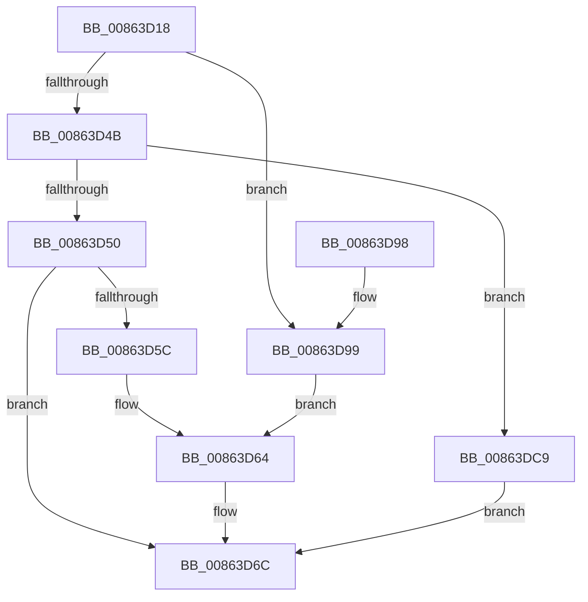

# EtwpEventWriteTemplateSessAndProv

- RVA: `0x00863D18`–`0x00863DEB` (길이 `211` bytes)
- VA: `0x0000000140863D18`
- 실행 섹션: `PAGE`
- PDB 이름 있음: `예`; PDB Function 태그: `아니요`
- unwind 정보 RVA: `0x0006B894`
- 디코드: `57`개 명령, `211/211` bytes 표시
- 미해석 바이트: `0` (있으면 어셈블리에 `.byte`로 보존)

> 이 문서는 커널 이미지의 기계어와 PDB 기호를 분석해 생성했습니다. 4번과 5번은 함수 원형과 자료형을 바이너리 사용 방식에서 추정한 C 해석이며 원본 소스 복구 결과는 아닙니다.

## 1. Dependencies

- 직접 호출 지점: **2**; 고유 호출 대상: **2**
- 직접 호출자로 확인된 함수: **4**
- RIP 상대 이미지 참조: **3**

### Outgoing calls
- `0x00863D81` → [EtwWrite](../../text/41/EtwWrite_function_0041C720.md) (function, `0x0041C720`)
- `0x00863D8D` → [_security_check_cookie](../../text/6A/_security_check_cookie_function_006AC640.md) (function, `0x006AC640`)

### Direct callers
- [ObpDecrementHandleCount](ObpDecrementHandleCount_function_008632E0.md) at `0x008634B5`
- [ObCloseHandleTableEntry](ObCloseHandleTableEntry_function_00869E20.md) at `0x0086A256`
- [ObpCreateHandle](ObpCreateHandle_function_0086B950.md) at `0x0086D63D`
- [EtwpEnableGuid](../A5/EtwpEnableGuid_function_00A5CD28.md) at `0x00A5D097`
- [EtwpEnableGuid](../A5/EtwpEnableGuid_function_00A5CD28.md) at `0x00A5D91E`

### Static image references
- `0x00863D21` → RVA `0x00E0A740` (`.data`; read)
- `0x00863D2F` → RVA `0x00EFF840` (`.data`; read)
- `0x00863DAF` → RVA `0x000105E0` (`.rdata`; read)

## 2. Other-region calls and transfers

- 다른 실행 섹션으로 향하는 call: **2**
  - `0x00863D81` → [EtwWrite](../../text/41/EtwWrite_function_0041C720.md) (`PAGE` → `.text`)
  - `0x00863D8D` → [_security_check_cookie](../../text/6A/_security_check_cookie_function_006AC640.md) (`PAGE` → `.text`)
- 별도 외부 분기/꼬리 이동을 확인하지 못했습니다.

## 3. Assembly (complete function range)

```asm
00863D18  40 55                           push rbp
00863D1A  48 8B EC                        mov rbp, rsp
00863D1D  48 83 EC 70                     sub rsp, 0x70
00863D21  48 8B 05 18 6A 5A 00            mov rax, qword ptr [rip + 0x5a6a18]
00863D28  48 33 C4                        xor rax, rsp
00863D2B  48 89 45 F0                     mov qword ptr [rbp - 0x10], rax
00863D2F  4C 8B 1D 0A BB 69 00            mov r11, qword ptr [rip + 0x69bb0a]
00863D36  4C 8B D2                        mov r10, rdx
00863D39  48 8B 4D 30                     mov rcx, qword ptr [rbp + 0x30]
00863D3D  33 D2                           xor edx, edx
00863D3F  41 B8 02 00 00 00               mov r8d, 2
00863D45  66 45 3B C8                     cmp r9w, r8w
00863D49  74 4E                           je 0x140863d99
00863D4B  48 85 C9                        test rcx, rcx
00863D4E  75 79                           jne 0x140863dc9
00863D50  48 8B 45 38                     mov rax, qword ptr [rbp + 0x38]
00863D54  44 8B C2                        mov r8d, edx
00863D57  48 85 C0                        test rax, rax
00863D5A  74 10                           je 0x140863d6c
00863D5C  48 89 45 C0                     mov qword ptr [rbp - 0x40], rax
00863D60  44 8D 42 01                     lea r8d, [rdx + 1]
00863D64  48 C7 45 C8 10 00 00 00         mov qword ptr [rbp - 0x38], 0x10
00863D6C  48 8D 45 C0                     lea rax, [rbp - 0x40]
00863D70  45 8B C8                        mov r9d, r8d
00863D73  45 33 C0                        xor r8d, r8d
00863D76  48 89 44 24 20                  mov qword ptr [rsp + 0x20], rax
00863D7B  49 8B D2                        mov rdx, r10
00863D7E  49 8B CB                        mov rcx, r11
00863D81  E8 9A 89 BB FF                  call 0x14041c720
00863D86  48 8B 4D F0                     mov rcx, qword ptr [rbp - 0x10]
00863D8A  48 33 CC                        xor rcx, rsp
00863D8D  E8 AE 88 E4 FF                  call 0x1406ac640
00863D92  48 83 C4 70                     add rsp, 0x70
00863D96  5D                              pop rbp
00863D97  C3                              ret
00863D98  CC                              int3
00863D99  48 8B 45 38                     mov rax, qword ptr [rbp + 0x38]
00863D9D  48 89 45 C0                     mov qword ptr [rbp - 0x40], rax
00863DA1  48 8B 41 08                     mov rax, qword ptr [rcx + 8]
00863DA5  48 89 45 D0                     mov qword ptr [rbp - 0x30], rax
00863DA9  0F B7 01                        movzx eax, word ptr [rcx]
00863DAC  89 45 D8                        mov dword ptr [rbp - 0x28], eax
00863DAF  48 8D 05 2A C8 7A FF            lea rax, [rip - 0x8537d6]
00863DB6  4C 89 45 E8                     mov qword ptr [rbp - 0x18], r8
00863DBA  41 B8 03 00 00 00               mov r8d, 3
00863DC0  48 89 45 E0                     mov qword ptr [rbp - 0x20], rax
00863DC4  89 55 DC                        mov dword ptr [rbp - 0x24], edx
00863DC7  EB 9B                           jmp 0x140863d64
00863DC9  48 8B 41 08                     mov rax, qword ptr [rcx + 8]
00863DCD  48 89 45 C0                     mov qword ptr [rbp - 0x40], rax
00863DD1  0F B7 01                        movzx eax, word ptr [rcx]
00863DD4  89 45 C8                        mov dword ptr [rbp - 0x38], eax
00863DD7  48 8D 05 02 C8 7A FF            lea rax, [rip - 0x8537fe]
00863DDE  48 89 45 D0                     mov qword ptr [rbp - 0x30], rax
00863DE2  89 55 CC                        mov dword ptr [rbp - 0x34], edx
00863DE5  4C 89 45 D8                     mov qword ptr [rbp - 0x28], r8
00863DE9  EB 81                           jmp 0x140863d6c
```

## 4. C-style interpretation (structured pseudocode)

```c
__int64 __fastcall EtwpEventWriteTemplateSessAndProv(__int64 a1, __int64 a2, __int64 a3, unsigned __int16 a4, __int64 a5, __int64 a6)
{
    __int64 result;
    __int64 v_rsp;
    unsigned __int64 v_stack_m18;
    unsigned __int64 v_stack_m20;
    unsigned __int64 v_stack_m28;
    unsigned int v_stack_m2C;
    unsigned int v_stack_m30;
    unsigned __int64 v_stack_m38;
    unsigned int v_stack_m3C;
    unsigned __int64 v_stack_m40;
    unsigned __int64 v_stack_m48;
    unsigned __int64 v_stack_m58;

    v_rsp = (v_rsp) - (112);
    result = (*(unsigned __int64 *)(v_rip + 5925400)) ^ (v_rsp);
    v_stack_m18 = result;
    a2 = 0;
    if (a4 == 2) goto loc_00863D99;
    if (a5 != 0) goto loc_00863DC9;
    if (a6 == 0) goto loc_00863D6C;
    v_stack_m48 = a6;
loc_00863D64:
    v_stack_m40 = 16;
loc_00863D6C:
    a3 = 0;
    v_stack_m58 = v_stack_m48;
    result = EtwWrite(*(unsigned __int64 *)(v_rip + 6929162), 0, a3, (unsigned int)((unsigned int)(a2 + 1)));
    a1 = (v_stack_m18) ^ (v_rsp);
    result = _security_check_cookie(a1, 0, a3, (unsigned int)((unsigned int)(a2 + 1)));
    v_rsp = (v_rsp) + (112);
    return result;
loc_00863D99:
    v_stack_m48 = a6;
    v_stack_m38 = *(unsigned __int64 *)(a1 + 8);
    v_stack_m30 = (unsigned int)(*(unsigned __int16 *)(a1));
    v_stack_m20 = 0;
    v_stack_m28 = v_rip - 8730582;
    v_stack_m2C = 0;
    goto loc_00863D64;
loc_00863DC9:
    v_stack_m48 = *(unsigned __int64 *)(a1 + 8);
    v_stack_m40 = (unsigned int)(*(unsigned __int16 *)(a1));
    v_stack_m38 = v_rip - 8730622;
    v_stack_m3C = 0;
    v_stack_m30 = 3;
    goto loc_00863D6C;
}
```

## 5. (Beta) C Style

```c
int64_t EtwpEventWriteTemplateSessAndProv(int64_t Arg1, int64_t Arg2, int64_t Arg3, uint16_t Arg4, void *Arg5, int64_t Arg6)
{
    uint8_t *arg5 = (uint8_t *)Arg5;

    int64_t result;
    int64_t local_rsp;
    uint64_t v_stack_m18;
    uint64_t v_stack_m20;
    uint64_t v_stack_m28;
    uint32_t v_stack_m2C;
    uint32_t v_stack_m30;
    uint64_t v_stack_m38;
    uint32_t v_stack_m3C;
    uint64_t v_stack_m40;
    uint64_t v_stack_m48;
    uint64_t v_stack_m58;

    local_rsp = (local_rsp) - (112);
    result = (*(uint64_t *)(v_rip + 0x5A6A18)) ^ (local_rsp);
    v_stack_m18 = result;
    Arg2 = 0;
    if (Arg4 == 2) goto loc_00863D99;
    if (Arg5 != NULL) goto loc_00863DC9;
    if (Arg6 == 0) goto loc_00863D6C;
    v_stack_m48 = Arg6;
loc_00863D64:
    v_stack_m40 = 16;
loc_00863D6C:
    Arg3 = 0;
    v_stack_m58 = v_stack_m48;
    result = EtwWrite(*(uint64_t *)(v_rip + 0x69BB0A), 0, Arg3, (uint32_t)((uint32_t)(Arg2 + 1)));
    Arg1 = (v_stack_m18) ^ (local_rsp);
    result = _security_check_cookie(Arg1, 0, Arg3, (uint32_t)((uint32_t)(Arg2 + 1)));
    local_rsp = (local_rsp) + (112);
    return result;
loc_00863D99:
    v_stack_m48 = Arg6;
    v_stack_m38 = *(uint64_t *)(Arg1 + 0x8);
    v_stack_m30 = (uint32_t)(*(uint16_t *)(Arg1));
    v_stack_m20 = 0;
    v_stack_m28 = v_rip - 8730582;
    v_stack_m2C = 0;
    goto loc_00863D64;
loc_00863DC9:
    v_stack_m48 = *(uint64_t *)(Arg1 + 0x8);
    v_stack_m40 = (uint32_t)(*(uint16_t *)(Arg1));
    v_stack_m38 = v_rip - 8730622;
    v_stack_m3C = 0;
    v_stack_m30 = 3;
    goto loc_00863D6C;
}
```

### 관측된 메모리 오프셋

구조체 형식이 확인되지 않은 접근은 인자 기준의 오프셋으로만 기록했습니다.

| 기준 인자 | 오프셋 표현 | 폭 (bit) | 접근 |
|---|---:|---:|---|
| `Arg5` | `+ 0x0` | `16` | `R` |
| `Arg5` | `+ 0x8` | `64` | `R` |

## 6. Execution-region graph

[열기: 2D/3D 그래프와 함수 탐색 컨트롤 패널](../../../control-panel.html?section=page&rva=0x00863D18&view=graph)

- 2D 그래프는 위에서 아래로 흐르고, 3D 그래프는 빈 공간을 드래그해 회전합니다. Shift+드래그는 이동, 휠은 확대·축소, 함수 노드 선택은 대상 보고서 이동입니다.

### Static fallback


