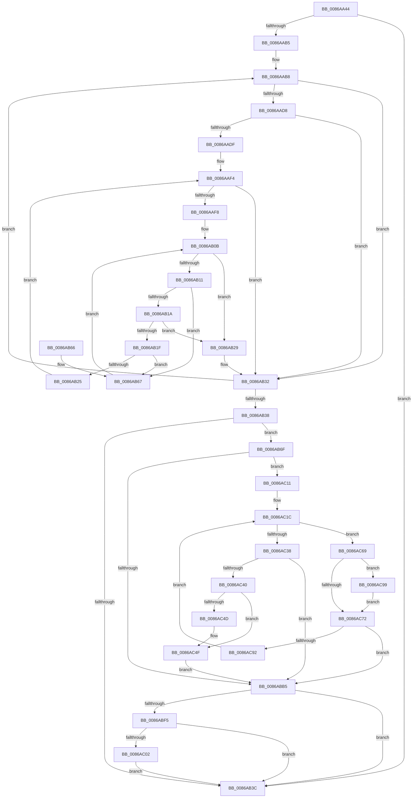

# EtwpTraceHandle

- RVA: `0x0086AA44`–`0x0086ACA5` (길이 `609` bytes)
- VA: `0x000000014086AA44`
- 실행 섹션: `PAGE`
- PDB 이름 있음: `예`; PDB Function 태그: `아니요`
- unwind 정보 RVA: `0x0006BEE0`
- 디코드: `160`개 명령, `609/609` bytes 표시
- 미해석 바이트: `0` (있으면 어셈블리에 `.byte`로 보존)

> 이 문서는 커널 이미지의 기계어와 PDB 기호를 분석해 생성했습니다. 4번과 5번은 함수 원형과 자료형을 바이너리 사용 방식에서 추정한 C 해석이며 원본 소스 복구 결과는 아닙니다.

## 1. Dependencies

- 직접 호출 지점: **6**; 고유 호출 대상: **5**
- 직접 호출자로 확인된 함수: **2**
- RIP 상대 이미지 참조: **4**

### Outgoing calls
- `0x0086AB46` → [_security_check_cookie](../../text/6A/_security_check_cookie_function_006AC640.md) (function, `0x006AC640`)
- `0x0086ABE7` → [EtwpTraceKernelEventWithFilter](../../text/49/EtwpTraceKernelEventWithFilter_function_00498540.md) (function, `0x00498540`)
- `0x0086AC07` → [ExFreePoolWithTag](../../poolcode/B8/ExFreePoolWithTag_function_00B82870.md) (function, `0x00B82870`)
- `0x0086AC2C` → [ObQueryNameStringMode](../8A/ObQueryNameStringMode_function_008A7ED0.md) (function, `0x008A7ED0`)
- `0x0086AC81` → [ExAllocatePool2](../../poolcode/B8/ExAllocatePool2_function_00B820F0.md) (function, `0x00B820F0`)
- `0x0086AC9E` → [ExFreePoolWithTag](../../poolcode/B8/ExFreePoolWithTag_function_00B82870.md) (function, `0x00B82870`)

### Direct callers
- [ObCloseHandleTableEntry](ObCloseHandleTableEntry_function_00869E20.md) at `0x00869EF6`
- [ObpCreateHandle](ObpCreateHandle_function_0086B950.md) at `0x0086CFE6`

### Static image references
- `0x0086AA63` → RVA `0x00E0A740` (`.data`; read)
- `0x0086AA74` → RVA `0x00FC6AA8` (`ALMOSTRO`; read)
- `0x0086AAE5` → RVA `0x00EFF880` (`.data`; read)
- `0x0086ABB5` → RVA `0x000105E0` (`.rdata`; read)

## 2. Other-region calls and transfers

- 다른 실행 섹션으로 향하는 call: **5**
  - `0x0086AB46` → [_security_check_cookie](../../text/6A/_security_check_cookie_function_006AC640.md) (`PAGE` → `.text`)
  - `0x0086ABE7` → [EtwpTraceKernelEventWithFilter](../../text/49/EtwpTraceKernelEventWithFilter_function_00498540.md) (`PAGE` → `.text`)
  - `0x0086AC07` → [ExFreePoolWithTag](../../poolcode/B8/ExFreePoolWithTag_function_00B82870.md) (`PAGE` → `POOLCODE`)
  - `0x0086AC81` → [ExAllocatePool2](../../poolcode/B8/ExAllocatePool2_function_00B820F0.md) (`PAGE` → `POOLCODE`)
  - `0x0086AC9E` → [ExFreePoolWithTag](../../poolcode/B8/ExFreePoolWithTag_function_00B82870.md) (`PAGE` → `POOLCODE`)
- 별도 외부 분기/꼬리 이동을 확인하지 못했습니다.

## 3. Assembly (complete function range)

```asm
0086AA44  48 89 5C 24 10                  mov qword ptr [rsp + 0x10], rbx
0086AA49  55                              push rbp
0086AA4A  56                              push rsi
0086AA4B  57                              push rdi
0086AA4C  41 54                           push r12
0086AA4E  41 55                           push r13
0086AA50  41 56                           push r14
0086AA52  41 57                           push r15
0086AA54  48 8D AC 24 50 FF FF FF         lea rbp, [rsp - 0xb0]
0086AA5C  48 81 EC B0 01 00 00            sub rsp, 0x1b0
0086AA63  48 8B 05 D6 FC 59 00            mov rax, qword ptr [rip + 0x59fcd6]
0086AA6A  48 33 C4                        xor rax, rsp
0086AA6D  48 89 85 A0 00 00 00            mov qword ptr [rbp + 0xa0], rax
0086AA74  48 8B 05 2D C0 75 00            mov rax, qword ptr [rip + 0x75c02d]
0086AA7B  4D 8B F1                        mov r14, r9
0086AA7E  83 64 24 30 00                  and dword ptr [rsp + 0x30], 0
0086AA83  33 F6                           xor esi, esi
0086AA85  45 8B A1 C0 00 00 00            mov r12d, dword ptr [r9 + 0xc0]
0086AA8C  0F 57 C0                        xorps xmm0, xmm0
0086AA8F  83 64 24 38 00                  and dword ptr [rsp + 0x38], 0
0086AA94  4D 8B F8                        mov r15, r8
0086AA97  44 8B 88 A8 11 00 00            mov r9d, dword ptr [rax + 0x11a8]
0086AA9E  4C 8B EA                        mov r13, rdx
0086AAA1  45 0F BC D1                     bsf r10d, r9d
0086AAA5  66 89 4C 24 34                  mov word ptr [rsp + 0x34], cx
0086AAAA  0F 11 44 24 48                  movups xmmword ptr [rsp + 0x48], xmm0
0086AAAF  0F 84 87 00 00 00               je 0x14086ab3c
0086AAB5  8D 7E 01                        lea edi, [rsi + 1]
0086AAB8  41 8D 41 FF                     lea eax, [r9 - 1]
0086AABC  41 8B CA                        mov ecx, r10d
0086AABF  44 23 C8                        and r9d, eax
0086AAC2  48 C1 E1 05                     shl rcx, 5
0086AAC6  48 8B 05 DB BF 75 00            mov rax, qword ptr [rip + 0x75bfdb]
0086AACD  48 05 CC 11 00 00               add rax, 0x11cc
0086AAD3  48 03 C1                        add rax, rcx
0086AAD6  74 5A                           je 0x14086ab32
0086AAD8  8B 40 10                        mov eax, dword ptr [rax + 0x10]
0086AADB  A8 40                           test al, 0x40
0086AADD  74 53                           je 0x14086ab32
0086AADF  4B 8D 04 92                     lea rax, [r10 + r10*4]
0086AAE3  33 D2                           xor edx, edx
0086AAE5  48 8D 0D 94 4D 69 00            lea rcx, [rip + 0x694d94]
0086AAEC  4C 8D 1C 81                     lea r11, [rcx + rax*4]
0086AAF0  41 0F B7 1B                     movzx ebx, word ptr [r11]
0086AAF4  3B D3                           cmp edx, ebx
0086AAF6  73 3A                           jae 0x14086ab32
0086AAF8  41 8B 4C 93 04                  mov ecx, dword ptr [r11 + rdx*4 + 4]
0086AAFD  45 33 C0                        xor r8d, r8d
0086AB00  33 C0                           xor eax, eax
0086AB02  89 4C 24 40                     mov dword ptr [rsp + 0x40], ecx
0086AB06  44 89 64 24 38                  mov dword ptr [rsp + 0x38], r12d
0086AB0B  41 83 F8 04                     cmp r8d, 4
0086AB0F  73 18                           jae 0x14086ab29
0086AB11  8A 4C 04 40                     mov cl, byte ptr [rsp + rax + 0x40]
0086AB15  80 F9 3F                        cmp cl, 0x3f
0086AB18  74 4D                           je 0x14086ab67
0086AB1A  80 F9 2A                        cmp cl, 0x2a
0086AB1D  74 0A                           je 0x14086ab29
0086AB1F  38 4C 04 38                     cmp byte ptr [rsp + rax + 0x38], cl
0086AB23  74 42                           je 0x14086ab67
0086AB25  03 D7                           add edx, edi
0086AB27  EB CB                           jmp 0x14086aaf4
0086AB29  41 8B CA                        mov ecx, r10d
0086AB2C  8B C7                           mov eax, edi
0086AB2E  D3 E0                           shl eax, cl
0086AB30  0B F0                           or esi, eax
0086AB32  45 0F BC D1                     bsf r10d, r9d
0086AB36  75 80                           jne 0x14086aab8
0086AB38  85 F6                           test esi, esi
0086AB3A  75 33                           jne 0x14086ab6f
0086AB3C  48 8B 8D A0 00 00 00            mov rcx, qword ptr [rbp + 0xa0]
0086AB43  48 33 CC                        xor rcx, rsp
0086AB46  E8 F5 1A E4 FF                  call 0x1406ac640
0086AB4B  48 8B 9C 24 F8 01 00 00         mov rbx, qword ptr [rsp + 0x1f8]
0086AB53  48 81 C4 B0 01 00 00            add rsp, 0x1b0
0086AB5A  41 5F                           pop r15
0086AB5C  41 5E                           pop r14
0086AB5E  41 5D                           pop r13
0086AB60  41 5C                           pop r12
0086AB62  5F                              pop rdi
0086AB63  5E                              pop rsi
0086AB64  5D                              pop rbp
0086AB65  C3                              ret
0086AB66  CC                              int3
0086AB67  44 03 C7                        add r8d, edi
0086AB6A  48 03 C7                        add rax, rdi
0086AB6D  EB 9C                           jmp 0x14086ab0b
0086AB6F  41 0F B6 46 28                  movzx eax, byte ptr [r14 + 0x28]
0086AB74  48 8D 5D 90                     lea rbx, [rbp - 0x70]
0086AB78  83 64 24 64 00                  and dword ptr [rsp + 0x64], 0
0086AB7D  41 BC 02 00 00 00               mov r12d, 2
0086AB83  44 0F B7 74 24 34               movzx r14d, word ptr [rsp + 0x34]
0086AB89  66 89 44 24 54                  mov word ptr [rsp + 0x54], ax
0086AB8E  48 8D 44 24 48                  lea rax, [rsp + 0x48]
0086AB93  48 89 44 24 58                  mov qword ptr [rsp + 0x58], rax
0086AB98  B8 21 11 00 00                  mov eax, 0x1121
0086AB9D  4C 89 7C 24 48                  mov qword ptr [rsp + 0x48], r15
0086ABA2  44 89 6C 24 50                  mov dword ptr [rsp + 0x50], r13d
0086ABA7  C7 44 24 60 0E 00 00 00         mov dword ptr [rsp + 0x60], 0xe
0086ABAF  66 44 3B F0                     cmp r14w, ax
0086ABB3  74 5C                           je 0x14086ac11
0086ABB5  48 8D 0D 24 5A 7A FF            lea rcx, [rip - 0x85a5dc]
0086ABBC  8B C7                           mov eax, edi
0086ABBE  48 03 C0                        add rax, rax
0086ABC1  C7 44 24 20 02 19 60 10         mov dword ptr [rsp + 0x20], 0x10601902
0086ABC9  8D 57 01                        lea edx, [rdi + 1]
0086ABCC  45 0F B7 CE                     movzx r9d, r14w
0086ABD0  44 8B C6                        mov r8d, esi
0086ABD3  83 64 C4 64 00                  and dword ptr [rsp + rax*8 + 0x64], 0
0086ABD8  48 89 4C C4 58                  mov qword ptr [rsp + rax*8 + 0x58], rcx
0086ABDD  48 8D 4C 24 58                  lea rcx, [rsp + 0x58]
0086ABE2  44 89 64 C4 60                  mov dword ptr [rsp + rax*8 + 0x60], r12d
0086ABE7  E8 54 D9 C2 FF                  call 0x140498540
0086ABEC  48 85 DB                        test rbx, rbx
0086ABEF  0F 84 47 FF FF FF               je 0x14086ab3c
0086ABF5  48 8D 45 90                     lea rax, [rbp - 0x70]
0086ABF9  48 3B D8                        cmp rbx, rax
0086ABFC  0F 84 3A FF FF FF               je 0x14086ab3c
0086AC02  33 D2                           xor edx, edx
0086AC04  48 8B CB                        mov rcx, rbx
0086AC07  E8 64 7C 31 00                  call 0x140b82870
0086AC0C  E9 2B FF FF FF                  jmp 0x14086ab3c
0086AC11  41 B8 10 01 00 00               mov r8d, 0x110
0086AC17  44 89 44 24 30                  mov dword ptr [rsp + 0x30], r8d
0086AC1C  4C 8D 4C 24 30                  lea r9, [rsp + 0x30]
0086AC21  C6 44 24 20 00                  mov byte ptr [rsp + 0x20], 0
0086AC26  48 8B D3                        mov rdx, rbx
0086AC29  49 8B CF                        mov rcx, r15
0086AC2C  E8 9F D2 03 00                  call 0x1408a7ed0
0086AC31  3D 04 00 00 C0                  cmp eax, 0xc0000004
0086AC36  74 31                           je 0x14086ac69
0086AC38  85 C0                           test eax, eax
0086AC3A  0F 85 75 FF FF FF               jne 0x14086abb5
0086AC40  0F B7 03                        movzx eax, word ptr [rbx]
0086AC43  B9 00 20 00 00                  mov ecx, 0x2000
0086AC48  66 3B C1                        cmp ax, cx
0086AC4B  73 02                           jae 0x14086ac4f
0086AC4D  8B C8                           mov ecx, eax
0086AC4F  48 8B 43 08                     mov rax, qword ptr [rbx + 8]
0086AC53  41 8B FC                        mov edi, r12d
0086AC56  83 64 24 74 00                  and dword ptr [rsp + 0x74], 0
0086AC5B  48 89 44 24 68                  mov qword ptr [rsp + 0x68], rax
0086AC60  89 4C 24 70                     mov dword ptr [rsp + 0x70], ecx
0086AC64  E9 4C FF FF FF                  jmp 0x14086abb5
0086AC69  48 8D 45 90                     lea rax, [rbp - 0x70]
0086AC6D  48 3B D8                        cmp rbx, rax
0086AC70  75 27                           jne 0x14086ac99
0086AC72  8B 54 24 30                     mov edx, dword ptr [rsp + 0x30]
0086AC76  B9 00 01 00 00                  mov ecx, 0x100
0086AC7B  41 B8 45 74 77 74               mov r8d, 0x74777445
0086AC81  E8 6A 74 31 00                  call 0x140b820f0
0086AC86  48 8B D8                        mov rbx, rax
0086AC89  48 85 C0                        test rax, rax
0086AC8C  0F 84 23 FF FF FF               je 0x14086abb5
0086AC92  44 8B 44 24 30                  mov r8d, dword ptr [rsp + 0x30]
0086AC97  EB 83                           jmp 0x14086ac1c
0086AC99  33 D2                           xor edx, edx
0086AC9B  48 8B CB                        mov rcx, rbx
0086AC9E  E8 CD 7B 31 00                  call 0x140b82870
0086ACA3  EB CD                           jmp 0x14086ac72
```

## 4. C-style interpretation (structured pseudocode)

```c
__int64 __fastcall EtwpTraceHandle(unsigned __int16 a1, __int64 a2, __int64 a3, __int64 a4)
{
    __int64 result;
    __int64 v_rsi;
    __int64 v_rsp;
    unsigned __int64 v_stack_m158;
    unsigned __int64 v_stack_m1A0;
    unsigned int v_stack_m1A8;
    unsigned int v_stack_m1B0;
    unsigned __int16 v_stack_m1B4;
    unsigned int v_stack_m1B8;
    unsigned __int64 v_stack_m48;
    unsigned __int64 v_stack_mE8;
    unsigned __int64 v_stack_p10;
    unsigned int v_stack_p20;
    unsigned int v_stack_p30;
    unsigned __int16 v_stack_p34;
    unsigned __int64 v_stack_p48;
    unsigned int v_stack_p50;
    unsigned __int16 v_stack_p54;
    unsigned __int64 v_stack_p58;
    unsigned int v_stack_p60;
    unsigned int v_stack_p64;
    unsigned __int64 v_stack_p68;
    unsigned int v_stack_p70;
    unsigned int v_stack_p74;

    v_stack_p10 = v_rbx;
    v_rsp = (v_rsp) - (432);
    result = (*(unsigned __int64 *)(v_rip + 5897430)) ^ (v_rsp);
    v_stack_m48 = result;
    v_rsi = 0;
    v_stack_m1B4 = a1;
    v_stack_m1A0 = v_xmm0;
    if (condition_is_equal) goto loc_0086AB3C;
loc_0086AAB8:
    a4 = (unsigned int)(((unsigned int)(*(unsigned int *)(*(unsigned __int64 *)(v_rip + 7716909) + 4520))) & ((unsigned int)((unsigned int)(*(unsigned int *)(*(unsigned __int64 *)(v_rip + 7716909) + 4520)) - 1)));
    a1 = ((unsigned int)((unsigned int)(v_r10))) << (5);
    result = (*(unsigned __int64 *)(v_rip + 7716827)) + (0x11CCULL);
    result = (result) + (a1);
    if (condition_is_equal) goto loc_0086AB32;
    if ((((unsigned __int8)((unsigned int)(*(unsigned int *)(result + 16)))) & (64)) == 0) goto loc_0086AB32;
    a2 = 0;
loc_0086AAF4:
    if (0 >= ((unsigned int)(*(unsigned __int16 *)(v_rip + 6901140 + v_r10 + v_r10 * 4 * 4)))) goto loc_0086AB32;
    a3 = 0;
    result = 0;
    v_stack_m1A8 = (unsigned int)((unsigned int)(*(unsigned int *)(v_rip + 6901140 + v_r10 + v_r10 * 4 * 4 + a2 * 4 + 4)));
    v_stack_m1B0 = (unsigned int)((unsigned int)(*(unsigned int *)(a4 + 192)));
loc_0086AB0B:
    if (0 >= 4) goto loc_0086AB29;
    if (((unsigned __int8)(*(unsigned __int8 *)(v_rsp + result * 1 + 64))) == 63) goto loc_0086AB67;
    if (((unsigned __int8)(*(unsigned __int8 *)(v_rsp + result * 1 + 64))) == 42) goto loc_0086AB29;
    if ((*(unsigned __int8 *)(v_rsp + result * 1 + 56)) == ((unsigned __int8)(*(unsigned __int8 *)(v_rsp + result * 1 + 64)))) goto loc_0086AB67;
    a2 = (unsigned int)((a2) + ((unsigned int)(v_rsi + 1)));
    goto loc_0086AAF4;
loc_0086AB29:
    result = (unsigned int)(((unsigned int)((unsigned int)(v_rsi + 1))) << ((unsigned __int8)((unsigned int)((unsigned int)(v_r10)))));
    v_rsi = (unsigned int)((v_rsi) | ((unsigned int)(result)));
loc_0086AB32:
    if (condition_is_not_equal) goto loc_0086AAB8;
    if ((unsigned int)(v_rsi) != 0) goto loc_0086AB6F;
loc_0086AB3C:
    a1 = (v_stack_m48) ^ (v_rsp);
    result = _security_check_cookie(a1, a2, a3, a4);
    v_rsp = (v_rsp) + (432);
    return result;
loc_0086AB67:
    a3 = (unsigned int)((a3) + ((unsigned int)(v_rsi + 1)));
    result = (result) + (v_rsi + 1);
    goto loc_0086AB0B;
loc_0086AB6F:
    v_stack_p54 = (unsigned __int16)(*(unsigned __int8 *)(a4 + 40));
    v_stack_p58 = v_stack_p48;
    v_stack_p48 = a3;
    v_stack_p50 = (unsigned int)(a2);
    v_stack_p60 = 14;
    if (((unsigned __int16)(v_stack_p34)) == ((unsigned __int16)((unsigned int)(0x1121ULL)))) goto loc_0086AC11;
loc_0086ABB5:
    result = ((unsigned int)((unsigned int)(v_rsi + 1))) + ((unsigned int)((unsigned int)(v_rsi + 1)));
    v_stack_p20 = 0x10601902ULL;
    *(unsigned __int64 *)(v_rsp + result * 8 + 88) = v_rip - 8758748;
    *(unsigned int *)(v_rsp + result * 8 + 96) = 2;
    result = EtwpTraceKernelEventWithFilter(v_stack_p58, v_rsi + 1 + 1, (unsigned int)((unsigned int)(v_rsi)), (unsigned __int16)(v_stack_p34));
    if (v_stack_m158 == 0) goto loc_0086AB3C;
    if (v_stack_m158 == v_stack_m158) goto loc_0086AB3C;
    a2 = 0;
    result = ExFreePoolWithTag(v_stack_m158, a2, (unsigned int)((unsigned int)(v_rsi)), (unsigned __int16)(v_stack_p34));
    goto loc_0086AB3C;
loc_0086AC11:
    v_stack_p30 = 272;
loc_0086AC1C:
    v_stack_p20 = 0;
    result = ObQueryNameStringMode(a3, v_stack_m158, 272, v_stack_p30);
    if (((unsigned int)(result)) == 0xC0000004ULL) goto loc_0086AC69;
    if ((unsigned int)(result) != 0) goto loc_0086ABB5;
    if (((unsigned __int16)(*(unsigned __int16 *)(v_stack_m158))) < ((unsigned __int16)((unsigned int)(0x2000ULL)))) {
        a1 = (unsigned int)(*(unsigned __int16 *)(v_stack_m158));
    }
    v_stack_p68 = *(unsigned __int64 *)(v_stack_m158 + 8);
    v_stack_p70 = a1;
    goto loc_0086ABB5;
loc_0086AC69:
    if (v_stack_m158 != v_stack_m158) goto loc_0086AC99;
loc_0086AC72:
    result = ExAllocatePool2(256, (unsigned int)(v_stack_p30), (unsigned int)(0x74777445ULL), v_stack_p30);
    if (result == 0) goto loc_0086ABB5;
    goto loc_0086AC1C;
loc_0086AC99:
    a2 = 0;
    result = ExFreePoolWithTag(result, a2, (unsigned int)(v_stack_p30), v_stack_p30);
    goto loc_0086AC72;
}
```

## 5. (Beta) C Style

```c
int64_t EtwpTraceHandle(uint16_t Arg1, int64_t Arg2, int64_t Arg3, void *Arg4)
{
    uint8_t *arg4 = (uint8_t *)Arg4;

    int64_t result;
    int64_t local_rsi;
    int64_t local_rsp;
    uint64_t v_stack_m158;
    uint64_t v_stack_m1A0;
    uint32_t v_stack_m1A8;
    uint32_t v_stack_m1B0;
    uint16_t v_stack_m1B4;
    uint32_t v_stack_m1B8;
    uint64_t v_stack_m48;
    uint64_t v_stack_mE8;
    uint64_t v_stack_p10;
    uint32_t v_stack_p20;
    uint32_t v_stack_p30;
    uint16_t v_stack_p34;
    uint64_t v_stack_p48;
    uint32_t v_stack_p50;
    uint16_t v_stack_p54;
    uint64_t v_stack_p58;
    uint32_t v_stack_p60;
    uint32_t v_stack_p64;
    uint64_t v_stack_p68;
    uint32_t v_stack_p70;
    uint32_t v_stack_p74;

    v_stack_p10 = local_rbx;
    local_rsp = (local_rsp) - (432);
    result = (*(uint64_t *)(v_rip + 0x59FCD6)) ^ (local_rsp);
    v_stack_m48 = result;
    local_rsi = 0;
    v_stack_m1B4 = Arg1;
    v_stack_m1A0 = v_xmm0;
    if (condition_is_equal) goto loc_0086AB3C;
loc_0086AAB8:
    Arg4 = (uint32_t)(((uint32_t)(*(uint32_t *)(*(uint64_t *)(v_rip + 0x75C02D) + 0x11A8))) & ((uint32_t)((uint32_t)(*(uint32_t *)(*(uint64_t *)(v_rip + 0x75C02D) + 0x11A8)) - 1)));
    Arg1 = ((uint32_t)((uint32_t)(local_r10))) << (5);
    result = (*(uint64_t *)(v_rip + 0x75BFDB)) + (0x11CCULL);
    result = (result) + (Arg1);
    if (condition_is_equal) goto loc_0086AB32;
    if ((((uint8_t)((uint32_t)(*(uint32_t *)(result + 0x10)))) & (64)) == 0) goto loc_0086AB32;
    Arg2 = 0;
loc_0086AAF4:
    if (0 >= ((uint32_t)(*(uint16_t *)(v_rip + 0x694D94 + local_r10 + local_r10 * 4 * 4)))) goto loc_0086AB32;
    Arg3 = 0;
    result = 0;
    v_stack_m1A8 = (uint32_t)((uint32_t)(*(uint32_t *)(v_rip + 0x694D94 + local_r10 + local_r10 * 4 * 4 + Arg2 * 4 + 0x4)));
    v_stack_m1B0 = (uint32_t)((uint32_t)(*(uint32_t *)(arg4 + 0xC0)));
loc_0086AB0B:
    if (0 >= 4) goto loc_0086AB29;
    if (((uint8_t)(*(uint8_t *)(local_rsp + result * 1 + 0x40))) == 63) goto loc_0086AB67;
    if (((uint8_t)(*(uint8_t *)(local_rsp + result * 1 + 0x40))) == 42) goto loc_0086AB29;
    if ((*(uint8_t *)(local_rsp + result * 1 + 0x38)) == ((uint8_t)(*(uint8_t *)(local_rsp + result * 1 + 0x40)))) goto loc_0086AB67;
    Arg2 = (uint32_t)((Arg2) + ((uint32_t)(local_rsi + 1)));
    goto loc_0086AAF4;
loc_0086AB29:
    result = (uint32_t)(((uint32_t)((uint32_t)(local_rsi + 1))) << ((uint8_t)((uint32_t)((uint32_t)(local_r10)))));
    local_rsi = (uint32_t)((local_rsi) | ((uint32_t)(result)));
loc_0086AB32:
    if (condition_is_not_equal) goto loc_0086AAB8;
    if ((uint32_t)(local_rsi) != 0) goto loc_0086AB6F;
loc_0086AB3C:
    Arg1 = (v_stack_m48) ^ (local_rsp);
    result = _security_check_cookie(Arg1, Arg2, Arg3, Arg4);
    local_rsp = (local_rsp) + (432);
    return result;
loc_0086AB67:
    Arg3 = (uint32_t)((Arg3) + ((uint32_t)(local_rsi + 1)));
    result = (result) + (local_rsi + 1);
    goto loc_0086AB0B;
loc_0086AB6F:
    v_stack_p54 = (uint16_t)(*(uint8_t *)(arg4 + 0x28));
    v_stack_p58 = v_stack_p48;
    v_stack_p48 = Arg3;
    v_stack_p50 = (uint32_t)(Arg2);
    v_stack_p60 = 14;
    if (((uint16_t)(v_stack_p34)) == ((uint16_t)((uint32_t)(0x1121ULL)))) goto loc_0086AC11;
loc_0086ABB5:
    result = ((uint32_t)((uint32_t)(local_rsi + 1))) + ((uint32_t)((uint32_t)(local_rsi + 1)));
    v_stack_p20 = 0x10601902ULL;
    *(uint64_t *)(local_rsp + result * 8 + 0x58) = v_rip - 8758748;
    *(uint32_t *)(local_rsp + result * 8 + 0x60) = 2;
    result = EtwpTraceKernelEventWithFilter(v_stack_p58, local_rsi + 1 + 1, (uint32_t)((uint32_t)(local_rsi)), (uint16_t)(v_stack_p34));
    if (v_stack_m158 == 0) goto loc_0086AB3C;
    if (v_stack_m158 == v_stack_m158) goto loc_0086AB3C;
    Arg2 = 0;
    result = ExFreePoolWithTag(v_stack_m158, Arg2, (uint32_t)((uint32_t)(local_rsi)), (uint16_t)(v_stack_p34));
    goto loc_0086AB3C;
loc_0086AC11:
    v_stack_p30 = 272;
loc_0086AC1C:
    v_stack_p20 = 0;
    result = ObQueryNameStringMode(Arg3, v_stack_m158, 272, v_stack_p30);
    if (((uint32_t)(result)) == 0xC0000004ULL) goto loc_0086AC69;
    if ((uint32_t)(result) != 0) goto loc_0086ABB5;
    if (((uint16_t)(*(uint16_t *)(v_stack_m158))) < ((uint16_t)((uint32_t)(0x2000ULL)))) {
        Arg1 = (uint32_t)(*(uint16_t *)(v_stack_m158));
    }
    v_stack_p68 = *(uint64_t *)(v_stack_m158 + 0x8);
    v_stack_p70 = Arg1;
    goto loc_0086ABB5;
loc_0086AC69:
    if (v_stack_m158 != v_stack_m158) goto loc_0086AC99;
loc_0086AC72:
    result = ExAllocatePool2(256, (uint32_t)(v_stack_p30), (uint32_t)(0x74777445ULL), v_stack_p30);
    if (result == 0) goto loc_0086ABB5;
    goto loc_0086AC1C;
loc_0086AC99:
    Arg2 = 0;
    result = ExFreePoolWithTag(result, Arg2, (uint32_t)(v_stack_p30), v_stack_p30);
    goto loc_0086AC72;
}
```

### 관측된 메모리 오프셋

구조체 형식이 확인되지 않은 접근은 인자 기준의 오프셋으로만 기록했습니다.

| 기준 인자 | 오프셋 표현 | 폭 (bit) | 접근 |
|---|---:|---:|---|
| `Arg4` | `+ 0x28` | `8` | `R` |
| `Arg4` | `+ 0xC0` | `32` | `R` |

## 6. Execution-region graph

[열기: 2D/3D 그래프와 함수 탐색 컨트롤 패널](../../../control-panel.html?section=page&rva=0x0086AA44&view=graph)

- 2D 그래프는 위에서 아래로 흐르고, 3D 그래프는 빈 공간을 드래그해 회전합니다. Shift+드래그는 이동, 휠은 확대·축소, 함수 노드 선택은 대상 보고서 이동입니다.

### Static fallback


