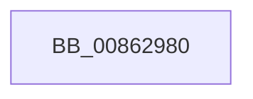

# EtwpTraceRegistry

- RVA: `0x00862980`–`0x008629D0` (길이 `80` bytes)
- VA: `0x0000000140862980`
- 실행 섹션: `PAGE`
- PDB 이름 있음: `예`; PDB Function 태그: `아니요`
- unwind 정보 RVA: `0x0006B660`
- 디코드: `20`개 명령, `80/80` bytes 표시
- 미해석 바이트: `0` (있으면 어셈블리에 `.byte`로 보존)

> 이 문서는 커널 이미지의 기계어와 PDB 기호를 분석해 생성했습니다. 4번과 5번은 함수 원형과 자료형을 바이너리 사용 방식에서 추정한 C 해석이며 원본 소스 복구 결과는 아닙니다.

## 1. Dependencies

- 직접 호출 지점: **0**; 고유 호출 대상: **0**
- 직접 호출자로 확인된 함수: **10**
- RIP 상대 이미지 참조: **2**

### Outgoing calls
- 직접 디코드된 call 명령이 없습니다.

### Direct callers
- [NtSetInformationKey](../84/NtSetInformationKey_function_00843720.md) at `0x00843CC9`
- [sub_008515D5](../85/Unknown_function_008515D5.md) at `0x00851672`
- [CmpCreateKeyControlBlock](../85/CmpCreateKeyControlBlock_function_00851DB0.md) at `0x008523A4`
- [sub_00861F68](Unknown_function_00861F68.md) at `0x00861FC8`
- [sub_00862CD4](Unknown_function_00862CD4.md) at `0x00862D3C`
- [CmpCloseKeyObject](CmpCloseKeyObject_function_00863AD0.md) at `0x00863BD0`
- [NtQueryKey](NtQueryKey_function_008676E0.md) at `0x00867DAE`
- [CmpSecurityMethod](../87/CmpSecurityMethod_function_00870CC0.md) at `0x00871183`
- [sub_00878374](../87/Unknown_function_00878374.md) at `0x008783B2`
- [NtEnumerateValueKey](../8B/NtEnumerateValueKey_function_008B3B50.md) at `0x008B44A6`

### Static image references
- `0x00862997` → RVA `0x00E0A740` (`.data`; read)
- `0x008629A9` → RVA `0x00FC6AA8` (`ALMOSTRO`; read)

## 2. Other-region calls and transfers

- 다른 실행 섹션으로 향하는 call: **0**
- call이 아닌 외부 분기/꼬리 이동: **1**
  - `0x008629CA` → [sub_00862AF3](Unknown_function_00862AF3.md) (`tail-transfer`)

## 3. Assembly (complete function range)

```asm
00862980  4C 8B DC                        mov r11, rsp
00862983  49 89 5B 20                     mov qword ptr [r11 + 0x20], rbx
00862987  55                              push rbp
00862988  41 54                           push r12
0086298A  41 55                           push r13
0086298C  41 56                           push r14
0086298E  41 57                           push r15
00862990  48 81 EC A0 00 00 00            sub rsp, 0xa0
00862997  48 8B 05 A2 7D 5A 00            mov rax, qword ptr [rip + 0x5a7da2]
0086299E  48 33 C4                        xor rax, rsp
008629A1  48 89 84 24 98 00 00 00         mov qword ptr [rsp + 0x98], rax
008629A9  48 8B 1D F8 40 76 00            mov rbx, qword ptr [rip + 0x7640f8]
008629B0  45 33 ED                        xor r13d, r13d
008629B3  41 8B E9                        mov ebp, r9d
008629B6  44 0F B6 E1                     movzx r12d, cl
008629BA  45 8B F0                        mov r14d, r8d
008629BD  4C 8B FA                        mov r15, rdx
008629C0  8B 9B A8 11 00 00               mov ebx, dword ptr [rbx + 0x11a8]
008629C6  44 0F BC D3                     bsf r10d, ebx
008629CA  0F 84 23 01 00 00               je 0x140862af3
```

## 4. C-style interpretation (structured pseudocode)

```c
__int64 __fastcall EtwpTraceRegistry(unsigned __int8 a1, __int64 a2, int a3, int a4)
{
    __int64 result;
    __int64 v_r13;
    __int64 v_rsp;
    unsigned __int64 v_stack_m30;

    *(unsigned __int64 *)(v_rsp + 32) = v_rbx;
    v_rsp = (v_rsp) - (160);
    result = (*(unsigned __int64 *)(v_rip + 5930402)) ^ (v_rsp);
    v_stack_m30 = result;
    v_r13 = 0;
}
```

## 5. (Beta) C Style

```c
int64_t EtwpTraceRegistry(uint8_t Arg1, int64_t Arg2, int32_t Arg3, int32_t Arg4)
{
    int64_t result;
    int64_t local_r13;
    int64_t local_rsp;
    uint64_t v_stack_m30;

    *(uint64_t *)(local_rsp + 0x20) = local_rbx;
    local_rsp = (local_rsp) - (160);
    result = (*(uint64_t *)(v_rip + 0x5A7DA2)) ^ (local_rsp);
    v_stack_m30 = result;
    local_r13 = 0;
}
```

## 6. Execution-region graph

[열기: 2D/3D 그래프와 함수 탐색 컨트롤 패널](../../../control-panel.html?section=page&rva=0x00862980&view=graph)

- 2D 그래프는 위에서 아래로 흐르고, 3D 그래프는 빈 공간을 드래그해 회전합니다. Shift+드래그는 이동, 휠은 확대·축소, 함수 노드 선택은 대상 보고서 이동입니다.

### Static fallback


