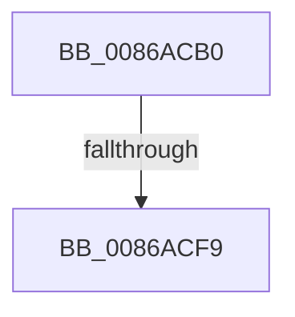

# ExCreateHandleEx

- RVA: `0x0086ACB0`–`0x0086AD2F` (길이 `127` bytes)
- VA: `0x000000014086ACB0`
- 실행 섹션: `PAGE`
- PDB 이름 있음: `예`; PDB Function 태그: `아니요`
- unwind 정보 RVA: `0x0006BF08`
- 디코드: `30`개 명령, `127/127` bytes 표시
- 미해석 바이트: `0` (있으면 어셈블리에 `.byte`로 보존)

> 이 문서는 커널 이미지의 기계어와 PDB 기호를 분석해 생성했습니다. 4번과 5번은 함수 원형과 자료형을 바이너리 사용 방식에서 추정한 C 해석이며 원본 소스 복구 결과는 아닙니다.

## 1. Dependencies

- 직접 호출 지점: **0**; 고유 호출 대상: **0**
- 직접 호출자로 확인된 함수: **7**
- RIP 상대 이미지 참조: **0**

### Outgoing calls
- 직접 디코드된 call 명령이 없습니다.

### Direct callers
- [AlpcpAllocateMessageFromExtendedTables](../74/AlpcpAllocateMessageFromExtendedTables_function_0074C500.md) at `0x0074C5D1`
- [AlpcpAllocateMessageFunction](../89/AlpcpAllocateMessageFunction_function_00892FF0.md) at `0x00893036`
- [ObCompleteObjectDuplication](../89/ObCompleteObjectDuplication_function_0089387C.md) at `0x0089397D`
- [NtCreateJobObject](../91/NtCreateJobObject_function_009177E0.md) at `0x00917A65`
- [PspAllocateProcess](../A1/PspAllocateProcess_function_00A13B3C.md) at `0x00A16245`
- [ExCreateHandle](../A3/ExCreateHandle_function_00A304D4.md) at `0x00A304E4`
- [RtlpInsertStringAtom](../A3/RtlpInsertStringAtom_function_00A3ACAC.md) at `0x00A3ACD1`

### Static image references
- 디코드된 RIP-relative 메모리 참조가 없습니다.

## 2. Other-region calls and transfers

- 다른 실행 섹션으로 향하는 call: **0**
- call이 아닌 외부 분기/꼬리 이동: **2**
  - `0x0086ACF3` → [sub_0086B094](Unknown_function_0086B094.md) (`tail-transfer`)
  - `0x0086AD29` → [sub_0086B164](Unknown_function_0086B164.md) (`tail-transfer`)

## 3. Assembly (complete function range)

```asm
0086ACB0  40 53                           push rbx
0086ACB2  57                              push rdi
0086ACB3  41 56                           push r14
0086ACB5  48 83 EC 50                     sub rsp, 0x50
0086ACB9  41 8B C1                        mov eax, r9d
0086ACBC  48 C1 E2 10                     shl rdx, 0x10
0086ACC0  83 E0 07                        and eax, 7
0086ACC3  48 C7 44 24 28 00 00 00 00      mov qword ptr [rsp + 0x28], 0
0086ACCC  4C 8B F1                        mov r14, rcx
0086ACCF  48 C1 E0 11                     shl rax, 0x11
0086ACD3  48 81 E2 FF FF F1 FF            and rdx, 0xfffffffffff1ffff
0086ACDA  41 8B C8                        mov ecx, r8d
0086ACDD  48 0B C2                        or rax, rdx
0086ACE0  81 E1 FF FF FF 01               and ecx, 0x1ffffff
0086ACE6  89 4C 24 28                     mov dword ptr [rsp + 0x28], ecx
0086ACEA  48 89 44 24 20                  mov qword ptr [rsp + 0x20], rax
0086ACEF  41 F6 C1 08                     test r9b, 8
0086ACF3  0F 84 9B 03 00 00               je 0x14086b094
0086ACF9  0F BA E9 19                     bts ecx, 0x19
0086ACFD  89 4C 24 28                     mov dword ptr [rsp + 0x28], ecx
0086AD01  48 83 C8 01                     or rax, 1
0086AD05  33 DB                           xor ebx, ebx
0086AD07  48 89 44 24 20                  mov qword ptr [rsp + 0x20], rax
0086AD0C  65 48 8B 04 25 88 01 00 00      mov rax, qword ptr gs:[0x188]
0086AD15  48 89 44 24 78                  mov qword ptr [rsp + 0x78], rax
0086AD1A  66 FF 88 E4 01 00 00            dec word ptr [rax + 0x1e4]
0086AD21  90                              nop
0086AD22  41 0F B6 46 2C                  movzx eax, byte ptr [r14 + 0x2c]
0086AD27  A8 04                           test al, 4
0086AD29  0F 85 35 04 00 00               jne 0x14086b164
```

## 4. C-style interpretation (structured pseudocode)

```c
__int64 __fastcall ExCreateHandleEx(__int64 a1, __int64 a2, int a3, int a4)
{
    __int64 result;
    __int64 v_rbx;
    __int64 v_rsp;
    unsigned __int64 v_stack_m40;
    unsigned __int64 v_stack_m48;
    unsigned __int64 v_stack_p10;

    v_rsp = (v_rsp) - (80);
    a2 = (a2) << (16);
    result = (unsigned int)(((unsigned int)(a4)) & (7));
    v_stack_m40 = 0;
    result = (result) << (17);
    a2 = (a2) & (0xFFFFFFFFFFF1FFFFULL);
    result = (result) | (a2);
    a1 = (unsigned int)(((unsigned int)(a3)) & (0x1FFFFFFULL));
    v_stack_m40 = (unsigned int)(a1);
    v_stack_m48 = result;
    v_stack_m40 = (unsigned int)(a1);
    result = (result) | (1);
    v_rbx = 0;
    v_stack_m48 = result;
    v_stack_p10 = *(unsigned __int64 *)(gs_base + (0 + 392));
}
```

## 5. (Beta) C Style

```c
int64_t ExCreateHandleEx(void *Arg1, int64_t Arg2, int32_t Arg3, int32_t Arg4)
{
    uint8_t *arg1 = (uint8_t *)Arg1;

    int64_t result;
    int64_t local_rbx;
    int64_t local_rsp;
    uint64_t v_stack_m40;
    uint64_t v_stack_m48;
    uint64_t v_stack_p10;

    local_rsp = (local_rsp) - (80);
    Arg2 = (Arg2) << (16);
    result = (uint32_t)(((uint32_t)(Arg4)) & (7));
    v_stack_m40 = 0;
    result = (result) << (17);
    Arg2 = (Arg2) & (0xFFFFFFFFFFF1FFFFULL);
    result = (result) | (Arg2);
    Arg1 = (uint32_t)(((uint32_t)(Arg3)) & (0x1FFFFFFULL));
    v_stack_m40 = (uint32_t)(Arg1);
    v_stack_m48 = result;
    v_stack_m40 = (uint32_t)(Arg1);
    result = (result) | (1);
    local_rbx = 0;
    v_stack_m48 = result;
    v_stack_p10 = *(uint64_t *)(gs_base + (0 + 0x188));
}
```

### 관측된 메모리 오프셋

구조체 형식이 확인되지 않은 접근은 인자 기준의 오프셋으로만 기록했습니다.

| 기준 인자 | 오프셋 표현 | 폭 (bit) | 접근 |
|---|---:|---:|---|
| `Arg1` | `+ 0x2C` | `8` | `R` |

## 6. Execution-region graph

[열기: 2D/3D 그래프와 함수 탐색 컨트롤 패널](../../../control-panel.html?section=page&rva=0x0086ACB0&view=graph)

- 2D 그래프는 위에서 아래로 흐르고, 3D 그래프는 빈 공간을 드래그해 회전합니다. Shift+드래그는 이동, 휠은 확대·축소, 함수 노드 선택은 대상 보고서 이동입니다.

### Static fallback


