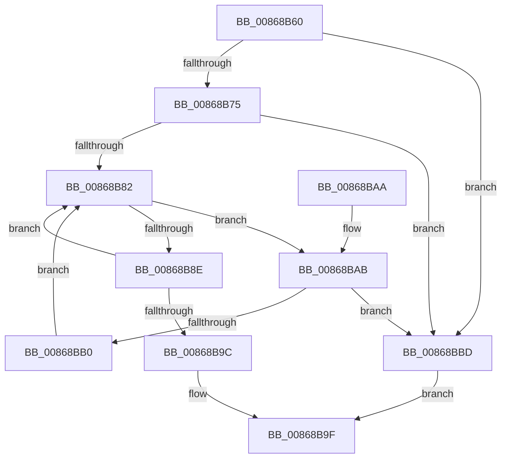

# ExMapHandleToPointer

- RVA: `0x00868B60`–`0x00868BC1` (길이 `97` bytes)
- VA: `0x0000000140868B60`
- 실행 섹션: `PAGE`
- PDB 이름 있음: `예`; PDB Function 태그: `아니요`
- unwind 정보 RVA: `0x0006BDE4`
- 디코드: `32`개 명령, `97/97` bytes 표시
- 미해석 바이트: `0` (있으면 어셈블리에 `.byte`로 보존)

> 이 문서는 커널 이미지의 기계어와 PDB 기호를 분석해 생성했습니다. 4번과 5번은 함수 원형과 자료형을 바이너리 사용 방식에서 추정한 C 해석이며 원본 소스 복구 결과는 아닙니다.

## 1. Dependencies

- 직접 호출 지점: **2**; 고유 호출 대상: **2**
- 직접 호출자로 확인된 함수: **7**
- RIP 상대 이미지 참조: **0**

### Outgoing calls
- `0x00868B75` → [ExpLookupHandleTableEntry](ExpLookupHandleTableEntry_function_00869DB0.md) (function, `0x00869DB0`)
- `0x00868BB6` → [ExpBlockOnLockedHandleEntry](ExpBlockOnLockedHandleEntry_function_00868838.md) (function, `0x00868838`)

### Direct callers
- [PspJobDelete](../../text/4B/PspJobDelete_function_004BF8F0.md) at `0x004BFC39`
- [RtlpFreeHandleForAtom](../88/RtlpFreeHandleForAtom_function_00887F08.md) at `0x00887F3C`
- [PspClearProcessThreadCidRefs](../90/PspClearProcessThreadCidRefs_function_009071D8.md) at `0x009071FC`
- [PspProcessDelete](../90/PspProcessDelete_function_00907B90.md) at `0x00907D9A`
- [ObQueryObjectAuditingByHandle](../A2/ObQueryObjectAuditingByHandle_function_00A22A20.md) at `0x00A22A9C`
- [RtlpInsertStringAtom](../A3/RtlpInsertStringAtom_function_00A3ACAC.md) at `0x00A3AD33`
- [PspThreadDelete](../A7/PspThreadDelete_function_00A79C20.md) at `0x00A79DED`

### Static image references
- 디코드된 RIP-relative 메모리 참조가 없습니다.

## 2. Other-region calls and transfers

- 다른 실행 섹션으로 향하는 call: **0**
- 별도 외부 분기/꼬리 이동을 확인하지 못했습니다.

## 3. Assembly (complete function range)

```asm
00868B60  48 89 5C 24 08                  mov qword ptr [rsp + 8], rbx
00868B65  57                              push rdi
00868B66  48 83 EC 20                     sub rsp, 0x20
00868B6A  48 8B F9                        mov rdi, rcx
00868B6D  F7 C2 FC 03 00 00               test edx, 0x3fc
00868B73  74 48                           je 0x140868bbd
00868B75  E8 36 12 00 00                  call 0x140869db0
00868B7A  48 8B D8                        mov rbx, rax
00868B7D  48 85 C0                        test rax, rax
00868B80  74 3B                           je 0x140868bbd
00868B82  0F 0D 0B                        prefetchw byte ptr [rbx]
00868B85  4C 8B 03                        mov r8, qword ptr [rbx]
00868B88  41 F6 C0 01                     test r8b, 1
00868B8C  74 1D                           je 0x140868bab
00868B8E  49 8D 48 FF                     lea rcx, [r8 - 1]
00868B92  49 8B C0                        mov rax, r8
00868B95  F0 48 0F B1 0B                  lock cmpxchg qword ptr [rbx], rcx
00868B9A  75 E6                           jne 0x140868b82
00868B9C  48 8B C3                        mov rax, rbx
00868B9F  48 8B 5C 24 30                  mov rbx, qword ptr [rsp + 0x30]
00868BA4  48 83 C4 20                     add rsp, 0x20
00868BA8  5F                              pop rdi
00868BA9  C3                              ret
00868BAA  CC                              int3
00868BAB  4D 85 C0                        test r8, r8
00868BAE  74 0D                           je 0x140868bbd
00868BB0  48 8B D3                        mov rdx, rbx
00868BB3  48 8B CF                        mov rcx, rdi
00868BB6  E8 7D FC FF FF                  call 0x140868838
00868BBB  EB C5                           jmp 0x140868b82
00868BBD  33 C0                           xor eax, eax
00868BBF  EB DE                           jmp 0x140868b9f
```

## 4. C-style interpretation (structured pseudocode)

```c
__int64 __fastcall ExMapHandleToPointer(__int64 a1, int a2)
{
    __int64 result;
    __int64 v_rsp;
    unsigned __int64 v_stack_p8;

    v_stack_p8 = v_rbx;
    v_rsp = (v_rsp) - (32);
    if (((a2) & (0x3FCULL)) == 0) goto loc_00868BBD;
    result = ExpLookupHandleTableEntry(a1, a2, a3, a4);
    if (result == 0) goto loc_00868BBD;
loc_00868B82:
    if ((((unsigned __int8)(*(unsigned __int64 *)(result))) & (1)) == 0) goto loc_00868BAB;
    if ((((unsigned __int8)(*(unsigned __int64 *)(result))) & (1)) != 0) goto loc_00868B82;
loc_00868B9F:
    v_rsp = (v_rsp) + (32);
    return result;
loc_00868BAB:
    if (*(unsigned __int64 *)(result) == 0) goto loc_00868BBD;
    result = ExpBlockOnLockedHandleEntry(a1, v_stack_p8, *(unsigned __int64 *)(result), a4);
    goto loc_00868B82;
loc_00868BBD:
    result = 0;
    goto loc_00868B9F;
}
```

## 5. (Beta) C Style

```c
int64_t ExMapHandleToPointer(int64_t Arg1, int32_t Arg2)
{
    int64_t result;
    int64_t local_rsp;
    uint64_t v_stack_p8;

    v_stack_p8 = local_rbx;
    local_rsp = (local_rsp) - (32);
    if (((Arg2) & (0x3FCULL)) == 0) goto loc_00868BBD;
    result = ExpLookupHandleTableEntry(Arg1, Arg2, a3, a4);
    if (result == 0) goto loc_00868BBD;
loc_00868B82:
    if ((((uint8_t)(*(uint64_t *)(result))) & (1)) == 0) goto loc_00868BAB;
    if ((((uint8_t)(*(uint64_t *)(result))) & (1)) != 0) goto loc_00868B82;
loc_00868B9F:
    local_rsp = (local_rsp) + (32);
    return result;
loc_00868BAB:
    if (*(uint64_t *)(result) == 0) goto loc_00868BBD;
    result = ExpBlockOnLockedHandleEntry(Arg1, v_stack_p8, *(uint64_t *)(result), a4);
    goto loc_00868B82;
loc_00868BBD:
    result = 0;
    goto loc_00868B9F;
}
```

## 6. Execution-region graph

[열기: 2D/3D 그래프와 함수 탐색 컨트롤 패널](../../../control-panel.html?section=page&rva=0x00868B60&view=graph)

- 2D 그래프는 위에서 아래로 흐르고, 3D 그래프는 빈 공간을 드래그해 회전합니다. Shift+드래그는 이동, 휠은 확대·축소, 함수 노드 선택은 대상 보고서 이동입니다.

### Static fallback


