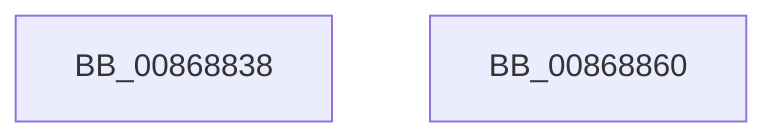

# ExpBlockOnLockedHandleEntry

- RVA: `0x00868838`–`0x00868861` (길이 `41` bytes)
- VA: `0x0000000140868838`
- 실행 섹션: `PAGE`
- PDB 이름 있음: `예`; PDB Function 태그: `아니요`
- unwind 정보 RVA: `0x0006BDBC`
- 디코드: `10`개 명령, `41/41` bytes 표시
- 미해석 바이트: `0` (있으면 어셈블리에 `.byte`로 보존)

> 이 문서는 커널 이미지의 기계어와 PDB 기호를 분석해 생성했습니다. 4번과 5번은 함수 원형과 자료형을 바이너리 사용 방식에서 추정한 C 해석이며 원본 소스 복구 결과는 아닙니다.

## 1. Dependencies

- 직접 호출 지점: **1**; 고유 호출 대상: **1**
- 직접 호출자로 확인된 함수: **30**
- RIP 상대 이미지 참조: **0**

### Outgoing calls
- `0x00868856` → [ExBlockOnAddressPushLock](../../text/2A/ExBlockOnAddressPushLock_function_002A43A0.md) (function, `0x002A43A0`)

### Direct callers
- [ExLockHandleTableEntry](../../text/40/ExLockHandleTableEntry_function_0040DAA0.md) at `0x0040DAE3`
- [sub_00868310](Unknown_function_00868310.md) at `0x00868393`
- [sub_00868496](Unknown_function_00868496.md) at `0x00868565`
- [ObpCloseHandle](ObpCloseHandle_function_008685B0.md) at `0x008686C2`
- [NtClose](NtClose_function_00868870.md) at `0x008689A6`
- [ExMapHandleToPointer](ExMapHandleToPointer_function_00868B60.md) at `0x00868BB6`
- [ObWaitForMultipleObjects](ObWaitForMultipleObjects_function_00868DF0.md) at `0x00868F4F`
- [ObWaitForMultipleObjects](ObWaitForMultipleObjects_function_00868DF0.md) at `0x00869240`
- [ObpReferenceObjectByHandleWithTag](ObpReferenceObjectByHandleWithTag_function_00869650.md) at `0x0086977F`
- [ObpReferenceObjectByHandleWithTag](ObpReferenceObjectByHandleWithTag_function_00869650.md) at `0x008699D1`
- [ExMapHandleToPointerEx](../88/ExMapHandleToPointerEx_function_00889390.md) at `0x00889401`
- [AlpcpSendMessage](../88/AlpcpSendMessage_function_0088BD40.md) at `0x0088C606`
- [ObpReferenceProcessObjectByHandle](../89/ObpReferenceProcessObjectByHandle_function_00893C00.md) at `0x00893D6F`
- [sub_00895B6D](../89/Unknown_function_00895B6D.md) at `0x00895C2A`
- [NtAlpcImpersonateClientOfPort](../89/NtAlpcImpersonateClientOfPort_function_008961A0.md) at `0x00896559`
- [ExpSnapShotHandleTables](../8A/ExpSnapShotHandleTables_function_008A25C0.md) at `0x008A2878`
- [sub_008A2AAB](../8A/Unknown_function_008A2AAB.md) at `0x008A2B32`
- [sub_008A2CF7](../8A/Unknown_function_008A2CF7.md) at `0x008A2D06`
- [ObDuplicateObject](../8C/ObDuplicateObject_function_008C4FA0.md) at `0x008C574A`
- [sub_008CB9B9](../8C/Unknown_function_008CB9B9.md) at `0x008CBA4E`
- [sub_008CBB8C](../8C/Unknown_function_008CBB8C.md) at `0x008CBC59`
- [NtWriteFile](../8E/NtWriteFile_function_008E92D0.md) at `0x008E93D9`
- [NtWriteFile](../8E/NtWriteFile_function_008E92D0.md) at `0x008E962F`
- [ExSweepHandleTable](../90/ExSweepHandleTable_function_00904D3C.md) at `0x00904EE3`
- [ExEnumHandleTable](../91/ExEnumHandleTable_function_0091DB20.md) at `0x0091DBE4`
- [sub_0094BE3F](../94/Unknown_function_0094BE3F.md) at `0x0094BEAE`
- [sub_0094C011](../94/Unknown_function_0094C011.md) at `0x0094C090`
- [RtlLookupAtomInAtomTable](../99/RtlLookupAtomInAtomTable_function_00992DF0.md) at `0x00993137`
- [RtlLookupAtomInAtomTable](../99/RtlLookupAtomInAtomTable_function_00992DF0.md) at `0x0099324E`
- [RtlpHashStringToAtom](../99/RtlpHashStringToAtom_function_0099E760.md) at `0x0099E963`
- [sub_009A7748](../9A/Unknown_function_009A7748.md) at `0x009A77D0`
- [sub_009A7932](../9A/Unknown_function_009A7932.md) at `0x009A79FF`
- [RtlQueryAtomInAtomTable](../9C/RtlQueryAtomInAtomTable_function_009C4690.md) at `0x009C488E`
- [RtlpAtomMapAtomToHandleEntry](../9C/RtlpAtomMapAtomToHandleEntry_function_009C4AD0.md) at `0x009C4BA0`

### Static image references
- 디코드된 RIP-relative 메모리 참조가 없습니다.

## 2. Other-region calls and transfers

- 다른 실행 섹션으로 향하는 call: **1**
  - `0x00868856` → [ExBlockOnAddressPushLock](../../text/2A/ExBlockOnAddressPushLock_function_002A43A0.md) (`PAGE` → `.text`)
- 별도 외부 분기/꼬리 이동을 확인하지 못했습니다.

## 3. Assembly (complete function range)

```asm
00868838  4C 89 44 24 18                  mov qword ptr [rsp + 0x18], r8
0086883D  48 83 EC 38                     sub rsp, 0x38
00868841  48 83 64 24 20 00               and qword ptr [rsp + 0x20], 0
00868847  4C 8D 44 24 50                  lea r8, [rsp + 0x50]
0086884C  48 83 C1 30                     add rcx, 0x30
00868850  41 B9 08 00 00 00               mov r9d, 8
00868856  E8 45 BB A3 FF                  call 0x1402a43a0
0086885B  48 83 C4 38                     add rsp, 0x38
0086885F  C3                              ret
00868860  CC                              int3
```

## 4. C-style interpretation (structured pseudocode)

```c
__int64 __fastcall ExpBlockOnLockedHandleEntry(__int64 a1, __int64 a2, __int64 a3)
{
    __int64 result;
    __int64 v_rsp;
    unsigned __int64 v_stack_m18;
    unsigned __int64 v_stack_p18;

    v_stack_p18 = a3;
    v_rsp = (v_rsp) - (56);
    a1 = (a1) + (48);
    result = ExBlockOnAddressPushLock(a1, a2, v_stack_p18, 8);
    v_rsp = (v_rsp) + (56);
    return result;
}
```

## 5. (Beta) C Style

```c
int64_t ExpBlockOnLockedHandleEntry(int64_t Arg1, int64_t Arg2, int64_t Arg3)
{
    int64_t result;
    int64_t local_rsp;
    uint64_t v_stack_m18;
    uint64_t v_stack_p18;

    v_stack_p18 = Arg3;
    local_rsp = (local_rsp) - (56);
    Arg1 = (Arg1) + (48);
    result = ExBlockOnAddressPushLock(Arg1, Arg2, v_stack_p18, 8);
    local_rsp = (local_rsp) + (56);
    return result;
}
```

## 6. Execution-region graph

[열기: 2D/3D 그래프와 함수 탐색 컨트롤 패널](../../../control-panel.html?section=page&rva=0x00868838&view=graph)

- 2D 그래프는 위에서 아래로 흐르고, 3D 그래프는 빈 공간을 드래그해 회전합니다. Shift+드래그는 이동, 휠은 확대·축소, 함수 노드 선택은 대상 보고서 이동입니다.

### Static fallback


