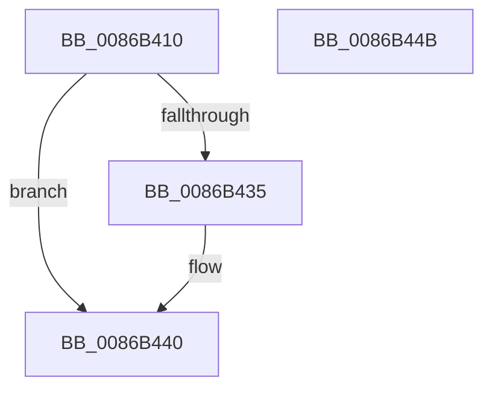

# ExpFreeTablePagedPool

- RVA: `0x0086B410`–`0x0086B44C` (길이 `60` bytes)
- VA: `0x000000014086B410`
- 실행 섹션: `PAGE`
- PDB 이름 있음: `예`; PDB Function 태그: `아니요`
- unwind 정보 RVA: `0x0005CAAC`
- 디코드: `19`개 명령, `60/60` bytes 표시
- 미해석 바이트: `0` (있으면 어셈블리에 `.byte`로 보존)

> 이 문서는 커널 이미지의 기계어와 PDB 기호를 분석해 생성했습니다. 4번과 5번은 함수 원형과 자료형을 바이너리 사용 방식에서 추정한 C 해석이며 원본 소스 복구 결과는 아닙니다.

## 1. Dependencies

- 직접 호출 지점: **2**; 고유 호출 대상: **2**
- 직접 호출자로 확인된 함수: **8**
- RIP 상대 이미지 참조: **0**

### Outgoing calls
- `0x0086B42B` → [ExFreePoolWithTag](../../poolcode/B8/ExFreePoolWithTag_function_00B82870.md) (function, `0x00B82870`)
- `0x0086B43B` → [PsReturnProcessPagedPoolQuota](../../text/2A/PsReturnProcessPagedPoolQuota_function_002A6860.md) (function, `0x002A6860`)

### Direct callers
- [sub_0086AEAF](Unknown_function_0086AEAF.md) at `0x0086AF68`
- [ObpCreateHandle](ObpCreateHandle_function_0086B950.md) at `0x0086CB93`
- [ObDuplicateObject](../8C/ObDuplicateObject_function_008C4FA0.md) at `0x008C5B7E`
- [ExpFreeLowLevelTable](../90/ExpFreeLowLevelTable_function_00901E28.md) at `0x00901E46`
- [ExpFreeLowLevelTable](../90/ExpFreeLowLevelTable_function_00901E28.md) at `0x00901E57`
- [ExpFreeHandleTable](../90/ExpFreeHandleTable_function_00903B70.md) at `0x00903C2B`
- [ExpFreeHandleTable](../90/ExpFreeHandleTable_function_00903B70.md) at `0x00903C72`
- [ExpSetHandleExtraInfo](../94/ExpSetHandleExtraInfo_function_0094C1B4.md) at `0x0094C247`
- [ExpAllocateHandleTableEntrySlow](../94/ExpAllocateHandleTableEntrySlow_function_0094D2FC.md) at `0x0094D440`
- [ExpAllocateMidLevelTable](../94/ExpAllocateMidLevelTable_function_0094D5B4.md) at `0x0094D625`

### Static image references
- 디코드된 RIP-relative 메모리 참조가 없습니다.

## 2. Other-region calls and transfers

- 다른 실행 섹션으로 향하는 call: **2**
  - `0x0086B42B` → [ExFreePoolWithTag](../../poolcode/B8/ExFreePoolWithTag_function_00B82870.md) (`PAGE` → `POOLCODE`)
  - `0x0086B43B` → [PsReturnProcessPagedPoolQuota](../../text/2A/PsReturnProcessPagedPoolQuota_function_002A6860.md) (`PAGE` → `.text`)
- 별도 외부 분기/꼬리 이동을 확인하지 못했습니다.

## 3. Assembly (complete function range)

```asm
0086B410  48 89 5C 24 08                  mov qword ptr [rsp + 8], rbx
0086B415  57                              push rdi
0086B416  48 83 EC 20                     sub rsp, 0x20
0086B41A  48 8B C2                        mov rax, rdx
0086B41D  48 8B D9                        mov rbx, rcx
0086B420  48 8B C8                        mov rcx, rax
0086B423  BA 4F 62 74 62                  mov edx, 0x6274624f
0086B428  49 8B F8                        mov rdi, r8
0086B42B  E8 40 74 31 00                  call 0x140b82870
0086B430  48 85 DB                        test rbx, rbx
0086B433  74 0B                           je 0x14086b440
0086B435  48 8B D7                        mov rdx, rdi
0086B438  48 8B CB                        mov rcx, rbx
0086B43B  E8 20 B4 A3 FF                  call 0x1402a6860
0086B440  48 8B 5C 24 30                  mov rbx, qword ptr [rsp + 0x30]
0086B445  48 83 C4 20                     add rsp, 0x20
0086B449  5F                              pop rdi
0086B44A  C3                              ret
0086B44B  CC                              int3
```

## 4. C-style interpretation (structured pseudocode)

```c
__int64 __fastcall ExpFreeTablePagedPool(__int64 a1, __int64 a2, __int64 a3)
{
    __int64 result;
    __int64 v_rsp;
    unsigned __int64 v_stack_p8;

    v_stack_p8 = v_rbx;
    v_rsp = (v_rsp) - (32);
    result = ExFreePoolWithTag(a2, (unsigned int)(0x6274624FULL), a3, a4);
    if (a1 != 0) {
        a2 = a3;
        a1 = a1;
        result = PsReturnProcessPagedPoolQuota(a1, a2, a3, a4);
    }
    v_rsp = (v_rsp) + (32);
    return result;
}
```

## 5. (Beta) C Style

```c
int64_t ExpFreeTablePagedPool(int64_t Arg1, int64_t Arg2, int64_t Arg3)
{
    int64_t result;
    int64_t local_rsp;
    uint64_t v_stack_p8;

    v_stack_p8 = local_rbx;
    local_rsp = (local_rsp) - (32);
    result = ExFreePoolWithTag(Arg2, (uint32_t)(0x6274624FULL), Arg3, a4);
    if (Arg1 != 0) {
        Arg2 = Arg3;
        Arg1 = Arg1;
        result = PsReturnProcessPagedPoolQuota(Arg1, Arg2, Arg3, a4);
    }
    local_rsp = (local_rsp) + (32);
    return result;
}
```

## 6. Execution-region graph

[열기: 2D/3D 그래프와 함수 탐색 컨트롤 패널](../../../control-panel.html?section=page&rva=0x0086B410&view=graph)

- 2D 그래프는 위에서 아래로 흐르고, 3D 그래프는 빈 공간을 드래그해 회전합니다. Shift+드래그는 이동, 휠은 확대·축소, 함수 노드 선택은 대상 보고서 이동입니다.

### Static fallback


