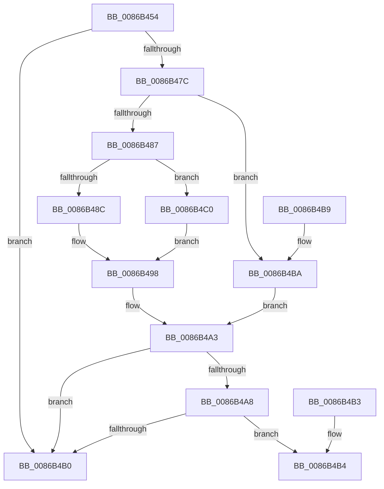

# ExpGetHandleExtraInfo

- RVA: `0x0086B454`–`0x0086B4DF` (길이 `139` bytes)
- VA: `0x000000014086B454`
- 실행 섹션: `PAGE`
- PDB 이름 있음: `예`; PDB Function 태그: `아니요`
- unwind 정보 RVA: `0x000DB714`
- 디코드: `43`개 명령, `139/139` bytes 표시
- 미해석 바이트: `0` (있으면 어셈블리에 `.byte`로 보존)

> 이 문서는 커널 이미지의 기계어와 PDB 기호를 분석해 생성했습니다. 4번과 5번은 함수 원형과 자료형을 바이너리 사용 방식에서 추정한 C 해석이며 원본 소스 복구 결과는 아닙니다.

## 1. Dependencies

- 직접 호출 지점: **0**; 고유 호출 대상: **0**
- 직접 호출자로 확인된 함수: **9**
- RIP 상대 이미지 참조: **0**

### Outgoing calls
- 직접 디코드된 call 명령이 없습니다.

### Direct callers
- [ObpReferenceObjectByHandleWithTag](ObpReferenceObjectByHandleWithTag_function_00869650.md) at `0x00869BEA`
- [ObCloseHandleTableEntry](ObCloseHandleTableEntry_function_00869E20.md) at `0x00869F6E`
- [sub_0086AEAF](Unknown_function_0086AEAF.md) at `0x0086AF91`
- [ObpCreateHandle](ObpCreateHandle_function_0086B950.md) at `0x0086CBC6`
- [ExDestroyHandle](../88/ExDestroyHandle_function_00889430.md) at `0x008894A4`
- [ObpReferenceProcessObjectByHandle](../89/ObpReferenceProcessObjectByHandle_function_00893C00.md) at `0x00893CB3`
- [ObDuplicateObject](../8C/ObDuplicateObject_function_008C4FA0.md) at `0x008C514E`
- [ObDuplicateObject](../8C/ObDuplicateObject_function_008C4FA0.md) at `0x008C5BAA`
- [ObpAuditObjectAccess](../94/ObpAuditObjectAccess_function_0094C270.md) at `0x0094C2A4`
- [ExpDuplicateSingleHandle](../94/ExpDuplicateSingleHandle_function_0094D0E4.md) at `0x0094D13B`

### Static image references
- 디코드된 RIP-relative 메모리 참조가 없습니다.

## 2. Other-region calls and transfers

- 다른 실행 섹션으로 향하는 call: **0**
- 별도 외부 분기/꼬리 이동을 확인하지 못했습니다.

## 3. Assembly (complete function range)

```asm
0086B454  48 89 54 24 08                  mov qword ptr [rsp + 8], rdx
0086B459  8B C2                           mov eax, edx
0086B45B  C1 E8 02                        shr eax, 2
0086B45E  81 E2 03 FC FF FF               and edx, 0xfffffc03
0086B464  89 54 24 08                     mov dword ptr [rsp + 8], edx
0086B468  4C 8B 44 24 08                  mov r8, qword ptr [rsp + 8]
0086B46D  44 0F B6 C8                     movzx r9d, al
0086B471  49 83 E0 FC                     and r8, 0xfffffffffffffffc
0086B475  8B 01                           mov eax, dword ptr [rcx]
0086B477  4C 3B C0                        cmp r8, rax
0086B47A  73 34                           jae 0x14086b4b0
0086B47C  48 8B 51 08                     mov rdx, qword ptr [rcx + 8]
0086B480  8B C2                           mov eax, edx
0086B482  83 E0 03                        and eax, 3
0086B485  74 33                           je 0x14086b4ba
0086B487  83 F8 01                        cmp eax, 1
0086B48A  75 34                           jne 0x14086b4c0
0086B48C  49 8B C0                        mov rax, r8
0086B48F  48 C1 E8 0A                     shr rax, 0xa
0086B493  48 8B 44 C2 FF                  mov rax, qword ptr [rdx + rax*8 - 1]
0086B498  41 81 E0 FF 03 00 00            and r8d, 0x3ff
0086B49F  4A 8D 0C 80                     lea rcx, [rax + r8*4]
0086B4A3  48 85 C9                        test rcx, rcx
0086B4A6  74 08                           je 0x14086b4b0
0086B4A8  48 8B 11                        mov rdx, qword ptr [rcx]
0086B4AB  48 85 D2                        test rdx, rdx
0086B4AE  75 04                           jne 0x14086b4b4
0086B4B0  33 C0                           xor eax, eax
0086B4B2  C3                              ret
0086B4B3  CC                              int3
0086B4B4  4A 8D 04 CA                     lea rax, [rdx + r9*8]
0086B4B8  C3                              ret
0086B4B9  CC                              int3
0086B4BA  4A 8D 0C 82                     lea rcx, [rdx + r8*4]
0086B4BE  EB E3                           jmp 0x14086b4a3
0086B4C0  49 8B C8                        mov rcx, r8
0086B4C3  48 C1 E9 0A                     shr rcx, 0xa
0086B4C7  48 8B C1                        mov rax, rcx
0086B4CA  48 C1 E8 09                     shr rax, 9
0086B4CE  81 E1 FF 01 00 00               and ecx, 0x1ff
0086B4D4  48 8B 44 C2 FE                  mov rax, qword ptr [rdx + rax*8 - 2]
0086B4D9  48 8B 04 C8                     mov rax, qword ptr [rax + rcx*8]
0086B4DD  EB B9                           jmp 0x14086b498
```

## 4. C-style interpretation (structured pseudocode)

```c
__int64 __fastcall ExpGetHandleExtraInfo(__int64 a1, __int64 a2)
{
    __int64 result;
    unsigned __int64 v_stack_p8;

    v_stack_p8 = a2;
    result = (unsigned int)(((unsigned int)((unsigned int)(a2))) >> (2));
    a2 = (unsigned int)((a2) & (0xFFFFFC03ULL));
    v_stack_p8 = (unsigned int)(a2);
    a3 = (v_stack_p8) & (-4);
    if (a3 >= ((unsigned int)(*(unsigned int *)(a1)))) goto loc_0086B4B0;
    result = (unsigned int)(((unsigned int)((unsigned int)(*(unsigned __int64 *)(a1 + 8)))) & (3));
    if (condition_is_equal) goto loc_0086B4BA;
    if (((unsigned int)(result)) != 1) goto loc_0086B4C0;
    result = (a3) >> (10);
loc_0086B498:
    a3 = (unsigned int)((a3) & (0x3FFULL));
loc_0086B4A3:
    if (*(unsigned __int64 *)(*(unsigned __int64 *)(a1 + 8) + result * 8 - 1) + a3 * 4 == 0) goto loc_0086B4B0;
    if (*(unsigned __int64 *)(*(unsigned __int64 *)(*(unsigned __int64 *)(a1 + 8) + result * 8 - 1) + a3 * 4) != 0) goto loc_0086B4B4;
loc_0086B4B0:
    result = 0;
    return result;
loc_0086B4B4:
    return *(unsigned __int64 *)(*(unsigned __int64 *)(*(unsigned __int64 *)(a1 + 8) + result * 8 - 1) + a3 * 4) + (unsigned __int8)(result) * 8;
loc_0086B4BA:
    goto loc_0086B4A3;
loc_0086B4C0:
    a1 = (a3) >> (10);
    result = (a1) >> (9);
    a1 = (unsigned int)((a1) & (511));
    goto loc_0086B498;
}
```

## 5. (Beta) C Style

```c
int64_t ExpGetHandleExtraInfo(void *Arg1, int64_t Arg2)
{
    uint8_t *arg1 = (uint8_t *)Arg1;

    int64_t result;
    uint64_t v_stack_p8;

    v_stack_p8 = Arg2;
    result = (uint32_t)(((uint32_t)((uint32_t)(Arg2))) >> (2));
    Arg2 = (uint32_t)((Arg2) & (0xFFFFFC03ULL));
    v_stack_p8 = (uint32_t)(Arg2);
    a3 = (v_stack_p8) & (-4);
    if (a3 >= ((uint32_t)(*(uint32_t *)(arg1)))) goto loc_0086B4B0;
    result = (uint32_t)(((uint32_t)((uint32_t)(*(uint64_t *)(arg1 + 0x8)))) & (3));
    if (condition_is_equal) goto loc_0086B4BA;
    if (((uint32_t)(result)) != 1) goto loc_0086B4C0;
    result = (a3) >> (10);
loc_0086B498:
    a3 = (uint32_t)((a3) & (0x3FFULL));
loc_0086B4A3:
    if (*(uint64_t *)(*(uint64_t *)(arg1 + 0x8) + result * 8 - 0x1) + a3 * 4 == 0) goto loc_0086B4B0;
    if (*(uint64_t *)(*(uint64_t *)(*(uint64_t *)(arg1 + 0x8) + result * 8 - 0x1) + a3 * 4) != 0) goto loc_0086B4B4;
loc_0086B4B0:
    result = 0;
    return result;
loc_0086B4B4:
    return *(uint64_t *)(*(uint64_t *)(*(uint64_t *)(arg1 + 0x8) + result * 8 - 0x1) + a3 * 4) + (uint8_t)(result) * 8;
loc_0086B4BA:
    goto loc_0086B4A3;
loc_0086B4C0:
    Arg1 = (a3) >> (10);
    result = (Arg1) >> (9);
    Arg1 = (uint32_t)((Arg1) & (511));
    goto loc_0086B498;
}
```

### 관측된 메모리 오프셋

구조체 형식이 확인되지 않은 접근은 인자 기준의 오프셋으로만 기록했습니다.

| 기준 인자 | 오프셋 표현 | 폭 (bit) | 접근 |
|---|---:|---:|---|
| `Arg1` | `+ 0x0` | `32` | `R` |
| `Arg1` | `+ 0x8` | `64` | `R` |

## 6. Execution-region graph

[열기: 2D/3D 그래프와 함수 탐색 컨트롤 패널](../../../control-panel.html?section=page&rva=0x0086B454&view=graph)

- 2D 그래프는 위에서 아래로 흐르고, 3D 그래프는 빈 공간을 드래그해 회전합니다. Shift+드래그는 이동, 휠은 확대·축소, 함수 노드 선택은 대상 보고서 이동입니다.

### Static fallback


