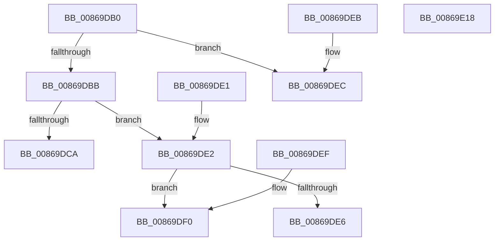

# ExpLookupHandleTableEntry

- RVA: `0x00869DB0`–`0x00869E19` (길이 `105` bytes)
- VA: `0x0000000140869DB0`
- 실행 섹션: `PAGE`
- PDB 이름 있음: `예`; PDB Function 태그: `아니요`
- unwind 정보 RVA: `0x000DB714`
- 디코드: `35`개 명령, `105/105` bytes 표시
- 미해석 바이트: `0` (있으면 어셈블리에 `.byte`로 보존)

> 이 문서는 커널 이미지의 기계어와 PDB 기호를 분석해 생성했습니다. 4번과 5번은 함수 원형과 자료형을 바이너리 사용 방식에서 추정한 C 해석이며 원본 소스 복구 결과는 아닙니다.

## 1. Dependencies

- 직접 호출 지점: **0**; 고유 호출 대상: **0**
- 직접 호출자로 확인된 함수: **29**
- RIP 상대 이미지 참조: **0**

### Outgoing calls
- 직접 디코드된 call 명령이 없습니다.

### Direct callers
- [sub_00868310](Unknown_function_00868310.md) at `0x00868348`
- [ObpCloseHandle](ObpCloseHandle_function_008685B0.md) at `0x00868632`
- [NtClose](NtClose_function_00868870.md) at `0x00868913`
- [ExMapHandleToPointer](ExMapHandleToPointer_function_00868B60.md) at `0x00868B75`
- [ObWaitForMultipleObjects](ObWaitForMultipleObjects_function_00868DF0.md) at `0x00868F0A`
- [ObpReferenceObjectByHandleWithTag](ObpReferenceObjectByHandleWithTag_function_00869650.md) at `0x00869734`
- [ObpCreateHandle](ObpCreateHandle_function_0086B950.md) at `0x0086C475`
- [ExMapHandleToPointerEx](../88/ExMapHandleToPointerEx_function_00889390.md) at `0x008893B6`
- [AlpcpSendMessage](../88/AlpcpSendMessage_function_0088BD40.md) at `0x0088C094`
- [ObpReferenceProcessObjectByHandle](../89/ObpReferenceProcessObjectByHandle_function_00893C00.md) at `0x00893C57`
- [AlpcpLookupMessage](../89/AlpcpLookupMessage_function_00895A40.md) at `0x00895AAC`
- [NtAlpcImpersonateClientOfPort](../89/NtAlpcImpersonateClientOfPort_function_008961A0.md) at `0x0089637D`
- [sub_008A2AAB](../8A/Unknown_function_008A2AAB.md) at `0x008A2AE7`
- [ObDuplicateObject](../8C/ObDuplicateObject_function_008C4FA0.md) at `0x008C50FB`
- [ObDuplicateObject](../8C/ObDuplicateObject_function_008C4FA0.md) at `0x008C57EF`
- [sub_008CB9B9](../8C/Unknown_function_008CB9B9.md) at `0x008CBA03`
- [NtWriteFile](../8E/NtWriteFile_function_008E92D0.md) at `0x008E938E`
- [ExSweepHandleTable](../90/ExSweepHandleTable_function_00904D3C.md) at `0x00904DB6`
- [ExSweepHandleTable](../90/ExSweepHandleTable_function_00904D3C.md) at `0x00904E3C`
- [ExEnumHandleTable](../91/ExEnumHandleTable_function_0091DB20.md) at `0x0091DB64`
- [ExEnumHandleTable](../91/ExEnumHandleTable_function_0091DB20.md) at `0x0091DC51`
- [sub_0094BE3F](../94/Unknown_function_0094BE3F.md) at `0x0094BE63`
- [ExpSetHandleExtraInfo](../94/ExpSetHandleExtraInfo_function_0094C1B4.md) at `0x0094C1EA`
- [ExQueryProcessHandleInformation](../94/ExQueryProcessHandleInformation_function_0094C3D8.md) at `0x0094C430`
- [ExpGetNextHandleTableEntry](../94/ExpGetNextHandleTableEntry_function_0094C5D0.md) at `0x0094C603`
- [ExpGetNextHandleTableEntry](../94/ExpGetNextHandleTableEntry_function_0094C5D0.md) at `0x0094C61C`
- [sub_0094CEB4](../94/Unknown_function_0094CEB4.md) at `0x0094CEED`
- [RtlLookupAtomInAtomTable](../99/RtlLookupAtomInAtomTable_function_00992DF0.md) at `0x00993073`
- [RtlLookupAtomInAtomTable](../99/RtlLookupAtomInAtomTable_function_00992DF0.md) at `0x009931AE`
- [RtlpHashStringToAtom](../99/RtlpHashStringToAtom_function_0099E760.md) at `0x0099E8AD`
- [sub_009A7748](../9A/Unknown_function_009A7748.md) at `0x009A7785`
- [RtlQueryAtomInAtomTable](../9C/RtlQueryAtomInAtomTable_function_009C4690.md) at `0x009C4776`
- [RtlpAtomMapAtomToHandleEntry](../9C/RtlpAtomMapAtomToHandleEntry_function_009C4AD0.md) at `0x009C4B1F`
- [ObSetHandleAttributes](../A0/ObSetHandleAttributes_function_00A03730.md) at `0x00A037DC`

### Static image references
- 디코드된 RIP-relative 메모리 참조가 없습니다.

## 2. Other-region calls and transfers

- 다른 실행 섹션으로 향하는 call: **0**
- 별도 외부 분기/꼬리 이동을 확인하지 못했습니다.

## 3. Assembly (complete function range)

```asm
00869DB0  8B 01                           mov eax, dword ptr [rcx]
00869DB2  48 83 E2 FC                     and rdx, 0xfffffffffffffffc
00869DB6  48 3B D0                        cmp rdx, rax
00869DB9  73 31                           jae 0x140869dec
00869DBB  4C 8B 41 08                     mov r8, qword ptr [rcx + 8]
00869DBF  41 8B C0                        mov eax, r8d
00869DC2  83 E0 03                        and eax, 3
00869DC5  83 F8 01                        cmp eax, 1
00869DC8  75 18                           jne 0x140869de2
00869DCA  48 8B C2                        mov rax, rdx
00869DCD  48 C1 E8 0A                     shr rax, 0xa
00869DD1  81 E2 FF 03 00 00               and edx, 0x3ff
00869DD7  49 8B 44 C0 FF                  mov rax, qword ptr [r8 + rax*8 - 1]
00869DDC  48 8D 04 90                     lea rax, [rax + rdx*4]
00869DE0  C3                              ret
00869DE1  CC                              int3
00869DE2  85 C0                           test eax, eax
00869DE4  75 0A                           jne 0x140869df0
00869DE6  49 8D 04 90                     lea rax, [r8 + rdx*4]
00869DEA  C3                              ret
00869DEB  CC                              int3
00869DEC  33 C0                           xor eax, eax
00869DEE  C3                              ret
00869DEF  CC                              int3
00869DF0  48 8B CA                        mov rcx, rdx
00869DF3  81 E2 FF 03 00 00               and edx, 0x3ff
00869DF9  48 C1 E9 0A                     shr rcx, 0xa
00869DFD  48 8B C1                        mov rax, rcx
00869E00  81 E1 FF 01 00 00               and ecx, 0x1ff
00869E06  48 C1 E8 09                     shr rax, 9
00869E0A  49 8B 44 C0 FE                  mov rax, qword ptr [r8 + rax*8 - 2]
00869E0F  48 8B 04 C8                     mov rax, qword ptr [rax + rcx*8]
00869E13  48 8D 04 90                     lea rax, [rax + rdx*4]
00869E17  C3                              ret
00869E18  CC                              int3
```

## 4. C-style interpretation (structured pseudocode)

```c
__int64 __fastcall ExpLookupHandleTableEntry(__int64 a1, __int64 a2)
{
    __int64 result;

    a2 = (a2) & (-4);
    if (a2 >= ((unsigned int)(*(unsigned int *)(a1)))) goto loc_00869DEC;
    result = (unsigned int)(((unsigned int)((unsigned int)(*(unsigned __int64 *)(a1 + 8)))) & (3));
    if (((unsigned int)(result)) != 1) goto loc_00869DE2;
    result = (a2) >> (10);
    a2 = (unsigned int)((a2) & (0x3FFULL));
    return *(unsigned __int64 *)(*(unsigned __int64 *)(a1 + 8) + result * 8 - 1) + a2 * 4;
loc_00869DE2:
    if ((unsigned int)(*(unsigned __int64 *)(*(unsigned __int64 *)(a1 + 8) + result * 8 - 1) + a2 * 4) != 0) goto loc_00869DF0;
    return *(unsigned __int64 *)(a1 + 8) + a2 * 4;
loc_00869DEC:
    result = 0;
    return result;
loc_00869DF0:
    a2 = (unsigned int)((a2) & (0x3FFULL));
    a1 = (a2) >> (10);
    a1 = (unsigned int)((a1) & (511));
    result = (a1) >> (9);
    return *(unsigned __int64 *)(*(unsigned __int64 *)(*(unsigned __int64 *)(a1 + 8) + result * 8 - 2) + a1 * 8) + a2 * 4;
}
```

## 5. (Beta) C Style

```c
int64_t ExpLookupHandleTableEntry(void *Arg1, int64_t Arg2)
{
    uint8_t *arg1 = (uint8_t *)Arg1;

    int64_t result;

    Arg2 = (Arg2) & (-4);
    if (Arg2 >= ((uint32_t)(*(uint32_t *)(arg1)))) goto loc_00869DEC;
    result = (uint32_t)(((uint32_t)((uint32_t)(*(uint64_t *)(arg1 + 0x8)))) & (3));
    if (((uint32_t)(result)) != 1) goto loc_00869DE2;
    result = (Arg2) >> (10);
    Arg2 = (uint32_t)((Arg2) & (0x3FFULL));
    return *(uint64_t *)(*(uint64_t *)(arg1 + 0x8) + result * 8 - 0x1) + Arg2 * 4;
loc_00869DE2:
    if ((uint32_t)(*(uint64_t *)(*(uint64_t *)(arg1 + 0x8) + result * 8 - 0x1) + Arg2 * 4) != 0) goto loc_00869DF0;
    return *(uint64_t *)(arg1 + 0x8) + Arg2 * 4;
loc_00869DEC:
    result = 0;
    return result;
loc_00869DF0:
    Arg2 = (uint32_t)((Arg2) & (0x3FFULL));
    Arg1 = (Arg2) >> (10);
    Arg1 = (uint32_t)((Arg1) & (511));
    result = (Arg1) >> (9);
    return *(uint64_t *)(*(uint64_t *)(*(uint64_t *)(arg1 + 0x8) + result * 8 - 0x2) + arg1 * 8) + Arg2 * 4;
}
```

### 관측된 메모리 오프셋

구조체 형식이 확인되지 않은 접근은 인자 기준의 오프셋으로만 기록했습니다.

| 기준 인자 | 오프셋 표현 | 폭 (bit) | 접근 |
|---|---:|---:|---|
| `Arg1` | `+ 0x0` | `32` | `R` |
| `Arg1` | `+ 0x8` | `64` | `R` |

## 6. Execution-region graph

[열기: 2D/3D 그래프와 함수 탐색 컨트롤 패널](../../../control-panel.html?section=page&rva=0x00869DB0&view=graph)

- 2D 그래프는 위에서 아래로 흐르고, 3D 그래프는 빈 공간을 드래그해 회전합니다. Shift+드래그는 이동, 휠은 확대·축소, 함수 노드 선택은 대상 보고서 이동입니다.

### Static fallback


