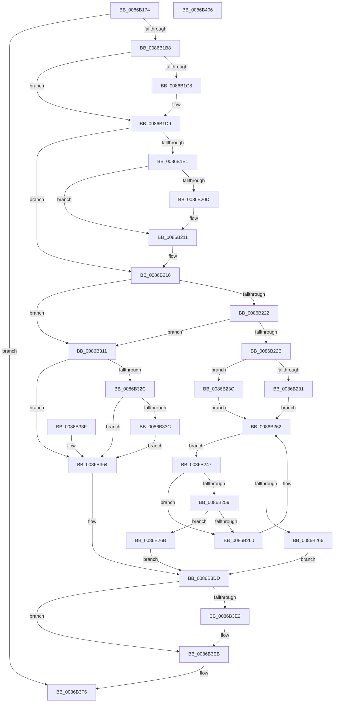

# ExpUpdateDebugInfo

- RVA: `0x0086B174`–`0x0086B407` (길이 `659` bytes)
- VA: `0x000000014086B174`
- 실행 섹션: `PAGE`
- PDB 이름 있음: `예`; PDB Function 태그: `아니요`
- unwind 정보 RVA: `0x0006BFB4`
- 디코드: `177`개 명령, `659/659` bytes 표시
- 미해석 바이트: `0` (있으면 어셈블리에 `.byte`로 보존)

> 이 문서는 커널 이미지의 기계어와 PDB 기호를 분석해 생성했습니다. 4번과 5번은 함수 원형과 자료형을 바이너리 사용 방식에서 추정한 C 해석이며 원본 소스 복구 결과는 아닙니다.

## 1. Dependencies

- 직접 호출 지점: **9**; 고유 호출 대상: **7**
- 직접 호출자로 확인된 함수: **7**
- RIP 상대 이미지 참조: **0**

### Outgoing calls
- `0x0086B19F` → [ExReferenceHandleDebugInfo](../9F/ExReferenceHandleDebugInfo_function_009F1E18.md) (function, `0x009F1E18`)
- `0x0086B1CC` → [ExAcquireFastMutex](../../text/20/ExAcquireFastMutex_function_0020E5A0.md) (function, `0x0020E5A0`)
- `0x0086B1F2` → [Feature_3714213176__private_IsEnabledDeviceUsageNoInline](../../text/65/Feature_3714213176__private_IsEnabledDeviceUsageNoInline_function_00655D2C.md) (function, `0x00655D2C`)
- `0x0086B211` → [memset](../../text/6C/memset_function_006C6C40.md) (function, `0x006C6C40`)
- `0x0086B39D` → [RtlWalkFrameChain](../../text/2F/RtlWalkFrameChain_function_002F85E0.md) (function, `0x002F85E0`)
- `0x0086B3BE` → [RtlWalkFrameChain](../../text/2F/RtlWalkFrameChain_function_002F85E0.md) (function, `0x002F85E0`)
- `0x0086B3D8` → [memset](../../text/6C/memset_function_006C6C40.md) (function, `0x006C6C40`)
- `0x0086B3E6` → [ExReleaseFastMutex](../../text/25/ExReleaseFastMutex_function_002519C0.md) (function, `0x002519C0`)
- `0x0086B3F1` → [ExDereferenceHandleDebugInfo](../A1/ExDereferenceHandleDebugInfo_function_00A17430.md) (function, `0x00A17430`)

### Direct callers
- [sub_004405B0](../../text/44/Unknown_function_004405B0.md) at `0x004405D5`
- [ObCloseHandleTableEntry](ObCloseHandleTableEntry_function_00869E20.md) at `0x00869F24`
- [sub_0086AD2F](Unknown_function_0086AD2F.md) at `0x0086AE68`
- [ObpCreateHandle](ObpCreateHandle_function_0086B950.md) at `0x0086C14B`
- [ExDestroyHandle](../88/ExDestroyHandle_function_00889430.md) at `0x00889464`
- [ObDuplicateObject](../8C/ObDuplicateObject_function_008C4FA0.md) at `0x008C5536`
- [sub_0094CD40](../94/Unknown_function_0094CD40.md) at `0x0094CE96`

### Static image references
- 디코드된 RIP-relative 메모리 참조가 없습니다.

## 2. Other-region calls and transfers

- 다른 실행 섹션으로 향하는 call: **7**
  - `0x0086B1CC` → [ExAcquireFastMutex](../../text/20/ExAcquireFastMutex_function_0020E5A0.md) (`PAGE` → `.text`)
  - `0x0086B1F2` → [Feature_3714213176__private_IsEnabledDeviceUsageNoInline](../../text/65/Feature_3714213176__private_IsEnabledDeviceUsageNoInline_function_00655D2C.md) (`PAGE` → `.text`)
  - `0x0086B211` → [memset](../../text/6C/memset_function_006C6C40.md) (`PAGE` → `.text`)
  - `0x0086B39D` → [RtlWalkFrameChain](../../text/2F/RtlWalkFrameChain_function_002F85E0.md) (`PAGE` → `.text`)
  - `0x0086B3BE` → [RtlWalkFrameChain](../../text/2F/RtlWalkFrameChain_function_002F85E0.md) (`PAGE` → `.text`)
  - `0x0086B3D8` → [memset](../../text/6C/memset_function_006C6C40.md) (`PAGE` → `.text`)
  - `0x0086B3E6` → [ExReleaseFastMutex](../../text/25/ExReleaseFastMutex_function_002519C0.md) (`PAGE` → `.text`)
- 별도 외부 분기/꼬리 이동을 확인하지 못했습니다.

## 3. Assembly (complete function range)

```asm
0086B174  48 8B C4                        mov rax, rsp
0086B177  44 89 48 20                     mov dword ptr [rax + 0x20], r9d
0086B17B  4C 89 40 18                     mov qword ptr [rax + 0x18], r8
0086B17F  48 89 50 10                     mov qword ptr [rax + 0x10], rdx
0086B183  48 89 48 08                     mov qword ptr [rax + 8], rcx
0086B187  53                              push rbx
0086B188  56                              push rsi
0086B189  57                              push rdi
0086B18A  41 54                           push r12
0086B18C  41 55                           push r13
0086B18E  41 56                           push r14
0086B190  41 57                           push r15
0086B192  48 83 EC 30                     sub rsp, 0x30
0086B196  41 8B D9                        mov ebx, r9d
0086B199  49 8B F8                        mov rdi, r8
0086B19C  4C 8B E9                        mov r13, rcx
0086B19F  E8 74 6C 18 00                  call 0x1409f1e18
0086B1A4  4C 8B F0                        mov r14, rax
0086B1A7  48 89 44 24 28                  mov qword ptr [rsp + 0x28], rax
0086B1AC  45 33 FF                        xor r15d, r15d
0086B1AF  48 85 C0                        test rax, rax
0086B1B2  0F 84 3E 02 00 00               je 0x14086b3f6
0086B1B8  45 8A E7                        mov r12b, r15b
0086B1BB  44 88 7C 24 20                  mov byte ptr [rsp + 0x20], r15b
0086B1C0  8B 48 08                        mov ecx, dword ptr [rax + 8]
0086B1C3  F6 C1 03                        test cl, 3
0086B1C6  74 11                           je 0x14086b1d9
0086B1C8  48 8D 48 10                     lea rcx, [rax + 0x10]
0086B1CC  E8 CF 33 9A FF                  call 0x14020e5a0
0086B1D1  41 B4 01                        mov r12b, 1
0086B1D4  44 88 64 24 20                  mov byte ptr [rsp + 0x20], r12b
0086B1D9  41 8B 46 08                     mov eax, dword ptr [r14 + 8]
0086B1DD  A8 01                           test al, 1
0086B1DF  74 35                           je 0x14086b216
0086B1E1  25 FE FF FF BF                  and eax, 0xbffffffe
0086B1E6  0F BA E8 1F                     bts eax, 0x1f
0086B1EA  41 89 46 08                     mov dword ptr [r14 + 8], eax
0086B1EE  45 89 7E 48                     mov dword ptr [r14 + 0x48], r15d
0086B1F2  E8 35 AB DE FF                  call 0x140655d2c
0086B1F7  49 8D 4E 50                     lea rcx, [r14 + 0x50]
0086B1FB  41 8B 56 04                     mov edx, dword ptr [r14 + 4]
0086B1FF  4C 8D 04 92                     lea r8, [rdx + rdx*4]
0086B203  49 C1 E0 05                     shl r8, 5
0086B207  33 D2                           xor edx, edx
0086B209  85 C0                           test eax, eax
0086B20B  75 04                           jne 0x14086b211
0086B20D  49 83 C0 50                     add r8, 0x50
0086B211  E8 2A BA E5 FF                  call 0x1406c6c40
0086B216  41 8B 46 08                     mov eax, dword ptr [r14 + 8]
0086B21A  A8 02                           test al, 2
0086B21C  0F 84 EF 00 00 00               je 0x14086b311
0086B222  83 FB 02                        cmp ebx, 2
0086B225  0F 85 E6 00 00 00               jne 0x14086b311
0086B22B  0F BA E0 1E                     bt eax, 0x1e
0086B22F  73 0B                           jae 0x14086b23c
0086B231  41 8B CF                        mov ecx, r15d
0086B234  41 8B 56 04                     mov edx, dword ptr [r14 + 4]
0086B238  FF CA                           dec edx
0086B23A  EB 26                           jmp 0x14086b262
0086B23C  B9 01 00 00 00                  mov ecx, 1
0086B241  41 8B 56 48                     mov edx, dword ptr [r14 + 0x48]
0086B245  EB 1B                           jmp 0x14086b262
0086B247  8B C1                           mov eax, ecx
0086B249  4C 8D 04 80                     lea r8, [rax + rax*4]
0086B24D  49 C1 E0 05                     shl r8, 5
0086B251  43 83 7C 30 68 01               cmp dword ptr [r8 + r14 + 0x68], 1
0086B257  75 07                           jne 0x14086b260
0086B259  4B 39 7C 30 60                  cmp qword ptr [r8 + r14 + 0x60], rdi
0086B25E  74 0B                           je 0x14086b26b
0086B260  FF C1                           inc ecx
0086B262  3B CA                           cmp ecx, edx
0086B264  76 E1                           jbe 0x14086b247
0086B266  E9 72 01 00 00                  jmp 0x14086b3dd
0086B26B  41 8B 46 48                     mov eax, dword ptr [r14 + 0x48]
0086B26F  8D 48 FF                        lea ecx, [rax - 1]
0086B272  41 89 4E 48                     mov dword ptr [r14 + 0x48], ecx
0086B276  33 D2                           xor edx, edx
0086B278  41 F7 76 04                     div dword ptr [r14 + 4]
0086B27C  48 8D 14 92                     lea rdx, [rdx + rdx*4]
0086B280  48 C1 E2 05                     shl rdx, 5
0086B284  4B 8D 0C 30                     lea rcx, [r8 + r14]
0086B288  4A 8D 04 32                     lea rax, [rdx + r14]
0086B28C  0F 10 40 50                     movups xmm0, xmmword ptr [rax + 0x50]
0086B290  0F 11 41 50                     movups xmmword ptr [rcx + 0x50], xmm0
0086B294  0F 10 48 60                     movups xmm1, xmmword ptr [rax + 0x60]
0086B298  0F 11 49 60                     movups xmmword ptr [rcx + 0x60], xmm1
0086B29C  0F 10 40 70                     movups xmm0, xmmword ptr [rax + 0x70]
0086B2A0  0F 11 41 70                     movups xmmword ptr [rcx + 0x70], xmm0
0086B2A4  0F 10 88 80 00 00 00            movups xmm1, xmmword ptr [rax + 0x80]
0086B2AB  0F 11 89 80 00 00 00            movups xmmword ptr [rcx + 0x80], xmm1
0086B2B2  0F 10 80 90 00 00 00            movups xmm0, xmmword ptr [rax + 0x90]
0086B2B9  0F 11 81 90 00 00 00            movups xmmword ptr [rcx + 0x90], xmm0
0086B2C0  0F 10 88 A0 00 00 00            movups xmm1, xmmword ptr [rax + 0xa0]
0086B2C7  0F 11 89 A0 00 00 00            movups xmmword ptr [rcx + 0xa0], xmm1
0086B2CE  0F 10 80 B0 00 00 00            movups xmm0, xmmword ptr [rax + 0xb0]
0086B2D5  0F 11 81 B0 00 00 00            movups xmmword ptr [rcx + 0xb0], xmm0
0086B2DC  41 B8 80 00 00 00               mov r8d, 0x80
0086B2E2  0F 10 80 C0 00 00 00            movups xmm0, xmmword ptr [rax + 0xc0]
0086B2E9  42 0F 11 44 01 40               movups xmmword ptr [rcx + r8 + 0x40], xmm0
0086B2EF  42 0F 10 4C 00 50               movups xmm1, xmmword ptr [rax + r8 + 0x50]
0086B2F5  42 0F 11 4C 01 50               movups xmmword ptr [rcx + r8 + 0x50], xmm1
0086B2FB  42 0F 10 44 00 60               movups xmm0, xmmword ptr [rax + r8 + 0x60]
0086B301  42 0F 11 44 01 60               movups xmmword ptr [rcx + r8 + 0x60], xmm0
0086B307  46 89 7C 32 68                  mov dword ptr [rdx + r14 + 0x68], r15d
0086B30C  E9 CC 00 00 00                  jmp 0x14086b3dd
0086B311  B8 01 00 00 00                  mov eax, 1
0086B316  F0 41 0F C1 46 48               lock xadd dword ptr [r14 + 0x48], eax
0086B31C  FF C0                           inc eax
0086B31E  33 D2                           xor edx, edx
0086B320  41 F7 76 04                     div dword ptr [r14 + 4]
0086B324  89 54 24 24                     mov dword ptr [rsp + 0x24], edx
0086B328  85 D2                           test edx, edx
0086B32A  75 38                           jne 0x14086b364
0086B32C  41 8B 46 08                     mov eax, dword ptr [r14 + 8]
0086B330  0F BA E8 1E                     bts eax, 0x1e
0086B334  41 89 46 08                     mov dword ptr [r14 + 8], eax
0086B338  A8 04                           test al, 4
0086B33A  74 28                           je 0x14086b364
0086B33C  CC                              int3
0086B33D  EB 25                           jmp 0x14086b364
0086B33F  45 33 FF                        xor r15d, r15d
0086B342  8B 9C 24 88 00 00 00            mov ebx, dword ptr [rsp + 0x88]
0086B349  48 8B BC 24 80 00 00 00         mov rdi, qword ptr [rsp + 0x80]
0086B351  4C 8B 6C 24 70                  mov r13, qword ptr [rsp + 0x70]
0086B356  4C 8B 74 24 28                  mov r14, qword ptr [rsp + 0x28]
0086B35B  8B 54 24 24                     mov edx, dword ptr [rsp + 0x24]
0086B35F  44 8A 64 24 20                  mov r12b, byte ptr [rsp + 0x20]
0086B364  8B C2                           mov eax, edx
0086B366  48 8D 34 80                     lea rsi, [rax + rax*4]
0086B36A  48 C1 E6 05                     shl rsi, 5
0086B36E  48 83 C6 50                     add rsi, 0x50
0086B372  49 03 F6                        add rsi, r14
0086B375  48 8B 44 24 78                  mov rax, qword ptr [rsp + 0x78]
0086B37A  0F 10 80 08 05 00 00            movups xmm0, xmmword ptr [rax + 0x508]
0086B381  F3 0F 7F 06                     movdqu xmmword ptr [rsi], xmm0
0086B385  48 89 7E 10                     mov qword ptr [rsi + 0x10], rdi
0086B389  89 5E 18                        mov dword ptr [rsi + 0x18], ebx
0086B38C  48 8D 4E 20                     lea rcx, [rsi + 0x20]
0086B390  BF 10 00 00 00                  mov edi, 0x10
0086B395  41 B8 00 03 00 00               mov r8d, 0x300
0086B39B  8B D7                           mov edx, edi
0086B39D  E8 3E D2 A8 FF                  call 0x1402f85e0
0086B3A2  8D 48 FD                        lea ecx, [rax - 3]
0086B3A5  83 F8 03                        cmp eax, 3
0086B3A8  41 0F 46 CF                     cmovbe ecx, r15d
0086B3AC  8B D9                           mov ebx, ecx
0086B3AE  8B D7                           mov edx, edi
0086B3B0  2B D1                           sub edx, ecx
0086B3B2  48 83 C1 04                     add rcx, 4
0086B3B6  48 8D 0C CE                     lea rcx, [rsi + rcx*8]
0086B3BA  44 8D 47 F1                     lea r8d, [rdi - 0xf]
0086B3BE  E8 1D D2 A8 FF                  call 0x1402f85e0
0086B3C3  03 C3                           add eax, ebx
0086B3C5  2B F8                           sub edi, eax
0086B3C7  44 8B C7                        mov r8d, edi
0086B3CA  49 C1 E0 03                     shl r8, 3
0086B3CE  48 83 C0 04                     add rax, 4
0086B3D2  48 8D 0C C6                     lea rcx, [rsi + rax*8]
0086B3D6  33 D2                           xor edx, edx
0086B3D8  E8 63 B8 E5 FF                  call 0x1406c6c40
0086B3DD  45 84 E4                        test r12b, r12b
0086B3E0  74 09                           je 0x14086b3eb
0086B3E2  49 8D 4E 10                     lea rcx, [r14 + 0x10]
0086B3E6  E8 D5 65 9E FF                  call 0x1402519c0
0086B3EB  49 8B D6                        mov rdx, r14
0086B3EE  49 8B CD                        mov rcx, r13
0086B3F1  E8 3A C0 1A 00                  call 0x140a17430
0086B3F6  48 83 C4 30                     add rsp, 0x30
0086B3FA  41 5F                           pop r15
0086B3FC  41 5E                           pop r14
0086B3FE  41 5D                           pop r13
0086B400  41 5C                           pop r12
0086B402  5F                              pop rdi
0086B403  5E                              pop rsi
0086B404  5B                              pop rbx
0086B405  C3                              ret
0086B406  CC                              int3
```

## 4. C-style interpretation (structured pseudocode)

```c
__int64 __fastcall ExpUpdateDebugInfo(__int64 a1, __int64 a2, __int64 a3, int a4)
{
    __int64 result;
    __int64 v_r12;
    __int64 v_r15;
    __int64 v_rdi;
    __int64 v_rsi;
    __int64 v_rsp;
    unsigned __int64 v_stack_m40;
    unsigned int v_stack_m44;
    unsigned __int8 v_stack_m48;
    unsigned __int64 v_stack_p10;
    unsigned __int64 v_stack_p18;
    unsigned int v_stack_p20;
    unsigned __int64 v_stack_p8;

    *(unsigned int *)(v_rsp + 32) = a4;
    *(unsigned __int64 *)(v_rsp + 24) = a3;
    *(unsigned __int64 *)(v_rsp + 16) = a2;
    *(unsigned __int64 *)(v_rsp + 8) = a1;
    v_rsp = (v_rsp) - (48);
    result = ExReferenceHandleDebugInfo(a1, a2, a3, a4);
    v_stack_m40 = result;
    v_r15 = 0;
    if (result == 0) goto loc_0086B3F6;
    v_stack_m48 = 0;
    v_r12 = 0;
    if ((((unsigned __int8)((unsigned int)(*(unsigned int *)(result + 8)))) & (3)) != 0) {
        a1 = result + 16;
        result = ExAcquireFastMutex(a1, a2, a3, a4);
        v_r12 = 1;
        v_stack_m48 = (unsigned __int8)(v_r12);
    }
    if ((((unsigned __int8)((unsigned int)(*(unsigned int *)(result + 8)))) & (1)) == 0) goto loc_0086B216;
    result = (unsigned int)(((unsigned int)(*(unsigned int *)(result + 8))) & (0xBFFFFFFEULL));
    *(unsigned int *)(result + 8) = (unsigned int)(result);
    *(unsigned int *)(result + 72) = 0;
    result = Feature_3714213176__private_IsEnabledDeviceUsageNoInline(a1, a2, a3, a4);
    a3 = ((unsigned int)(*(unsigned int *)(result + 4)) + (unsigned int)(*(unsigned int *)(result + 4)) * 4) << (5);
    a2 = 0;
    if ((unsigned int)(result) == 0) {
        a3 = (a3) + (80);
    }
    result = memset(result + 80, a2, a3, a4);
loc_0086B216:
    if ((((unsigned __int8)((unsigned int)(*(unsigned int *)(result + 8)))) & (2)) == 0) goto loc_0086B311;
    if (((unsigned int)((unsigned int)(a4))) != 2) goto loc_0086B311;
    if (((unsigned int)((unsigned int)(a4))) >= 2) goto loc_0086B23C;
    a2 = (unsigned int)(((unsigned int)(*(unsigned int *)(result + 4))) - 1);
    goto loc_0086B262;
loc_0086B23C:
    goto loc_0086B262;
loc_0086B247:
    a3 = (1 + 1 * 4) << (5);
    if ((*(unsigned int *)(a3 + result * 1 + 104)) != 1) goto loc_0086B260;
    if ((*(unsigned __int64 *)(a3 + result * 1 + 96)) == a3) goto loc_0086B26B;
loc_0086B260:
    a1 = (unsigned int)((1) + 1);
loc_0086B262:
    if (((unsigned int)(a1)) <= ((unsigned int)((unsigned int)(*(unsigned int *)(result + 72))))) goto loc_0086B247;
    goto loc_0086B3DD;
loc_0086B26B:
    *(unsigned int *)(result + 72) = (unsigned int)((unsigned int)(*(unsigned int *)(result + 72)) - 1);
    a2 = 0;
    a2 = (a2 + a2 * 4) << (5);
    *(unsigned __int64 *)(a3 + result * 1 + 80) = v_xmm0;
    *(unsigned __int64 *)(a3 + result * 1 + 96) = v_xmm1;
    *(unsigned __int64 *)(a3 + result * 1 + 112) = v_xmm0;
    *(unsigned __int64 *)(a3 + result * 1 + 128) = v_xmm1;
    *(unsigned __int64 *)(a3 + result * 1 + 144) = v_xmm0;
    *(unsigned __int64 *)(a3 + result * 1 + 160) = v_xmm1;
    *(unsigned __int64 *)(a3 + result * 1 + 176) = v_xmm0;
    *(unsigned __int64 *)(a3 + result * 1 + 128 * 1 + 64) = v_xmm0;
    *(unsigned __int64 *)(a3 + result * 1 + 128 * 1 + 80) = v_xmm1;
    *(unsigned __int64 *)(a3 + result * 1 + 128 * 1 + 96) = v_xmm0;
    *(unsigned int *)(a2 + result * 1 + 104) = 0;
    goto loc_0086B3DD;
loc_0086B311:
    result = (unsigned int)((1) + 1);
    a2 = 0;
    v_stack_m44 = 0;
    if (0 != 0) goto loc_0086B364;
    *(unsigned int *)(result + 8) = (unsigned int)((unsigned int)(*(unsigned int *)(result + 8)));
    if ((((unsigned __int8)((unsigned int)(*(unsigned int *)(result + 8)))) & (4)) == 0) goto loc_0086B364;
    goto loc_0086B364;
loc_0086B364:
    v_rsi = (0 + 0 * 4) << (5);
    v_rsi = (v_rsi) + (80);
    v_rsi = (v_rsi) + (result);
    *(unsigned __int64 *)(v_rsi) = v_xmm0;
    *(unsigned __int64 *)(v_rsi + 16) = a3;
    *(unsigned int *)(v_rsi + 24) = (unsigned int)((unsigned int)(a4));
    result = RtlWalkFrameChain(v_rsi + 32, 16, 768, a4);
    a1 = result - 3;
    if (((unsigned int)(result)) <= 3) { a1 = 0; }
    a2 = (unsigned int)((16) - ((unsigned int)(a1)));
    a1 = (a1) + (4);
    result = RtlWalkFrameChain(v_rsi + a1 * 8, a2, 16 - 15, a4);
    result = (unsigned int)((result) + ((unsigned int)((unsigned int)((unsigned int)(a1)))));
    v_rdi = (unsigned int)((16) - ((unsigned int)(result)));
    a3 = ((unsigned int)((unsigned int)(v_rdi))) << (3);
    result = (result) + (4);
    a2 = 0;
    result = memset(v_rsi + result * 8, a2, a3, a4);
loc_0086B3DD:
    if ((unsigned __int8)(v_r12) != 0) {
        a1 = result + 16;
        result = ExReleaseFastMutex(a1, a2, a3, a4);
    }
    result = ExDereferenceHandleDebugInfo(a1, result, a3, a4);
loc_0086B3F6:
    v_rsp = (v_rsp) + (48);
    return result;
}
```

## 5. (Beta) C Style

```c
int64_t ExpUpdateDebugInfo(int64_t Arg1, int64_t Arg2, int64_t Arg3, int32_t Arg4)
{
    int64_t result;
    int64_t local_r12;
    int64_t local_r15;
    int64_t local_rdi;
    int64_t local_rsi;
    int64_t local_rsp;
    uint64_t v_stack_m40;
    uint32_t v_stack_m44;
    uint8_t v_stack_m48;
    uint64_t v_stack_p10;
    uint64_t v_stack_p18;
    uint32_t v_stack_p20;
    uint64_t v_stack_p8;

    *(uint32_t *)(local_rsp + 0x20) = Arg4;
    *(uint64_t *)(local_rsp + 0x18) = Arg3;
    *(uint64_t *)(local_rsp + 0x10) = Arg2;
    *(uint64_t *)(local_rsp + 0x8) = Arg1;
    local_rsp = (local_rsp) - (48);
    result = ExReferenceHandleDebugInfo(Arg1, Arg2, Arg3, Arg4);
    v_stack_m40 = result;
    local_r15 = 0;
    if (result == 0) goto loc_0086B3F6;
    v_stack_m48 = 0;
    local_r12 = 0;
    if ((((uint8_t)((uint32_t)(*(uint32_t *)(result + 0x8)))) & (3)) != 0) {
        Arg1 = result + 16;
        result = ExAcquireFastMutex(Arg1, Arg2, Arg3, Arg4);
        local_r12 = 1;
        v_stack_m48 = (uint8_t)(local_r12);
    }
    if ((((uint8_t)((uint32_t)(*(uint32_t *)(result + 0x8)))) & (1)) == 0) goto loc_0086B216;
    result = (uint32_t)(((uint32_t)(*(uint32_t *)(result + 0x8))) & (0xBFFFFFFEULL));
    *(uint32_t *)(result + 0x8) = (uint32_t)(result);
    *(uint32_t *)(result + 0x48) = 0;
    result = Feature_3714213176__private_IsEnabledDeviceUsageNoInline(Arg1, Arg2, Arg3, Arg4);
    Arg3 = ((uint32_t)(*(uint32_t *)(result + 0x4)) + (uint32_t)(*(uint32_t *)(result + 0x4)) * 4) << (5);
    Arg2 = 0;
    if ((uint32_t)(result) == 0) {
        Arg3 = (Arg3) + (80);
    }
    result = memset(result + 80, Arg2, Arg3, Arg4);
loc_0086B216:
    if ((((uint8_t)((uint32_t)(*(uint32_t *)(result + 0x8)))) & (2)) == 0) goto loc_0086B311;
    if (((uint32_t)((uint32_t)(Arg4))) != 2) goto loc_0086B311;
    if (((uint32_t)((uint32_t)(Arg4))) >= 2) goto loc_0086B23C;
    Arg2 = (uint32_t)(((uint32_t)(*(uint32_t *)(result + 0x4))) - 1);
    goto loc_0086B262;
loc_0086B23C:
    goto loc_0086B262;
loc_0086B247:
    Arg3 = (1 + 1 * 4) << (5);
    if ((*(uint32_t *)(Arg3 + result * 1 + 0x68)) != 1) goto loc_0086B260;
    if ((*(uint64_t *)(Arg3 + result * 1 + 0x60)) == Arg3) goto loc_0086B26B;
loc_0086B260:
    Arg1 = (uint32_t)((1) + 1);
loc_0086B262:
    if (((uint32_t)(Arg1)) <= ((uint32_t)((uint32_t)(*(uint32_t *)(result + 0x48))))) goto loc_0086B247;
    goto loc_0086B3DD;
loc_0086B26B:
    *(uint32_t *)(result + 0x48) = (uint32_t)((uint32_t)(*(uint32_t *)(result + 0x48)) - 1);
    Arg2 = 0;
    Arg2 = (Arg2 + Arg2 * 4) << (5);
    *(uint64_t *)(Arg3 + result * 1 + 0x50) = v_xmm0;
    *(uint64_t *)(Arg3 + result * 1 + 0x60) = v_xmm1;
    *(uint64_t *)(Arg3 + result * 1 + 0x70) = v_xmm0;
    *(uint64_t *)(Arg3 + result * 1 + 0x80) = v_xmm1;
    *(uint64_t *)(Arg3 + result * 1 + 0x90) = v_xmm0;
    *(uint64_t *)(Arg3 + result * 1 + 0xA0) = v_xmm1;
    *(uint64_t *)(Arg3 + result * 1 + 0xB0) = v_xmm0;
    *(uint64_t *)(Arg3 + result * 1 + 0x80 * 1 + 0x40) = v_xmm0;
    *(uint64_t *)(Arg3 + result * 1 + 0x80 * 1 + 0x50) = v_xmm1;
    *(uint64_t *)(Arg3 + result * 1 + 0x80 * 1 + 0x60) = v_xmm0;
    *(uint32_t *)(Arg2 + result * 1 + 0x68) = 0;
    goto loc_0086B3DD;
loc_0086B311:
    result = (uint32_t)((1) + 1);
    Arg2 = 0;
    v_stack_m44 = 0;
    if (0 != 0) goto loc_0086B364;
    *(uint32_t *)(result + 0x8) = (uint32_t)((uint32_t)(*(uint32_t *)(result + 0x8)));
    if ((((uint8_t)((uint32_t)(*(uint32_t *)(result + 0x8)))) & (4)) == 0) goto loc_0086B364;
    goto loc_0086B364;
loc_0086B364:
    local_rsi = (0 + 0 * 4) << (5);
    local_rsi = (local_rsi) + (80);
    local_rsi = (local_rsi) + (result);
    *(uint64_t *)(local_rsi) = v_xmm0;
    *(uint64_t *)(local_rsi + 0x10) = Arg3;
    *(uint32_t *)(local_rsi + 0x18) = (uint32_t)((uint32_t)(Arg4));
    result = RtlWalkFrameChain(local_rsi + 32, 16, 768, Arg4);
    Arg1 = result - 3;
    if (((uint32_t)(result)) <= 3) { Arg1 = 0; }
    Arg2 = (uint32_t)((16) - ((uint32_t)(Arg1)));
    Arg1 = (Arg1) + (4);
    result = RtlWalkFrameChain(local_rsi + Arg1 * 8, Arg2, 16 - 15, Arg4);
    result = (uint32_t)((result) + ((uint32_t)((uint32_t)((uint32_t)(Arg1)))));
    local_rdi = (uint32_t)((16) - ((uint32_t)(result)));
    Arg3 = ((uint32_t)((uint32_t)(local_rdi))) << (3);
    result = (result) + (4);
    Arg2 = 0;
    result = memset(local_rsi + result * 8, Arg2, Arg3, Arg4);
loc_0086B3DD:
    if ((uint8_t)(local_r12) != 0) {
        Arg1 = result + 16;
        result = ExReleaseFastMutex(Arg1, Arg2, Arg3, Arg4);
    }
    result = ExDereferenceHandleDebugInfo(Arg1, result, Arg3, Arg4);
loc_0086B3F6:
    local_rsp = (local_rsp) + (48);
    return result;
}
```

## 6. Execution-region graph

[열기: 2D/3D 그래프와 함수 탐색 컨트롤 패널](../../../control-panel.html?section=page&rva=0x0086B174&view=graph)

- 2D 그래프는 위에서 아래로 흐르고, 3D 그래프는 빈 공간을 드래그해 회전합니다. Shift+드래그는 이동, 휠은 확대·축소, 함수 노드 선택은 대상 보고서 이동입니다.

### Static fallback


