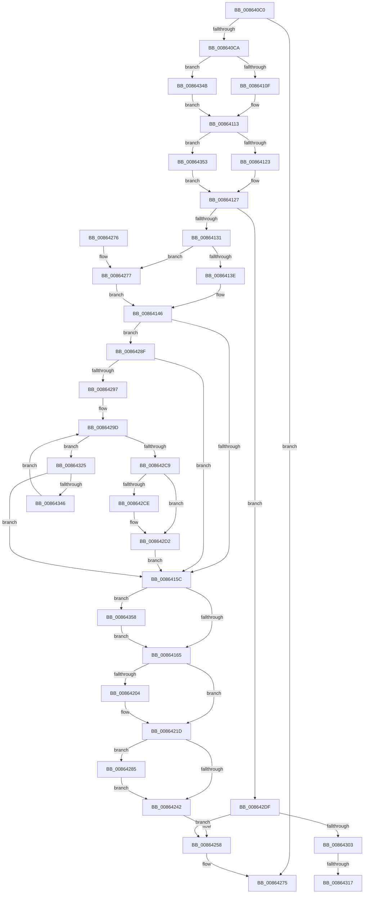

# IopCloseFile

- RVA: `0x008640C0`–`0x00864368` (길이 `680` bytes)
- VA: `0x00000001408640C0`
- 실행 섹션: `PAGE`
- PDB 이름 있음: `예`; PDB Function 태그: `예`
- unwind 정보 RVA: `0x0006B92C`
- 디코드: `167`개 명령, `680/680` bytes 표시
- 미해석 바이트: `0` (있으면 어셈블리에 `.byte`로 보존)

> 이 문서는 커널 이미지의 기계어와 PDB 기호를 분석해 생성했습니다. 4번과 5번은 함수 원형과 자료형을 바이너리 사용 방식에서 추정한 C 해석이며 원본 소스 복구 결과는 아닙니다.

## 1. Dependencies

- 직접 호출 지점: **20**; 고유 호출 대상: **18**
- 직접 호출자로 확인된 함수: **6**
- RIP 상대 이미지 참조: **0**

### Outgoing calls
- `0x00864141` → [IoGetRelatedDeviceObject](../../text/29/IoGetRelatedDeviceObject_function_0029B120.md) (function, `0x0029B120`)
- `0x00864170` → [KeInitializeEvent](../../text/40/KeInitializeEvent_function_0040DD10.md) (function, `0x0040DD10`)
- `0x00864178` → [IopResetEvent](../../text/29/IopResetEvent_function_0029D5F0.md) (function, `0x0029D5F0`)
- `0x00864184` → [IopAllocateIrpMustSucceed](../../text/20/IopAllocateIrpMustSucceed_function_002076C0.md) (function, `0x002076C0`)
- `0x008641D5` → [IopQueueThreadIrp](../../text/20/IopQueueThreadIrp_function_002075C0.md) (function, `0x002075C0`)
- `0x008641F8` → [IofCallDriver](../../text/29/IofCallDriver_function_0029B4B0.md) (function, `0x0029B4B0`)
- `0x00864218` → [KeWaitForSingleObject](../../text/20/KeWaitForSingleObject_function_0020E6B0.md) (function, `0x0020E6B0`)
- `0x00864230` → [IopDequeueIrpFromThread](../../text/20/IopDequeueIrpFromThread_function_00207B20.md) (function, `0x00207B20`)
- `0x00864238` → [IoFreeIrp](../../text/24/IoFreeIrp_function_0024DF70.md) (function, `0x0024DF70`)
- `0x0086424B` → [IopCleanupProcessResources](../9E/IopCleanupProcessResources_function_009E8850.md) (function, `0x009E8850`)
- `0x00864253` → [IopCloseFileObjectExtension](../../text/38/IopCloseFileObjectExtension_function_0038F6E0.md) (function, `0x0038F6E0`)
- `0x0086427B` → [IoGetAttachedDevice](../../text/41/IoGetAttachedDevice_function_00410810.md) (function, `0x00410810`)
- `0x00864288` → [IopReleaseFileObjectLock](../../text/25/IopReleaseFileObjectLock_function_00250A90.md) (function, `0x00250A90`)
- `0x008642BA` → [KeAbPreAcquire](../../text/21/KeAbPreAcquire_function_00210230.md) (function, `0x00210230`)
- `0x008642D5` → [ObfReferenceObject](../../text/20/ObfReferenceObject_function_0020FA20.md) (function, `0x0020FA20`)
- `0x008642E8` → [IopCleanupProcessResources](../9E/IopCleanupProcessResources_function_009E8850.md) (function, `0x009E8850`)
- `0x008642F6` → [IopSetLockOperationProcess](../../text/43/IopSetLockOperationProcess_function_00433740.md) (function, `0x00433740`)
- `0x0086431A` → [IoGetRelatedDeviceObject](../../text/29/IoGetRelatedDeviceObject_function_0029B120.md) (function, `0x0029B120`)
- `0x00864339` → [IopWaitAndAcquireFileObjectLock](../8A/IopWaitAndAcquireFileObjectLock_function_008AE6D8.md) (function, `0x008AE6D8`)
- `0x0086435E` → [IopFreeBandwidthContract](../AD/IopFreeBandwidthContract_function_00ADC7B4.md) (function, `0x00ADC7B4`)

### Direct callers
- [ObpDecrementHandleCount](ObpDecrementHandleCount_function_008632E0.md) at `0x008636B9`
- [sub_00863E45](Unknown_function_00863E45.md) at `0x00863E75`
- [ObCloseHandleTableEntry](ObCloseHandleTableEntry_function_00869E20.md) at `0x0086A457`
- [ObpCreateHandle](ObpCreateHandle_function_0086B950.md) at `0x0086D79F`
- [IopParseDevice](../89/IopParseDevice_function_0089E510.md) at `0x0089EF5B`
- [sub_00B19FF6](../B1/Unknown_function_00B19FF6.md) at `0x00B1A3DC`

### Static image references
- 디코드된 RIP-relative 메모리 참조가 없습니다.

## 2. Other-region calls and transfers

- 다른 실행 섹션으로 향하는 call: **16**
  - `0x00864141` → [IoGetRelatedDeviceObject](../../text/29/IoGetRelatedDeviceObject_function_0029B120.md) (`PAGE` → `.text`)
  - `0x00864170` → [KeInitializeEvent](../../text/40/KeInitializeEvent_function_0040DD10.md) (`PAGE` → `.text`)
  - `0x00864178` → [IopResetEvent](../../text/29/IopResetEvent_function_0029D5F0.md) (`PAGE` → `.text`)
  - `0x00864184` → [IopAllocateIrpMustSucceed](../../text/20/IopAllocateIrpMustSucceed_function_002076C0.md) (`PAGE` → `.text`)
  - `0x008641D5` → [IopQueueThreadIrp](../../text/20/IopQueueThreadIrp_function_002075C0.md) (`PAGE` → `.text`)
  - `0x008641F8` → [IofCallDriver](../../text/29/IofCallDriver_function_0029B4B0.md) (`PAGE` → `.text`)
  - `0x00864218` → [KeWaitForSingleObject](../../text/20/KeWaitForSingleObject_function_0020E6B0.md) (`PAGE` → `.text`)
  - `0x00864230` → [IopDequeueIrpFromThread](../../text/20/IopDequeueIrpFromThread_function_00207B20.md) (`PAGE` → `.text`)
  - `0x00864238` → [IoFreeIrp](../../text/24/IoFreeIrp_function_0024DF70.md) (`PAGE` → `.text`)
  - `0x00864253` → [IopCloseFileObjectExtension](../../text/38/IopCloseFileObjectExtension_function_0038F6E0.md) (`PAGE` → `.text`)
  - `0x0086427B` → [IoGetAttachedDevice](../../text/41/IoGetAttachedDevice_function_00410810.md) (`PAGE` → `.text`)
  - `0x00864288` → [IopReleaseFileObjectLock](../../text/25/IopReleaseFileObjectLock_function_00250A90.md) (`PAGE` → `.text`)
  - `0x008642BA` → [KeAbPreAcquire](../../text/21/KeAbPreAcquire_function_00210230.md) (`PAGE` → `.text`)
  - `0x008642D5` → [ObfReferenceObject](../../text/20/ObfReferenceObject_function_0020FA20.md) (`PAGE` → `.text`)
  - `0x008642F6` → [IopSetLockOperationProcess](../../text/43/IopSetLockOperationProcess_function_00433740.md) (`PAGE` → `.text`)
  - `0x0086431A` → [IoGetRelatedDeviceObject](../../text/29/IoGetRelatedDeviceObject_function_0029B120.md) (`PAGE` → `.text`)
- call이 아닌 외부 분기/꼬리 이동: **2**
  - `0x00864311` → [sub_00B174A6](../B1/Unknown_function_00B174A6.md) (`tail-transfer`)
  - `0x00864320` → [sub_00B174A6 + 0x9](../B1/Unknown_function_00B174A6.md) (`tail-transfer`)

## 3. Assembly (complete function range)

```asm
008640C0  49 83 F8 01                     cmp r8, 1
008640C4  0F 85 AB 01 00 00               jne 0x140864275
008640CA  48 89 5C 24 08                  mov qword ptr [rsp + 8], rbx
008640CF  48 89 74 24 10                  mov qword ptr [rsp + 0x10], rsi
008640D4  48 89 7C 24 20                  mov qword ptr [rsp + 0x20], rdi
008640D9  55                              push rbp
008640DA  41 54                           push r12
008640DC  41 55                           push r13
008640DE  41 56                           push r14
008640E0  41 57                           push r15
008640E2  48 8B EC                        mov rbp, rsp
008640E5  48 83 EC 60                     sub rsp, 0x60
008640E9  33 C0                           xor eax, eax
008640EB  45 33 FF                        xor r15d, r15d
008640EE  48 89 45 F8                     mov qword ptr [rbp - 8], rax
008640F2  0F 57 C0                        xorps xmm0, xmm0
008640F5  48 8B 82 D0 00 00 00            mov rax, qword ptr [rdx + 0xd0]
008640FC  48 8B FA                        mov rdi, rdx
008640FF  48 8B F1                        mov rsi, rcx
00864102  0F 11 45 E8                     movups xmmword ptr [rbp - 0x18], xmm0
00864106  48 85 C0                        test rax, rax
00864109  0F 84 3C 02 00 00               je 0x14086434b
0086410F  4C 8B 70 18                     mov r14, qword ptr [rax + 0x18]
00864113  48 8B 9A D0 00 00 00            mov rbx, qword ptr [rdx + 0xd0]
0086411A  48 85 DB                        test rbx, rbx
0086411D  0F 84 30 02 00 00               je 0x140864353
00864123  48 8B 5B 28                     mov rbx, qword ptr [rbx + 0x28]
00864127  49 83 F9 01                     cmp r9, 1
0086412B  0F 85 AE 01 00 00               jne 0x1408642df
00864131  F7 42 50 00 08 00 00            test dword ptr [rdx + 0x50], 0x800
00864138  0F 85 39 01 00 00               jne 0x140864277
0086413E  48 8B CF                        mov rcx, rdi
00864141  E8 DA 6F A3 FF                  call 0x14029b120
00864146  4C 8B E8                        mov r13, rax
00864149  8B 47 50                        mov eax, dword ptr [rdi + 0x50]
0086414C  0F BA E8 12                     bts eax, 0x12
00864150  89 47 50                        mov dword ptr [rdi + 0x50], eax
00864153  48 85 F6                        test rsi, rsi
00864156  0F 85 33 01 00 00               jne 0x14086428f
0086415C  48 85 DB                        test rbx, rbx
0086415F  0F 85 F3 01 00 00               jne 0x140864358
00864165  45 33 C0                        xor r8d, r8d
00864168  48 8D 4D E8                     lea rcx, [rbp - 0x18]
0086416C  41 8D 50 01                     lea edx, [r8 + 1]
00864170  E8 9B 9B BA FF                  call 0x14040dd10
00864175  48 8B CF                        mov rcx, rdi
00864178  E8 73 94 A3 FF                  call 0x14029d5f0
0086417D  41 8A 55 4C                     mov dl, byte ptr [r13 + 0x4c]
00864181  49 8B CD                        mov rcx, r13
00864184  E8 37 35 9A FF                  call 0x1402076c0
00864189  48 8B D8                        mov rbx, rax
0086418C  48 89 B8 C0 00 00 00            mov qword ptr [rax + 0xc0], rdi
00864193  65 48 8B 0C 25 88 01 00 00      mov rcx, qword ptr gs:[0x188]
0086419C  48 83 63 58 00                  and qword ptr [rbx + 0x58], 0
008641A1  48 89 88 98 00 00 00            mov qword ptr [rax + 0x98], rcx
008641A8  48 8D 4B 30                     lea rcx, [rbx + 0x30]
008641AC  48 89 4B 48                     mov qword ptr [rbx + 0x48], rcx
008641B0  48 8B 8B B8 00 00 00            mov rcx, qword ptr [rbx + 0xb8]
008641B7  C6 40 40 00                     mov byte ptr [rax + 0x40], 0
008641BB  48 8D 45 E8                     lea rax, [rbp - 0x18]
008641BF  48 89 43 50                     mov qword ptr [rbx + 0x50], rax
008641C3  C7 43 10 04 04 00 00            mov dword ptr [rbx + 0x10], 0x404
008641CA  C6 41 B8 12                     mov byte ptr [rcx - 0x48], 0x12
008641CE  48 89 79 E8                     mov qword ptr [rcx - 0x18], rdi
008641D2  48 8B CB                        mov rcx, rbx
008641D5  E8 E6 33 9A FF                  call 0x1402075c0
008641DA  65 48 8B 04 25 88 01 00 00      mov rax, qword ptr gs:[0x188]
008641E3  48 8B D3                        mov rdx, rbx
008641E6  49 8B CD                        mov rcx, r13
008641E9  48 FF 80 90 03 00 00            inc qword ptr [rax + 0x390]
008641F0  65 FF 04 25 E4 2E 00 00         inc dword ptr gs:[0x2ee4]
008641F8  E8 B3 72 A3 FF                  call 0x14029b4b0
008641FD  3D 03 01 00 00                  cmp eax, 0x103
00864202  75 19                           jne 0x14086421d
00864204  48 83 64 24 20 00               and qword ptr [rsp + 0x20], 0
0086420A  48 8D 4D E8                     lea rcx, [rbp - 0x18]
0086420E  45 33 C9                        xor r9d, r9d
00864211  45 33 C0                        xor r8d, r8d
00864214  41 8D 51 06                     lea edx, [r9 + 6]
00864218  E8 93 A4 9A FF                  call 0x14020e6b0
0086421D  65 48 8B 04 25 88 01 00 00      mov rax, qword ptr gs:[0x188]
00864226  48 8B CB                        mov rcx, rbx
00864229  48 89 83 98 00 00 00            mov qword ptr [rbx + 0x98], rax
00864230  E8 EB 38 9A FF                  call 0x140207b20
00864235  48 8B CB                        mov rcx, rbx
00864238  E8 33 9D 9E FF                  call 0x14024df70
0086423D  45 85 FF                        test r15d, r15d
00864240  75 43                           jne 0x140864285
00864242  4D 8B C6                        mov r8, r14
00864245  48 8B D6                        mov rdx, rsi
00864248  48 8B CF                        mov rcx, rdi
0086424B  E8 00 46 18 00                  call 0x1409e8850
00864250  48 8B CF                        mov rcx, rdi
00864253  E8 88 B4 B2 FF                  call 0x14038f6e0
00864258  4C 8D 5C 24 60                  lea r11, [rsp + 0x60]
0086425D  49 8B 5B 30                     mov rbx, qword ptr [r11 + 0x30]
00864261  49 8B 73 38                     mov rsi, qword ptr [r11 + 0x38]
00864265  49 8B 7B 48                     mov rdi, qword ptr [r11 + 0x48]
00864269  49 8B E3                        mov rsp, r11
0086426C  41 5F                           pop r15
0086426E  41 5E                           pop r14
00864270  41 5D                           pop r13
00864272  41 5C                           pop r12
00864274  5D                              pop rbp
00864275  C3                              ret
00864276  CC                              int3
00864277  48 8B 4A 08                     mov rcx, qword ptr [rdx + 8]
0086427B  E8 90 C5 BA FF                  call 0x140410810
00864280  E9 C1 FE FF FF                  jmp 0x140864146
00864285  48 8B CF                        mov rcx, rdi
00864288  E8 03 C8 9E FF                  call 0x140250a90
0086428D  EB B3                           jmp 0x140864242
0086428F  A8 02                           test al, 2
00864291  0F 84 C5 FE FF FF               je 0x14086415c
00864297  41 BF 01 00 00 00               mov r15d, 1
0086429D  65 48 8B 04 25 88 01 00 00      mov rax, qword ptr gs:[0x188]
008642A6  48 8D 8F 80 00 00 00            lea rcx, [rdi + 0x80]
008642AD  45 33 C0                        xor r8d, r8d
008642B0  33 D2                           xor edx, edx
008642B2  66 FF 88 E4 01 00 00            dec word ptr [rax + 0x1e4]
008642B9  90                              nop
008642BA  E8 71 BF 9A FF                  call 0x140210230
008642BF  41 8B CF                        mov ecx, r15d
008642C2  87 4F 74                        xchg dword ptr [rdi + 0x74], ecx
008642C5  85 C9                           test ecx, ecx
008642C7  75 5C                           jne 0x140864325
008642C9  48 85 C0                        test rax, rax
008642CC  74 04                           je 0x1408642d2
008642CE  44 88 78 0A                     mov byte ptr [rax + 0xa], r15b
008642D2  48 8B CF                        mov rcx, rdi
008642D5  E8 46 B7 9A FF                  call 0x14020fa20
008642DA  E9 7D FE FF FF                  jmp 0x14086415c
008642DF  4D 8B C6                        mov r8, r14
008642E2  48 8B D6                        mov rdx, rsi
008642E5  48 8B CF                        mov rcx, rdi
008642E8  E8 63 45 18 00                  call 0x1409e8850
008642ED  41 B0 01                        mov r8b, 1
008642F0  48 8B D6                        mov rdx, rsi
008642F3  48 8B CF                        mov rcx, rdi
008642F6  E8 45 F4 BC FF                  call 0x140433740
008642FB  85 C0                           test eax, eax
008642FD  0F 88 55 FF FF FF               js 0x140864258
00864303  F7 47 50 00 08 00 00            test dword ptr [rdi + 0x50], 0x800
0086430A  0F 57 C0                        xorps xmm0, xmm0
0086430D  0F 11 45 D8                     movups xmmword ptr [rbp - 0x28], xmm0
00864311  0F 85 8F 31 2B 00               jne 0x140b174a6
00864317  48 8B CF                        mov rcx, rdi
0086431A  E8 01 6E A3 FF                  call 0x14029b120
0086431F  90                              nop
00864320  E9 8A 31 2B 00                  jmp 0x140b174af
00864325  48 8D 4D D0                     lea rcx, [rbp - 0x30]
00864329  4C 8B C8                        mov r9, rax
0086432C  48 89 4C 24 20                  mov qword ptr [rsp + 0x20], rcx
00864331  45 33 C0                        xor r8d, r8d
00864334  48 8B CF                        mov rcx, rdi
00864337  33 D2                           xor edx, edx
00864339  E8 9A A3 04 00                  call 0x1408ae6d8
0086433E  85 C0                           test eax, eax
00864340  0F 84 16 FE FF FF               je 0x14086415c
00864346  E9 52 FF FF FF                  jmp 0x14086429d
0086434B  45 33 F6                        xor r14d, r14d
0086434E  E9 C0 FD FF FF                  jmp 0x140864113
00864353  E9 CF FD FF FF                  jmp 0x140864127
00864358  48 8B D3                        mov rdx, rbx
0086435B  48 8B CF                        mov rcx, rdi
0086435E  E8 51 84 27 00                  call 0x140adc7b4
00864363  E9 FD FD FF FF                  jmp 0x140864165
```

## 4. C-style interpretation (structured pseudocode)

```c
__int64 __fastcall IopCloseFile(__int64 a1, __int64 a2, __int64 a3, __int64 a4)
{
    __int64 result;
    __int64 v_r14;
    __int64 v_r15;
    __int64 v_rsp;
    unsigned __int64 v_stack_m28;
    unsigned __int64 v_stack_m30;
    unsigned __int64 v_stack_m40;
    unsigned __int64 v_stack_m50;
    unsigned __int64 v_stack_m58;
    unsigned __int64 v_stack_m68;
    unsigned __int64 v_stack_p10;
    unsigned __int64 v_stack_p20;
    unsigned __int64 v_stack_p8;

    if (a3 != 1) goto loc_00864275;
    v_stack_p8 = v_rbx;
    v_stack_p10 = v_rsi;
    v_stack_p20 = v_rdi;
    v_rsp = (v_rsp) - (96);
    result = 0;
    v_r15 = 0;
    v_stack_m30 = 0;
    v_stack_m40 = v_xmm0;
    if (*(unsigned __int64 *)(a2 + 208) == 0) goto loc_0086434B;
loc_00864113:
    if (*(unsigned __int64 *)(a2 + 208) == 0) goto loc_00864353;
loc_00864127:
    if (a4 != 1) goto loc_008642DF;
    if (((*(unsigned int *)(a2 + 80)) & (0x800ULL)) != 0) goto loc_00864277;
    result = IoGetRelatedDeviceObject(a2, a2, a3, a4);
loc_00864146:
    *(unsigned int *)(a2 + 80) = (unsigned int)((unsigned int)(*(unsigned int *)(a2 + 80)));
    if (a1 != 0) goto loc_0086428F;
loc_0086415C:
    if (*(unsigned __int64 *)(*(unsigned __int64 *)(a2 + 208) + 40) != 0) goto loc_00864358;
loc_00864165:
    a3 = 0;
    result = KeInitializeEvent(v_stack_m40, a3 + 1, a3, a4);
    result = IopResetEvent(a2, a3 + 1, a3, a4);
    result = IopAllocateIrpMustSucceed(result, *(unsigned __int8 *)(result + 76), a3, a4);
    *(unsigned __int64 *)(result + 192) = a2;
    *(unsigned __int64 *)(result + 152) = *(unsigned __int64 *)(gs_base + (0 + 392));
    *(unsigned __int64 *)(result + 72) = result + 48;
    *(unsigned __int8 *)(result + 64) = 0;
    *(unsigned __int64 *)(result + 80) = v_stack_m40;
    *(unsigned int *)(result + 16) = 0x404ULL;
    *(unsigned __int8 *)(*(unsigned __int64 *)(result + 184) - 72) = 18;
    *(unsigned __int64 *)(*(unsigned __int64 *)(result + 184) - 24) = a2;
    result = IopQueueThreadIrp(result, *(unsigned __int8 *)(result + 76), a3, a4);
    result = IofCallDriver(result, result, a3, a4);
    if (((unsigned int)(result)) == 259) {
        a1 = v_stack_m40;
        a4 = 0;
        a3 = 0;
        a2 = a4 + 6;
        result = KeWaitForSingleObject(a1, a2, a3, a4);
    }
    *(unsigned __int64 *)(result + 152) = *(unsigned __int64 *)(gs_base + (0 + 392));
    result = IopDequeueIrpFromThread(result, a2, a3, a4);
    result = IoFreeIrp(result, a2, a3, a4);
    if (0 != 0) goto loc_00864285;
loc_00864242:
    result = IopCleanupProcessResources(a2, a1, *(unsigned __int64 *)(*(unsigned __int64 *)(a2 + 208) + 24), a4);
    result = IopCloseFileObjectExtension(a2, a1, *(unsigned __int64 *)(*(unsigned __int64 *)(a2 + 208) + 24), a4);
loc_00864258:
loc_00864275:
    return result;
loc_00864277:
    result = IoGetAttachedDevice(*(unsigned __int64 *)(a1 + 8), a1, *(unsigned __int64 *)(*(unsigned __int64 *)(a2 + 208) + 24), a4);
    goto loc_00864146;
loc_00864285:
    result = IopReleaseFileObjectLock(*(unsigned __int64 *)(v_stack_m28 + 72), a1, *(unsigned __int64 *)(*(unsigned __int64 *)(a2 + 208) + 24), a4);
    goto loc_00864242;
loc_0086428F:
    if ((((unsigned __int8)(result)) & (2)) == 0) goto loc_0086415C;
loc_0086429D:
    a3 = 0;
    a2 = 0;
    result = KeAbPreAcquire(*(unsigned __int64 *)(v_stack_m28 + 72) + 128, a2, a3, a4);
    if (1 != 0) goto loc_00864325;
    if (result != 0) {
        *(unsigned __int8 *)(result + 10) = 1;
    }
    result = ObfReferenceObject(*(unsigned __int64 *)(v_stack_m28 + 72), a2, a3, a4);
    goto loc_0086415C;
loc_008642DF:
    result = IopCleanupProcessResources(*(unsigned __int64 *)(v_stack_m28 + 72), *(unsigned __int64 *)(v_stack_m28 + 56), *(unsigned __int64 *)(*(unsigned __int64 *)(a2 + 208) + 24), a4);
    result = IopSetLockOperationProcess(*(unsigned __int64 *)(v_stack_m28 + 72), *(unsigned __int64 *)(v_stack_m28 + 56), 1, a4);
    if (sign_flag) goto loc_00864258;
    v_stack_m50 = v_xmm0;
    result = IoGetRelatedDeviceObject(*(unsigned __int64 *)(v_stack_m28 + 72), *(unsigned __int64 *)(v_stack_m28 + 56), 1, a4);
loc_00864325:
    v_stack_m40 = v_stack_m58;
    a3 = 0;
    a2 = 0;
    result = IopWaitAndAcquireFileObjectLock(*(unsigned __int64 *)(v_stack_m28 + 72), a2, a3, result);
    if ((unsigned int)(result) == 0) goto loc_0086415C;
    goto loc_0086429D;
loc_0086434B:
    v_r14 = 0;
    goto loc_00864113;
loc_00864353:
    goto loc_00864127;
loc_00864358:
    result = IopFreeBandwidthContract(*(unsigned __int64 *)(v_stack_m28 + 72), *(unsigned __int64 *)(v_stack_m28 + 48), a3, result);
    goto loc_00864165;
}
```

## 5. (Beta) C Style

```c
int64_t IopCloseFile(int64_t Arg1, void *Arg2, int64_t Arg3, int64_t Arg4)
{
    uint8_t *arg2 = (uint8_t *)Arg2;

    int64_t result;
    int64_t local_r14;
    int64_t local_r15;
    int64_t local_rsp;
    uint64_t v_stack_m28;
    uint64_t v_stack_m30;
    uint64_t v_stack_m40;
    uint64_t v_stack_m50;
    uint64_t v_stack_m58;
    uint64_t v_stack_m68;
    uint64_t v_stack_p10;
    uint64_t v_stack_p20;
    uint64_t v_stack_p8;

    if (Arg3 != 1) goto loc_00864275;
    v_stack_p8 = local_rbx;
    v_stack_p10 = local_rsi;
    v_stack_p20 = local_rdi;
    local_rsp = (local_rsp) - (96);
    result = 0;
    local_r15 = 0;
    v_stack_m30 = 0;
    v_stack_m40 = v_xmm0;
    if (*(uint64_t *)(arg2 + 0xD0) == 0) goto loc_0086434B;
loc_00864113:
    if (*(uint64_t *)(arg2 + 0xD0) == 0) goto loc_00864353;
loc_00864127:
    if (Arg4 != 1) goto loc_008642DF;
    if (((*(uint32_t *)(arg2 + 0x50)) & (0x800ULL)) != 0) goto loc_00864277;
    result = IoGetRelatedDeviceObject(Arg2, Arg2, Arg3, Arg4);
loc_00864146:
    *(uint32_t *)(arg2 + 0x50) = (uint32_t)((uint32_t)(*(uint32_t *)(arg2 + 0x50)));
    if (Arg1 != 0) goto loc_0086428F;
loc_0086415C:
    if (*(uint64_t *)(*(uint64_t *)(arg2 + 0xD0) + 0x28) != 0) goto loc_00864358;
loc_00864165:
    Arg3 = 0;
    result = KeInitializeEvent(v_stack_m40, Arg3 + 1, Arg3, Arg4);
    result = IopResetEvent(Arg2, Arg3 + 1, Arg3, Arg4);
    result = IopAllocateIrpMustSucceed(result, *(uint8_t *)(result + 0x4C), Arg3, Arg4);
    *(void **)(result + 0xC0) = Arg2;
    *(uint64_t *)(result + 0x98) = *(uint64_t *)(gs_base + (0 + 0x188));
    *(uint64_t *)(result + 0x48) = result + 48;
    *(uint8_t *)(result + 0x40) = 0;
    *(uint64_t *)(result + 0x50) = v_stack_m40;
    *(uint32_t *)(result + 0x10) = 0x404ULL;
    *(uint8_t *)(*(uint64_t *)(result + 0xB8) - 0x48) = 18;
    *(void **)(*(uint64_t *)(result + 0xB8) - 0x18) = Arg2;
    result = IopQueueThreadIrp(result, *(uint8_t *)(result + 0x4C), Arg3, Arg4);
    result = IofCallDriver(result, result, Arg3, Arg4);
    if (((uint32_t)(result)) == 259) {
        Arg1 = v_stack_m40;
        Arg4 = 0;
        Arg3 = 0;
        Arg2 = Arg4 + 6;
        result = KeWaitForSingleObject(Arg1, Arg2, Arg3, Arg4);
    }
    *(uint64_t *)(result + 0x98) = *(uint64_t *)(gs_base + (0 + 0x188));
    result = IopDequeueIrpFromThread(result, Arg2, Arg3, Arg4);
    result = IoFreeIrp(result, Arg2, Arg3, Arg4);
    if (0 != 0) goto loc_00864285;
loc_00864242:
    result = IopCleanupProcessResources(Arg2, Arg1, *(uint64_t *)(*(uint64_t *)(arg2 + 0xD0) + 0x18), Arg4);
    result = IopCloseFileObjectExtension(Arg2, Arg1, *(uint64_t *)(*(uint64_t *)(arg2 + 0xD0) + 0x18), Arg4);
loc_00864258:
loc_00864275:
    return result;
loc_00864277:
    result = IoGetAttachedDevice(*(uint64_t *)(Arg1 + 0x8), Arg1, *(uint64_t *)(*(uint64_t *)(arg2 + 0xD0) + 0x18), Arg4);
    goto loc_00864146;
loc_00864285:
    result = IopReleaseFileObjectLock(*(uint64_t *)(v_stack_m28 + 0x48), Arg1, *(uint64_t *)(*(uint64_t *)(arg2 + 0xD0) + 0x18), Arg4);
    goto loc_00864242;
loc_0086428F:
    if ((((uint8_t)(result)) & (2)) == 0) goto loc_0086415C;
loc_0086429D:
    Arg3 = 0;
    Arg2 = 0;
    result = KeAbPreAcquire(*(uint64_t *)(v_stack_m28 + 0x48) + 128, Arg2, Arg3, Arg4);
    if (1 != 0) goto loc_00864325;
    if (result != 0) {
        *(uint8_t *)(result + 0xA) = 1;
    }
    result = ObfReferenceObject(*(uint64_t *)(v_stack_m28 + 0x48), Arg2, Arg3, Arg4);
    goto loc_0086415C;
loc_008642DF:
    result = IopCleanupProcessResources(*(uint64_t *)(v_stack_m28 + 0x48), *(uint64_t *)(v_stack_m28 + 0x38), *(uint64_t *)(*(uint64_t *)(arg2 + 0xD0) + 0x18), Arg4);
    result = IopSetLockOperationProcess(*(uint64_t *)(v_stack_m28 + 0x48), *(uint64_t *)(v_stack_m28 + 0x38), 1, Arg4);
    if (sign_flag) goto loc_00864258;
    v_stack_m50 = v_xmm0;
    result = IoGetRelatedDeviceObject(*(uint64_t *)(v_stack_m28 + 0x48), *(uint64_t *)(v_stack_m28 + 0x38), 1, Arg4);
loc_00864325:
    v_stack_m40 = v_stack_m58;
    Arg3 = 0;
    Arg2 = 0;
    result = IopWaitAndAcquireFileObjectLock(*(uint64_t *)(v_stack_m28 + 0x48), Arg2, Arg3, result);
    if ((uint32_t)(result) == 0) goto loc_0086415C;
    goto loc_0086429D;
loc_0086434B:
    local_r14 = 0;
    goto loc_00864113;
loc_00864353:
    goto loc_00864127;
loc_00864358:
    result = IopFreeBandwidthContract(*(uint64_t *)(v_stack_m28 + 0x48), *(uint64_t *)(v_stack_m28 + 0x30), Arg3, result);
    goto loc_00864165;
}
```

### 관측된 메모리 오프셋

구조체 형식이 확인되지 않은 접근은 인자 기준의 오프셋으로만 기록했습니다.

| 기준 인자 | 오프셋 표현 | 폭 (bit) | 접근 |
|---|---:|---:|---|
| `Arg2` | `+ 0x8` | `64` | `R` |
| `Arg2` | `+ 0x50` | `32` | `R` |
| `Arg2` | `+ 0x50` | `32` | `W` |
| `Arg2` | `+ 0x74` | `32` | `R/W` |
| `Arg2` | `+ 0x80` | `64` | `R` |
| `Arg2` | `+ 0xD0` | `64` | `R` |

## 6. Execution-region graph

[열기: 2D/3D 그래프와 함수 탐색 컨트롤 패널](../../../control-panel.html?section=page&rva=0x008640C0&view=graph)

- 2D 그래프는 위에서 아래로 흐르고, 3D 그래프는 빈 공간을 드래그해 회전합니다. Shift+드래그는 이동, 휠은 확대·축소, 함수 노드 선택은 대상 보고서 이동입니다.

### Static fallback


