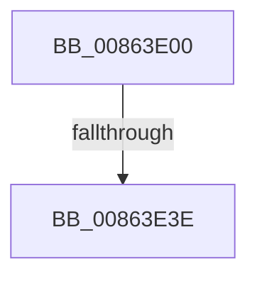

# IopDeleteFile

- RVA: `0x00863E00`–`0x00863E45` (길이 `69` bytes)
- VA: `0x0000000140863E00`
- 실행 섹션: `PAGE`
- PDB 이름 있음: `예`; PDB Function 태그: `아니요`
- unwind 정보 RVA: `0x0006B8A8`
- 디코드: `20`개 명령, `69/69` bytes 표시
- 미해석 바이트: `0` (있으면 어셈블리에 `.byte`로 보존)

> 이 문서는 커널 이미지의 기계어와 PDB 기호를 분석해 생성했습니다. 4번과 5번은 함수 원형과 자료형을 바이너리 사용 방식에서 추정한 C 해석이며 원본 소스 복구 결과는 아닙니다.

## 1. Dependencies

- 직접 호출 지점: **0**; 고유 호출 대상: **0**
- 직접 호출자로 확인된 함수: **1**
- RIP 상대 이미지 참조: **0**

### Outgoing calls
- 직접 디코드된 call 명령이 없습니다.

### Direct callers
- [ObpRemoveObjectRoutine](ObpRemoveObjectRoutine_function_00864A60.md) at `0x00864B53`

### Static image references
- 디코드된 RIP-relative 메모리 참조가 없습니다.

## 2. Other-region calls and transfers

- 다른 실행 섹션으로 향하는 call: **0**
- call이 아닌 외부 분기/꼬리 이동: **1**
  - `0x00863E38` → [sub_00863F57 + 0xCB](Unknown_function_00863F57.md) (`tail-transfer`)

## 3. Assembly (complete function range)

```asm
00863E00  48 89 5C 24 18                  mov qword ptr [rsp + 0x18], rbx
00863E05  55                              push rbp
00863E06  57                              push rdi
00863E07  41 54                           push r12
00863E09  41 56                           push r14
00863E0B  41 57                           push r15
00863E0D  48 83 EC 60                     sub rsp, 0x60
00863E11  45 33 E4                        xor r12d, r12d
00863E14  33 C0                           xor eax, eax
00863E16  48 8B D9                        mov rbx, rcx
00863E19  48 89 44 24 50                  mov qword ptr [rsp + 0x50], rax
00863E1E  48 8B 49 08                     mov rcx, qword ptr [rcx + 8]
00863E22  0F 57 C0                        xorps xmm0, xmm0
00863E25  0F 57 C9                        xorps xmm1, xmm1
00863E28  45 8B F4                        mov r14d, r12d
00863E2B  0F 11 44 24 30                  movups xmmword ptr [rsp + 0x30], xmm0
00863E30  0F 11 4C 24 40                  movups xmmword ptr [rsp + 0x40], xmm1
00863E35  48 85 C9                        test rcx, rcx
00863E38  0F 84 E4 01 00 00               je 0x140864022
00863E3E  F7 43 50 00 08 00 00            test dword ptr [rbx + 0x50], 0x800
```

## 4. C-style interpretation (structured pseudocode)

```c
__int64 __fastcall IopDeleteFile(__int64 a1)
{
    __int64 result;
    __int64 v_r12;
    __int64 v_rsp;
    unsigned __int64 v_stack_m38;
    unsigned __int64 v_stack_m48;
    unsigned __int64 v_stack_m58;
    unsigned __int64 v_stack_p18;

    v_stack_p18 = v_rbx;
    v_rsp = (v_rsp) - (96);
    v_r12 = 0;
    result = 0;
    v_stack_m38 = 0;
    v_stack_m58 = v_xmm0;
    v_stack_m48 = v_xmm1;
    return result;
}
```

## 5. (Beta) C Style

```c
int64_t IopDeleteFile(void *Arg1)
{
    uint8_t *arg1 = (uint8_t *)Arg1;

    int64_t result;
    int64_t local_r12;
    int64_t local_rsp;
    uint64_t v_stack_m38;
    uint64_t v_stack_m48;
    uint64_t v_stack_m58;
    uint64_t v_stack_p18;

    v_stack_p18 = local_rbx;
    local_rsp = (local_rsp) - (96);
    local_r12 = 0;
    result = 0;
    v_stack_m38 = 0;
    v_stack_m58 = v_xmm0;
    v_stack_m48 = v_xmm1;
    return result;
}
```

### 관측된 메모리 오프셋

구조체 형식이 확인되지 않은 접근은 인자 기준의 오프셋으로만 기록했습니다.

| 기준 인자 | 오프셋 표현 | 폭 (bit) | 접근 |
|---|---:|---:|---|
| `Arg1` | `+ 0x8` | `64` | `R` |
| `Arg1` | `+ 0x50` | `32` | `R` |

## 6. Execution-region graph

[열기: 2D/3D 그래프와 함수 탐색 컨트롤 패널](../../../control-panel.html?section=page&rva=0x00863E00&view=graph)

- 2D 그래프는 위에서 아래로 흐르고, 3D 그래프는 빈 공간을 드래그해 회전합니다. Shift+드래그는 이동, 휠은 확대·축소, 함수 노드 선택은 대상 보고서 이동입니다.

### Static fallback


