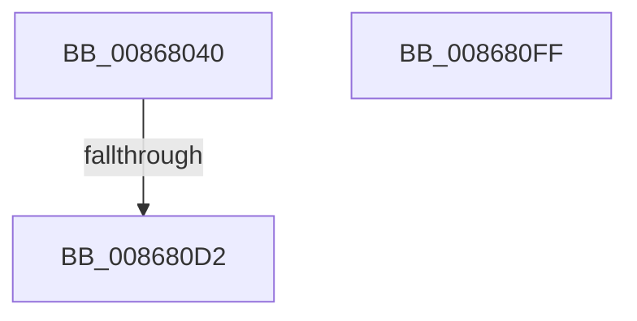

# NtAlpcSendWaitReceivePort

- RVA: `0x00868040`–`0x00868100` (길이 `192` bytes)
- VA: `0x0000000140868040`
- 실행 섹션: `PAGE`
- PDB 이름 있음: `예`; PDB Function 태그: `예`
- unwind 정보 RVA: `0x0006BCE4`
- 디코드: `50`개 명령, `192/192` bytes 표시
- 미해석 바이트: `0` (있으면 어셈블리에 `.byte`로 보존)

> 이 문서는 커널 이미지의 기계어와 PDB 기호를 분석해 생성했습니다. 4번과 5번은 함수 원형과 자료형을 바이너리 사용 방식에서 추정한 C 해석이며 원본 소스 복구 결과는 아닙니다.

## 1. Dependencies

- 직접 호출 지점: **2**; 고유 호출 대상: **2**
- 직접 호출자로 확인된 함수: **1**
- RIP 상대 이미지 참조: **1**

### Outgoing calls
- `0x008680C7` → [ObReferenceObjectByHandle](ObReferenceObjectByHandle_function_00868DB0.md) (function, `0x00868DB0`)
- `0x008680DB` → [KeLeaveCriticalRegionThread](../../text/25/KeLeaveCriticalRegionThread_function_0025EFF0.md) (function, `0x0025EFF0`)

### Direct callers
- [NtWaitForWorkViaWorkerFactory](../../text/39/NtWaitForWorkViaWorkerFactory_function_00394270.md) at `0x00394EB9`

### Static image references
- `0x008680A5` → RVA `0x00FC6C18` (`ALMOSTRO`; read)

## 2. Other-region calls and transfers

- 다른 실행 섹션으로 향하는 call: **1**
  - `0x008680DB` → [KeLeaveCriticalRegionThread](../../text/25/KeLeaveCriticalRegionThread_function_0025EFF0.md) (`PAGE` → `.text`)
- call이 아닌 외부 분기/꼬리 이동: **1**
  - `0x008680D0` → [sub_00868100](Unknown_function_00868100.md) (`tail-transfer`)

## 3. Assembly (complete function range)

```asm
00868040  48 8B C4                        mov rax, rsp
00868043  48 89 58 10                     mov qword ptr [rax + 0x10], rbx
00868047  48 89 70 18                     mov qword ptr [rax + 0x18], rsi
0086804B  57                              push rdi
0086804C  41 54                           push r12
0086804E  41 55                           push r13
00868050  41 56                           push r14
00868052  41 57                           push r15
00868054  48 81 EC A0 00 00 00            sub rsp, 0xa0
0086805B  0F 57 C0                        xorps xmm0, xmm0
0086805E  8B FA                           mov edi, edx
00868060  0F 11 40 98                     movups xmmword ptr [rax - 0x68], xmm0
00868064  45 33 ED                        xor r13d, r13d
00868067  4D 8B E1                        mov r12, r9
0086806A  0F 11 40 A8                     movups xmmword ptr [rax - 0x58], xmm0
0086806E  4D 8B F8                        mov r15, r8
00868071  BE 01 00 00 00                  mov esi, 1
00868076  0F 11 40 B8                     movups xmmword ptr [rax - 0x48], xmm0
0086807A  4C 89 6C 24 28                  mov qword ptr [rsp + 0x28], r13
0086807F  8B D6                           mov edx, esi
00868081  0F 11 40 C8                     movups xmmword ptr [rax - 0x38], xmm0
00868085  65 48 8B 04 25 88 01 00 00      mov rax, qword ptr gs:[0x188]
0086808E  81 E7 00 00 FF FF               and edi, 0xffff0000
00868094  66 FF 88 E4 01 00 00            dec word ptr [rax + 0x1e4]
0086809B  90                              nop
0086809C  65 48 8B 04 25 88 01 00 00      mov rax, qword ptr gs:[0x188]
008680A5  4C 8B 05 6C EB 75 00            mov r8, qword ptr [rip + 0x75eb6c]
008680AC  4C 89 6C 24 50                  mov qword ptr [rsp + 0x50], r13
008680B1  44 0F B6 B0 32 02 00 00         movzx r14d, byte ptr [rax + 0x232]
008680B9  48 8D 44 24 50                  lea rax, [rsp + 0x50]
008680BE  45 0F B6 CE                     movzx r9d, r14b
008680C2  48 89 44 24 20                  mov qword ptr [rsp + 0x20], rax
008680C7  E8 E4 0C 00 00                  call 0x140868db0
008680CC  8B D8                           mov ebx, eax
008680CE  85 C0                           test eax, eax
008680D0  79 2E                           jns 0x140868100
008680D2  65 48 8B 0C 25 88 01 00 00      mov rcx, qword ptr gs:[0x188]
008680DB  E8 10 6F 9F FF                  call 0x14025eff0
008680E0  4C 8D 9C 24 A0 00 00 00         lea r11, [rsp + 0xa0]
008680E8  8B C3                           mov eax, ebx
008680EA  49 8B 5B 38                     mov rbx, qword ptr [r11 + 0x38]
008680EE  49 8B 73 40                     mov rsi, qword ptr [r11 + 0x40]
008680F2  49 8B E3                        mov rsp, r11
008680F5  41 5F                           pop r15
008680F7  41 5E                           pop r14
008680F9  41 5D                           pop r13
008680FB  41 5C                           pop r12
008680FD  5F                              pop rdi
008680FE  C3                              ret
008680FF  CC                              int3
```

## 4. C-style interpretation (structured pseudocode)

```c
__int64 __fastcall NtAlpcSendWaitReceivePort(__int64 a1, int a2, __int64 a3, __int64 a4)
{
    __int64 result;
    __int64 v_r13;
    __int64 v_rdi;
    __int64 v_rsp;
    unsigned __int64 v_stack_m28;
    unsigned __int64 v_stack_m78;
    unsigned __int64 v_stack_mA0;
    unsigned __int64 v_stack_mA8;

    *(unsigned __int64 *)(v_rsp + 16) = v_rbx;
    *(unsigned __int64 *)(v_rsp + 24) = v_rsi;
    v_rsp = (v_rsp) - (160);
    *(unsigned __int64 *)(v_rsp - 104) = v_xmm0;
    v_r13 = 0;
    *(unsigned __int64 *)(v_rsp - 88) = v_xmm0;
    *(unsigned __int64 *)(v_rsp - 72) = v_xmm0;
    v_stack_mA0 = 0;
    *(unsigned __int64 *)(v_rsp - 56) = v_xmm0;
    v_rdi = (unsigned int)(((unsigned int)(a2)) & (0xFFFF0000ULL));
    v_stack_m78 = 0;
    v_stack_mA8 = v_stack_m78;
    result = ObReferenceObjectByHandle(a1, 1, *(unsigned __int64 *)(v_rip + 7727980), (unsigned __int8)(*(unsigned __int8 *)(*(unsigned __int64 *)(gs_base + (0 + 392)) + 562)));
    result = KeLeaveCriticalRegionThread(*(unsigned __int64 *)(gs_base + (0 + 392)), 1, *(unsigned __int64 *)(v_rip + 7727980), (unsigned __int8)(*(unsigned __int8 *)(*(unsigned __int64 *)(gs_base + (0 + 392)) + 562)));
    return (unsigned int)((unsigned int)((unsigned int)((unsigned int)(result))));
}
```

## 5. (Beta) C Style

```c
int64_t NtAlpcSendWaitReceivePort(int64_t Arg1, int32_t Arg2, int64_t Arg3, int64_t Arg4)
{
    int64_t result;
    int64_t local_r13;
    int64_t local_rdi;
    int64_t local_rsp;
    uint64_t v_stack_m28;
    uint64_t v_stack_m78;
    uint64_t v_stack_mA0;
    uint64_t v_stack_mA8;

    *(uint64_t *)(local_rsp + 0x10) = local_rbx;
    *(uint64_t *)(local_rsp + 0x18) = local_rsi;
    local_rsp = (local_rsp) - (160);
    *(uint64_t *)(local_rsp - 0x68) = v_xmm0;
    local_r13 = 0;
    *(uint64_t *)(local_rsp - 0x58) = v_xmm0;
    *(uint64_t *)(local_rsp - 0x48) = v_xmm0;
    v_stack_mA0 = 0;
    *(uint64_t *)(local_rsp - 0x38) = v_xmm0;
    local_rdi = (uint32_t)(((uint32_t)(Arg2)) & (0xFFFF0000ULL));
    v_stack_m78 = 0;
    v_stack_mA8 = v_stack_m78;
    result = ObReferenceObjectByHandle(Arg1, 1, *(uint64_t *)(v_rip + 0x75EB6C), (uint8_t)(*(uint8_t *)(*(uint64_t *)(gs_base + (0 + 0x188)) + 0x232)));
    result = KeLeaveCriticalRegionThread(*(uint64_t *)(gs_base + (0 + 0x188)), 1, *(uint64_t *)(v_rip + 0x75EB6C), (uint8_t)(*(uint8_t *)(*(uint64_t *)(gs_base + (0 + 0x188)) + 0x232)));
    return (uint32_t)((uint32_t)((uint32_t)((uint32_t)(result))));
}
```

## 6. Execution-region graph

[열기: 2D/3D 그래프와 함수 탐색 컨트롤 패널](../../../control-panel.html?section=page&rva=0x00868040&view=graph)

- 2D 그래프는 위에서 아래로 흐르고, 3D 그래프는 빈 공간을 드래그해 회전합니다. Shift+드래그는 이동, 휠은 확대·축소, 함수 노드 선택은 대상 보고서 이동입니다.

### Static fallback


