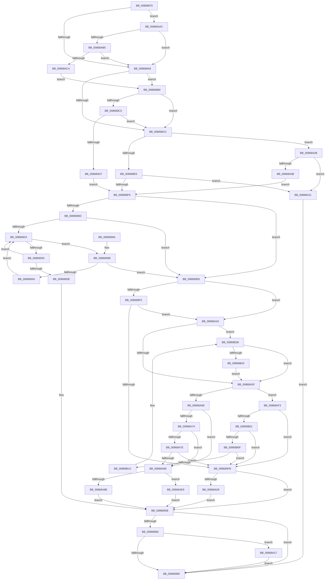

# NtClose

- RVA: `0x00868870`–`0x00868B57` (길이 `743` bytes)
- VA: `0x0000000140868870`
- 실행 섹션: `PAGE`
- PDB 이름 있음: `예`; PDB Function 태그: `아니요`
- unwind 정보 RVA: `0x0006BDC8`
- 디코드: `174`개 명령, `743/743` bytes 표시
- 미해석 바이트: `0` (있으면 어셈블리에 `.byte`로 보존)

> 이 문서는 커널 이미지의 기계어와 PDB 기호를 분석해 생성했습니다. 4번과 5번은 함수 원형과 자료형을 바이너리 사용 방식에서 추정한 C 해석이며 원본 소스 복구 결과는 아닙니다.

## 1. Dependencies

- 직접 호출 지점: **12**; 고유 호출 대상: **12**
- 직접 호출자로 확인된 함수: **51**
- RIP 상대 이미지 참조: **5**

### Outgoing calls
- `0x00868913` → [ExpLookupHandleTableEntry](ExpLookupHandleTableEntry_function_00869DB0.md) (function, `0x00869DB0`)
- `0x00868954` → [ObCloseHandleTableEntry](ObCloseHandleTableEntry_function_00869E20.md) (function, `0x00869E20`)
- `0x008689A6` → [ExpBlockOnLockedHandleEntry](ExpBlockOnLockedHandleEntry_function_00868838.md) (function, `0x00868838`)
- `0x008689EB` → [KeLeaveCriticalRegionThread](../../text/25/KeLeaveCriticalRegionThread_function_0025EFF0.md) (function, `0x0025EFF0`)
- `0x00868A17` → [ExfReleaseRundownProtection](../../text/34/ExfReleaseRundownProtection_function_00349EB0.md) (function, `0x00349EB0`)
- `0x00868A2E` → [ObReferenceProcessHandleTable](../89/ObReferenceProcessHandleTable_function_00893B70.md) (function, `0x00893B70`)
- `0x00868A50` → [ExQueryHandleExceptionsPermanency](../../text/45/ExQueryHandleExceptionsPermanency_function_00458CE0.md) (function, `0x00458CE0`)
- `0x00868AA0` → [KeRaiseUserException](../../text/4D/KeRaiseUserException_function_004D7750.md) (function, `0x004D7750`)
- `0x00868AB7` → [ObpIsKernelHandle](../../text/41/ObpIsKernelHandle_function_00416D00.md) (function, `0x00416D00`)
- `0x00868AC4` → [VfCheckUserHandle](../../pagevrfy/BB/VfCheckUserHandle_function_00BB9218.md) (function, `0x00BB9218`)
- `0x00868B32` → [KeBugCheckEx](../../text/4F/KeBugCheckEx_function_004FD660.md) (function, `0x004FD660`)
- `0x00868B4D` → [ExHandleLogBadReference](../../text/44/ExHandleLogBadReference_function_00440580.md) (function, `0x00440580`)

### Direct callers
- [SepRmCallLsa](../../text/22/SepRmCallLsa_function_00223630.md) at `0x002238D4`
- [RtlQueryValidationRunlevel](../../text/5E/RtlQueryValidationRunlevel_function_005EE220.md) at `0x005EE2C4`
- [RtlpMuiRegLoadInstalledFromKey](../../text/6A/RtlpMuiRegLoadInstalledFromKey_function_006A9450.md) at `0x006A9631`
- [RtlpMuiRegLoadInstalledFromKey](../../text/6A/RtlpMuiRegLoadInstalledFromKey_function_006A9450.md) at `0x006A964D`
- [RtlpRemovePendingDeleteLanguages](../../text/6A/RtlpRemovePendingDeleteLanguages_function_006A9684.md) at `0x006A97C6`
- [IopConnectLinkTrackingPort](../71/IopConnectLinkTrackingPort_function_0071B050.md) at `0x0071B14A`
- [IopConnectLinkTrackingPort](../71/IopConnectLinkTrackingPort_function_0071B050.md) at `0x0071B151`
- [PopEtEnergyTrackerCreate](../76/PopEtEnergyTrackerCreate_function_00769EE0.md) at `0x0076A19C`
- [NtCreateProcessStateChange](../78/NtCreateProcessStateChange_function_007830C0.md) at `0x0078323B`
- [RtlInitFunctionalityCache](../78/RtlInitFunctionalityCache_function_0078A5F8.md) at `0x0078A6F6`
- [RtlCreateSystemVolumeInformationFolder](../79/RtlCreateSystemVolumeInformationFolder_function_00791010.md) at `0x007911E9`
- [RtlCreateSystemVolumeInformationFolder](../79/RtlCreateSystemVolumeInformationFolder_function_00791010.md) at `0x007912F0`
- [RtlpSysVolTakeOwnership](../79/RtlpSysVolTakeOwnership_function_007917C8.md) at `0x0079194C`
- [RtlpSysVolTakeOwnership](../79/RtlpSysVolTakeOwnership_function_007917C8.md) at `0x00791955`
- [EtwpSetCoverageSamplerInformation](../7C/EtwpSetCoverageSamplerInformation_function_007C288C.md) at `0x007C3020`
- [ExpWatchLicenseInfoWork](../7C/ExpWatchLicenseInfoWork_function_007C6DB0.md) at `0x007C6E59`
- [ExpWatchLicenseInfoWork](../7C/ExpWatchLicenseInfoWork_function_007C6DB0.md) at `0x007C70EC`
- [NtOpenRegistryTransaction](../7D/NtOpenRegistryTransaction_function_007DFE40.md) at `0x007DFF40`
- [CmpInitializeLazyWriters](../7E/CmpInitializeLazyWriters_function_007EEF34.md) at `0x007EEFEC`
- [CmpHiveCacheEntryCleanup](../7F/CmpHiveCacheEntryCleanup_function_007F5B38.md) at `0x007F5CAF`
- [AdtpObjsInitialize](../82/AdtpObjsInitialize_function_00822B30.md) at `0x00822E59`
- [AdtpObjsInitialize](../82/AdtpObjsInitialize_function_00822B30.md) at `0x00822FD1`
- [AdtpObjsInitialize](../82/AdtpObjsInitialize_function_00822B30.md) at `0x00822FED`
- [AdtpInitializeDriveLetters](../82/AdtpInitializeDriveLetters_function_00823058.md) at `0x00823172`
- [AdtpInitializeDriveLetters](../82/AdtpInitializeDriveLetters_function_00823058.md) at `0x00823270`
- [RtlpLoadLanguageConfigList](../83/RtlpLoadLanguageConfigList_function_0083D450.md) at `0x0083D4DD`
- [RtlpLoadLanguageConfigList](../83/RtlpLoadLanguageConfigList_function_0083D450.md) at `0x0083D537`
- [CmOpenKey](../87/CmOpenKey_function_00876350.md) at `0x008765D3`
- [sub_008A9240](../8A/Unknown_function_008A9240.md) at `0x008A9240`
- [PfSnGetSectionObject](../8A/PfSnGetSectionObject_function_008A9448.md) at `0x008A97E3`
- [PfSnOpenVolumesForPrefetch](../8A/PfSnOpenVolumesForPrefetch_function_008AA4AC.md) at `0x008AA90A`
- [PfSnIsVolumeMounted](../8A/PfSnIsVolumeMounted_function_008AAACC.md) at `0x008AABDB`
- [PfSnGetPrefetchInstructions](../8A/PfSnGetPrefetchInstructions_function_008AEBE4.md) at `0x008AEE70`
- [ObDuplicateObject](../8C/ObDuplicateObject_function_008C4FA0.md) at `0x008C5363`
- [ObDuplicateObject](../8C/ObDuplicateObject_function_008C4FA0.md) at `0x008C579D`
- [ObDuplicateObject](../8C/ObDuplicateObject_function_008C4FA0.md) at `0x008C5EB6`
- [NtSecureConnectPort](../92/NtSecureConnectPort_function_00922F20.md) at `0x0092352C`
- [AlpcpConnectPort](../92/AlpcpConnectPort_function_00926C8C.md) at `0x00926FCF`
- [PfpVolumeOpenAndVerify](../93/PfpVolumeOpenAndVerify_function_009381F4.md) at `0x0093837A`
- [PfpVolumeOpenAndVerify](../93/PfpVolumeOpenAndVerify_function_009381F4.md) at `0x0093858D`
- [PfpPrefetchPrivatePages](../93/PfpPrefetchPrivatePages_function_0093A7FC.md) at `0x0093AA6B`
- [PfpFileBuildReadSupport](../93/PfpFileBuildReadSupport_function_0093B504.md) at `0x0093B8C0`
- [PfpReadSupportCleanup](../93/PfpReadSupportCleanup_function_0093B8E0.md) at `0x0093B8F9`
- [PfSnPrefetchMetadata](../93/PfSnPrefetchMetadata_function_0093B9B4.md) at `0x0093BC52`
- [PnpPrepareDriverLoading](../99/PnpPrepareDriverLoading_function_00996CC8.md) at `0x00996E15`
- [AlpcpCreateConnectionPort](../9E/AlpcpCreateConnectionPort_function_009E70B0.md) at `0x009E727B`
- [AlpcpAcceptConnectPort](../A3/AlpcpAcceptConnectPort_function_00A34290.md) at `0x00A34D50`
- [NtCreateRegistryTransaction](../A6/NtCreateRegistryTransaction_function_00A61370.md) at `0x00A61522`
- [NtCreateThreadStateChange](../A7/NtCreateThreadStateChange_function_00A77110.md) at `0x00A772C5`
- [PfpSourceGetPrefetchSupport](../AC/PfpSourceGetPrefetchSupport_function_00ACF6C0.md) at `0x00ACF801`
- [NtQueryInformationToken](../AE/NtQueryInformationToken_function_00AECDD0.md) at `0x00AED7A6`
- [NtQueryInformationToken](../AE/NtQueryInformationToken_function_00AECDD0.md) at `0x00AEEA3E`
- [sub_00C18CD4](../../init/C1/Unknown_function_00C18CD4.md) at `0x00C19091`
- [CreateSystemRootLink](../../init/C1/CreateSystemRootLink_function_00C1AA18.md) at `0x00C1AAEA`
- [CreateSystemRootLink](../../init/C1/CreateSystemRootLink_function_00C1AA18.md) at `0x00C1AB5D`
- [CreateSystemRootLink](../../init/C1/CreateSystemRootLink_function_00C1AA18.md) at `0x00C1AC20`
- [CreateSystemRootLink](../../init/C1/CreateSystemRootLink_function_00C1AA18.md) at `0x00C1ACF3`
- [CreateSystemRootLink](../../init/C1/CreateSystemRootLink_function_00C1AA18.md) at `0x00C1ADBC`
- [CreateSystemRootLink](../../init/C1/CreateSystemRootLink_function_00C1AA18.md) at `0x00C1AE45`
- [InitSafeBoot](../../init/C1/InitSafeBoot_function_00C1BFE0.md) at `0x00C1C11B`
- [InitSafeBoot](../../init/C1/InitSafeBoot_function_00C1BFE0.md) at `0x00C1C19D`
- [FsRtlInitializeSmssEvent](../../init/C2/FsRtlInitializeSmssEvent_function_00C29030.md) at `0x00C290D0`
- [IopInitCrashDumpRegCallback](../../init/C2/IopInitCrashDumpRegCallback_function_00C2CC80.md) at `0x00C2CDAE`
- [IopApplySystemPartitionProt](../../init/C2/IopApplySystemPartitionProt_function_00C2E398.md) at `0x00C2E5AC`
- [IopProtectSystemPartition](../../init/C2/IopProtectSystemPartition_function_00C2E5EC.md) at `0x00C2E6C7`
- [SepAdtInitializeAuditingOptions](../../init/C4/SepAdtInitializeAuditingOptions_function_00C4BC1C.md) at `0x00C4BC52`
- [ExpWatchProductTypeInitialization](../../init/C5/ExpWatchProductTypeInitialization_function_00C52170.md) at `0x00C52B67`
- [ExpInitializeCallbacks](../../init/C5/ExpInitializeCallbacks_function_00C532CC.md) at `0x00C533FB`
- [ObInitSystem](../../init/C7/ObInitSystem_function_00C71C7C.md) at `0x00C7223C`
- [IopInitializeBuiltinDriver](../../init/C7/IopInitializeBuiltinDriver_function_00C7625C.md) at `0x00C765B9`
- [IopInitializeBuiltinDriver](../../init/C7/IopInitializeBuiltinDriver_function_00C7625C.md) at `0x00C766BB`

### Static image references
- `0x00868890` → RVA `0x00F04A20` (`.data`; read)
- `0x008688EC` → RVA `0x00F0F5B8` (`.data`; read)
- `0x008689D9` → RVA `0x00FC6AB0` (`ALMOSTRO`; read)
- `0x00868A68` → RVA `0x00FC42C0` (`.data`; read)
- `0x00868B0F` → RVA `0x00F475F8` (`.data`; read)

## 2. Other-region calls and transfers

- 다른 실행 섹션으로 향하는 call: **8**
  - `0x008689EB` → [KeLeaveCriticalRegionThread](../../text/25/KeLeaveCriticalRegionThread_function_0025EFF0.md) (`PAGE` → `.text`)
  - `0x00868A17` → [ExfReleaseRundownProtection](../../text/34/ExfReleaseRundownProtection_function_00349EB0.md) (`PAGE` → `.text`)
  - `0x00868A50` → [ExQueryHandleExceptionsPermanency](../../text/45/ExQueryHandleExceptionsPermanency_function_00458CE0.md) (`PAGE` → `.text`)
  - `0x00868AA0` → [KeRaiseUserException](../../text/4D/KeRaiseUserException_function_004D7750.md) (`PAGE` → `.text`)
  - `0x00868AB7` → [ObpIsKernelHandle](../../text/41/ObpIsKernelHandle_function_00416D00.md) (`PAGE` → `.text`)
  - `0x00868AC4` → [VfCheckUserHandle](../../pagevrfy/BB/VfCheckUserHandle_function_00BB9218.md) (`PAGE` → `PAGEVRFY`)
  - `0x00868B32` → [KeBugCheckEx](../../text/4F/KeBugCheckEx_function_004FD660.md) (`PAGE` → `.text`)
  - `0x00868B4D` → [ExHandleLogBadReference](../../text/44/ExHandleLogBadReference_function_00440580.md) (`PAGE` → `.text`)
- 별도 외부 분기/꼬리 이동을 확인하지 못했습니다.

## 3. Assembly (complete function range)

```asm
00868870  48 89 5C 24 18                  mov qword ptr [rsp + 0x18], rbx
00868875  55                              push rbp
00868876  56                              push rsi
00868877  57                              push rdi
00868878  41 54                           push r12
0086887A  41 55                           push r13
0086887C  41 56                           push r14
0086887E  41 57                           push r15
00868880  48 83 EC 30                     sub rsp, 0x30
00868884  65 48 8B 04 25 88 01 00 00      mov rax, qword ptr gs:[0x188]
0086888D  48 8B D9                        mov rbx, rcx
00868890  F7 05 86 C1 69 00 00 01 00 00   test dword ptr [rip + 0x69c186], 0x100
0086889A  44 0F B6 B8 32 02 00 00         movzx r15d, byte ptr [rax + 0x232]
008688A2  0F 85 04 02 00 00               jne 0x140868aac
008688A8  65 48 8B 2C 25 88 01 00 00      mov rbp, qword ptr gs:[0x188]
008688B1  45 32 E4                        xor r12b, r12b
008688B4  C6 44 24 70 00                  mov byte ptr [rsp + 0x70], 0
008688B9  48 8B F3                        mov rsi, rbx
008688BC  4C 8B B5 B8 00 00 00            mov r14, qword ptr [rbp + 0xb8]
008688C3  45 84 FF                        test r15b, r15b
008688C6  0F 84 E4 00 00 00               je 0x1408689b0
008688CC  65 48 8B 04 25 88 01 00 00      mov rax, qword ptr gs:[0x188]
008688D5  4D 8B EE                        mov r13, r14
008688D8  80 B8 4A 02 00 00 01            cmp byte ptr [rax + 0x24a], 1
008688DF  0F 84 46 01 00 00               je 0x140868a2b
008688E5  49 8B BE 00 03 00 00            mov rdi, qword ptr [r14 + 0x300]
008688EC  48 3B 3D C5 6C 6A 00            cmp rdi, qword ptr [rip + 0x6a6cc5]
008688F3  0F 84 28 01 00 00               je 0x140868a21
008688F9  66 FF 8D E4 01 00 00            dec word ptr [rbp + 0x1e4]
00868900  90                              nop
00868901  F7 C6 FC 03 00 00               test esi, 0x3fc
00868907  0F 84 DB 00 00 00               je 0x1408689e8
0086890D  48 8B D6                        mov rdx, rsi
00868910  48 8B CF                        mov rcx, rdi
00868913  E8 98 14 00 00                  call 0x140869db0
00868918  48 8B D8                        mov rbx, rax
0086891B  48 85 C0                        test rax, rax
0086891E  0F 84 C4 00 00 00               je 0x1408689e8
00868924  0F 0D 0B                        prefetchw byte ptr [rbx]
00868927  4C 8B 03                        mov r8, qword ptr [rbx]
0086892A  41 F6 C0 01                     test r8b, 1
0086892E  74 6B                           je 0x14086899b
00868930  49 8D 48 FF                     lea rcx, [r8 - 1]
00868934  49 8B C0                        mov rax, r8
00868937  F0 48 0F B1 0B                  lock cmpxchg qword ptr [rbx], rcx
0086893C  75 E6                           jne 0x140868924
0086893E  C6 44 24 28 00                  mov byte ptr [rsp + 0x28], 0
00868943  4C 8B CE                        mov r9, rsi
00868946  4D 8B C5                        mov r8, r13
00868949  44 88 7C 24 20                  mov byte ptr [rsp + 0x20], r15b
0086894E  48 8B D3                        mov rdx, rbx
00868951  48 8B CF                        mov rcx, rdi
00868954  E8 C7 14 00 00                  call 0x140869e20
00868959  8B D8                           mov ebx, eax
0086895B  45 84 E4                        test r12b, r12b
0086895E  74 20                           je 0x140868980
00868960  49 8D 8D E8 01 00 00            lea rcx, [r13 + 0x1e8]
00868967  0F 0D 09                        prefetchw byte ptr [rcx]
0086896A  48 8B 01                        mov rax, qword ptr [rcx]
0086896D  48 83 E0 FE                     and rax, 0xfffffffffffffffe
00868971  48 8D 50 FE                     lea rdx, [rax - 2]
00868975  F0 48 0F B1 11                  lock cmpxchg qword ptr [rcx], rdx
0086897A  0F 85 97 00 00 00               jne 0x140868a17
00868980  8B C3                           mov eax, ebx
00868982  48 8B 9C 24 80 00 00 00         mov rbx, qword ptr [rsp + 0x80]
0086898A  48 83 C4 30                     add rsp, 0x30
0086898E  41 5F                           pop r15
00868990  41 5E                           pop r14
00868992  41 5D                           pop r13
00868994  41 5C                           pop r12
00868996  5F                              pop rdi
00868997  5E                              pop rsi
00868998  5D                              pop rbp
00868999  C3                              ret
0086899A  CC                              int3
0086899B  4D 85 C0                        test r8, r8
0086899E  74 48                           je 0x1408689e8
008689A0  48 8B D3                        mov rdx, rbx
008689A3  48 8B CF                        mov rcx, rdi
008689A6  E8 8D FE FF FF                  call 0x140868838
008689AB  E9 74 FF FF FF                  jmp 0x140868924
008689B0  48 8B C3                        mov rax, rbx
008689B3  48 25 00 00 00 80               and rax, 0xffffffff80000000
008689B9  48 3D 00 00 00 80               cmp rax, -0x80000000
008689BF  0F 85 07 FF FF FF               jne 0x1408688cc
008689C5  48 83 FB FD                     cmp rbx, -3
008689C9  0F 87 FD FE FF FF               ja 0x1408688cc
008689CF  48 8B 3D E2 6B 6A 00            mov rdi, qword ptr [rip + 0x6a6be2]
008689D6  48 8B F3                        mov rsi, rbx
008689D9  4C 8B 2D D0 E0 75 00            mov r13, qword ptr [rip + 0x75e0d0]
008689E0  48 33 F0                        xor rsi, rax
008689E3  E9 11 FF FF FF                  jmp 0x1408688f9
008689E8  48 8B CD                        mov rcx, rbp
008689EB  E8 00 66 9F FF                  call 0x14025eff0
008689F0  48 85 F6                        test rsi, rsi
008689F3  7F 4E                           jg 0x140868a43
008689F5  48 83 FE FA                     cmp rsi, -6
008689F9  7C 48                           jl 0x140868a43
008689FB  BB 08 00 00 C0                  mov ebx, 0xc0000008
00868A00  48 85 F6                        test rsi, rsi
00868A03  0F 89 52 FF FF FF               jns 0x14086895b
00868A09  33 C0                           xor eax, eax
00868A0B  48 83 FE FA                     cmp rsi, -6
00868A0F  0F 4D D8                        cmovge ebx, eax
00868A12  E9 44 FF FF FF                  jmp 0x14086895b
00868A17  E8 94 14 AE FF                  call 0x140349eb0
00868A1C  E9 5F FF FF FF                  jmp 0x140868980
00868A21  BB 08 00 00 C0                  mov ebx, 0xc0000008
00868A26  E9 55 FF FF FF                  jmp 0x140868980
00868A2B  49 8B CE                        mov rcx, r14
00868A2E  E8 3D B1 02 00                  call 0x140893b70
00868A33  48 8B F8                        mov rdi, rax
00868A36  48 85 C0                        test rax, rax
00868A39  74 E6                           je 0x140868a21
00868A3B  41 B4 01                        mov r12b, 1
00868A3E  E9 B6 FE FF FF                  jmp 0x1408688f9
00868A43  4C 8D 44 24 70                  lea r8, [rsp + 0x70]
00868A48  48 8B CF                        mov rcx, rdi
00868A4B  48 8D 54 24 78                  lea rdx, [rsp + 0x78]
00868A50  E8 8B 02 BF FF                  call 0x140458ce0
00868A55  F6 47 2C 10                     test byte ptr [rdi + 0x2c], 0x10
00868A59  0F 85 D9 00 00 00               jne 0x140868b38
00868A5F  45 84 FF                        test r15b, r15b
00868A62  0F 84 8B 00 00 00               je 0x140868af3
00868A68  F7 05 4E B8 75 00 00 00 40 00   test dword ptr [rip + 0x75b84e], 0x400000
00868A72  75 15                           jne 0x140868a89
00868A74  49 83 BE 08 03 00 00 00         cmp qword ptr [r14 + 0x308], 0
00868A7C  75 0B                           jne 0x140868a89
00868A7E  48 83 7F 60 00                  cmp qword ptr [rdi + 0x60], 0
00868A83  0F 84 72 FF FF FF               je 0x1408689fb
00868A89  65 48 8B 04 25 88 01 00 00      mov rax, qword ptr gs:[0x188]
00868A92  80 B8 4A 02 00 00 01            cmp byte ptr [rax + 0x24a], 1
00868A99  74 4E                           je 0x140868ae9
00868A9B  B9 08 00 00 C0                  mov ecx, 0xc0000008
00868AA0  E8 AB EC C6 FF                  call 0x1404d7750
00868AA5  8B D8                           mov ebx, eax
00868AA7  E9 AF FE FF FF                  jmp 0x14086895b
00868AAC  45 84 FF                        test r15b, r15b
00868AAF  0F 85 F3 FD FF FF               jne 0x1408688a8
00868AB5  33 D2                           xor edx, edx
00868AB7  E8 44 E2 BA FF                  call 0x140416d00
00868ABC  84 C0                           test al, al
00868ABE  0F 85 E4 FD FF FF               jne 0x1408688a8
00868AC4  E8 4F 07 35 00                  call 0x140bb9218
00868AC9  65 48 8B 2C 25 88 01 00 00      mov rbp, qword ptr gs:[0x188]
00868AD2  48 8B F3                        mov rsi, rbx
00868AD5  44 88 7C 24 70                  mov byte ptr [rsp + 0x70], r15b
00868ADA  45 32 E4                        xor r12b, r12b
00868ADD  4C 8B B5 B8 00 00 00            mov r14, qword ptr [rbp + 0xb8]
00868AE4  E9 C7 FE FF FF                  jmp 0x1408689b0
00868AE9  BB 08 00 00 C0                  mov ebx, 0xc0000008
00868AEE  E9 68 FE FF FF                  jmp 0x14086895b
00868AF3  8B 85 A0 05 00 00               mov eax, dword ptr [rbp + 0x5a0]
00868AF9  A8 01                           test al, 1
00868AFB  0F 85 FA FE FF FF               jne 0x1408689fb
00868B01  49 83 BE E0 02 00 00 00         cmp qword ptr [r14 + 0x2e0], 0
00868B09  0F 84 EC FE FF FF               je 0x1408689fb
00868B0F  80 3D E2 EA 6D 00 00            cmp byte ptr [rip + 0x6deae2], 0
00868B16  0F 84 DF FE FF FF               je 0x1408689fb
00868B1C  33 C0                           xor eax, eax
00868B1E  45 33 C9                        xor r9d, r9d
00868B21  48 8B D6                        mov rdx, rsi
00868B24  48 89 44 24 20                  mov qword ptr [rsp + 0x20], rax
00868B29  B9 93 00 00 00                  mov ecx, 0x93
00868B2E  44 8D 40 01                     lea r8d, [rax + 1]
00868B32  E8 29 4B C9 FF                  call 0x1404fd660
00868B37  CC                              int3
00868B38  80 7C 24 70 00                  cmp byte ptr [rsp + 0x70], 0
00868B3D  0F 84 1C FF FF FF               je 0x140868a5f
00868B43  45 0F B6 C7                     movzx r8d, r15b
00868B47  48 8B D6                        mov rdx, rsi
00868B4A  48 8B CF                        mov rcx, rdi
00868B4D  E8 2E 7A BD FF                  call 0x140440580
00868B52  E9 08 FF FF FF                  jmp 0x140868a5f
```

## 4. C-style interpretation (structured pseudocode)

```c
__int64 __fastcall NtClose(__int64 a1)
{
    __int64 result;
    __int64 v_r12;
    __int64 v_rbx;
    __int64 v_rsi;
    __int64 v_rsp;
    unsigned __int8 v_stack_m40;
    unsigned __int8 v_stack_m48;
    unsigned __int64 v_stack_p18;
    unsigned __int64 v_stack_p20;
    unsigned __int64 v_stack_p70;
    unsigned __int64 v_stack_p78;
    unsigned __int8 v_stack_p8;

    v_stack_p18 = v_rbx;
    v_rsp = (v_rsp) - (48);
    if (((*(unsigned int *)(v_rip + 6930822)) & (256)) != 0) goto loc_00868AAC;
loc_008688A8:
    v_r12 = 0;
    v_stack_p8 = 0;
    if ((unsigned __int8)(*(unsigned __int8 *)(*(unsigned __int64 *)(gs_base + (0 + 392)) + 562)) == 0) goto loc_008689B0;
loc_008688CC:
    if ((*(unsigned __int8 *)(*(unsigned __int64 *)(gs_base + (0 + 392)) + 586)) == 1) goto loc_00868A2B;
    if ((*(unsigned __int64 *)(*(unsigned __int64 *)(*(unsigned __int64 *)(gs_base + (0 + 392)) + 184) + 768)) == (*(unsigned __int64 *)(v_rip + 6974661))) goto loc_00868A21;
loc_008688F9:
    if ((((unsigned int)(a1)) & (0x3FCULL)) == 0) goto loc_008689E8;
    result = ExpLookupHandleTableEntry(*(unsigned __int64 *)(*(unsigned __int64 *)(*(unsigned __int64 *)(gs_base + (0 + 392)) + 184) + 768), a1, a3, a4);
    if (result == 0) goto loc_008689E8;
loc_00868924:
    if ((((unsigned __int8)(*(unsigned __int64 *)(result))) & (1)) == 0) goto loc_0086899B;
    if ((((unsigned __int8)(*(unsigned __int64 *)(result))) & (1)) != 0) goto loc_00868924;
    v_stack_m40 = 0;
    v_stack_m48 = (unsigned __int8)(*(unsigned __int8 *)(*(unsigned __int64 *)(gs_base + (0 + 392)) + 562));
    result = ObCloseHandleTableEntry(*(unsigned __int64 *)(*(unsigned __int64 *)(*(unsigned __int64 *)(gs_base + (0 + 392)) + 184) + 768), result, *(unsigned __int64 *)(*(unsigned __int64 *)(gs_base + (0 + 392)) + 184), a1);
loc_0086895B:
    if (0 == 0) goto loc_00868980;
    result = (*(unsigned __int64 *)(*(unsigned __int64 *)(*(unsigned __int64 *)(gs_base + (0 + 392)) + 184) + 488)) & (-2);
    if (condition_is_not_equal) goto loc_00868A17;
loc_00868980:
    v_rsp = (v_rsp) + (48);
    return (unsigned int)((unsigned int)((unsigned int)((unsigned int)(result))));
loc_0086899B:
    if (*(unsigned __int64 *)(*(unsigned __int64 *)(gs_base + (0 + 392)) + 184) == 0) goto loc_008689E8;
    result = ExpBlockOnLockedHandleEntry(*(unsigned __int64 *)(*(unsigned __int64 *)(*(unsigned __int64 *)(gs_base + (0 + 392)) + 184) + 768), v_stack_p18, *(unsigned __int64 *)(*(unsigned __int64 *)(gs_base + (0 + 392)) + 184), a1);
    goto loc_00868924;
loc_008689B0:
    result = (v_stack_p18) & (0xFFFFFFFF80000000ULL);
    if (result != 0xFFFFFFFF80000000ULL) goto loc_008688CC;
    if (v_stack_p18 > -3) goto loc_008688CC;
    v_rsi = (v_stack_p18) ^ (result);
    goto loc_008688F9;
loc_008689E8:
    result = KeLeaveCriticalRegionThread(*(unsigned __int64 *)(gs_base + (0 + 392)), v_stack_p18, *(unsigned __int64 *)(*(unsigned __int64 *)(gs_base + (0 + 392)) + 184), a1);
    if (condition_is_greater) goto loc_00868A43;
    if (v_rsi < -6) goto loc_00868A43;
loc_008689FB:
    if (!sign_flag) goto loc_0086895B;
    result = 0;
    v_rbx = (unsigned int)(0xC0000008ULL);
    if (v_rsi >= -6) { v_rbx = 0; }
    goto loc_0086895B;
loc_00868A17:
    result = ExfReleaseRundownProtection(*(unsigned __int64 *)(gs_base + (0 + 392)), v_stack_p18, *(unsigned __int64 *)(*(unsigned __int64 *)(gs_base + (0 + 392)) + 184), a1);
    goto loc_00868980;
loc_00868A21:
    goto loc_00868980;
loc_00868A2B:
    result = ObReferenceProcessHandleTable(*(unsigned __int64 *)(*(unsigned __int64 *)(gs_base + (0 + 392)) + 184), v_stack_p18, *(unsigned __int64 *)(*(unsigned __int64 *)(gs_base + (0 + 392)) + 184), a1);
    if (result == 0) goto loc_00868A21;
    goto loc_008688F9;
loc_00868A43:
    result = ExQueryHandleExceptionsPermanency(result, v_stack_p78, v_stack_p70, a1);
    if (((*(unsigned __int8 *)(result + 44)) & (16)) != 0) goto loc_00868B38;
loc_00868A5F:
    if ((unsigned __int8)(*(unsigned __int8 *)(*(unsigned __int64 *)(gs_base + (0 + 392)) + 562)) == 0) goto loc_00868AF3;
    if (((*(unsigned int *)(v_rip + 7714894)) & (0x400000ULL)) != 0) goto loc_00868A89;
    if ((*(unsigned __int64 *)(*(unsigned __int64 *)(*(unsigned __int64 *)(gs_base + (0 + 392)) + 184) + 776)) != 0) goto loc_00868A89;
    if ((*(unsigned __int64 *)(result + 96)) == 0) goto loc_008689FB;
loc_00868A89:
    if ((*(unsigned __int8 *)(*(unsigned __int64 *)(gs_base + (0 + 392)) + 586)) == 1) goto loc_00868AE9;
    result = KeRaiseUserException((unsigned int)(0xC0000008ULL), v_stack_p78, v_stack_p70, a1);
    goto loc_0086895B;
loc_00868AAC:
    if ((unsigned __int8)(*(unsigned __int8 *)(*(unsigned __int64 *)(gs_base + (0 + 392)) + 562)) != 0) goto loc_008688A8;
    a2 = 0;
    result = ObpIsKernelHandle((unsigned int)(0xC0000008ULL), a2, v_stack_p70, a1);
    if ((unsigned __int8)(result) != 0) goto loc_008688A8;
    result = VfCheckUserHandle((unsigned int)(0xC0000008ULL), a2, v_stack_p70, a1);
    v_stack_p70 = (unsigned __int8)(*(unsigned __int8 *)(*(unsigned __int64 *)(gs_base + (0 + 392)) + 562));
    v_r12 = 0;
    goto loc_008689B0;
loc_00868AE9:
    goto loc_0086895B;
loc_00868AF3:
    if ((((unsigned __int8)((unsigned int)(*(unsigned int *)(*(unsigned __int64 *)(gs_base + (0 + 392)) + 1440)))) & (1)) != 0) goto loc_008689FB;
    if ((*(unsigned __int64 *)(*(unsigned __int64 *)(*(unsigned __int64 *)(gs_base + (0 + 392)) + 184) + 736)) == 0) goto loc_008689FB;
    if ((*(unsigned __int8 *)(v_rip + 7203554)) == 0) goto loc_008689FB;
    result = 0;
    a4 = 0;
    v_stack_p20 = 0;
    result = KeBugCheckEx(147, (unsigned int)((unsigned int)(result)), result + 1, a4);
loc_00868B38:
    if (v_stack_p70 == 0) goto loc_00868A5F;
    result = ExHandleLogBadReference(result, (unsigned int)((unsigned int)(result)), (unsigned __int8)(*(unsigned __int8 *)(*(unsigned __int64 *)(gs_base + (0 + 392)) + 562)), a4);
    goto loc_00868A5F;
}
```

## 5. (Beta) C Style

```c
int64_t NtClose(int64_t Arg1)
{
    int64_t result;
    int64_t local_r12;
    int64_t local_rbx;
    int64_t local_rsi;
    int64_t local_rsp;
    uint8_t v_stack_m40;
    uint8_t v_stack_m48;
    uint64_t v_stack_p18;
    uint64_t v_stack_p20;
    uint64_t v_stack_p70;
    uint64_t v_stack_p78;
    uint8_t v_stack_p8;

    v_stack_p18 = local_rbx;
    local_rsp = (local_rsp) - (48);
    if (((*(uint32_t *)(v_rip + 0x69C186)) & (256)) != 0) goto loc_00868AAC;
loc_008688A8:
    local_r12 = 0;
    v_stack_p8 = 0;
    if ((uint8_t)(*(uint8_t *)(*(uint64_t *)(gs_base + (0 + 0x188)) + 0x232)) == 0) goto loc_008689B0;
loc_008688CC:
    if ((*(uint8_t *)(*(uint64_t *)(gs_base + (0 + 0x188)) + 0x24A)) == 1) goto loc_00868A2B;
    if ((*(uint64_t *)(*(uint64_t *)(*(uint64_t *)(gs_base + (0 + 0x188)) + 0xB8) + 0x300)) == (*(uint64_t *)(v_rip + 0x6A6CC5))) goto loc_00868A21;
loc_008688F9:
    if ((((uint32_t)(Arg1)) & (0x3FCULL)) == 0) goto loc_008689E8;
    result = ExpLookupHandleTableEntry(*(uint64_t *)(*(uint64_t *)(*(uint64_t *)(gs_base + (0 + 0x188)) + 0xB8) + 0x300), Arg1, a3, a4);
    if (result == 0) goto loc_008689E8;
loc_00868924:
    if ((((uint8_t)(*(uint64_t *)(result))) & (1)) == 0) goto loc_0086899B;
    if ((((uint8_t)(*(uint64_t *)(result))) & (1)) != 0) goto loc_00868924;
    v_stack_m40 = 0;
    v_stack_m48 = (uint8_t)(*(uint8_t *)(*(uint64_t *)(gs_base + (0 + 0x188)) + 0x232));
    result = ObCloseHandleTableEntry(*(uint64_t *)(*(uint64_t *)(*(uint64_t *)(gs_base + (0 + 0x188)) + 0xB8) + 0x300), result, *(uint64_t *)(*(uint64_t *)(gs_base + (0 + 0x188)) + 0xB8), Arg1);
loc_0086895B:
    if (0 == 0) goto loc_00868980;
    result = (*(uint64_t *)(*(uint64_t *)(*(uint64_t *)(gs_base + (0 + 0x188)) + 0xB8) + 0x1E8)) & (-2);
    if (condition_is_not_equal) goto loc_00868A17;
loc_00868980:
    local_rsp = (local_rsp) + (48);
    return (uint32_t)((uint32_t)((uint32_t)((uint32_t)(result))));
loc_0086899B:
    if (*(uint64_t *)(*(uint64_t *)(gs_base + (0 + 0x188)) + 0xB8) == 0) goto loc_008689E8;
    result = ExpBlockOnLockedHandleEntry(*(uint64_t *)(*(uint64_t *)(*(uint64_t *)(gs_base + (0 + 0x188)) + 0xB8) + 0x300), v_stack_p18, *(uint64_t *)(*(uint64_t *)(gs_base + (0 + 0x188)) + 0xB8), Arg1);
    goto loc_00868924;
loc_008689B0:
    result = (v_stack_p18) & (0xFFFFFFFF80000000ULL);
    if (result != 0xFFFFFFFF80000000ULL) goto loc_008688CC;
    if (v_stack_p18 > -3) goto loc_008688CC;
    local_rsi = (v_stack_p18) ^ (result);
    goto loc_008688F9;
loc_008689E8:
    result = KeLeaveCriticalRegionThread(*(uint64_t *)(gs_base + (0 + 0x188)), v_stack_p18, *(uint64_t *)(*(uint64_t *)(gs_base + (0 + 0x188)) + 0xB8), Arg1);
    if (condition_is_greater) goto loc_00868A43;
    if (local_rsi < -6) goto loc_00868A43;
loc_008689FB:
    if (!sign_flag) goto loc_0086895B;
    result = 0;
    local_rbx = (uint32_t)(0xC0000008ULL);
    if (local_rsi >= -6) { local_rbx = 0; }
    goto loc_0086895B;
loc_00868A17:
    result = ExfReleaseRundownProtection(*(uint64_t *)(gs_base + (0 + 0x188)), v_stack_p18, *(uint64_t *)(*(uint64_t *)(gs_base + (0 + 0x188)) + 0xB8), Arg1);
    goto loc_00868980;
loc_00868A21:
    goto loc_00868980;
loc_00868A2B:
    result = ObReferenceProcessHandleTable(*(uint64_t *)(*(uint64_t *)(gs_base + (0 + 0x188)) + 0xB8), v_stack_p18, *(uint64_t *)(*(uint64_t *)(gs_base + (0 + 0x188)) + 0xB8), Arg1);
    if (result == 0) goto loc_00868A21;
    goto loc_008688F9;
loc_00868A43:
    result = ExQueryHandleExceptionsPermanency(result, v_stack_p78, v_stack_p70, Arg1);
    if (((*(uint8_t *)(result + 0x2C)) & (16)) != 0) goto loc_00868B38;
loc_00868A5F:
    if ((uint8_t)(*(uint8_t *)(*(uint64_t *)(gs_base + (0 + 0x188)) + 0x232)) == 0) goto loc_00868AF3;
    if (((*(uint32_t *)(v_rip + 0x75B84E)) & (0x400000ULL)) != 0) goto loc_00868A89;
    if ((*(uint64_t *)(*(uint64_t *)(*(uint64_t *)(gs_base + (0 + 0x188)) + 0xB8) + 0x308)) != 0) goto loc_00868A89;
    if ((*(uint64_t *)(result + 0x60)) == 0) goto loc_008689FB;
loc_00868A89:
    if ((*(uint8_t *)(*(uint64_t *)(gs_base + (0 + 0x188)) + 0x24A)) == 1) goto loc_00868AE9;
    result = KeRaiseUserException((uint32_t)(0xC0000008ULL), v_stack_p78, v_stack_p70, Arg1);
    goto loc_0086895B;
loc_00868AAC:
    if ((uint8_t)(*(uint8_t *)(*(uint64_t *)(gs_base + (0 + 0x188)) + 0x232)) != 0) goto loc_008688A8;
    a2 = 0;
    result = ObpIsKernelHandle((uint32_t)(0xC0000008ULL), a2, v_stack_p70, Arg1);
    if ((uint8_t)(result) != 0) goto loc_008688A8;
    result = VfCheckUserHandle((uint32_t)(0xC0000008ULL), a2, v_stack_p70, Arg1);
    v_stack_p70 = (uint8_t)(*(uint8_t *)(*(uint64_t *)(gs_base + (0 + 0x188)) + 0x232));
    local_r12 = 0;
    goto loc_008689B0;
loc_00868AE9:
    goto loc_0086895B;
loc_00868AF3:
    if ((((uint8_t)((uint32_t)(*(uint32_t *)(*(uint64_t *)(gs_base + (0 + 0x188)) + 0x5A0)))) & (1)) != 0) goto loc_008689FB;
    if ((*(uint64_t *)(*(uint64_t *)(*(uint64_t *)(gs_base + (0 + 0x188)) + 0xB8) + 0x2E0)) == 0) goto loc_008689FB;
    if ((*(uint8_t *)(v_rip + 0x6DEAE2)) == 0) goto loc_008689FB;
    result = 0;
    a4 = 0;
    v_stack_p20 = 0;
    result = KeBugCheckEx(147, (uint32_t)((uint32_t)(result)), result + 1, a4);
loc_00868B38:
    if (v_stack_p70 == 0) goto loc_00868A5F;
    result = ExHandleLogBadReference(result, (uint32_t)((uint32_t)(result)), (uint8_t)(*(uint8_t *)(*(uint64_t *)(gs_base + (0 + 0x188)) + 0x232)), a4);
    goto loc_00868A5F;
}
```

## 6. Execution-region graph

[열기: 2D/3D 그래프와 함수 탐색 컨트롤 패널](../../../control-panel.html?section=page&rva=0x00868870&view=graph)

- 2D 그래프는 위에서 아래로 흐르고, 3D 그래프는 빈 공간을 드래그해 회전합니다. Shift+드래그는 이동, 휠은 확대·축소, 함수 노드 선택은 대상 보고서 이동입니다.

### Static fallback


