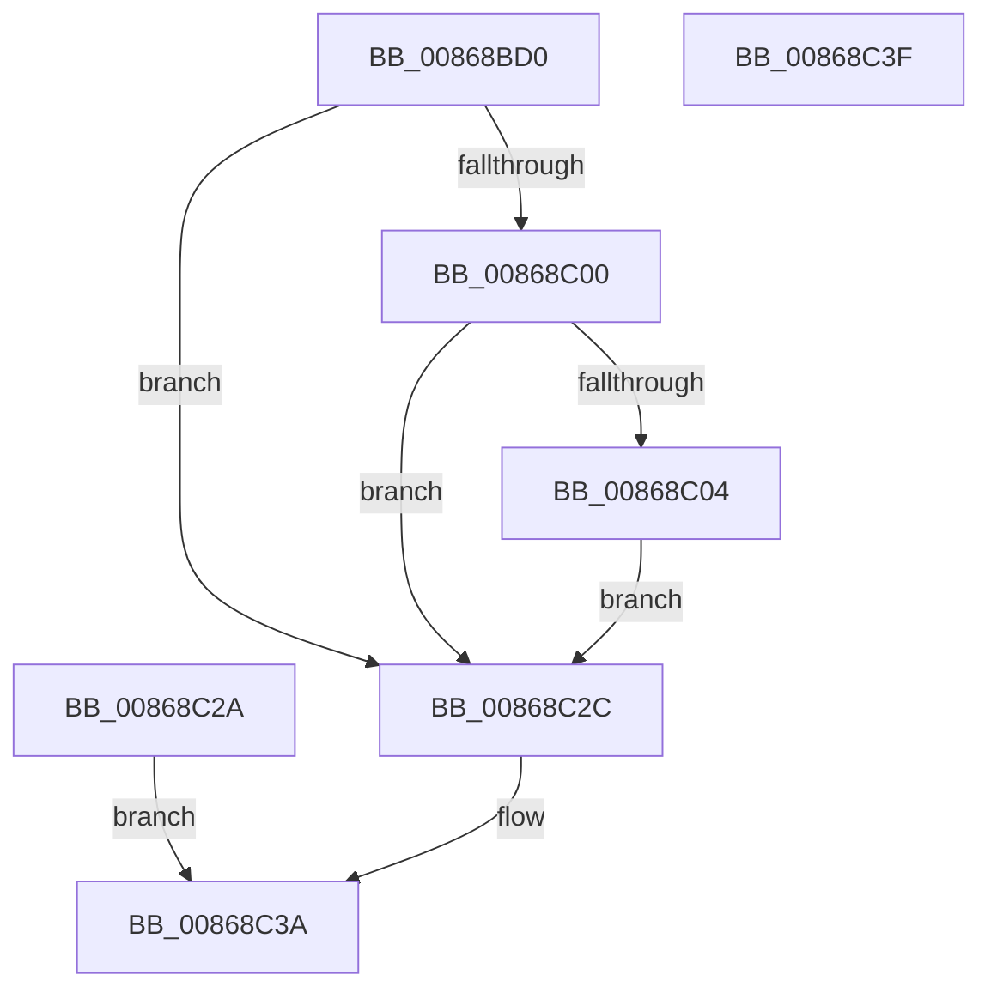

# NtWaitForSingleObject

- RVA: `0x00868BD0`–`0x00868C40` (길이 `112` bytes)
- VA: `0x0000000140868BD0`
- 실행 섹션: `PAGE`
- PDB 이름 있음: `예`; PDB Function 태그: `아니요`
- unwind 정보 RVA: `0x0006BDF4`
- 디코드: `27`개 명령, `112/112` bytes 표시
- 미해석 바이트: `0` (있으면 어셈블리에 `.byte`로 보존)

> 이 문서는 커널 이미지의 기계어와 PDB 기호를 분석해 생성했습니다. 4번과 5번은 함수 원형과 자료형을 바이너리 사용 방식에서 추정한 C 해석이며 원본 소스 복구 결과는 아닙니다.

## 1. Dependencies

- 직접 호출 지점: **1**; 고유 호출 대상: **1**
- 직접 호출자로 확인된 함수: **4**
- RIP 상대 이미지 참조: **0**

### Outgoing calls
- `0x00868C35` → [ObWaitForSingleObject](ObWaitForSingleObject_function_00868C50.md) (function, `0x00868C50`)

### Direct callers
- [SepRmCallLsa](../../text/22/SepRmCallLsa_function_00223630.md) at `0x002238C9`
- [PfSnGetSectionObject](../8A/PfSnGetSectionObject_function_008A9448.md) at `0x008A9917`
- [PfSnPrefetchFileMetadata](../8A/PfSnPrefetchFileMetadata_function_008AA178.md) at `0x008AA272`
- [sub_00B19EB2](../B1/Unknown_function_00B19EB2.md) at `0x00B19F5B`

### Static image references
- 디코드된 RIP-relative 메모리 참조가 없습니다.

## 2. Other-region calls and transfers

- 다른 실행 섹션으로 향하는 call: **0**
- 별도 외부 분기/꼬리 이동을 확인하지 못했습니다.

## 3. Assembly (complete function range)

```asm
00868BD0  4C 89 44 24 18                  mov qword ptr [rsp + 0x18], r8
00868BD5  48 83 EC 38                     sub rsp, 0x38
00868BD9  44 0F B6 CA                     movzx r9d, dl
00868BDD  48 C7 44 24 58 00 00 00 00      mov qword ptr [rsp + 0x58], 0
00868BE6  65 48 8B 14 25 88 01 00 00      mov rdx, qword ptr gs:[0x188]
00868BEF  0F B6 92 32 02 00 00            movzx edx, byte ptr [rdx + 0x232]
00868BF6  4C 8B 44 24 50                  mov r8, qword ptr [rsp + 0x50]
00868BFB  4D 85 C0                        test r8, r8
00868BFE  74 2C                           je 0x140868c2c
00868C00  84 D2                           test dl, dl
00868C02  74 28                           je 0x140868c2c
00868C04  48 B8 00 00 FF FF FF 7F 00 00   movabs rax, 0x7fffffff0000
00868C0E  4C 3B C0                        cmp r8, rax
00868C11  49 0F 42 C0                     cmovb rax, r8
00868C15  90                              nop
00868C16  48 8B 00                        mov rax, qword ptr [rax]
00868C19  48 89 44 24 58                  mov qword ptr [rsp + 0x58], rax
00868C1E  4C 8D 44 24 58                  lea r8, [rsp + 0x58]
00868C23  4C 89 44 24 50                  mov qword ptr [rsp + 0x50], r8
00868C28  EB 02                           jmp 0x140868c2c
00868C2A  EB 0E                           jmp 0x140868c3a
00868C2C  4C 89 44 24 20                  mov qword ptr [rsp + 0x20], r8
00868C31  44 0F B6 C2                     movzx r8d, dl
00868C35  E8 16 00 00 00                  call 0x140868c50
00868C3A  48 83 C4 38                     add rsp, 0x38
00868C3E  C3                              ret
00868C3F  CC                              int3
```

## 4. C-style interpretation (structured pseudocode)

```c
__int64 __fastcall NtWaitForSingleObject(__int64 a1, unsigned __int8 a2, __int64 a3)
{
    __int64 result;
    __int64 v_rsp;
    unsigned __int64 v_stack_m18;
    unsigned __int64 v_stack_p18;
    unsigned __int64 v_stack_p20;

    v_stack_p18 = a3;
    v_rsp = (v_rsp) - (56);
    v_stack_p20 = 0;
    if (v_stack_p18 == 0) goto loc_00868C2C;
    if ((unsigned __int8)(*(unsigned __int8 *)(*(unsigned __int64 *)(gs_base + (0 + 392)) + 562)) == 0) goto loc_00868C2C;
    if (v_stack_p18 < result) { result = v_stack_p18; }
    v_stack_p20 = *(unsigned __int64 *)(result);
    v_stack_p18 = v_stack_p20;
    goto loc_00868C2C;
loc_00868C2C:
    v_stack_m18 = v_stack_p20;
    result = ObWaitForSingleObject(a1, *(unsigned __int8 *)(*(unsigned __int64 *)(gs_base + (0 + 392)) + 562), (unsigned __int8)(*(unsigned __int8 *)(*(unsigned __int64 *)(gs_base + (0 + 392)) + 562)), a2);
loc_00868C3A:
    v_rsp = (v_rsp) + (56);
    return result;
}
```

## 5. (Beta) C Style

```c
int64_t NtWaitForSingleObject(int64_t Arg1, uint8_t Arg2, int64_t Arg3)
{
    int64_t result;
    int64_t local_rsp;
    uint64_t v_stack_m18;
    uint64_t v_stack_p18;
    uint64_t v_stack_p20;

    v_stack_p18 = Arg3;
    local_rsp = (local_rsp) - (56);
    v_stack_p20 = 0;
    if (v_stack_p18 == 0) goto loc_00868C2C;
    if ((uint8_t)(*(uint8_t *)(*(uint64_t *)(gs_base + (0 + 0x188)) + 0x232)) == 0) goto loc_00868C2C;
    if (v_stack_p18 < result) { result = v_stack_p18; }
    v_stack_p20 = *(uint64_t *)(result);
    v_stack_p18 = v_stack_p20;
    goto loc_00868C2C;
loc_00868C2C:
    v_stack_m18 = v_stack_p20;
    result = ObWaitForSingleObject(Arg1, *(uint8_t *)(*(uint64_t *)(gs_base + (0 + 0x188)) + 0x232), (uint8_t)(*(uint8_t *)(*(uint64_t *)(gs_base + (0 + 0x188)) + 0x232)), Arg2);
loc_00868C3A:
    local_rsp = (local_rsp) + (56);
    return result;
}
```

## 6. Execution-region graph

[열기: 2D/3D 그래프와 함수 탐색 컨트롤 패널](../../../control-panel.html?section=page&rva=0x00868BD0&view=graph)

- 2D 그래프는 위에서 아래로 흐르고, 3D 그래프는 빈 공간을 드래그해 회전합니다. Shift+드래그는 이동, 휠은 확대·축소, 함수 노드 선택은 대상 보고서 이동입니다.

### Static fallback


