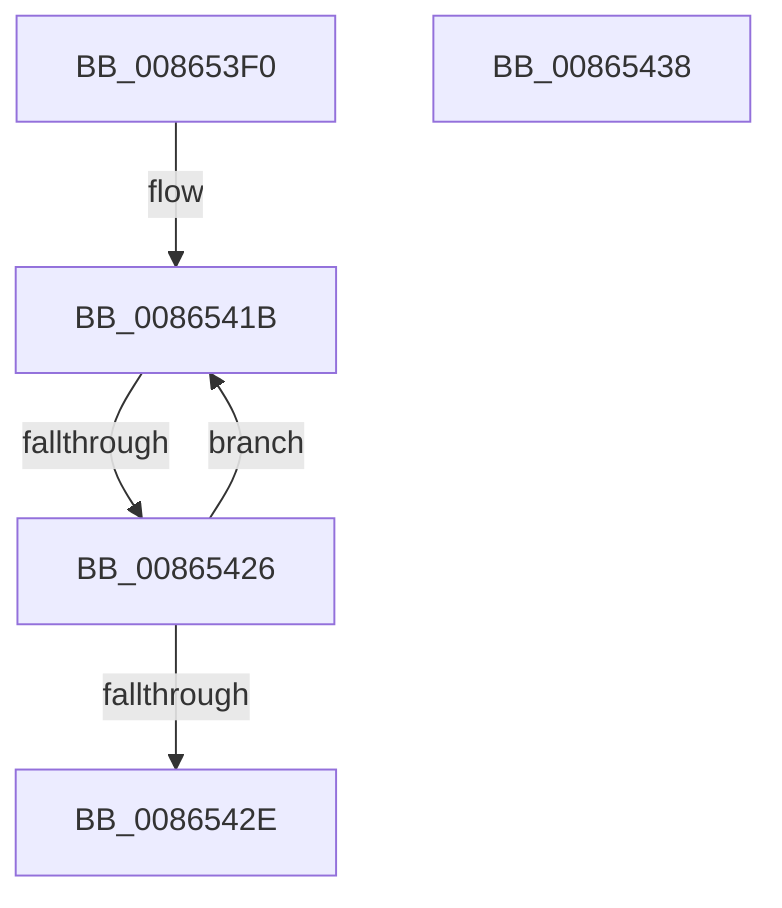

# ObDeassignSecurity

- RVA: `0x008653F0`–`0x00865439` (길이 `73` bytes)
- VA: `0x00000001408653F0`
- 실행 섹션: `PAGE`
- PDB 이름 있음: `예`; PDB Function 태그: `아니요`
- unwind 정보 RVA: `0x0006BA88`
- 디코드: `27`개 명령, `73/73` bytes 표시
- 미해석 바이트: `0` (있으면 어셈블리에 `.byte`로 보존)

> 이 문서는 커널 이미지의 기계어와 PDB 기호를 분석해 생성했습니다. 4번과 5번은 함수 원형과 자료형을 바이너리 사용 방식에서 추정한 C 해석이며 원본 소스 복구 결과는 아닙니다.

## 1. Dependencies

- 직접 호출 지점: **0**; 고유 호출 대상: **0**
- 직접 호출자로 확인된 함수: **2**
- RIP 상대 이미지 참조: **0**

### Outgoing calls
- 직접 디코드된 call 명령이 없습니다.

### Direct callers
- [ObpRemoveObjectRoutine](ObpRemoveObjectRoutine_function_00864A60.md) at `0x00864AF1`
- [WmipSecurityMethod](../9A/WmipSecurityMethod_function_009A71F0.md) at `0x009A7288`

### Static image references
- 디코드된 RIP-relative 메모리 참조가 없습니다.

## 2. Other-region calls and transfers

- 다른 실행 섹션으로 향하는 call: **0**
- call이 아닌 외부 분기/꼬리 이동: **1**
  - `0x00865424` → [sub_00865439](Unknown_function_00865439.md) (`tail-transfer`)

## 3. Assembly (complete function range)

```asm
008653F0  40 53                           push rbx
008653F2  56                              push rsi
008653F3  57                              push rdi
008653F4  48 83 EC 20                     sub rsp, 0x20
008653F8  48 8B 19                        mov rbx, qword ptr [rcx]
008653FB  8B F3                           mov esi, ebx
008653FD  48 C7 01 00 00 00 00            mov qword ptr [rcx], 0
00865404  83 E6 0F                        and esi, 0xf
00865407  48 83 E3 F0                     and rbx, 0xfffffffffffffff0
0086540B  FF C6                           inc esi
0086540D  48 83 EB 20                     sub rbx, 0x20
00865411  0F 0D 4B 08                     prefetchw byte ptr [rbx + 8]
00865415  48 8B 43 08                     mov rax, qword ptr [rbx + 8]
00865419  8B FE                           mov edi, esi
0086541B  48 8B C8                        mov rcx, rax
0086541E  48 2B CF                        sub rcx, rdi
00865421  48 85 C9                        test rcx, rcx
00865424  7E 13                           jle 0x140865439
00865426  F0 48 0F B1 4B 08               lock cmpxchg qword ptr [rbx + 8], rcx
0086542C  75 ED                           jne 0x14086541b
0086542E  33 C0                           xor eax, eax
00865430  48 83 C4 20                     add rsp, 0x20
00865434  5F                              pop rdi
00865435  5E                              pop rsi
00865436  5B                              pop rbx
00865437  C3                              ret
00865438  CC                              int3
```

## 4. C-style interpretation (structured pseudocode)

```c
__int64 __fastcall ObDeassignSecurity(__int64 a1)
{
    __int64 result;
    __int64 v_rbx;
    __int64 v_rsi;
    __int64 v_rsp;

    v_rsp = (v_rsp) - (32);
    *(unsigned __int64 *)(a1) = 0;
    v_rsi = (unsigned int)(((unsigned int)((unsigned int)(*(unsigned __int64 *)(a1)))) & (15));
    v_rbx = (*(unsigned __int64 *)(a1)) & (-16);
    v_rsi = (unsigned int)((v_rsi) + 1);
    v_rbx = (v_rbx) - (32);
loc_0086541B:
    a1 = (*(unsigned __int64 *)(v_rbx + 8)) - ((unsigned int)((unsigned int)(v_rsi)));
    if (a1 != 0) goto loc_0086541B;
    result = 0;
    v_rsp = (v_rsp) + (32);
    return result;
}
```

## 5. (Beta) C Style

```c
int64_t ObDeassignSecurity(void *Arg1)
{
    uint8_t *arg1 = (uint8_t *)Arg1;

    int64_t result;
    int64_t local_rbx;
    int64_t local_rsi;
    int64_t local_rsp;

    local_rsp = (local_rsp) - (32);
    *(uint64_t *)(arg1) = 0;
    local_rsi = (uint32_t)(((uint32_t)((uint32_t)(*(uint64_t *)(arg1)))) & (15));
    local_rbx = (*(uint64_t *)(arg1)) & (-16);
    local_rsi = (uint32_t)((local_rsi) + 1);
    local_rbx = (local_rbx) - (32);
loc_0086541B:
    Arg1 = (*(uint64_t *)(local_rbx + 0x8)) - ((uint32_t)((uint32_t)(local_rsi)));
    if (Arg1 != NULL) goto loc_0086541B;
    result = 0;
    local_rsp = (local_rsp) + (32);
    return result;
}
```

### 관측된 메모리 오프셋

구조체 형식이 확인되지 않은 접근은 인자 기준의 오프셋으로만 기록했습니다.

| 기준 인자 | 오프셋 표현 | 폭 (bit) | 접근 |
|---|---:|---:|---|
| `Arg1` | `+ 0x0` | `64` | `R` |
| `Arg1` | `+ 0x0` | `64` | `W` |

## 6. Execution-region graph

[열기: 2D/3D 그래프와 함수 탐색 컨트롤 패널](../../../control-panel.html?section=page&rva=0x008653F0&view=graph)

- 2D 그래프는 위에서 아래로 흐르고, 3D 그래프는 빈 공간을 드래그해 회전합니다. Shift+드래그는 이동, 휠은 확대·축소, 함수 노드 선택은 대상 보고서 이동입니다.

### Static fallback


