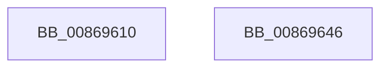

# ObReferenceObjectByHandleWithTag

- RVA: `0x00869610`–`0x00869647` (길이 `55` bytes)
- VA: `0x0000000140869610`
- 실행 섹션: `PAGE`
- PDB 이름 있음: `예`; PDB Function 태그: `아니요`
- unwind 정보 RVA: `0x00063458`
- 디코드: `12`개 명령, `55/55` bytes 표시
- 미해석 바이트: `0` (있으면 어셈블리에 `.byte`로 보존)

> 이 문서는 커널 이미지의 기계어와 PDB 기호를 분석해 생성했습니다. 4번과 5번은 함수 원형과 자료형을 바이너리 사용 방식에서 추정한 C 해석이며 원본 소스 복구 결과는 아닙니다.

## 1. Dependencies

- 직접 호출 지점: **1**; 고유 호출 대상: **1**
- 직접 호출자로 확인된 함수: **11**
- RIP 상대 이미지 참조: **0**

### Outgoing calls
- `0x0086963C` → [ObpReferenceObjectByHandleWithTag](ObpReferenceObjectByHandleWithTag_function_00869650.md) (function, `0x00869650`)

### Direct callers
- [NtGetWriteWatch](../../text/2A/NtGetWriteWatch_function_002A7CE0.md) at `0x002A8380`
- [NtSignalAndWaitForSingleObject](../../text/3A/NtSignalAndWaitForSingleObject_function_003A11D0.md) at `0x003A124A`
- [NtSignalAndWaitForSingleObject](../../text/3A/NtSignalAndWaitForSingleObject_function_003A11D0.md) at `0x003A127D`
- [SepReferenceTokenByHandle](../../text/3E/SepReferenceTokenByHandle_function_003EDAD0.md) at `0x003EDBE6`
- [PopCreatePowerThread](../../text/4A/PopCreatePowerThread_function_004A17D8.md) at `0x004A1869`
- [MiReferenceAweHandle](../../text/4E/MiReferenceAweHandle_function_004E00A4.md) at `0x004E0104`
- [MiReferenceAweHandle](../../text/4E/MiReferenceAweHandle_function_004E00A4.md) at `0x004E016F`
- [DbgkCaptureLiveKernelDump](../../text/58/DbgkCaptureLiveKernelDump_function_00580288.md) at `0x00580395`
- [DbgkCaptureLiveKernelDump](../../text/58/DbgkCaptureLiveKernelDump_function_00580288.md) at `0x0058043E`
- [PspTimerDelayProcess](../../text/5E/PspTimerDelayProcess_function_005E3EC0.md) at `0x005E3EF4`
- [SepSetImageEa](../../text/60/SepSetImageEa_function_0060874C.md) at `0x00608784`
- [MiInsertNewZeroThread](../../text/69/MiInsertNewZeroThread_function_00696140.md) at `0x006962B6`
- [NtSetInformationProcess](../AE/NtSetInformationProcess_function_00AE5370.md) at `0x00AE961B`
- [NtSetInformationProcess](../AE/NtSetInformationProcess_function_00AE5370.md) at `0x00AE9752`
- [NtSetInformationProcess](../AE/NtSetInformationProcess_function_00AE5370.md) at `0x00AE97BA`
- [NtSetInformationProcess](../AE/NtSetInformationProcess_function_00AE5370.md) at `0x00AE97F4`
- [NtSetInformationProcess](../AE/NtSetInformationProcess_function_00AE5370.md) at `0x00AE992A`
- [NtSetInformationProcess](../AE/NtSetInformationProcess_function_00AE5370.md) at `0x00AE9D69`
- [NtSetInformationProcess](../AE/NtSetInformationProcess_function_00AE5370.md) at `0x00AE9F25`
- [PopDirectedDripsInitializePhase3](../../init/C3/PopDirectedDripsInitializePhase3_function_00C3E594.md) at `0x00C3E65C`

### Static image references
- 디코드된 RIP-relative 메모리 참조가 없습니다.

## 2. Other-region calls and transfers

- 다른 실행 섹션으로 향하는 call: **0**
- 별도 외부 분기/꼬리 이동을 확인하지 못했습니다.

## 3. Assembly (complete function range)

```asm
00869610  48 83 EC 48                     sub rsp, 0x48
00869614  48 8B 84 24 80 00 00 00         mov rax, qword ptr [rsp + 0x80]
0086961C  48 C7 44 24 38 00 00 00 00      mov qword ptr [rsp + 0x38], 0
00869625  48 89 44 24 30                  mov qword ptr [rsp + 0x30], rax
0086962A  48 8B 44 24 78                  mov rax, qword ptr [rsp + 0x78]
0086962F  48 89 44 24 28                  mov qword ptr [rsp + 0x28], rax
00869634  8B 44 24 70                     mov eax, dword ptr [rsp + 0x70]
00869638  89 44 24 20                     mov dword ptr [rsp + 0x20], eax
0086963C  E8 0F 00 00 00                  call 0x140869650
00869641  48 83 C4 48                     add rsp, 0x48
00869645  C3                              ret
00869646  CC                              int3
```

## 4. C-style interpretation (structured pseudocode)

```c
__int64 __fastcall ObReferenceObjectByHandleWithTag(__int64 a1, __int64 a2, __int64 a3, __int64 a4, unsigned int a5, __int64 a6, __int64 a7)
{
    __int64 result;
    __int64 v_rsp;
    unsigned __int64 v_stack_m10;
    unsigned __int64 v_stack_m18;
    unsigned __int64 v_stack_m20;
    unsigned int v_stack_m28;

    v_rsp = (v_rsp) - (72);
    v_stack_m10 = 0;
    v_stack_m18 = a7;
    v_stack_m20 = a6;
    v_stack_m28 = (unsigned int)((unsigned int)(a5));
    result = ObpReferenceObjectByHandleWithTag(a1, a2, a3, a4);
    v_rsp = (v_rsp) + (72);
    return result;
}
```

## 5. (Beta) C Style

```c
int64_t ObReferenceObjectByHandleWithTag(int64_t Arg1, int64_t Arg2, int64_t Arg3, int64_t Arg4, uint32_t Arg5, int64_t Arg6, int64_t Arg7)
{
    int64_t result;
    int64_t local_rsp;
    uint64_t v_stack_m10;
    uint64_t v_stack_m18;
    uint64_t v_stack_m20;
    uint32_t v_stack_m28;

    local_rsp = (local_rsp) - (72);
    v_stack_m10 = 0;
    v_stack_m18 = Arg7;
    v_stack_m20 = Arg6;
    v_stack_m28 = (uint32_t)((uint32_t)(Arg5));
    result = ObpReferenceObjectByHandleWithTag(Arg1, Arg2, Arg3, Arg4);
    local_rsp = (local_rsp) + (72);
    return result;
}
```

## 6. Execution-region graph

[열기: 2D/3D 그래프와 함수 탐색 컨트롤 패널](../../../control-panel.html?section=page&rva=0x00869610&view=graph)

- 2D 그래프는 위에서 아래로 흐르고, 3D 그래프는 빈 공간을 드래그해 회전합니다. Shift+드래그는 이동, 휠은 확대·축소, 함수 노드 선택은 대상 보고서 이동입니다.

### Static fallback


