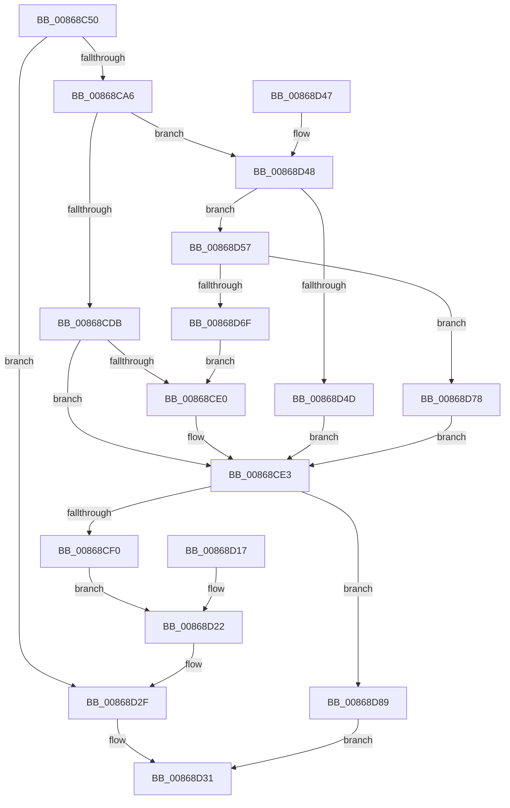

# ObWaitForSingleObject

- RVA: `0x00868C50`–`0x00868D9D` (길이 `333` bytes)
- VA: `0x0000000140868C50`
- 실행 섹션: `PAGE`
- PDB 이름 있음: `예`; PDB Function 태그: `아니요`
- unwind 정보 RVA: `0x0006BE18`
- 디코드: `84`개 명령, `333/333` bytes 표시
- 미해석 바이트: `0` (있으면 어셈블리에 `.byte`로 보존)

> 이 문서는 커널 이미지의 기계어와 PDB 기호를 분석해 생성했습니다. 4번과 5번은 함수 원형과 자료형을 바이너리 사용 방식에서 추정한 C 해석이며 원본 소스 복구 결과는 아닙니다.

## 1. Dependencies

- 직접 호출 지점: **4**; 고유 호출 대상: **3**
- 직접 호출자로 확인된 함수: **1**
- RIP 상대 이미지 참조: **3**

### Outgoing calls
- `0x00868C97` → [ObpReferenceObjectByHandleWithTag](ObpReferenceObjectByHandleWithTag_function_00869650.md) (function, `0x00869650`)
- `0x00868D0A` → [KeWaitForSingleObject](../../text/20/KeWaitForSingleObject_function_0020E6B0.md) (function, `0x0020E6B0`)
- `0x00868D2A` → [ObfDereferenceObjectWithTag](../../text/2F/ObfDereferenceObjectWithTag_function_002F78E0.md) (function, `0x002F78E0`)
- `0x00868D91` → [ObfDereferenceObjectWithTag](../../text/2F/ObfDereferenceObjectWithTag_function_002F78E0.md) (function, `0x002F78E0`)

### Direct callers
- [NtWaitForSingleObject](NtWaitForSingleObject_function_00868BD0.md) at `0x00868C35`

### Static image references
- `0x00868CBD` → RVA `0x00FC6E4C` (`ALMOSTRO`; read)
- `0x00868CC7` → RVA `0x00FC7800` (`ALMOSTRO`; read)
- `0x00868CE3` → RVA `0x00EFA128` (`.data`; read)

## 2. Other-region calls and transfers

- 다른 실행 섹션으로 향하는 call: **3**
  - `0x00868D0A` → [KeWaitForSingleObject](../../text/20/KeWaitForSingleObject_function_0020E6B0.md) (`PAGE` → `.text`)
  - `0x00868D2A` → [ObfDereferenceObjectWithTag](../../text/2F/ObfDereferenceObjectWithTag_function_002F78E0.md) (`PAGE` → `.text`)
  - `0x00868D91` → [ObfDereferenceObjectWithTag](../../text/2F/ObfDereferenceObjectWithTag_function_002F78E0.md) (`PAGE` → `.text`)
- 별도 외부 분기/꼬리 이동을 확인하지 못했습니다.

## 3. Assembly (complete function range)

```asm
00868C50  4C 8B DC                        mov r11, rsp
00868C53  49 89 5B 08                     mov qword ptr [r11 + 8], rbx
00868C57  49 89 73 10                     mov qword ptr [r11 + 0x10], rsi
00868C5B  49 89 7B 18                     mov qword ptr [r11 + 0x18], rdi
00868C5F  41 56                           push r14
00868C61  48 83 EC 50                     sub rsp, 0x50
00868C65  41 0F B6 F1                     movzx esi, r9b
00868C69  45 0F B6 F0                     movzx r14d, r8b
00868C6D  33 C0                           xor eax, eax
00868C6F  49 89 43 F0                     mov qword ptr [r11 - 0x10], rax
00868C73  49 89 43 E0                     mov qword ptr [r11 - 0x20], rax
00868C77  49 89 43 D8                     mov qword ptr [r11 - 0x28], rax
00868C7B  49 8D 43 F0                     lea rax, [r11 - 0x10]
00868C7F  49 89 43 D0                     mov qword ptr [r11 - 0x30], rax
00868C83  C7 44 24 20 4F 62 57 74         mov dword ptr [rsp + 0x20], 0x7457624f
00868C8B  44 0F B6 CA                     movzx r9d, dl
00868C8F  45 33 C0                        xor r8d, r8d
00868C92  BA 00 00 10 00                  mov edx, 0x100000
00868C97  E8 B4 09 00 00                  call 0x140869650
00868C9C  8B D8                           mov ebx, eax
00868C9E  85 C0                           test eax, eax
00868CA0  0F 88 89 00 00 00               js 0x140868d2f
00868CA6  48 8B 7C 24 48                  mov rdi, qword ptr [rsp + 0x48]
00868CAB  48 8D 47 D0                     lea rax, [rdi - 0x30]
00868CAF  48 C1 E8 08                     shr rax, 8
00868CB3  0F B6 D0                        movzx edx, al
00868CB6  0F B6 47 E8                     movzx eax, byte ptr [rdi - 0x18]
00868CBA  48 33 D0                        xor rdx, rax
00868CBD  0F B6 05 88 E1 75 00            movzx eax, byte ptr [rip + 0x75e188]
00868CC4  48 33 D0                        xor rdx, rax
00868CC7  4C 8D 05 32 EB 75 00            lea r8, [rip + 0x75eb32]
00868CCE  4D 8B 04 D0                     mov r8, qword ptr [r8 + rdx*8]
00868CD2  49 8B 48 20                     mov rcx, qword ptr [r8 + 0x20]
00868CD6  F6 C1 01                        test cl, 1
00868CD9  75 6D                           jne 0x140868d48
00868CDB  48 85 C9                        test rcx, rcx
00868CDE  78 03                           js 0x140868ce3
00868CE0  48 03 CF                        add rcx, rdi
00868CE3  4C 39 05 3E 14 69 00            cmp qword ptr [rip + 0x69143e], r8
00868CEA  0F 84 99 00 00 00               je 0x140868d89
00868CF0  48 8B 84 24 80 00 00 00         mov rax, qword ptr [rsp + 0x80]
00868CF8  48 89 44 24 20                  mov qword ptr [rsp + 0x20], rax
00868CFD  44 0F B6 CE                     movzx r9d, sil
00868D01  45 0F B6 C6                     movzx r8d, r14b
00868D05  BA 06 00 00 00                  mov edx, 6
00868D0A  E8 A1 59 9A FF                  call 0x14020e6b0
00868D0F  8B D8                           mov ebx, eax
00868D11  89 44 24 40                     mov dword ptr [rsp + 0x40], eax
00868D15  EB 0B                           jmp 0x140868d22
00868D17  8B D8                           mov ebx, eax
00868D19  89 44 24 40                     mov dword ptr [rsp + 0x40], eax
00868D1D  48 8B 7C 24 48                  mov rdi, qword ptr [rsp + 0x48]
00868D22  BA 4F 62 57 74                  mov edx, 0x7457624f
00868D27  48 8B CF                        mov rcx, rdi
00868D2A  E8 B1 EB A8 FF                  call 0x1402f78e0
00868D2F  8B C3                           mov eax, ebx
00868D31  48 8B 5C 24 60                  mov rbx, qword ptr [rsp + 0x60]
00868D36  48 8B 74 24 68                  mov rsi, qword ptr [rsp + 0x68]
00868D3B  48 8B 7C 24 70                  mov rdi, qword ptr [rsp + 0x70]
00868D40  48 83 C4 50                     add rsp, 0x50
00868D44  41 5E                           pop r14
00868D46  C3                              ret
00868D47  CC                              int3
00868D48  F6 C1 02                        test cl, 2
00868D4B  75 0A                           jne 0x140868d57
00868D4D  48 8D 04 39                     lea rax, [rcx + rdi]
00868D51  48 8B 48 FF                     mov rcx, qword ptr [rax - 1]
00868D55  EB 8C                           jmp 0x140868ce3
00868D57  41 0F B7 80 B4 00 00 00         movzx eax, word ptr [r8 + 0xb4]
00868D5F  41 8B 90 B0 00 00 00            mov edx, dword ptr [r8 + 0xb0]
00868D66  8B 04 38                        mov eax, dword ptr [rax + rdi]
00868D69  23 C2                           and eax, edx
00868D6B  3B C2                           cmp eax, edx
00868D6D  74 09                           je 0x140868d78
00868D6F  48 83 C1 FD                     add rcx, -3
00868D73  E9 68 FF FF FF                  jmp 0x140868ce0
00868D78  41 0F B7 88 B6 00 00 00         movzx ecx, word ptr [r8 + 0xb6]
00868D80  48 8B 0C 39                     mov rcx, qword ptr [rcx + rdi]
00868D84  E9 5A FF FF FF                  jmp 0x140868ce3
00868D89  BA 4F 62 57 74                  mov edx, 0x7457624f
00868D8E  48 8B CF                        mov rcx, rdi
00868D91  E8 4A EB A8 FF                  call 0x1402f78e0
00868D96  B8 24 00 00 C0                  mov eax, 0xc0000024
00868D9B  EB 94                           jmp 0x140868d31
```

## 4. C-style interpretation (structured pseudocode)

```c
__int64 __fastcall ObWaitForSingleObject(__int64 a1, unsigned __int8 a2, int a3, unsigned __int8 a4, __int64 a5)
{
    __int64 result;
    __int64 v_rsp;
    unsigned __int64 v_stack_m10;
    unsigned int v_stack_m18;
    unsigned int v_stack_m38;
    unsigned __int64 v_stack_p10;
    unsigned __int64 v_stack_p18;
    unsigned __int64 v_stack_p8;

    *(unsigned __int64 *)(v_rsp + 8) = v_rbx;
    *(unsigned __int64 *)(v_rsp + 16) = v_rsi;
    *(unsigned __int64 *)(v_rsp + 24) = v_rdi;
    v_rsp = (v_rsp) - (80);
    result = 0;
    *(unsigned __int64 *)(v_rsp - 16) = 0;
    *(unsigned __int64 *)(v_rsp - 32) = 0;
    *(unsigned __int64 *)(v_rsp - 40) = 0;
    *(unsigned __int64 *)(v_rsp - 48) = v_rsp - 16;
    v_stack_m38 = 0x7457624FULL;
    a3 = 0;
    result = ObpReferenceObjectByHandleWithTag(a1, (unsigned int)(0x100000ULL), a3, a2);
    if (sign_flag) goto loc_00868D2F;
    result = (v_stack_m10 - 48) >> (8);
    a2 = ((unsigned __int8)(result)) ^ (*(unsigned __int8 *)(v_stack_m10 - 24));
    a2 = (a2) ^ (*(unsigned __int8 *)(v_rip + 7725448));
    if ((((unsigned __int8)(*(unsigned __int64 *)(*(unsigned __int64 *)(v_rip + 7727922 + a2 * 8) + 32))) & (1)) != 0) goto loc_00868D48;
    if (!(sign_flag)) {
        a1 = (*(unsigned __int64 *)(*(unsigned __int64 *)(v_rip + 7727922 + a2 * 8) + 32)) + (v_stack_m10);
    }
    if ((*(unsigned __int64 *)(v_rip + 6886462)) == (*(unsigned __int64 *)(v_rip + 7727922 + a2 * 8))) goto loc_00868D89;
    v_stack_m38 = a5;
    result = KeWaitForSingleObject(a1, 6, (unsigned __int8)((unsigned __int8)(a3)), a4);
    v_stack_m18 = (unsigned int)(result);
    goto loc_00868D22;
loc_00868D22:
    result = ObfDereferenceObjectWithTag(v_stack_m10, (unsigned int)(0x7457624FULL), (unsigned __int8)((unsigned __int8)(a3)), a4);
loc_00868D2F:
loc_00868D31:
    v_rsp = (v_rsp) + (80);
    return (unsigned int)((unsigned int)((unsigned int)((unsigned int)(result))));
loc_00868D48:
    if ((((unsigned __int8)(v_stack_m10)) & (2)) != 0) goto loc_00868D57;
    goto loc_00868CE3;
loc_00868D57:
    result = (unsigned int)(((unsigned int)(*(unsigned int *)(*(unsigned __int16 *)((unsigned __int8)((unsigned __int8)(a3)) + 180) + v_stack_p18 * 1))) & ((unsigned int)((unsigned int)(*(unsigned int *)((unsigned __int8)((unsigned __int8)(a3)) + 176)))));
    if (((unsigned int)(result)) == ((unsigned int)((unsigned int)(*(unsigned int *)((unsigned __int8)((unsigned __int8)(a3)) + 176))))) goto loc_00868D78;
    a1 = (*(unsigned __int64 *)(v_stack_m10 + v_stack_p18 * 1 - 1)) + (-3);
    goto loc_00868CE0;
loc_00868D78:
    goto loc_00868CE3;
loc_00868D89:
    result = ObfDereferenceObjectWithTag(v_stack_p18, (unsigned int)(0x7457624FULL), (unsigned __int8)((unsigned __int8)(a3)), a4);
    goto loc_00868D31;
}
```

## 5. (Beta) C Style

```c
int64_t ObWaitForSingleObject(int64_t Arg1, uint8_t Arg2, int32_t Arg3, uint8_t Arg4, int64_t Arg5)
{
    int64_t result;
    int64_t local_rsp;
    uint64_t v_stack_m10;
    uint32_t v_stack_m18;
    uint32_t v_stack_m38;
    uint64_t v_stack_p10;
    uint64_t v_stack_p18;
    uint64_t v_stack_p8;

    *(uint64_t *)(local_rsp + 0x8) = local_rbx;
    *(uint64_t *)(local_rsp + 0x10) = local_rsi;
    *(uint64_t *)(local_rsp + 0x18) = local_rdi;
    local_rsp = (local_rsp) - (80);
    result = 0;
    *(uint64_t *)(local_rsp - 0x10) = 0;
    *(uint64_t *)(local_rsp - 0x20) = 0;
    *(uint64_t *)(local_rsp - 0x28) = 0;
    *(uint64_t *)(local_rsp - 0x30) = local_rsp - 16;
    v_stack_m38 = 0x7457624FULL;
    Arg3 = 0;
    result = ObpReferenceObjectByHandleWithTag(Arg1, (uint32_t)(0x100000ULL), Arg3, Arg2);
    if (sign_flag) goto loc_00868D2F;
    result = (v_stack_m10 - 48) >> (8);
    Arg2 = ((uint8_t)(result)) ^ (*(uint8_t *)(v_stack_m10 - 0x18));
    Arg2 = (Arg2) ^ (*(uint8_t *)(v_rip + 0x75E188));
    if ((((uint8_t)(*(uint64_t *)(*(uint64_t *)(v_rip + 0x75EB32 + Arg2 * 8) + 0x20))) & (1)) != 0) goto loc_00868D48;
    if (!(sign_flag)) {
        Arg1 = (*(uint64_t *)(*(uint64_t *)(v_rip + 0x75EB32 + Arg2 * 8) + 0x20)) + (v_stack_m10);
    }
    if ((*(uint64_t *)(v_rip + 0x69143E)) == (*(uint64_t *)(v_rip + 0x75EB32 + Arg2 * 8))) goto loc_00868D89;
    v_stack_m38 = Arg5;
    result = KeWaitForSingleObject(Arg1, 6, (uint8_t)((uint8_t)(Arg3)), Arg4);
    v_stack_m18 = (uint32_t)(result);
    goto loc_00868D22;
loc_00868D22:
    result = ObfDereferenceObjectWithTag(v_stack_m10, (uint32_t)(0x7457624FULL), (uint8_t)((uint8_t)(Arg3)), Arg4);
loc_00868D2F:
loc_00868D31:
    local_rsp = (local_rsp) + (80);
    return (uint32_t)((uint32_t)((uint32_t)((uint32_t)(result))));
loc_00868D48:
    if ((((uint8_t)(v_stack_m10)) & (2)) != 0) goto loc_00868D57;
    goto loc_00868CE3;
loc_00868D57:
    result = (uint32_t)(((uint32_t)(*(uint32_t *)(*(uint16_t *)((uint8_t)((uint8_t)(Arg3)) + 0xB4) + v_stack_p18 * 1))) & ((uint32_t)((uint32_t)(*(uint32_t *)((uint8_t)((uint8_t)(Arg3)) + 0xB0)))));
    if (((uint32_t)(result)) == ((uint32_t)((uint32_t)(*(uint32_t *)((uint8_t)((uint8_t)(Arg3)) + 0xB0))))) goto loc_00868D78;
    Arg1 = (*(uint64_t *)(v_stack_m10 + v_stack_p18 * 1 - 0x1)) + (-3);
    goto loc_00868CE0;
loc_00868D78:
    goto loc_00868CE3;
loc_00868D89:
    result = ObfDereferenceObjectWithTag(v_stack_p18, (uint32_t)(0x7457624FULL), (uint8_t)((uint8_t)(Arg3)), Arg4);
    goto loc_00868D31;
}
```

## 6. Execution-region graph

[열기: 2D/3D 그래프와 함수 탐색 컨트롤 패널](../../../control-panel.html?section=page&rva=0x00868C50&view=graph)

- 2D 그래프는 위에서 아래로 흐르고, 3D 그래프는 빈 공간을 드래그해 회전합니다. Shift+드래그는 이동, 휠은 확대·축소, 함수 노드 선택은 대상 보고서 이동입니다.

### Static fallback


