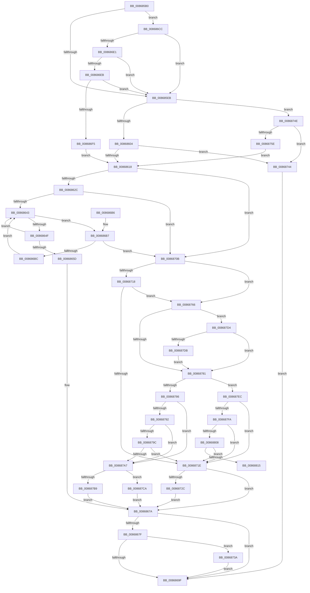

# ObpCloseHandle

- RVA: `0x008685B0`–`0x00868831` (길이 `641` bytes)
- VA: `0x00000001408685B0`
- 실행 섹션: `PAGE`
- PDB 이름 있음: `예`; PDB Function 태그: `아니요`
- unwind 정보 RVA: `0x0006BDA0`
- 디코드: `158`개 명령, `641/641` bytes 표시
- 미해석 바이트: `0` (있으면 어셈블리에 `.byte`로 보존)

> 이 문서는 커널 이미지의 기계어와 PDB 기호를 분석해 생성했습니다. 4번과 5번은 함수 원형과 자료형을 바이너리 사용 방식에서 추정한 C 해석이며 원본 소스 복구 결과는 아닙니다.

## 1. Dependencies

- 직접 호출 지점: **10**; 고유 호출 대상: **10**
- 직접 호출자로 확인된 함수: **1**
- RIP 상대 이미지 참조: **4**

### Outgoing calls
- `0x00868632` → [ExpLookupHandleTableEntry](ExpLookupHandleTableEntry_function_00869DB0.md) (function, `0x00869DB0`)
- `0x00868673` → [ObCloseHandleTableEntry](ObCloseHandleTableEntry_function_00869E20.md) (function, `0x00869E20`)
- `0x008686C2` → [ExpBlockOnLockedHandleEntry](ExpBlockOnLockedHandleEntry_function_00868838.md) (function, `0x00868838`)
- `0x0086870E` → [KeLeaveCriticalRegionThread](../../text/25/KeLeaveCriticalRegionThread_function_0025EFF0.md) (function, `0x0025EFF0`)
- `0x0086873A` → [ExfReleaseRundownProtection](../../text/34/ExfReleaseRundownProtection_function_00349EB0.md) (function, `0x00349EB0`)
- `0x00868751` → [ObReferenceProcessHandleTable](../89/ObReferenceProcessHandleTable_function_00893B70.md) (function, `0x00893B70`)
- `0x00868776` → [ExQueryHandleExceptionsPermanency](../../text/45/ExQueryHandleExceptionsPermanency_function_00458CE0.md) (function, `0x00458CE0`)
- `0x008687BE` → [KeRaiseUserException](../../text/4D/KeRaiseUserException_function_004D7750.md) (function, `0x004D7750`)
- `0x008687E5` → [ExHandleLogBadReference](../../text/44/ExHandleLogBadReference_function_00440580.md) (function, `0x00440580`)
- `0x0086882B` → [KeBugCheckEx](../../text/4F/KeBugCheckEx_function_004FD660.md) (function, `0x004FD660`)

### Direct callers
- [ObCloseHandle](../8A/ObCloseHandle_function_008A1870.md) at `0x008A1892`

### Static image references
- `0x0086860B` → RVA `0x00F0F5B8` (`.data`; read)
- `0x008686FF` → RVA `0x00FC6AB0` (`ALMOSTRO`; read)
- `0x00868786` → RVA `0x00FC42C0` (`.data`; read)
- `0x00868808` → RVA `0x00F475F8` (`.data`; read)

## 2. Other-region calls and transfers

- 다른 실행 섹션으로 향하는 call: **6**
  - `0x0086870E` → [KeLeaveCriticalRegionThread](../../text/25/KeLeaveCriticalRegionThread_function_0025EFF0.md) (`PAGE` → `.text`)
  - `0x0086873A` → [ExfReleaseRundownProtection](../../text/34/ExfReleaseRundownProtection_function_00349EB0.md) (`PAGE` → `.text`)
  - `0x00868776` → [ExQueryHandleExceptionsPermanency](../../text/45/ExQueryHandleExceptionsPermanency_function_00458CE0.md) (`PAGE` → `.text`)
  - `0x008687BE` → [KeRaiseUserException](../../text/4D/KeRaiseUserException_function_004D7750.md) (`PAGE` → `.text`)
  - `0x008687E5` → [ExHandleLogBadReference](../../text/44/ExHandleLogBadReference_function_00440580.md) (`PAGE` → `.text`)
  - `0x0086882B` → [KeBugCheckEx](../../text/4F/KeBugCheckEx_function_004FD660.md) (`PAGE` → `.text`)
- 별도 외부 분기/꼬리 이동을 확인하지 못했습니다.

## 3. Assembly (complete function range)

```asm
008685B0  48 89 5C 24 08                  mov qword ptr [rsp + 8], rbx
008685B5  55                              push rbp
008685B6  56                              push rsi
008685B7  57                              push rdi
008685B8  41 54                           push r12
008685BA  41 55                           push r13
008685BC  41 56                           push r14
008685BE  41 57                           push r15
008685C0  48 83 EC 30                     sub rsp, 0x30
008685C4  65 48 8B 2C 25 88 01 00 00      mov rbp, qword ptr gs:[0x188]
008685CD  45 32 ED                        xor r13b, r13b
008685D0  C6 44 24 78 00                  mov byte ptr [rsp + 0x78], 0
008685D5  44 0F B6 E2                     movzx r12d, dl
008685D9  48 8B F9                        mov rdi, rcx
008685DC  4C 8B B5 B8 00 00 00            mov r14, qword ptr [rbp + 0xb8]
008685E3  84 D2                           test dl, dl
008685E5  0F 84 E1 00 00 00               je 0x1408686cc
008685EB  65 48 8B 04 25 88 01 00 00      mov rax, qword ptr gs:[0x188]
008685F4  4D 8B FE                        mov r15, r14
008685F7  80 B8 4A 02 00 00 01            cmp byte ptr [rax + 0x24a], 1
008685FE  0F 84 4A 01 00 00               je 0x14086874e
00868604  49 8B B6 00 03 00 00            mov rsi, qword ptr [r14 + 0x300]
0086860B  48 3B 35 A6 6F 6A 00            cmp rsi, qword ptr [rip + 0x6a6fa6]
00868612  0F 84 2C 01 00 00               je 0x140868744
00868618  66 FF 8D E4 01 00 00            dec word ptr [rbp + 0x1e4]
0086861F  90                              nop
00868620  F7 C7 FC 03 00 00               test edi, 0x3fc
00868626  0F 84 DF 00 00 00               je 0x14086870b
0086862C  48 8B D7                        mov rdx, rdi
0086862F  48 8B CE                        mov rcx, rsi
00868632  E8 79 17 00 00                  call 0x140869db0
00868637  48 8B D8                        mov rbx, rax
0086863A  48 85 C0                        test rax, rax
0086863D  0F 84 C8 00 00 00               je 0x14086870b
00868643  0F 0D 0B                        prefetchw byte ptr [rbx]
00868646  4C 8B 03                        mov r8, qword ptr [rbx]
00868649  41 F6 C0 01                     test r8b, 1
0086864D  74 68                           je 0x1408686b7
0086864F  49 8D 48 FF                     lea rcx, [r8 - 1]
00868653  49 8B C0                        mov rax, r8
00868656  F0 48 0F B1 0B                  lock cmpxchg qword ptr [rbx], rcx
0086865B  75 E6                           jne 0x140868643
0086865D  C6 44 24 28 00                  mov byte ptr [rsp + 0x28], 0
00868662  4C 8B CF                        mov r9, rdi
00868665  4D 8B C7                        mov r8, r15
00868668  44 88 64 24 20                  mov byte ptr [rsp + 0x20], r12b
0086866D  48 8B D3                        mov rdx, rbx
00868670  48 8B CE                        mov rcx, rsi
00868673  E8 A8 17 00 00                  call 0x140869e20
00868678  8B D8                           mov ebx, eax
0086867A  45 84 ED                        test r13b, r13b
0086867D  74 20                           je 0x14086869f
0086867F  49 8D 8F E8 01 00 00            lea rcx, [r15 + 0x1e8]
00868686  0F 0D 09                        prefetchw byte ptr [rcx]
00868689  48 8B 01                        mov rax, qword ptr [rcx]
0086868C  48 83 E0 FE                     and rax, 0xfffffffffffffffe
00868690  48 8D 50 FE                     lea rdx, [rax - 2]
00868694  F0 48 0F B1 11                  lock cmpxchg qword ptr [rcx], rdx
00868699  0F 85 9B 00 00 00               jne 0x14086873a
0086869F  8B C3                           mov eax, ebx
008686A1  48 8B 5C 24 70                  mov rbx, qword ptr [rsp + 0x70]
008686A6  48 83 C4 30                     add rsp, 0x30
008686AA  41 5F                           pop r15
008686AC  41 5E                           pop r14
008686AE  41 5D                           pop r13
008686B0  41 5C                           pop r12
008686B2  5F                              pop rdi
008686B3  5E                              pop rsi
008686B4  5D                              pop rbp
008686B5  C3                              ret
008686B6  CC                              int3
008686B7  4D 85 C0                        test r8, r8
008686BA  74 4F                           je 0x14086870b
008686BC  48 8B D3                        mov rdx, rbx
008686BF  48 8B CE                        mov rcx, rsi
008686C2  E8 71 01 00 00                  call 0x140868838
008686C7  E9 77 FF FF FF                  jmp 0x140868643
008686CC  48 8B C7                        mov rax, rdi
008686CF  48 25 00 00 00 80               and rax, 0xffffffff80000000
008686D5  48 3D 00 00 00 80               cmp rax, -0x80000000
008686DB  0F 85 0A FF FF FF               jne 0x1408685eb
008686E1  48 83 FF FE                     cmp rdi, -2
008686E5  0F 84 00 FF FF FF               je 0x1408685eb
008686EB  48 83 FF FF                     cmp rdi, -1
008686EF  0F 84 F6 FE FF FF               je 0x1408685eb
008686F5  48 8B 35 BC 6E 6A 00            mov rsi, qword ptr [rip + 0x6a6ebc]
008686FC  48 33 F8                        xor rdi, rax
008686FF  4C 8B 3D AA E3 75 00            mov r15, qword ptr [rip + 0x75e3aa]
00868706  E9 0D FF FF FF                  jmp 0x140868618
0086870B  48 8B CD                        mov rcx, rbp
0086870E  E8 DD 68 9F FF                  call 0x14025eff0
00868713  48 85 FF                        test rdi, rdi
00868716  7F 4E                           jg 0x140868766
00868718  48 83 FF FA                     cmp rdi, -6
0086871C  7C 48                           jl 0x140868766
0086871E  BB 08 00 00 C0                  mov ebx, 0xc0000008
00868723  48 85 FF                        test rdi, rdi
00868726  0F 89 4E FF FF FF               jns 0x14086867a
0086872C  33 C0                           xor eax, eax
0086872E  48 83 FF FA                     cmp rdi, -6
00868732  0F 4D D8                        cmovge ebx, eax
00868735  E9 40 FF FF FF                  jmp 0x14086867a
0086873A  E8 71 17 AE FF                  call 0x140349eb0
0086873F  E9 5B FF FF FF                  jmp 0x14086869f
00868744  BB 08 00 00 C0                  mov ebx, 0xc0000008
00868749  E9 51 FF FF FF                  jmp 0x14086869f
0086874E  49 8B CE                        mov rcx, r14
00868751  E8 1A B4 02 00                  call 0x140893b70
00868756  48 8B F0                        mov rsi, rax
00868759  48 85 C0                        test rax, rax
0086875C  74 E6                           je 0x140868744
0086875E  41 B5 01                        mov r13b, 1
00868761  E9 B2 FE FF FF                  jmp 0x140868618
00868766  4C 8D 44 24 78                  lea r8, [rsp + 0x78]
0086876B  48 8B CE                        mov rcx, rsi
0086876E  48 8D 94 24 80 00 00 00         lea rdx, [rsp + 0x80]
00868776  E8 65 05 BF FF                  call 0x140458ce0
0086877B  F6 46 2C 10                     test byte ptr [rsi + 0x2c], 0x10
0086877F  75 53                           jne 0x1408687d4
00868781  45 84 E4                        test r12b, r12b
00868784  74 66                           je 0x1408687ec
00868786  F7 05 30 BB 75 00 00 00 40 00   test dword ptr [rip + 0x75bb30], 0x400000
00868790  75 15                           jne 0x1408687a7
00868792  49 83 BE 08 03 00 00 00         cmp qword ptr [r14 + 0x308], 0
0086879A  75 0B                           jne 0x1408687a7
0086879C  48 83 7E 60 00                  cmp qword ptr [rsi + 0x60], 0
008687A1  0F 84 77 FF FF FF               je 0x14086871e
008687A7  65 48 8B 04 25 88 01 00 00      mov rax, qword ptr gs:[0x188]
008687B0  80 B8 4A 02 00 00 01            cmp byte ptr [rax + 0x24a], 1
008687B7  74 11                           je 0x1408687ca
008687B9  B9 08 00 00 C0                  mov ecx, 0xc0000008
008687BE  E8 8D EF C6 FF                  call 0x1404d7750
008687C3  8B D8                           mov ebx, eax
008687C5  E9 B0 FE FF FF                  jmp 0x14086867a
008687CA  BB 08 00 00 C0                  mov ebx, 0xc0000008
008687CF  E9 A6 FE FF FF                  jmp 0x14086867a
008687D4  80 7C 24 78 00                  cmp byte ptr [rsp + 0x78], 0
008687D9  74 A6                           je 0x140868781
008687DB  45 0F B6 C4                     movzx r8d, r12b
008687DF  48 8B D7                        mov rdx, rdi
008687E2  48 8B CE                        mov rcx, rsi
008687E5  E8 96 7D BD FF                  call 0x140440580
008687EA  EB 95                           jmp 0x140868781
008687EC  8B 85 A0 05 00 00               mov eax, dword ptr [rbp + 0x5a0]
008687F2  A8 01                           test al, 1
008687F4  0F 85 24 FF FF FF               jne 0x14086871e
008687FA  49 83 BE E0 02 00 00 00         cmp qword ptr [r14 + 0x2e0], 0
00868802  0F 84 16 FF FF FF               je 0x14086871e
00868808  80 3D E9 ED 6D 00 00            cmp byte ptr [rip + 0x6dede9], 0
0086880F  0F 84 09 FF FF FF               je 0x14086871e
00868815  33 C0                           xor eax, eax
00868817  45 33 C9                        xor r9d, r9d
0086881A  48 8B D7                        mov rdx, rdi
0086881D  48 89 44 24 20                  mov qword ptr [rsp + 0x20], rax
00868822  B9 93 00 00 00                  mov ecx, 0x93
00868827  44 8D 40 01                     lea r8d, [rax + 1]
0086882B  E8 30 4E C9 FF                  call 0x1404fd660
00868830  CC                              int3
```

## 4. C-style interpretation (structured pseudocode)

```c
__int64 __fastcall ObpCloseHandle(__int64 a1, unsigned __int8 a2)
{
    __int64 result;
    __int64 v_r13;
    __int64 v_rbx;
    __int64 v_rdi;
    __int64 v_rsp;
    unsigned __int8 v_stack_m40;
    unsigned __int8 v_stack_m48;
    unsigned __int8 v_stack_p10;
    unsigned __int64 v_stack_p20;
    unsigned __int64 v_stack_p78;
    unsigned __int64 v_stack_p8;
    unsigned __int64 v_stack_p80;

    v_stack_p8 = v_rbx;
    v_rsp = (v_rsp) - (48);
    v_r13 = 0;
    v_stack_p10 = 0;
    if (a2 == 0) goto loc_008686CC;
loc_008685EB:
    if ((*(unsigned __int8 *)(*(unsigned __int64 *)(gs_base + (0 + 392)) + 586)) == 1) goto loc_0086874E;
    if ((*(unsigned __int64 *)(*(unsigned __int64 *)(*(unsigned __int64 *)(gs_base + (0 + 392)) + 184) + 768)) == (*(unsigned __int64 *)(v_rip + 6975398))) goto loc_00868744;
loc_00868618:
    if ((((unsigned int)(a1)) & (0x3FCULL)) == 0) goto loc_0086870B;
    result = ExpLookupHandleTableEntry(*(unsigned __int64 *)(*(unsigned __int64 *)(*(unsigned __int64 *)(gs_base + (0 + 392)) + 184) + 768), a1, a3, a4);
    if (result == 0) goto loc_0086870B;
loc_00868643:
    if ((((unsigned __int8)(*(unsigned __int64 *)(result))) & (1)) == 0) goto loc_008686B7;
    if ((((unsigned __int8)(*(unsigned __int64 *)(result))) & (1)) != 0) goto loc_00868643;
    v_stack_m40 = 0;
    v_stack_m48 = a2;
    result = ObCloseHandleTableEntry(*(unsigned __int64 *)(*(unsigned __int64 *)(*(unsigned __int64 *)(gs_base + (0 + 392)) + 184) + 768), result, *(unsigned __int64 *)(*(unsigned __int64 *)(gs_base + (0 + 392)) + 184), a1);
loc_0086867A:
    if (0 == 0) goto loc_0086869F;
    result = (*(unsigned __int64 *)(*(unsigned __int64 *)(*(unsigned __int64 *)(gs_base + (0 + 392)) + 184) + 488)) & (-2);
    if (condition_is_not_equal) goto loc_0086873A;
loc_0086869F:
    v_rsp = (v_rsp) + (48);
    return (unsigned int)((unsigned int)((unsigned int)((unsigned int)(result))));
loc_008686B7:
    if (*(unsigned __int64 *)(*(unsigned __int64 *)(gs_base + (0 + 392)) + 184) == 0) goto loc_0086870B;
    result = ExpBlockOnLockedHandleEntry(*(unsigned __int64 *)(*(unsigned __int64 *)(*(unsigned __int64 *)(gs_base + (0 + 392)) + 184) + 768), v_stack_p8, *(unsigned __int64 *)(*(unsigned __int64 *)(gs_base + (0 + 392)) + 184), a1);
    goto loc_00868643;
loc_008686CC:
    result = (a1) & (0xFFFFFFFF80000000ULL);
    if (result != 0xFFFFFFFF80000000ULL) goto loc_008685EB;
    if (a1 == -2) goto loc_008685EB;
    if (a1 == -1) goto loc_008685EB;
    v_rdi = (a1) ^ (result);
    goto loc_00868618;
loc_0086870B:
    result = KeLeaveCriticalRegionThread(*(unsigned __int64 *)(gs_base + (0 + 392)), v_stack_p8, *(unsigned __int64 *)(*(unsigned __int64 *)(gs_base + (0 + 392)) + 184), a1);
    if (condition_is_greater) goto loc_00868766;
    if (v_rdi < -6) goto loc_00868766;
loc_0086871E:
    if (!sign_flag) goto loc_0086867A;
    result = 0;
    v_rbx = (unsigned int)(0xC0000008ULL);
    if (v_rdi >= -6) { v_rbx = 0; }
    goto loc_0086867A;
loc_0086873A:
    result = ExfReleaseRundownProtection(*(unsigned __int64 *)(gs_base + (0 + 392)), v_stack_p8, *(unsigned __int64 *)(*(unsigned __int64 *)(gs_base + (0 + 392)) + 184), a1);
    goto loc_0086869F;
loc_00868744:
    goto loc_0086869F;
loc_0086874E:
    result = ObReferenceProcessHandleTable(*(unsigned __int64 *)(*(unsigned __int64 *)(gs_base + (0 + 392)) + 184), v_stack_p8, *(unsigned __int64 *)(*(unsigned __int64 *)(gs_base + (0 + 392)) + 184), a1);
    if (result == 0) goto loc_00868744;
    goto loc_00868618;
loc_00868766:
    result = ExQueryHandleExceptionsPermanency(result, v_stack_p80, v_stack_p78, a1);
    if (((*(unsigned __int8 *)(result + 44)) & (16)) != 0) goto loc_008687D4;
loc_00868781:
    if (a2 == 0) goto loc_008687EC;
    if (((*(unsigned int *)(v_rip + 7715632)) & (0x400000ULL)) != 0) goto loc_008687A7;
    if ((*(unsigned __int64 *)(*(unsigned __int64 *)(*(unsigned __int64 *)(gs_base + (0 + 392)) + 184) + 776)) != 0) goto loc_008687A7;
    if ((*(unsigned __int64 *)(result + 96)) == 0) goto loc_0086871E;
loc_008687A7:
    if ((*(unsigned __int8 *)(*(unsigned __int64 *)(gs_base + (0 + 392)) + 586)) == 1) goto loc_008687CA;
    result = KeRaiseUserException((unsigned int)(0xC0000008ULL), v_stack_p80, v_stack_p78, a1);
    goto loc_0086867A;
loc_008687CA:
    goto loc_0086867A;
loc_008687D4:
    if (v_stack_p78 == 0) goto loc_00868781;
    result = ExHandleLogBadReference(result, v_rdi, a2, a1);
    goto loc_00868781;
loc_008687EC:
    if ((((unsigned __int8)((unsigned int)(*(unsigned int *)(*(unsigned __int64 *)(gs_base + (0 + 392)) + 1440)))) & (1)) != 0) goto loc_0086871E;
    if ((*(unsigned __int64 *)(*(unsigned __int64 *)(*(unsigned __int64 *)(gs_base + (0 + 392)) + 184) + 736)) == 0) goto loc_0086871E;
    if ((*(unsigned __int8 *)(v_rip + 7204329)) == 0) goto loc_0086871E;
    result = 0;
    a4 = 0;
    v_stack_p20 = 0;
    result = KeBugCheckEx(147, v_rdi, result + 1, a4);
    return result;
}
```

## 5. (Beta) C Style

```c
int64_t ObpCloseHandle(int64_t Arg1, uint8_t Arg2)
{
    int64_t result;
    int64_t local_r13;
    int64_t local_rbx;
    int64_t local_rdi;
    int64_t local_rsp;
    uint8_t v_stack_m40;
    uint8_t v_stack_m48;
    uint8_t v_stack_p10;
    uint64_t v_stack_p20;
    uint64_t v_stack_p78;
    uint64_t v_stack_p8;
    uint64_t v_stack_p80;

    v_stack_p8 = local_rbx;
    local_rsp = (local_rsp) - (48);
    local_r13 = 0;
    v_stack_p10 = 0;
    if (Arg2 == 0) goto loc_008686CC;
loc_008685EB:
    if ((*(uint8_t *)(*(uint64_t *)(gs_base + (0 + 0x188)) + 0x24A)) == 1) goto loc_0086874E;
    if ((*(uint64_t *)(*(uint64_t *)(*(uint64_t *)(gs_base + (0 + 0x188)) + 0xB8) + 0x300)) == (*(uint64_t *)(v_rip + 0x6A6FA6))) goto loc_00868744;
loc_00868618:
    if ((((uint32_t)(Arg1)) & (0x3FCULL)) == 0) goto loc_0086870B;
    result = ExpLookupHandleTableEntry(*(uint64_t *)(*(uint64_t *)(*(uint64_t *)(gs_base + (0 + 0x188)) + 0xB8) + 0x300), Arg1, a3, a4);
    if (result == 0) goto loc_0086870B;
loc_00868643:
    if ((((uint8_t)(*(uint64_t *)(result))) & (1)) == 0) goto loc_008686B7;
    if ((((uint8_t)(*(uint64_t *)(result))) & (1)) != 0) goto loc_00868643;
    v_stack_m40 = 0;
    v_stack_m48 = Arg2;
    result = ObCloseHandleTableEntry(*(uint64_t *)(*(uint64_t *)(*(uint64_t *)(gs_base + (0 + 0x188)) + 0xB8) + 0x300), result, *(uint64_t *)(*(uint64_t *)(gs_base + (0 + 0x188)) + 0xB8), Arg1);
loc_0086867A:
    if (0 == 0) goto loc_0086869F;
    result = (*(uint64_t *)(*(uint64_t *)(*(uint64_t *)(gs_base + (0 + 0x188)) + 0xB8) + 0x1E8)) & (-2);
    if (condition_is_not_equal) goto loc_0086873A;
loc_0086869F:
    local_rsp = (local_rsp) + (48);
    return (uint32_t)((uint32_t)((uint32_t)((uint32_t)(result))));
loc_008686B7:
    if (*(uint64_t *)(*(uint64_t *)(gs_base + (0 + 0x188)) + 0xB8) == 0) goto loc_0086870B;
    result = ExpBlockOnLockedHandleEntry(*(uint64_t *)(*(uint64_t *)(*(uint64_t *)(gs_base + (0 + 0x188)) + 0xB8) + 0x300), v_stack_p8, *(uint64_t *)(*(uint64_t *)(gs_base + (0 + 0x188)) + 0xB8), Arg1);
    goto loc_00868643;
loc_008686CC:
    result = (Arg1) & (0xFFFFFFFF80000000ULL);
    if (result != 0xFFFFFFFF80000000ULL) goto loc_008685EB;
    if (Arg1 == -2) goto loc_008685EB;
    if (Arg1 == -1) goto loc_008685EB;
    local_rdi = (Arg1) ^ (result);
    goto loc_00868618;
loc_0086870B:
    result = KeLeaveCriticalRegionThread(*(uint64_t *)(gs_base + (0 + 0x188)), v_stack_p8, *(uint64_t *)(*(uint64_t *)(gs_base + (0 + 0x188)) + 0xB8), Arg1);
    if (condition_is_greater) goto loc_00868766;
    if (local_rdi < -6) goto loc_00868766;
loc_0086871E:
    if (!sign_flag) goto loc_0086867A;
    result = 0;
    local_rbx = (uint32_t)(0xC0000008ULL);
    if (local_rdi >= -6) { local_rbx = 0; }
    goto loc_0086867A;
loc_0086873A:
    result = ExfReleaseRundownProtection(*(uint64_t *)(gs_base + (0 + 0x188)), v_stack_p8, *(uint64_t *)(*(uint64_t *)(gs_base + (0 + 0x188)) + 0xB8), Arg1);
    goto loc_0086869F;
loc_00868744:
    goto loc_0086869F;
loc_0086874E:
    result = ObReferenceProcessHandleTable(*(uint64_t *)(*(uint64_t *)(gs_base + (0 + 0x188)) + 0xB8), v_stack_p8, *(uint64_t *)(*(uint64_t *)(gs_base + (0 + 0x188)) + 0xB8), Arg1);
    if (result == 0) goto loc_00868744;
    goto loc_00868618;
loc_00868766:
    result = ExQueryHandleExceptionsPermanency(result, v_stack_p80, v_stack_p78, Arg1);
    if (((*(uint8_t *)(result + 0x2C)) & (16)) != 0) goto loc_008687D4;
loc_00868781:
    if (Arg2 == 0) goto loc_008687EC;
    if (((*(uint32_t *)(v_rip + 0x75BB30)) & (0x400000ULL)) != 0) goto loc_008687A7;
    if ((*(uint64_t *)(*(uint64_t *)(*(uint64_t *)(gs_base + (0 + 0x188)) + 0xB8) + 0x308)) != 0) goto loc_008687A7;
    if ((*(uint64_t *)(result + 0x60)) == 0) goto loc_0086871E;
loc_008687A7:
    if ((*(uint8_t *)(*(uint64_t *)(gs_base + (0 + 0x188)) + 0x24A)) == 1) goto loc_008687CA;
    result = KeRaiseUserException((uint32_t)(0xC0000008ULL), v_stack_p80, v_stack_p78, Arg1);
    goto loc_0086867A;
loc_008687CA:
    goto loc_0086867A;
loc_008687D4:
    if (v_stack_p78 == 0) goto loc_00868781;
    result = ExHandleLogBadReference(result, local_rdi, Arg2, Arg1);
    goto loc_00868781;
loc_008687EC:
    if ((((uint8_t)((uint32_t)(*(uint32_t *)(*(uint64_t *)(gs_base + (0 + 0x188)) + 0x5A0)))) & (1)) != 0) goto loc_0086871E;
    if ((*(uint64_t *)(*(uint64_t *)(*(uint64_t *)(gs_base + (0 + 0x188)) + 0xB8) + 0x2E0)) == 0) goto loc_0086871E;
    if ((*(uint8_t *)(v_rip + 0x6DEDE9)) == 0) goto loc_0086871E;
    result = 0;
    a4 = 0;
    v_stack_p20 = 0;
    result = KeBugCheckEx(147, local_rdi, result + 1, a4);
    return result;
}
```

## 6. Execution-region graph

[열기: 2D/3D 그래프와 함수 탐색 컨트롤 패널](../../../control-panel.html?section=page&rva=0x008685B0&view=graph)

- 2D 그래프는 위에서 아래로 흐르고, 3D 그래프는 빈 공간을 드래그해 회전합니다. Shift+드래그는 이동, 휠은 확대·축소, 함수 노드 선택은 대상 보고서 이동입니다.

### Static fallback


