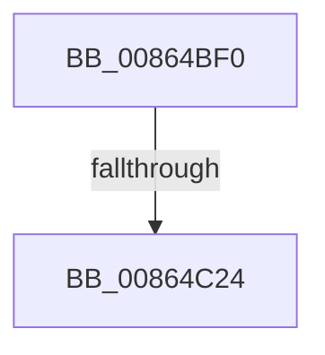

# ObpFreeObject

- RVA: `0x00864BF0`–`0x00864C29` (길이 `57` bytes)
- VA: `0x0000000140864BF0`
- 실행 섹션: `PAGE`
- PDB 이름 있음: `예`; PDB Function 태그: `아니요`
- unwind 정보 RVA: `0x0006B9D8`
- 디코드: `17`개 명령, `57/57` bytes 표시
- 미해석 바이트: `0` (있으면 어셈블리에 `.byte`로 보존)

> 이 문서는 커널 이미지의 기계어와 PDB 기호를 분석해 생성했습니다. 4번과 5번은 함수 원형과 자료형을 바이너리 사용 방식에서 추정한 C 해석이며 원본 소스 복구 결과는 아닙니다.

## 1. Dependencies

- 직접 호출 지점: **0**; 고유 호출 대상: **0**
- 직접 호출자로 확인된 함수: **1**
- RIP 상대 이미지 참조: **1**

### Outgoing calls
- 직접 디코드된 call 명령이 없습니다.

### Direct callers
- [ObpRemoveObjectRoutine](ObpRemoveObjectRoutine_function_00864A60.md) at `0x00864B28`

### Static image references
- `0x00864BFE` → RVA `0x00000000` (`image boundary/outside`; read)

## 2. Other-region calls and transfers

- 다른 실행 섹션으로 향하는 call: **0**
- call이 아닌 외부 분기/꼬리 이동: **1**
  - `0x00864C1E` → [sub_00864E12](Unknown_function_00864E12.md) (`tail-transfer`)

## 3. Assembly (complete function range)

```asm
00864BF0  40 53                           push rbx
00864BF2  55                              push rbp
00864BF3  56                              push rsi
00864BF4  57                              push rdi
00864BF5  41 56                           push r14
00864BF7  48 83 EC 30                     sub rsp, 0x30
00864BFB  48 8B D9                        mov rbx, rcx
00864BFE  48 8D 2D FB B3 79 FF            lea rbp, [rip - 0x864c05]
00864C05  0F B6 49 1A                     movzx ecx, byte ptr [rcx + 0x1a]
00864C09  B8 00 00 00 00                  mov eax, 0
00864C0E  F6 C1 01                        test cl, 1
00864C11  8B D1                           mov edx, ecx
00864C13  4C 8D 73 E0                     lea r14, [rbx - 0x20]
00864C17  4C 0F 44 F0                     cmove r14, rax
00864C1B  F6 C1 02                        test cl, 2
00864C1E  0F 85 EE 01 00 00               jne 0x140864e12
00864C24  48 89 44 24 70                  mov qword ptr [rsp + 0x70], rax
```

## 4. C-style interpretation (structured pseudocode)

```c
__int64 __fastcall ObpFreeObject(__int64 a1)
{
    __int64 v_r14;
    __int64 v_rsp;
    unsigned __int64 v_stack_p18;

    v_rsp = (v_rsp) - (48);
    v_r14 = a1 - 32;
    if ((((unsigned __int8)(*(unsigned __int8 *)(a1 + 26))) & (1)) == 0) { v_r14 = 0; }
    v_stack_p18 = 0;
    return 0;
}
```

## 5. (Beta) C Style

```c
int64_t ObpFreeObject(void *Arg1)
{
    uint8_t *arg1 = (uint8_t *)Arg1;

    int64_t local_r14;
    int64_t local_rsp;
    uint64_t v_stack_p18;

    local_rsp = (local_rsp) - (48);
    local_r14 = Arg1 - 32;
    if ((((uint8_t)(*(uint8_t *)(arg1 + 0x1A))) & (1)) == 0) { local_r14 = 0; }
    v_stack_p18 = 0;
    return 0;
}
```

### 관측된 메모리 오프셋

구조체 형식이 확인되지 않은 접근은 인자 기준의 오프셋으로만 기록했습니다.

| 기준 인자 | 오프셋 표현 | 폭 (bit) | 접근 |
|---|---:|---:|---|
| `Arg1` | `- 0x20` | `64` | `R` |
| `Arg1` | `+ 0x1A` | `8` | `R` |

## 6. Execution-region graph

[열기: 2D/3D 그래프와 함수 탐색 컨트롤 패널](../../../control-panel.html?section=page&rva=0x00864BF0&view=graph)

- 2D 그래프는 위에서 아래로 흐르고, 3D 그래프는 빈 공간을 드래그해 회전합니다. Shift+드래그는 이동, 휠은 확대·축소, 함수 노드 선택은 대상 보고서 이동입니다.

### Static fallback


