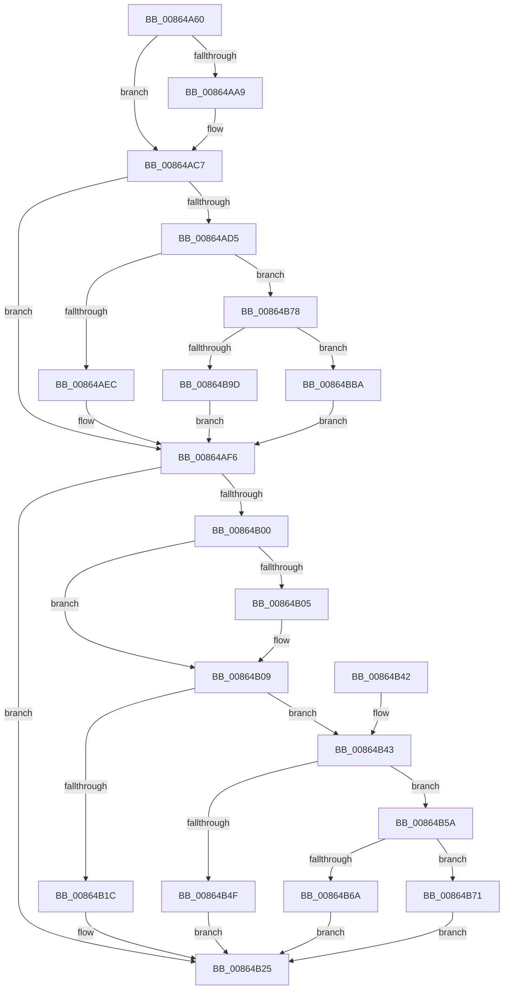

# ObpRemoveObjectRoutine

- RVA: `0x00864A60`–`0x00864BDB` (길이 `379` bytes)
- VA: `0x0000000140864A60`
- 실행 섹션: `PAGE`
- PDB 이름 있음: `예`; PDB Function 태그: `아니요`
- unwind 정보 RVA: `0x0006B9C0`
- 디코드: `90`개 명령, `379/379` bytes 표시
- 미해석 바이트: `0` (있으면 어셈블리에 `.byte`로 보존)

> 이 문서는 커널 이미지의 기계어와 PDB 기호를 분석해 생성했습니다. 4번과 5번은 함수 원형과 자료형을 바이너리 사용 방식에서 추정한 C 해석이며 원본 소스 복구 결과는 아닙니다.

## 1. Dependencies

- 직접 호출 지점: **9**; 고유 호출 대상: **8**
- 직접 호출자로 확인된 함수: **18**
- RIP 상대 이미지 참조: **8**

### Outgoing calls
- `0x00864AC1` → [KeBugCheckEx](../../text/4F/KeBugCheckEx_function_004FD660.md) (function, `0x004FD660`)
- `0x00864AF1` → [ObDeassignSecurity](ObDeassignSecurity_function_008653F0.md) (function, `0x008653F0`)
- `0x00864B20` → [CmpDeleteKeyObject](CmpDeleteKeyObject_function_00865590.md) (function, `0x00865590`)
- `0x00864B28` → [ObpFreeObject](ObpFreeObject_function_00864BF0.md) (function, `0x00864BF0`)
- `0x00864B53` → [IopDeleteFile](IopDeleteFile_function_00863E00.md) (function, `0x00863E00`)
- `0x00864B6A` → [SepTokenDeleteMethod](../AF/SepTokenDeleteMethod_function_00AF23D0.md) (function, `0x00AF23D0`)
- `0x00864B71` → [guard_dispatch_icall](../../text/6B/guard_dispatch_icall_function_006BAAD0.md) (function, `0x006BAAD0`)
- `0x00864BB0` → [WmipSecurityMethod](../9A/WmipSecurityMethod_function_009A71F0.md) (function, `0x009A71F0`)
- `0x00864BD1` → [guard_dispatch_icall](../../text/6B/guard_dispatch_icall_function_006BAAD0.md) (function, `0x006BAAD0`)

### Direct callers
- [IoRemoveIoCompletion](../../text/20/IoRemoveIoCompletion_function_0020B580.md) at `0x0020BB92`
- [IoRemoveIoCompletion](../../text/20/IoRemoveIoCompletion_function_0020B580.md) at `0x0020BC19`
- [IoRemoveIoCompletion](../../text/20/IoRemoveIoCompletion_function_0020B580.md) at `0x0020BCA1`
- [IopReleaseFileObjectLock](../../text/25/IopReleaseFileObjectLock_function_00250A90.md) at `0x00250DED`
- [NtSetInformationFile](../../text/29/NtSetInformationFile_function_0029C5E0.md) at `0x0029D1B2`
- [ObfDereferenceObjectWithTag](../../text/2F/ObfDereferenceObjectWithTag_function_002F78E0.md) at `0x002F79E3`
- [ObfDereferenceObject](../../text/2F/ObfDereferenceObject_function_002F9350.md) at `0x002F9452`
- [NtTraceEvent](../../text/2F/NtTraceEvent_function_002FA6C0.md) at `0x002FADF3`
- [PfSnGetFileInformation](../../text/34/PfSnGetFileInformation_function_00343210.md) at `0x0034363C`
- [sub_00343D34](../../text/34/Unknown_function_00343D34.md) at `0x00343D82`
- [IopFreeWaitCompletionPacket](../../text/35/IopFreeWaitCompletionPacket_function_00351A50.md) at `0x00351D6F`
- [IopFreeWaitCompletionPacket](../../text/35/IopFreeWaitCompletionPacket_function_00351A50.md) at `0x00351DED`
- [IopFreeWaitCompletionPacket](../../text/35/IopFreeWaitCompletionPacket_function_00351A50.md) at `0x00351E6A`
- [sub_0038C58B](../../text/38/Unknown_function_0038C58B.md) at `0x0038C781`
- [sub_00393FDE](../../text/39/Unknown_function_00393FDE.md) at `0x00394061`
- [sub_00393FDE](../../text/39/Unknown_function_00393FDE.md) at `0x003940DE`
- [NtWaitForWorkViaWorkerFactory](../../text/39/NtWaitForWorkViaWorkerFactory_function_00394270.md) at `0x00394DE8`
- [ObpDereferenceNamedObject](../../text/3A/ObpDereferenceNamedObject_function_003A0310.md) at `0x003A0426`
- [ExpSetTimerObject2](../../text/3A/ExpSetTimerObject2_function_003A0658.md) at `0x003A07DA`
- [NtSignalAndWaitForSingleObject](../../text/3A/NtSignalAndWaitForSingleObject_function_003A11D0.md) at `0x003A15F2`
- [NtSignalAndWaitForSingleObject](../../text/3A/NtSignalAndWaitForSingleObject_function_003A11D0.md) at `0x003A1641`
- [IopUnloadSafeCompletion](../../text/3A/IopUnloadSafeCompletion_function_003A16A0.md) at `0x003A1805`
- [sub_003ED675](../../text/3E/Unknown_function_003ED675.md) at `0x003ED721`
- [ObpProcessRemoveObjectQueue](../9D/ObpProcessRemoveObjectQueue_function_009D7B40.md) at `0x009D7D24`

### Static image references
- `0x00864A77` → RVA `0x00FC7800` (`ALMOSTRO`; read)
- `0x00864A92` → RVA `0x00FC6E4C` (`ALMOSTRO`; read)
- `0x00864AA0` → RVA `0x00F0F660` (`.data`; read)
- `0x00864ADC` → RVA `0x008BA2B0` (`SeDefaultObjectMethod`; read)
- `0x00864B10` → RVA `0x00865590` (`CmpDeleteKeyObject`; read)
- `0x00864B43` → RVA `0x00863E00` (`IopDeleteFile`; read)
- `0x00864B5A` → RVA `0x00AF23D0` (`SepTokenDeleteMethod`; read)
- `0x00864B88` → RVA `0x009A71F0` (`WmipSecurityMethod`; read)

## 2. Other-region calls and transfers

- 다른 실행 섹션으로 향하는 call: **3**
  - `0x00864AC1` → [KeBugCheckEx](../../text/4F/KeBugCheckEx_function_004FD660.md) (`PAGE` → `.text`)
  - `0x00864B71` → [guard_dispatch_icall](../../text/6B/guard_dispatch_icall_function_006BAAD0.md) (`PAGE` → `.text`)
  - `0x00864BD1` → [guard_dispatch_icall](../../text/6B/guard_dispatch_icall_function_006BAAD0.md) (`PAGE` → `.text`)
- 별도 외부 분기/꼬리 이동을 확인하지 못했습니다.

## 3. Assembly (complete function range)

```asm
00864A60  48 89 5C 24 10                  mov qword ptr [rsp + 0x10], rbx
00864A65  48 89 6C 24 18                  mov qword ptr [rsp + 0x18], rbp
00864A6A  48 89 74 24 20                  mov qword ptr [rsp + 0x20], rsi
00864A6F  57                              push rdi
00864A70  48 83 EC 50                     sub rsp, 0x50
00864A74  48 8B D9                        mov rbx, rcx
00864A77  48 8D 3D 82 2D 76 00            lea rdi, [rip + 0x762d82]
00864A7E  48 8B C1                        mov rax, rcx
00864A81  0F B6 EA                        movzx ebp, dl
00864A84  48 C1 E8 08                     shr rax, 8
00864A88  0F B6 C8                        movzx ecx, al
00864A8B  0F B6 43 18                     movzx eax, byte ptr [rbx + 0x18]
00864A8F  48 33 C8                        xor rcx, rax
00864A92  0F B6 05 B3 23 76 00            movzx eax, byte ptr [rip + 0x7623b3]
00864A99  48 33 C8                        xor rcx, rax
00864A9C  48 8B 3C CF                     mov rdi, qword ptr [rdi + rcx*8]
00864AA0  48 3B 3D B9 AB 6A 00            cmp rdi, qword ptr [rip + 0x6aabb9]
00864AA7  75 1E                           jne 0x140864ac7
00864AA9  45 33 C9                        xor r9d, r9d
00864AAC  48 C7 44 24 20 00 00 00 00      mov qword ptr [rsp + 0x20], 0
00864AB5  4C 8D 43 30                     lea r8, [rbx + 0x30]
00864AB9  48 8B D7                        mov rdx, rdi
00864ABC  B9 F4 00 00 00                  mov ecx, 0xf4
00864AC1  E8 9A 8B C9 FF                  call 0x1404fd660
00864AC6  CC                              int3
00864AC7  48 8B 43 28                     mov rax, qword ptr [rbx + 0x28]
00864ACB  48 89 44 24 60                  mov qword ptr [rsp + 0x60], rax
00864AD0  48 85 C0                        test rax, rax
00864AD3  74 21                           je 0x140864af6
00864AD5  48 8B 87 98 00 00 00            mov rax, qword ptr [rdi + 0x98]
00864ADC  48 8D 0D CD 57 05 00            lea rcx, [rip + 0x557cd]
00864AE3  48 3B C1                        cmp rax, rcx
00864AE6  0F 85 8C 00 00 00               jne 0x140864b78
00864AEC  48 8D 4C 24 60                  lea rcx, [rsp + 0x60]
00864AF1  E8 FA 08 00 00                  call 0x1408653f0
00864AF6  48 83 BF 88 00 00 00 00         cmp qword ptr [rdi + 0x88], 0
00864AFE  74 25                           je 0x140864b25
00864B00  40 84 ED                        test bpl, bpl
00864B03  75 04                           jne 0x140864b09
00864B05  80 4B 1B 80                     or byte ptr [rbx + 0x1b], 0x80
00864B09  48 8B 87 88 00 00 00            mov rax, qword ptr [rdi + 0x88]
00864B10  48 8D 0D 79 0A 00 00            lea rcx, [rip + 0xa79]
00864B17  48 3B C1                        cmp rax, rcx
00864B1A  75 27                           jne 0x140864b43
00864B1C  48 8D 4B 30                     lea rcx, [rbx + 0x30]
00864B20  E8 6B 0A 00 00                  call 0x140865590
00864B25  48 8B CB                        mov rcx, rbx
00864B28  E8 C3 00 00 00                  call 0x140864bf0
00864B2D  48 8B 5C 24 68                  mov rbx, qword ptr [rsp + 0x68]
00864B32  48 8B 6C 24 70                  mov rbp, qword ptr [rsp + 0x70]
00864B37  48 8B 74 24 78                  mov rsi, qword ptr [rsp + 0x78]
00864B3C  48 83 C4 50                     add rsp, 0x50
00864B40  5F                              pop rdi
00864B41  C3                              ret
00864B42  CC                              int3
00864B43  48 8D 0D B6 F2 FF FF            lea rcx, [rip - 0xd4a]
00864B4A  48 3B C1                        cmp rax, rcx
00864B4D  75 0B                           jne 0x140864b5a
00864B4F  48 8D 4B 30                     lea rcx, [rbx + 0x30]
00864B53  E8 A8 F2 FF FF                  call 0x140863e00
00864B58  EB CB                           jmp 0x140864b25
00864B5A  48 8D 0D 6F D8 28 00            lea rcx, [rip + 0x28d86f]
00864B61  48 3B C1                        cmp rax, rcx
00864B64  48 8D 4B 30                     lea rcx, [rbx + 0x30]
00864B68  75 07                           jne 0x140864b71
00864B6A  E8 61 D8 28 00                  call 0x140af23d0
00864B6F  EB B4                           jmp 0x140864b25
00864B71  E8 5A 5F E5 FF                  call 0x1406baad0
00864B76  EB AD                           jmp 0x140864b25
00864B78  45 33 C0                        xor r8d, r8d
00864B7B  C6 44 24 40 00                  mov byte ptr [rsp + 0x40], 0
00864B80  45 33 C9                        xor r9d, r9d
00864B83  4C 89 44 24 38                  mov qword ptr [rsp + 0x38], r8
00864B88  48 8D 0D 61 26 14 00            lea rcx, [rip + 0x142661]
00864B8F  44 89 44 24 30                  mov dword ptr [rsp + 0x30], r8d
00864B94  41 8D 51 02                     lea edx, [r9 + 2]
00864B98  48 3B C1                        cmp rax, rcx
00864B9B  75 1D                           jne 0x140864bba
00864B9D  48 8D 44 24 60                  lea rax, [rsp + 0x60]
00864BA2  48 89 44 24 28                  mov qword ptr [rsp + 0x28], rax
00864BA7  48 8D 4B 30                     lea rcx, [rbx + 0x30]
00864BAB  4C 89 44 24 20                  mov qword ptr [rsp + 0x20], r8
00864BB0  E8 3B 26 14 00                  call 0x1409a71f0
00864BB5  E9 3C FF FF FF                  jmp 0x140864af6
00864BBA  48 8D 4C 24 60                  lea rcx, [rsp + 0x60]
00864BBF  48 89 4C 24 28                  mov qword ptr [rsp + 0x28], rcx
00864BC4  48 8D 4B 30                     lea rcx, [rbx + 0x30]
00864BC8  48 C7 44 24 20 00 00 00 00      mov qword ptr [rsp + 0x20], 0
00864BD1  E8 FA 5E E5 FF                  call 0x1406baad0
00864BD6  E9 1B FF FF FF                  jmp 0x140864af6
```

## 4. C-style interpretation (structured pseudocode)

```c
__int64 __fastcall ObpRemoveObjectRoutine(__int64 a1, unsigned __int8 a2, __int64 a3, int a4)
{
    __int64 result;
    __int64 v_rsp;
    unsigned __int64 v_stack_m38;
    unsigned __int64 v_stack_p10;
    unsigned __int64 v_stack_p18;
    unsigned __int64 v_stack_p20;
    unsigned __int64 v_stack_p28;
    unsigned int v_stack_p30;
    unsigned __int64 v_stack_p38;
    unsigned __int8 v_stack_p40;
    unsigned __int64 v_stack_p60;
    unsigned __int64 v_stack_p8;

    v_stack_p10 = v_rbx;
    v_stack_p18 = v_rbp;
    v_stack_p20 = v_rsi;
    v_rsp = (v_rsp) - (80);
    result = (a1) >> (8);
    a1 = ((unsigned __int8)(result)) ^ (*(unsigned __int8 *)(a1 + 24));
    a1 = (a1) ^ (*(unsigned __int8 *)(v_rip + 7742387));
    result = *(unsigned __int8 *)(v_rip + 7742387);
    if ((*(unsigned __int64 *)(v_rip + 7744898 + a1 * 8)) == (*(unsigned __int64 *)(v_rip + 6990777))) {
        a4 = 0;
        v_stack_m38 = 0;
        a3 = a1 + 48;
        a2 = *(unsigned __int64 *)(v_rip + 7744898 + a1 * 8);
        a1 = 244;
        result = KeBugCheckEx(a1, a2, a3, a4);
    }
    v_stack_p8 = *(unsigned __int64 *)(a1 + 40);
    if (*(unsigned __int64 *)(a1 + 40) == 0) goto loc_00864AF6;
    if ((*(unsigned __int64 *)(*(unsigned __int64 *)(v_rip + 7744898 + a1 * 8) + 152)) != (v_rip + 350157)) goto loc_00864B78;
    result = ObDeassignSecurity(v_stack_p8, a2, a3, a4);
loc_00864AF6:
    if ((*(unsigned __int64 *)(*(unsigned __int64 *)(v_rip + 7744898 + a1 * 8) + 136)) == 0) goto loc_00864B25;
    if (a2 == 0) {
    }
    if ((*(unsigned __int64 *)(*(unsigned __int64 *)(v_rip + 7744898 + a1 * 8) + 136)) != (v_rip + 2681)) goto loc_00864B43;
    result = CmpDeleteKeyObject(a1 + 48, a2, a3, a4);
loc_00864B25:
    result = ObpFreeObject(a1, a2, a3, a4);
    v_rsp = (v_rsp) + (80);
    return result;
loc_00864B43:
    if (result != (v_rip - 3402)) goto loc_00864B5A;
    result = IopDeleteFile(v_stack_p10 + 48, a2, a3, a4);
    goto loc_00864B25;
loc_00864B5A:
    if (result != (v_rip + 2676847)) goto loc_00864B71;
    result = SepTokenDeleteMethod(v_stack_p10 + 48, a2, a3, a4);
    goto loc_00864B25;
loc_00864B71:
    result = guard_dispatch_icall(v_stack_p10 + 48, a2, a3, a4);
    goto loc_00864B25;
loc_00864B78:
    a3 = 0;
    v_stack_p40 = 0;
    a4 = 0;
    v_stack_p38 = 0;
    v_stack_p30 = 0;
    if (result != (v_rip + 1320545)) goto loc_00864BBA;
    v_stack_p28 = v_stack_p60;
    v_stack_p20 = 0;
    result = WmipSecurityMethod(v_stack_p10 + 48, a4 + 2, a3, a4);
    goto loc_00864AF6;
loc_00864BBA:
    v_stack_p28 = v_stack_p60;
    v_stack_p20 = 0;
    result = guard_dispatch_icall(v_stack_p10 + 48, a4 + 2, a3, a4);
    goto loc_00864AF6;
}
```

## 5. (Beta) C Style

```c
int64_t ObpRemoveObjectRoutine(void *Arg1, uint8_t Arg2, int64_t Arg3, int32_t Arg4)
{
    uint8_t *arg1 = (uint8_t *)Arg1;

    int64_t result;
    int64_t local_rsp;
    uint64_t v_stack_m38;
    uint64_t v_stack_p10;
    uint64_t v_stack_p18;
    uint64_t v_stack_p20;
    uint64_t v_stack_p28;
    uint32_t v_stack_p30;
    uint64_t v_stack_p38;
    uint8_t v_stack_p40;
    uint64_t v_stack_p60;
    uint64_t v_stack_p8;

    v_stack_p10 = local_rbx;
    v_stack_p18 = local_rbp;
    v_stack_p20 = local_rsi;
    local_rsp = (local_rsp) - (80);
    result = (Arg1) >> (8);
    Arg1 = ((uint8_t)(result)) ^ (*(uint8_t *)(arg1 + 0x18));
    Arg1 = (Arg1) ^ (*(uint8_t *)(v_rip + 0x7623B3));
    result = *(uint8_t *)(v_rip + 0x7623B3);
    if ((*(uint64_t *)(v_rip + 0x762D82 + arg1 * 8)) == (*(uint64_t *)(v_rip + 0x6AABB9))) {
        Arg4 = 0;
        v_stack_m38 = 0;
        Arg3 = Arg1 + 48;
        Arg2 = *(uint64_t *)(v_rip + 0x762D82 + arg1 * 8);
        Arg1 = 244;
        result = KeBugCheckEx(Arg1, Arg2, Arg3, Arg4);
    }
    v_stack_p8 = *(uint64_t *)(arg1 + 0x28);
    if (*(uint64_t *)(arg1 + 0x28) == 0) goto loc_00864AF6;
    if ((*(uint64_t *)(*(uint64_t *)(v_rip + 0x762D82 + arg1 * 8) + 0x98)) != (v_rip + 350157)) goto loc_00864B78;
    result = ObDeassignSecurity(v_stack_p8, Arg2, Arg3, Arg4);
loc_00864AF6:
    if ((*(uint64_t *)(*(uint64_t *)(v_rip + 0x762D82 + arg1 * 8) + 0x88)) == 0) goto loc_00864B25;
    if (Arg2 == 0) {
    }
    if ((*(uint64_t *)(*(uint64_t *)(v_rip + 0x762D82 + arg1 * 8) + 0x88)) != (v_rip + 2681)) goto loc_00864B43;
    result = CmpDeleteKeyObject(Arg1 + 48, Arg2, Arg3, Arg4);
loc_00864B25:
    result = ObpFreeObject(Arg1, Arg2, Arg3, Arg4);
    local_rsp = (local_rsp) + (80);
    return result;
loc_00864B43:
    if (result != (v_rip - 3402)) goto loc_00864B5A;
    result = IopDeleteFile(v_stack_p10 + 48, Arg2, Arg3, Arg4);
    goto loc_00864B25;
loc_00864B5A:
    if (result != (v_rip + 2676847)) goto loc_00864B71;
    result = SepTokenDeleteMethod(v_stack_p10 + 48, Arg2, Arg3, Arg4);
    goto loc_00864B25;
loc_00864B71:
    result = guard_dispatch_icall(v_stack_p10 + 48, Arg2, Arg3, Arg4);
    goto loc_00864B25;
loc_00864B78:
    Arg3 = 0;
    v_stack_p40 = 0;
    Arg4 = 0;
    v_stack_p38 = 0;
    v_stack_p30 = 0;
    if (result != (v_rip + 1320545)) goto loc_00864BBA;
    v_stack_p28 = v_stack_p60;
    v_stack_p20 = 0;
    result = WmipSecurityMethod(v_stack_p10 + 48, Arg4 + 2, Arg3, Arg4);
    goto loc_00864AF6;
loc_00864BBA:
    v_stack_p28 = v_stack_p60;
    v_stack_p20 = 0;
    result = guard_dispatch_icall(v_stack_p10 + 48, Arg4 + 2, Arg3, Arg4);
    goto loc_00864AF6;
}
```

### 관측된 메모리 오프셋

구조체 형식이 확인되지 않은 접근은 인자 기준의 오프셋으로만 기록했습니다.

| 기준 인자 | 오프셋 표현 | 폭 (bit) | 접근 |
|---|---:|---:|---|
| `Arg1` | `+ 0x18` | `8` | `R` |
| `Arg1` | `+ 0x1B` | `8` | `R/W` |
| `Arg1` | `+ 0x28` | `64` | `R` |
| `Arg1` | `+ 0x30` | `64` | `R` |

## 6. Execution-region graph

[열기: 2D/3D 그래프와 함수 탐색 컨트롤 패널](../../../control-panel.html?section=page&rva=0x00864A60&view=graph)

- 2D 그래프는 위에서 아래로 흐르고, 3D 그래프는 빈 공간을 드래그해 회전합니다. Shift+드래그는 이동, 휠은 확대·축소, 함수 노드 선택은 대상 보고서 이동입니다.

### Static fallback


