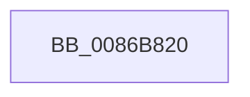

# SeCaptureSubjectContext

- RVA: `0x0086B820`–`0x0086B826` (길이 `6` bytes)
- VA: `0x000000014086B820`
- 실행 섹션: `PAGE`
- PDB 이름 있음: `예`; PDB Function 태그: `아니요`
- unwind 정보 RVA: `0x0006C018`
- 디코드: `2`개 명령, `6/6` bytes 표시
- 미해석 바이트: `0` (있으면 어셈블리에 `.byte`로 보존)

> 이 문서는 커널 이미지의 기계어와 PDB 기호를 분석해 생성했습니다. 4번과 5번은 함수 원형과 자료형을 바이너리 사용 방식에서 추정한 C 해석이며 원본 소스 복구 결과는 아닙니다.

## 1. Dependencies

- 직접 호출 지점: **0**; 고유 호출 대상: **0**
- 직접 호출자로 확인된 함수: **104**
- RIP 상대 이미지 참조: **0**

### Outgoing calls
- 직접 디코드된 call 명령이 없습니다.

### Direct callers
- [SeReportSecurityEventWithSubCategory](../../text/22/SeReportSecurityEventWithSubCategory_function_002248B0.md) at `0x00224ADC`
- [RtlCheckTokenCapability](../../text/3A/RtlCheckTokenCapability_function_003A5520.md) at `0x003A5853`
- [RtlCheckTokenMembershipEx](../../text/3A/RtlCheckTokenMembershipEx_function_003A5A30.md) at `0x003A5AEA`
- [SeAccessCheckByType](../../text/44/SeAccessCheckByType_function_00440BC8.md) at `0x004416B8`
- [IoCheckRedirectionTrustLevel](../../text/48/IoCheckRedirectionTrustLevel_function_00485BB0.md) at `0x00485C1F`
- [IoComputeRedirectionTrustLevel](../../text/4B/IoComputeRedirectionTrustLevel_function_004BFE50.md) at `0x004BFE7A`
- [SepCreateAppContainerToken](../../text/4F/SepCreateAppContainerToken_function_004F43AC.md) at `0x004F4750`
- [SepCreateAppContainerToken](../../text/4F/SepCreateAppContainerToken_function_004F43AC.md) at `0x004F48A9`
- [SeAdjustAntiTamperCreatorAccess](../../text/60/SeAdjustAntiTamperCreatorAccess_function_00607590.md) at `0x006075E1`
- [WdipAccessCheck](../../text/64/WdipAccessCheck_function_0064E084.md) at `0x0064E255`
- [CmpCheckHivePrimaryFileReadWriteAccess](../../text/66/CmpCheckHivePrimaryFileReadWriteAccess_function_0066AD0C.md) at `0x0066AD42`
- [SepCheckCreateAppContainer](../70/SepCheckCreateAppContainer_function_007006CC.md) at `0x007006F7`
- [FsRtlpOplockTryPrepForAckTimeout](../71/FsRtlpOplockTryPrepForAckTimeout_function_007156C0.md) at `0x00715760`
- [PnpGetCallerSessionId](../72/PnpGetCallerSessionId_function_0072C7C4.md) at `0x0072C7DF`
- [PiAuCheckTokenMembership](../73/PiAuCheckTokenMembership_function_00731348.md) at `0x00731459`
- [PspIumVerifyParentSd](../78/PspIumVerifyParentSd_function_00787D04.md) at `0x00787D47`
- [SeAdtRegistryValueChangedAuditAlarm](../79/SeAdtRegistryValueChangedAuditAlarm_function_0079DDD4.md) at `0x0079DE77`
- [SeAuditBootConfiguration](../79/SeAuditBootConfiguration_function_0079E374.md) at `0x0079E417`
- [SeAuditFipsCryptoSelftests](../79/SeAuditFipsCryptoSelftests_function_0079E820.md) at `0x0079E8A3`
- [SeAuditSystemTimeChange](../79/SeAuditSystemTimeChange_function_0079EB8C.md) at `0x0079EBDC`
- [SeAuditTransactionStateChange](../79/SeAuditTransactionStateChange_function_0079ED50.md) at `0x0079EE1E`
- [SepAuditAssignPrimaryToken](../79/SepAuditAssignPrimaryToken_function_0079F828.md) at `0x0079F8B2`
- [NtDeleteObjectAuditAlarm](../7A/NtDeleteObjectAuditAlarm_function_007A03C0.md) at `0x007A040A`
- [NtSetUuidSeed](../7D/NtSetUuidSeed_function_007D0DD0.md) at `0x007D0E78`
- [NtRenameKey](../7E/NtRenameKey_function_007E04B0.md) at `0x007E0724`
- [CmUpdateFeatureConfiguration](../7E/CmUpdateFeatureConfiguration_function_007E5C10.md) at `0x007E5C55`
- [CmUpdateFeatureUsageSubscription](../7E/CmUpdateFeatureUsageSubscription_function_007E5E78.md) at `0x007E5EB1`
- [NtSetInformationKey](../84/NtSetInformationKey_function_00843720.md) at `0x00843D4B`
- [NtSetValueKey](../84/NtSetValueKey_function_00844EA0.md) at `0x008456B8`
- [CmSetValueKey](../84/CmSetValueKey_function_008457C0.md) at `0x008458D1`
- [NtDeleteValueKey](../84/NtDeleteValueKey_function_00848770.md) at `0x00848C4F`
- [NtDeleteKey](../84/NtDeleteKey_function_00849920.md) at `0x00849CFB`
- [ObCloseHandleTableEntry](ObCloseHandleTableEntry_function_00869E20.md) at `0x0086A042`
- [SepAdtAuditObjectAccessWithContext](SepAdtAuditObjectAccessWithContext_function_0086EEF0.md) at `0x0086F058`
- [sub_00870B27](../87/Unknown_function_00870B27.md) at `0x00870B3E`
- [ObCreateObject](../87/ObCreateObject_function_00872CB0.md) at `0x00872ECE`
- [CmpLogHiveFileInaccessible](../87/CmpLogHiveFileInaccessible_function_0087AEAC.md) at `0x0087B119`
- [IopAllocRealFileObject](../89/IopAllocRealFileObject_function_00899720.md) at `0x00899B05`
- [ObpParseSymbolicLinkEx](../8B/ObpParseSymbolicLinkEx_function_008B35C0.md) at `0x008B38D6`
- [RtlIsSandboxedToken](../8B/RtlIsSandboxedToken_function_008B3AB0.md) at `0x008B3B3E`
- [NtDuplicateToken](../8B/NtDuplicateToken_function_008B6DF0.md) at `0x008B6EF5`
- [NtCreateEvent](../8B/NtCreateEvent_function_008B9140.md) at `0x008B9409`
- [sub_008BB534](../8B/Unknown_function_008BB534.md) at `0x008BB657`
- [EtwpCheckLoggerControlAccess](../8C/EtwpCheckLoggerControlAccess_function_008C0AE0.md) at `0x008C0B21`
- [EtwpFindOrCreateGuidEntry](../8C/EtwpFindOrCreateGuidEntry_function_008C1B70.md) at `0x008C1CA5`
- [sub_008C2328](../8C/Unknown_function_008C2328.md) at `0x008C244F`
- [EtwpAccessCheck](../8C/EtwpAccessCheck_function_008C6C2C.md) at `0x008C6C60`
- [PiDqQueryCreate](../8D/PiDqQueryCreate_function_008DCA88.md) at `0x008DCB26`
- [sub_008E6A55](../8E/Unknown_function_008E6A55.md) at `0x008E6B35`
- [PiAuIsLocalSystem](../8E/PiAuIsLocalSystem_function_008E6D34.md) at `0x008E6D7C`
- [PiCMValidateDeviceInstance](../8E/PiCMValidateDeviceInstance_function_008E799C.md) at `0x008E7AA2`
- [IopGetDeviceInterfaces](../8F/IopGetDeviceInterfaces_function_008F0120.md) at `0x008F03A6`
- [IoGetDeviceInterfaceAlias](../8F/IoGetDeviceInterfaceAlias_function_008F5570.md) at `0x008F5693`
- [PiPnpRtlObjectEventWorker](../8F/PiPnpRtlObjectEventWorker_function_008F8630.md) at `0x008F8A0C`
- [PipProcessStartPhase3](../8F/PipProcessStartPhase3_function_008FBAF8.md) at `0x008FBC85`
- [SepAdtTokenRightAdjusted](../90/SepAdtTokenRightAdjusted_function_0090445C.md) at `0x009044BB`
- [NtDeleteWnfStateName](../90/NtDeleteWnfStateName_function_00908E60.md) at `0x00908FD8`
- [NtDeleteWnfStateName](../90/NtDeleteWnfStateName_function_00908E60.md) at `0x00909194`
- [NtQueryWnfStateData](../90/NtQueryWnfStateData_function_00909DF0.md) at `0x0090A3E3`
- [ExpNtUpdateWnfStateData](../90/ExpNtUpdateWnfStateData_function_0090A7A0.md) at `0x0090ACF7`
- [ExpWnfCheckCrossScopeAccess](../90/ExpWnfCheckCrossScopeAccess_function_0090CA94.md) at `0x0090CB06`
- [SeOperationAuditAlarm](../91/SeOperationAuditAlarm_function_0091EA78.md) at `0x0091EB50`
- [SeSecurityDescriptorChangedAuditAlarm](../91/SeSecurityDescriptorChangedAuditAlarm_function_0091FC5C.md) at `0x0091FCE1`
- [SeTokenDefaultDaclChangedAuditAlarm](../92/SeTokenDefaultDaclChangedAuditAlarm_function_00920570.md) at `0x009205DF`
- [SeDeleteObjectAuditAlarmWithTransaction](../92/SeDeleteObjectAuditAlarmWithTransaction_function_00920830.md) at `0x00920858`
- [PspInsertProcess](../94/PspInsertProcess_function_009472CC.md) at `0x00947555`
- [SeAuditProcessCreation](../94/SeAuditProcessCreation_function_00947624.md) at `0x00947800`
- [CmpSetKeySecurity](../94/CmpSetKeySecurity_function_0094A124.md) at `0x0094A1D7`
- [ObInitProcess](../94/ObInitProcess_function_0094C62C.md) at `0x0094C770`
- [PiAuDoesClientHaveAccess](../96/PiAuDoesClientHaveAccess_function_00962940.md) at `0x00962979`
- [PiAuDoesClientHavePrivilege](../96/PiAuDoesClientHavePrivilege_function_00964ADC.md) at `0x00964B3C`
- [sub_00968AF6](../96/Unknown_function_00968AF6.md) at `0x00969A63`
- [sub_00968AF6](../96/Unknown_function_00968AF6.md) at `0x00969FCA`
- [NtPrivilegeObjectAuditAlarm](../97/NtPrivilegeObjectAuditAlarm_function_00974170.md) at `0x009741CB`
- [NtPrivilegedServiceAuditAlarm](../97/NtPrivilegedServiceAuditAlarm_function_00974430.md) at `0x00974486`
- [NtOpenObjectAuditAlarm](../97/NtOpenObjectAuditAlarm_function_00974700.md) at `0x009747A3`
- [PiDqOpenUserObjectRegKey](../99/PiDqOpenUserObjectRegKey_function_00990444.md) at `0x00990769`
- [sub_009A2983](../9A/Unknown_function_009A2983.md) at `0x009A299E`
- [PspSinglePrivCheck](../9B/PspSinglePrivCheck_function_009BADCC.md) at `0x009BAE03`
- [PiUEventHandleRegistration](../9C/PiUEventHandleRegistration_function_009C3304.md) at `0x009C3372`
- [SepFilterToken](../9C/SepFilterToken_function_009C6B80.md) at `0x009C76FB`
- [ExpWnfCheckCallerAccess](../9D/ExpWnfCheckCallerAccess_function_009D57C0.md) at `0x009D57F0`
- [ExpWnfValidatePubSubPreconditions](../9E/ExpWnfValidatePubSubPreconditions_function_009E6E00.md) at `0x009E6E4E`
- [PiAuVerifyAccessToObject](../9E/PiAuVerifyAccessToObject_function_009E92D0.md) at `0x009E9336`
- [SeAssignPrimaryToken](../9F/SeAssignPrimaryToken_function_009F117C.md) at `0x009F11BC`
- [SeCheckPrivilegedObject](../9F/SeCheckPrivilegedObject_function_009F62CC.md) at `0x009F631A`
- [EtwpCoverageUserIsAdmin](../9F/EtwpCoverageUserIsAdmin_function_009FE548.md) at `0x009FE560`
- [SepAccessCheckAndAuditAlarm](../A1/SepAccessCheckAndAuditAlarm_function_00A1AF4C.md) at `0x00A1B286`
- [ExIsRestrictedCaller](../A2/ExIsRestrictedCaller_function_00A217E8.md) at `0x00A2184C`
- [SeIsAppContainerOrIdentifyLevelContext](../A2/SeIsAppContainerOrIdentifyLevelContext_function_00A21A74.md) at `0x00A21AAC`
- [NtCloseObjectAuditAlarm](../A2/NtCloseObjectAuditAlarm_function_00A21E60.md) at `0x00A21EB9`
- [PiCMGetDeviceIdList](../A2/PiCMGetDeviceIdList_function_00A2BAAC.md) at `0x00A2BBC0`
- [ObpGetIntegrityLevel](../A3/ObpGetIntegrityLevel_function_00A33F50.md) at `0x00A33FD6`
- [NtImpersonateAnonymousToken](../A3/NtImpersonateAnonymousToken_function_00A3A150.md) at `0x00A3A1D1`
- [CmpNotifyChangeKey](../A4/CmpNotifyChangeKey_function_00A43C80.md) at `0x00A43D66`
- [SeAuditPlugAndPlay](../A8/SeAuditPlugAndPlay_function_00A86BA0.md) at `0x00A86CBE`
- [SeCloseObjectAuditAlarm](../A8/SeCloseObjectAuditAlarm_function_00A8DDE0.md) at `0x00A8DE06`
- [SeAuditHardLinkCreationWithTransaction](../A9/SeAuditHardLinkCreationWithTransaction_function_00A90E40.md) at `0x00A90F00`
- [NtCreateLowBoxToken](../AB/NtCreateLowBoxToken_function_00AB9880.md) at `0x00AB9FA0`
- [PopBootStatAccessCheck](../AC/PopBootStatAccessCheck_function_00AC0814.md) at `0x00AC0892`
- [SeAuditHandleDuplication](../AC/SeAuditHandleDuplication_function_00AC1458.md) at `0x00AC14AD`
- [NtQueryInformationToken](../AE/NtQueryInformationToken_function_00AECDD0.md) at `0x00AEE7FE`
- [NtSetInformationToken](../AF/NtSetInformationToken_function_00AF0530.md) at `0x00AF1B04`
- [NtSetInformationToken](../AF/NtSetInformationToken_function_00AF0530.md) at `0x00AF1BF9`
- [sub_00B1E436](../B1/Unknown_function_00B1E436.md) at `0x00B1E5F7`
- [sub_00B20D1A](../B2/Unknown_function_00B20D1A.md) at `0x00B20D1F`
- [WmipInitializeSecurity](../../init/C4/WmipInitializeSecurity_function_00C4D840.md) at `0x00C4DA22`
- [CmFcInitSystem2](../../init/C5/CmFcInitSystem2_function_00C5AD0C.md) at `0x00C5AD4A`

### Static image references
- 디코드된 RIP-relative 메모리 참조가 없습니다.

## 2. Other-region calls and transfers

- 다른 실행 섹션으로 향하는 call: **0**
- 별도 외부 분기/꼬리 이동을 확인하지 못했습니다.

## 3. Assembly (complete function range)

```asm
0086B820  40 53                           push rbx
0086B822  48 83 EC 20                     sub rsp, 0x20
```

## 4. C-style interpretation (structured pseudocode)

```c
void __fastcall SeCaptureSubjectContext(void)
{
    __int64 v_rsp;

    v_rsp = (v_rsp) - (32);
    return;
}
```

## 5. (Beta) C Style

```c
void SeCaptureSubjectContext(void)
{
    int64_t local_rsp;

    local_rsp = (local_rsp) - (32);
    return;
}
```

## 6. Execution-region graph

[열기: 2D/3D 그래프와 함수 탐색 컨트롤 패널](../../../control-panel.html?section=page&rva=0x0086B820&view=graph)

- 2D 그래프는 위에서 아래로 흐르고, 3D 그래프는 빈 공간을 드래그해 회전합니다. Shift+드래그는 이동, 휠은 확대·축소, 함수 노드 선택은 대상 보고서 이동입니다.

### Static fallback


