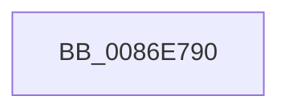

# SeOpenObjectAuditAlarmWithTransaction

- RVA: `0x0086E790`–`0x0086E7EE` (길이 `94` bytes)
- VA: `0x000000014086E790`
- 실행 섹션: `PAGE`
- PDB 이름 있음: `예`; PDB Function 태그: `아니요`
- unwind 정보 RVA: `0x0006C114`
- 디코드: `26`개 명령, `94/94` bytes 표시
- 미해석 바이트: `0` (있으면 어셈블리에 `.byte`로 보존)

> 이 문서는 커널 이미지의 기계어와 PDB 기호를 분석해 생성했습니다. 4번과 5번은 함수 원형과 자료형을 바이너리 사용 방식에서 추정한 C 해석이며 원본 소스 복구 결과는 아닙니다.

## 1. Dependencies

- 직접 호출 지점: **0**; 고유 호출 대상: **0**
- 직접 호출자로 확인된 함수: **8**
- RIP 상대 이미지 참조: **0**

### Outgoing calls
- 직접 디코드된 call 명령이 없습니다.

### Direct callers
- [ObpCreateHandle](ObpCreateHandle_function_0086B950.md) at `0x0086BC6C`
- [ObpGrantAccess](ObpGrantAccess_function_0086F250.md) at `0x0086F48C`
- [sub_0086FA65](Unknown_function_0086FA65.md) at `0x0086FCA0`
- [SeOpenObjectAuditAlarm](SeOpenObjectAuditAlarm_function_0086FFA0.md) at `0x0086FFEF`
- [CmpCheckOpenAccessOnKeyBody](../87/CmpCheckOpenAccessOnKeyBody_function_00870000.md) at `0x00870399`
- [ObCheckObjectAccess](../87/ObCheckObjectAccess_function_00872260.md) at `0x00872495`
- [IopParseDevice](../89/IopParseDevice_function_0089E510.md) at `0x0089EB8A`
- [CmpCheckCreateAccess](../8C/CmpCheckCreateAccess_function_008C6E8C.md) at `0x008C6F84`

### Static image references
- 디코드된 RIP-relative 메모리 참조가 없습니다.

## 2. Other-region calls and transfers

- 다른 실행 섹션으로 향하는 call: **0**
- call이 아닌 외부 분기/꼬리 이동: **1**
  - `0x0086E7E8` → [sub_0086E94F](Unknown_function_0086E94F.md) (`tail-transfer`)

## 3. Assembly (complete function range)

```asm
0086E790  4C 8B DC                        mov r11, rsp
0086E793  4D 89 4B 20                     mov qword ptr [r11 + 0x20], r9
0086E797  4D 89 43 18                     mov qword ptr [r11 + 0x18], r8
0086E79B  49 89 53 10                     mov qword ptr [r11 + 0x10], rdx
0086E79F  49 89 4B 08                     mov qword ptr [r11 + 8], rcx
0086E7A3  55                              push rbp
0086E7A4  57                              push rdi
0086E7A5  41 55                           push r13
0086E7A7  41 56                           push r14
0086E7A9  49 8D 6B D1                     lea rbp, [r11 - 0x2f]
0086E7AD  48 81 EC F8 00 00 00            sub rsp, 0xf8
0086E7B4  48 8B 7D 57                     mov rdi, qword ptr [rbp + 0x57]
0086E7B8  33 C0                           xor eax, eax
0086E7BA  44 8B E8                        mov r13d, eax
0086E7BD  48 89 45 CF                     mov qword ptr [rbp - 0x31], rax
0086E7C1  4D 8B F1                        mov r14, r9
0086E7C4  48 89 45 BF                     mov qword ptr [rbp - 0x41], rax
0086E7C8  4C 8B D2                        mov r10, rdx
0086E7CB  48 89 45 C7                     mov qword ptr [rbp - 0x39], rax
0086E7CF  48 89 45 D7                     mov qword ptr [rbp - 0x29], rax
0086E7D3  B8 E7 03 00 00                  mov eax, 0x3e7
0086E7D8  66 89 45 BB                     mov word ptr [rbp - 0x45], ax
0086E7DC  C6 45 B7 00                     mov byte ptr [rbp - 0x49], 0
0086E7E0  C6 45 B8 00                     mov byte ptr [rbp - 0x48], 0
0086E7E4  44 38 6D 6F                     cmp byte ptr [rbp + 0x6f], r13b
0086E7E8  0F 84 61 01 00 00               je 0x14086e94f
```

## 4. C-style interpretation (structured pseudocode)

```c
__int64 __fastcall SeOpenObjectAuditAlarmWithTransaction(__int64 a1, __int64 a2, __int64 a3, __int64 a4)
{
    __int64 result;
    __int64 v_rsp;

    *(unsigned __int64 *)(v_rsp + 32) = a4;
    *(unsigned __int64 *)(v_rsp + 24) = a3;
    *(unsigned __int64 *)(v_rsp + 16) = a2;
    *(unsigned __int64 *)(v_rsp + 8) = a1;
    v_rsp = (v_rsp) - (248);
    result = 0;
    *(unsigned __int64 *)(v_rsp - 47 - 49) = 0;
    *(unsigned __int64 *)(v_rsp - 47 - 65) = 0;
    *(unsigned __int64 *)(v_rsp - 47 - 57) = 0;
    *(unsigned __int64 *)(v_rsp - 47 - 41) = 0;
    *(unsigned __int16 *)(v_rsp - 47 - 69) = 999;
    *(unsigned __int8 *)(v_rsp - 47 - 73) = 0;
    *(unsigned __int8 *)(v_rsp - 47 - 72) = 0;
}
```

## 5. (Beta) C Style

```c
int64_t SeOpenObjectAuditAlarmWithTransaction(int64_t Arg1, int64_t Arg2, int64_t Arg3, int64_t Arg4)
{
    int64_t result;
    int64_t local_rsp;

    *(uint64_t *)(local_rsp + 0x20) = Arg4;
    *(uint64_t *)(local_rsp + 0x18) = Arg3;
    *(uint64_t *)(local_rsp + 0x10) = Arg2;
    *(uint64_t *)(local_rsp + 0x8) = Arg1;
    local_rsp = (local_rsp) - (248);
    result = 0;
    *(uint64_t *)(local_rsp - 0x2F - 0x31) = 0;
    *(uint64_t *)(local_rsp - 0x2F - 0x41) = 0;
    *(uint64_t *)(local_rsp - 0x2F - 0x39) = 0;
    *(uint64_t *)(local_rsp - 0x2F - 0x29) = 0;
    *(uint16_t *)(local_rsp - 0x2F - 0x45) = 999;
    *(uint8_t *)(local_rsp - 0x2F - 0x49) = 0;
    *(uint8_t *)(local_rsp - 0x2F - 0x48) = 0;
}
```

## 6. Execution-region graph

[열기: 2D/3D 그래프와 함수 탐색 컨트롤 패널](../../../control-panel.html?section=page&rva=0x0086E790&view=graph)

- 2D 그래프는 위에서 아래로 흐르고, 3D 그래프는 빈 공간을 드래그해 회전합니다. Shift+드래그는 이동, 휠은 확대·축소, 함수 노드 선택은 대상 보고서 이동입니다.

### Static fallback


