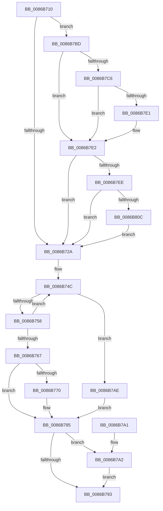

# SeReleaseSubjectContext

- RVA: `0x0086B710`–`0x0086B812` (길이 `258` bytes)
- VA: `0x000000014086B710`
- 실행 섹션: `PAGE`
- PDB 이름 있음: `예`; PDB Function 태그: `아니요`
- unwind 정보 RVA: `0x0006C008`
- 디코드: `62`개 명령, `258/258` bytes 표시
- 미해석 바이트: `0` (있으면 어셈블리에 `.byte`로 보존)

> 이 문서는 커널 이미지의 기계어와 PDB 기호를 분석해 생성했습니다. 4번과 5번은 함수 원형과 자료형을 바이너리 사용 방식에서 추정한 C 해석이며 원본 소스 복구 결과는 아닙니다.

## 1. Dependencies

- 직접 호출 지점: **3**; 고유 호출 대상: **2**
- 직접 호출자로 확인된 함수: **132**
- RIP 상대 이미지 참조: **3**

### Outgoing calls
- `0x0086B780` → [ObpPushStackInfo](../../text/21/ObpPushStackInfo_function_002109E4.md) (function, `0x002109E4`)
- `0x0086B7A7` → [ObfDereferenceObjectWithTag](../../text/2F/ObfDereferenceObjectWithTag_function_002F78E0.md) (function, `0x002F78E0`)
- `0x0086B7B6` → [ObfDereferenceObjectWithTag](../../text/2F/ObfDereferenceObjectWithTag_function_002F78E0.md) (function, `0x002F78E0`)

### Direct callers
- [SeReportSecurityEventWithSubCategory](../../text/22/SeReportSecurityEventWithSubCategory_function_002248B0.md) at `0x00224B4B`
- [NtSetInformationFile](../../text/29/NtSetInformationFile_function_0029C5E0.md) at `0x0029CAB0`
- [ExCpuSetResourceManagerAccessCheck](../../text/3A/ExCpuSetResourceManagerAccessCheck_function_003A5444.md) at `0x003A54F6`
- [RtlCheckTokenCapability](../../text/3A/RtlCheckTokenCapability_function_003A5520.md) at `0x003A58CD`
- [RtlCheckTokenMembershipEx](../../text/3A/RtlCheckTokenMembershipEx_function_003A5A30.md) at `0x003A5C3E`
- [SeAccessCheckByType](../../text/44/SeAccessCheckByType_function_00440BC8.md) at `0x004417C3`
- [SeAccessCheckByType](../../text/44/SeAccessCheckByType_function_00440BC8.md) at `0x00441B95`
- [SeAccessCheckByType](../../text/44/SeAccessCheckByType_function_00440BC8.md) at `0x0044217D`
- [SeAccessCheckByType](../../text/44/SeAccessCheckByType_function_00440BC8.md) at `0x004421A5`
- [IoCheckRedirectionTrustLevel](../../text/48/IoCheckRedirectionTrustLevel_function_00485BB0.md) at `0x00485C7E`
- [PspJobDelete](../../text/4B/PspJobDelete_function_004BF8F0.md) at `0x004BFAA9`
- [IoComputeRedirectionTrustLevel](../../text/4B/IoComputeRedirectionTrustLevel_function_004BFE50.md) at `0x004BFEA5`
- [FsRtlCancelNotify](../../text/4E/FsRtlCancelNotify_function_004E7F90.md) at `0x004E8354`
- [SepCreateAppContainerToken](../../text/4F/SepCreateAppContainerToken_function_004F43AC.md) at `0x004F47B3`
- [SepCreateAppContainerToken](../../text/4F/SepCreateAppContainerToken_function_004F43AC.md) at `0x004F491D`
- [SepCreateAppContainerToken](../../text/4F/SepCreateAppContainerToken_function_004F43AC.md) at `0x004F4A23`
- [SeAdjustAntiTamperCreatorAccess](../../text/60/SeAdjustAntiTamperCreatorAccess_function_00607590.md) at `0x0060762A`
- [SeAdjustAntiTamperCreatorAccess](../../text/60/SeAdjustAntiTamperCreatorAccess_function_00607590.md) at `0x00607683`
- [SeComputeMandatoryDeniedAccess](../../text/60/SeComputeMandatoryDeniedAccess_function_006076BC.md) at `0x0060774A`
- [WdipAccessCheck](../../text/64/WdipAccessCheck_function_0064E084.md) at `0x0064E29B`
- [CmpCheckHivePrimaryFileReadWriteAccess](../../text/66/CmpCheckHivePrimaryFileReadWriteAccess_function_0066AD0C.md) at `0x0066AD97`
- [FsRtlCancelNotify$fin$1](../../text/6D/FsRtlCancelNotify_fin_1_function_006D54F9.md) at `0x006D5524`
- [sub_006F2FA4](../../text/6F/Unknown_function_006F2FA4.md) at `0x006F3041`
- [SepCheckCreateAppContainer](../70/SepCheckCreateAppContainer_function_007006CC.md) at `0x0070076B`
- [FsRtlpOplockTryPrepForAckTimeout](../71/FsRtlpOplockTryPrepForAckTimeout_function_007156C0.md) at `0x007157A0`
- [FsRtlNotifyCleanupAll](../71/FsRtlNotifyCleanupAll_function_00716D90.md) at `0x00716DF0`
- [PnpGetCallerSessionId](../72/PnpGetCallerSessionId_function_0072C7C4.md) at `0x0072C804`
- [PiAuCheckTokenMembership](../73/PiAuCheckTokenMembership_function_00731348.md) at `0x007314B3`
- [PspIumVerifyParentSd](../78/PspIumVerifyParentSd_function_00787D04.md) at `0x00787D94`
- [SeAdtRegistryValueChangedAuditAlarm](../79/SeAdtRegistryValueChangedAuditAlarm_function_0079DDD4.md) at `0x0079E336`
- [SeAuditBootConfiguration](../79/SeAuditBootConfiguration_function_0079E374.md) at `0x0079E7DD`
- [SeAuditFipsCryptoSelftests](../79/SeAuditFipsCryptoSelftests_function_0079E820.md) at `0x0079E995`
- [SeAuditSystemTimeChange](../79/SeAuditSystemTimeChange_function_0079EB8C.md) at `0x0079ED10`
- [SeAuditTransactionStateChange](../79/SeAuditTransactionStateChange_function_0079ED50.md) at `0x0079EF33`
- [SepAuditAssignPrimaryToken](../79/SepAuditAssignPrimaryToken_function_0079F828.md) at `0x0079FA14`
- [NtDeleteObjectAuditAlarm](../7A/NtDeleteObjectAuditAlarm_function_007A03C0.md) at `0x007A0489`
- [NtSetUuidSeed](../7D/NtSetUuidSeed_function_007D0DD0.md) at `0x007D113E`
- [NtRenameKey](../7E/NtRenameKey_function_007E04B0.md) at `0x007E08B4`
- [CmUpdateFeatureConfiguration](../7E/CmUpdateFeatureConfiguration_function_007E5C10.md) at `0x007E5CB0`
- [CmUpdateFeatureUsageSubscription](../7E/CmUpdateFeatureUsageSubscription_function_007E5E78.md) at `0x007E5F05`
- [NtSetValueKey](../84/NtSetValueKey_function_00844EA0.md) at `0x008454E9`
- [CmSetValueKey](../84/CmSetValueKey_function_008457C0.md) at `0x00845F90`
- [NtDeleteValueKey](../84/NtDeleteValueKey_function_00848770.md) at `0x00848B07`
- [NtDeleteKey](../84/NtDeleteKey_function_00849920.md) at `0x00849D63`
- [CmQueryKey](../85/CmQueryKey_function_00858240.md) at `0x00858776`
- [sub_0086560A](Unknown_function_0086560A.md) at `0x0086585B`
- [ObCloseHandleTableEntry](ObCloseHandleTableEntry_function_00869E20.md) at `0x0086A06D`
- [SepAdtAuditObjectAccessWithContext](SepAdtAuditObjectAccessWithContext_function_0086EEF0.md) at `0x0086F0E2`
- [sub_00870BB6](../87/Unknown_function_00870BB6.md) at `0x00870BB9`
- [ObCreateObject](../87/ObCreateObject_function_00872CB0.md) at `0x00872F55`
- [ObCreateObject](../87/ObCreateObject_function_00872CB0.md) at `0x00873169`
- [CmpLogHiveFileInaccessible](../87/CmpLogHiveFileInaccessible_function_0087AEAC.md) at `0x0087B15B`
- [IopAllocRealFileObject](../89/IopAllocRealFileObject_function_00899720.md) at `0x00899B27`
- [ObpParseSymbolicLinkEx](../8B/ObpParseSymbolicLinkEx_function_008B35C0.md) at `0x008B3838`
- [RtlIsSandboxedToken](../8B/RtlIsSandboxedToken_function_008B3AB0.md) at `0x008B3B18`
- [NtDuplicateToken](../8B/NtDuplicateToken_function_008B6DF0.md) at `0x008B6F61`
- [NtCreateEvent](../8B/NtCreateEvent_function_008B9140.md) at `0x008B94C6`
- [sub_008BB987](../8B/Unknown_function_008BB987.md) at `0x008BB98B`
- [EtwpCheckLoggerControlAccess](../8C/EtwpCheckLoggerControlAccess_function_008C0AE0.md) at `0x008C0B74`
- [EtwpFindOrCreateGuidEntry](../8C/EtwpFindOrCreateGuidEntry_function_008C1B70.md) at `0x008C1D06`
- [sub_008C2328](../8C/Unknown_function_008C2328.md) at `0x008C249B`
- [EtwpAccessCheck](../8C/EtwpAccessCheck_function_008C6C2C.md) at `0x008C6CB8`
- [PiDqQueryRelease](../8D/PiDqQueryRelease_function_008DE800.md) at `0x008DE867`
- [sub_008E6A55](../8E/Unknown_function_008E6A55.md) at `0x008E6B9B`
- [PiAuIsLocalSystem](../8E/PiAuIsLocalSystem_function_008E6D34.md) at `0x008E6DEE`
- [PiPnpRtlObjectEventRelease](../8E/PiPnpRtlObjectEventRelease_function_008E6E24.md) at `0x008E6E9F`
- [PiCMValidateDeviceInstance](../8E/PiCMValidateDeviceInstance_function_008E799C.md) at `0x008E7BC7`
- [IopXxxControlFile](../8E/IopXxxControlFile_function_008E9AD0.md) at `0x008EB1A5`
- [IopGetDeviceInterfaces](../8F/IopGetDeviceInterfaces_function_008F0120.md) at `0x008F0524`
- [IoGetDeviceInterfaceAlias](../8F/IoGetDeviceInterfaceAlias_function_008F5570.md) at `0x008F56C7`
- [PipProcessStartPhase3](../8F/PipProcessStartPhase3_function_008FBAF8.md) at `0x008FBCB4`
- [SepAdtTokenRightAdjusted](../90/SepAdtTokenRightAdjusted_function_0090445C.md) at `0x00904502`
- [NtDeleteWnfStateName](../90/NtDeleteWnfStateName_function_00908E60.md) at `0x0090902F`
- [NtDeleteWnfStateName](../90/NtDeleteWnfStateName_function_00908E60.md) at `0x009091EB`
- [NtQueryWnfStateData](../90/NtQueryWnfStateData_function_00909DF0.md) at `0x0090A43C`
- [ExpNtUpdateWnfStateData](../90/ExpNtUpdateWnfStateData_function_0090A7A0.md) at `0x0090AD52`
- [ExpWnfCheckCrossScopeAccess](../90/ExpWnfCheckCrossScopeAccess_function_0090CA94.md) at `0x0090CB52`
- [SeOperationAuditAlarm](../91/SeOperationAuditAlarm_function_0091EA78.md) at `0x0091EE14`
- [SeSecurityDescriptorChangedAuditAlarm](../91/SeSecurityDescriptorChangedAuditAlarm_function_0091FC5C.md) at `0x0091FE15`
- [SeTokenDefaultDaclChangedAuditAlarm](../92/SeTokenDefaultDaclChangedAuditAlarm_function_00920570.md) at `0x00920617`
- [SeDeleteObjectAuditAlarmWithTransaction](../92/SeDeleteObjectAuditAlarmWithTransaction_function_00920830.md) at `0x00920883`
- [PspInsertProcess](../94/PspInsertProcess_function_009472CC.md) at `0x00947584`
- [SeAuditProcessCreation](../94/SeAuditProcessCreation_function_00947624.md) at `0x00947980`
- [CmpSetKeySecurity](../94/CmpSetKeySecurity_function_0094A124.md) at `0x0094A491`
- [ObInitProcess](../94/ObInitProcess_function_0094C62C.md) at `0x0094C79F`
- [ExCheckFullProcessInformationAccess](../95/ExCheckFullProcessInformationAccess_function_0095D93C.md) at `0x0095D9ED`
- [PiAuDoesClientHaveAccess](../96/PiAuDoesClientHaveAccess_function_00962940.md) at `0x009629DB`
- [PiAuDoesClientHavePrivilege](../96/PiAuDoesClientHavePrivilege_function_00964ADC.md) at `0x00964B77`
- [sub_00968AF6](../96/Unknown_function_00968AF6.md) at `0x00969AB9`
- [sub_00968AF6](../96/Unknown_function_00968AF6.md) at `0x0096A01D`
- [NtPrivilegeObjectAuditAlarm](../97/NtPrivilegeObjectAuditAlarm_function_00974170.md) at `0x0097421C`
- [NtPrivilegeObjectAuditAlarm](../97/NtPrivilegeObjectAuditAlarm_function_00974170.md) at `0x009743BA`
- [NtPrivilegeObjectAuditAlarm](../97/NtPrivilegeObjectAuditAlarm_function_00974170.md) at `0x009743D8`
- [NtPrivilegedServiceAuditAlarm](../97/NtPrivilegedServiceAuditAlarm_function_00974430.md) at `0x00974679`
- [NtPrivilegedServiceAuditAlarm](../97/NtPrivilegedServiceAuditAlarm_function_00974430.md) at `0x009746A4`
- [NtPrivilegedServiceAuditAlarm](../97/NtPrivilegedServiceAuditAlarm_function_00974430.md) at `0x009746BF`
- [NtOpenObjectAuditAlarm](../97/NtOpenObjectAuditAlarm_function_00974700.md) at `0x00974A2A`
- [NtOpenObjectAuditAlarm](../97/NtOpenObjectAuditAlarm_function_00974700.md) at `0x00974C1F`
- [NtOpenObjectAuditAlarm](../97/NtOpenObjectAuditAlarm_function_00974700.md) at `0x00974C58`
- [NtOpenObjectAuditAlarm](../97/NtOpenObjectAuditAlarm_function_00974700.md) at `0x00974CCD`
- [NtOpenObjectAuditAlarm](../97/NtOpenObjectAuditAlarm_function_00974700.md) at `0x00974D06`
- [NtOpenObjectAuditAlarm](../97/NtOpenObjectAuditAlarm_function_00974700.md) at `0x00974DAF`
- [PiDqOpenUserObjectRegKey](../99/PiDqOpenUserObjectRegKey_function_00990444.md) at `0x0099077A`
- [sub_009A2A39](../9A/Unknown_function_009A2A39.md) at `0x009A2A4B`
- [CmpPerformUnloadKey](../9A/CmpPerformUnloadKey_function_009AFA28.md) at `0x009AFBB0`
- [CmpFlushNotify](../9B/CmpFlushNotify_function_009B36A8.md) at `0x009B3722`
- [PspSetQuotaLimits](../9B/PspSetQuotaLimits_function_009BA8A8.md) at `0x009BAC82`
- [PiUEventFreeClientRegistrationContext](../9C/PiUEventFreeClientRegistrationContext_function_009C3A2C.md) at `0x009C3AFB`
- [SepFilterToken](../9C/SepFilterToken_function_009C6B80.md) at `0x009C7788`
- [SepFilterToken](../9C/SepFilterToken_function_009C6B80.md) at `0x009C7799`
- [ObpCaptureBoundaryDescriptor](../9C/ObpCaptureBoundaryDescriptor_function_009C9738.md) at `0x009C9968`
- [ObpVerifyCreatorAccessCheck](../9C/ObpVerifyCreatorAccessCheck_function_009CA524.md) at `0x009CA644`
- [ExpWnfCheckCallerAccess](../9D/ExpWnfCheckCallerAccess_function_009D57C0.md) at `0x009D5841`
- [ExpWnfValidatePubSubPreconditions](../9E/ExpWnfValidatePubSubPreconditions_function_009E6E00.md) at `0x009E6E9C`
- [PiAuVerifyAccessToObject](../9E/PiAuVerifyAccessToObject_function_009E92D0.md) at `0x009E939B`
- [EtwpIsRegEntryAllowed](../9E/EtwpIsRegEntryAllowed_function_009EB2D0.md) at `0x009EB377`
- [SeAssignPrimaryToken](../9F/SeAssignPrimaryToken_function_009F117C.md) at `0x009F11EF`
- [SeCheckPrivilegedObject](../9F/SeCheckPrivilegedObject_function_009F62CC.md) at `0x009F6369`
- [NtSetInformationJobObject](../9F/NtSetInformationJobObject_function_009F84C0.md) at `0x009F954E`
- [NtSetInformationJobObject](../9F/NtSetInformationJobObject_function_009F84C0.md) at `0x009F9A16`
- [MiIsUserQueryVmCallerTrusted](../9F/MiIsUserQueryVmCallerTrusted_function_009FE378.md) at `0x009FE453`
- [EtwpCoverageUserIsAdmin](../9F/EtwpCoverageUserIsAdmin_function_009FE548.md) at `0x009FE596`
- [SepAccessCheckAndAuditAlarm](../A1/SepAccessCheckAndAuditAlarm_function_00A1AF4C.md) at `0x00A1BF82`
- [SepAccessCheckAndAuditAlarm](../A1/SepAccessCheckAndAuditAlarm_function_00A1AF4C.md) at `0x00A1D73C`
- [ExIsRestrictedCaller](../A2/ExIsRestrictedCaller_function_00A217E8.md) at `0x00A218A6`
- [SeIsAppContainerOrIdentifyLevelContext](../A2/SeIsAppContainerOrIdentifyLevelContext_function_00A21A74.md) at `0x00A21B2B`
- [AlpcpCheckConnectionSecurity](../A2/AlpcpCheckConnectionSecurity_function_00A227A0.md) at `0x00A2293A`
- [PiCMGetDeviceIdList](../A2/PiCMGetDeviceIdList_function_00A2BAAC.md) at `0x00A2BC15`
- [FsRtlNotifyCleanup](../A3/FsRtlNotifyCleanup_function_00A32840.md) at `0x00A328C9`
- [ObpGetIntegrityLevel](../A3/ObpGetIntegrityLevel_function_00A33F50.md) at `0x00A33FAB`
- [NtImpersonateAnonymousToken](../A3/NtImpersonateAnonymousToken_function_00A3A150.md) at `0x00A3A2A2`
- [SeAuditPlugAndPlay](../A8/SeAuditPlugAndPlay_function_00A86BA0.md) at `0x00A86F30`
- [SeCloseObjectAuditAlarm](../A8/SeCloseObjectAuditAlarm_function_00A8DDE0.md) at `0x00A8DE2C`
- [SeAuditHardLinkCreationWithTransaction](../A9/SeAuditHardLinkCreationWithTransaction_function_00A90E40.md) at `0x00A90FBB`
- [FsRtlNotifyFilterChangeDirectory](../AA/FsRtlNotifyFilterChangeDirectory_function_00AAB9E0.md) at `0x00AABD00`
- [ExpCheckWakeTimerAccess](../AB/ExpCheckWakeTimerAccess_function_00AB15FC.md) at `0x00AB169B`
- [NtCreateLowBoxToken](../AB/NtCreateLowBoxToken_function_00AB9880.md) at `0x00ABA013`
- [PopBootStatAccessCheck](../AC/PopBootStatAccessCheck_function_00AC0814.md) at `0x00AC08E1`
- [SeAuditHandleDuplication](../AC/SeAuditHandleDuplication_function_00AC1458.md) at `0x00AC15BF`
- [FsRtlNotifyFilterChangeDirectoryLite](../AD/FsRtlNotifyFilterChangeDirectoryLite_function_00ADC950.md) at `0x00ADCC3F`
- [NtSetInformationProcess](../AE/NtSetInformationProcess_function_00AE5370.md) at `0x00AE7DD0`
- [NtQueryInformationToken](../AE/NtQueryInformationToken_function_00AECDD0.md) at `0x00AEE921`
- [NtSetInformationToken](../AF/NtSetInformationToken_function_00AF0530.md) at `0x00AF1B75`
- [NtSetInformationToken](../AF/NtSetInformationToken_function_00AF0530.md) at `0x00AF1B96`
- [NtSetInformationToken](../AF/NtSetInformationToken_function_00AF0530.md) at `0x00AF1C2F`
- [FsRtlNotifyCleanup$fin$0](../B1/FsRtlNotifyCleanup_fin_0_function_00B1150B.md) at `0x00B11536`
- [FsRtlNotifyFilterChangeDirectory$fin$0](../B1/FsRtlNotifyFilterChangeDirectory_fin_0_function_00B138B7.md) at `0x00B138F2`
- [FsRtlNotifyFilterChangeDirectoryLite$fin$0](../B1/FsRtlNotifyFilterChangeDirectoryLite_fin_0_function_00B13D9E.md) at `0x00B13DDD`
- [sub_00B1E436](../B1/Unknown_function_00B1E436.md) at `0x00B1E62E`
- [sub_00B20D1A](../B2/Unknown_function_00B20D1A.md) at `0x00B20D59`
- [sub_00B297AC](../B2/Unknown_function_00B297AC.md) at `0x00B297D2`
- [sub_00B297EE](../B2/Unknown_function_00B297EE.md) at `0x00B29823`
- [sub_00B379EA](../B3/Unknown_function_00B379EA.md) at `0x00B37A47`
- [VfUtilIsLocalSystem](../../pagevrfy/B9/VfUtilIsLocalSystem_function_00B933F4.md) at `0x00B93487`
- [CmFcInitSystem2](../../init/C5/CmFcInitSystem2_function_00C5AD0C.md) at `0x00C5AD8A`

### Static image references
- `0x0086B71A` → RVA `0x00FD8010` (`PAGEDATA`; read)
- `0x0086B767` → RVA `0x00FC5010` (`ALMOSTRO`; read)
- `0x0086B7D4` → RVA `0x00E67B90` (`.data`; read)

## 2. Other-region calls and transfers

- 다른 실행 섹션으로 향하는 call: **3**
  - `0x0086B780` → [ObpPushStackInfo](../../text/21/ObpPushStackInfo_function_002109E4.md) (`PAGE` → `.text`)
  - `0x0086B7A7` → [ObfDereferenceObjectWithTag](../../text/2F/ObfDereferenceObjectWithTag_function_002F78E0.md) (`PAGE` → `.text`)
  - `0x0086B7B6` → [ObfDereferenceObjectWithTag](../../text/2F/ObfDereferenceObjectWithTag_function_002F78E0.md) (`PAGE` → `.text`)
- 별도 외부 분기/꼬리 이동을 확인하지 못했습니다.

## 3. Assembly (complete function range)

```asm
0086B710  48 89 5C 24 08                  mov qword ptr [rsp + 8], rbx
0086B715  57                              push rdi
0086B716  48 83 EC 20                     sub rsp, 0x20
0086B71A  83 3D EF C8 76 00 00            cmp dword ptr [rip + 0x76c8ef], 0
0086B721  48 8B D9                        mov rbx, rcx
0086B724  0F 85 93 00 00 00               jne 0x14086b7bd
0086B72A  65 48 8B 04 25 88 01 00 00      mov rax, qword ptr gs:[0x188]
0086B733  4C 8B 41 10                     mov r8, qword ptr [rcx + 0x10]
0086B737  48 8B 90 B8 00 00 00            mov rdx, qword ptr [rax + 0xb8]
0086B73E  0F 0D 8A 48 02 00 00            prefetchw byte ptr [rdx + 0x248]
0086B745  48 8B 82 48 02 00 00            mov rax, qword ptr [rdx + 0x248]
0086B74C  48 8B C8                        mov rcx, rax
0086B74F  49 33 C8                        xor rcx, r8
0086B752  48 83 F9 0F                     cmp rcx, 0xf
0086B756  73 56                           jae 0x14086b7ae
0086B758  48 8D 48 01                     lea rcx, [rax + 1]
0086B75C  F0 48 0F B1 8A 48 02 00 00      lock cmpxchg qword ptr [rdx + 0x248], rcx
0086B765  75 E5                           jne 0x14086b74c
0086B767  83 3D A2 98 75 00 00            cmp dword ptr [rip + 0x7598a2], 0
0086B76E  74 15                           je 0x14086b785
0086B770  33 D2                           xor edx, edx
0086B772  49 8D 48 D0                     lea rcx, [r8 - 0x30]
0086B776  41 B9 53 65 53 75               mov r9d, 0x75536553
0086B77C  44 8D 42 01                     lea r8d, [rdx + 1]
0086B780  E8 5F 52 9A FF                  call 0x1402109e4
0086B785  48 8B 0B                        mov rcx, qword ptr [rbx]
0086B788  33 FF                           xor edi, edi
0086B78A  48 89 7B 10                     mov qword ptr [rbx + 0x10], rdi
0086B78E  48 85 C9                        test rcx, rcx
0086B791  75 0F                           jne 0x14086b7a2
0086B793  48 89 3B                        mov qword ptr [rbx], rdi
0086B796  48 8B 5C 24 30                  mov rbx, qword ptr [rsp + 0x30]
0086B79B  48 83 C4 20                     add rsp, 0x20
0086B79F  5F                              pop rdi
0086B7A0  C3                              ret
0086B7A1  CC                              int3
0086B7A2  BA 53 65 53 75                  mov edx, 0x75536553
0086B7A7  E8 34 C1 A8 FF                  call 0x1402f78e0
0086B7AC  EB E5                           jmp 0x14086b793
0086B7AE  BA 53 65 53 75                  mov edx, 0x75536553
0086B7B3  49 8B C8                        mov rcx, r8
0086B7B6  E8 25 C1 A8 FF                  call 0x1402f78e0
0086B7BB  EB C8                           jmp 0x14086b785
0086B7BD  48 8B 41 10                     mov rax, qword ptr [rcx + 0x10]
0086B7C1  48 85 C0                        test rax, rax
0086B7C4  74 1C                           je 0x14086b7e2
0086B7C6  48 8B 80 78 04 00 00            mov rax, qword ptr [rax + 0x478]
0086B7CD  F0 FF 88 1C 01 00 00            lock dec dword ptr [rax + 0x11c]
0086B7D4  48 8B 05 B5 C3 5F 00            mov rax, qword ptr [rip + 0x5fc3b5]
0086B7DB  48 39 41 10                     cmp qword ptr [rcx + 0x10], rax
0086B7DF  75 01                           jne 0x14086b7e2
0086B7E1  CC                              int3
0086B7E2  48 8B 01                        mov rax, qword ptr [rcx]
0086B7E5  48 85 C0                        test rax, rax
0086B7E8  0F 84 3C FF FF FF               je 0x14086b72a
0086B7EE  48 8B 80 78 04 00 00            mov rax, qword ptr [rax + 0x478]
0086B7F5  F0 FF 88 1C 01 00 00            lock dec dword ptr [rax + 0x11c]
0086B7FC  48 8B 05 8D C3 5F 00            mov rax, qword ptr [rip + 0x5fc38d]
0086B803  48 39 01                        cmp qword ptr [rcx], rax
0086B806  0F 85 1E FF FF FF               jne 0x14086b72a
0086B80C  CC                              int3
0086B80D  E9 18 FF FF FF                  jmp 0x14086b72a
```

## 4. C-style interpretation (structured pseudocode)

```c
__int64 __fastcall SeReleaseSubjectContext(__int64 a1)
{
    __int64 result;
    __int64 v_rdi;
    __int64 v_rsp;
    unsigned __int64 v_stack_p8;

    v_stack_p8 = v_rbx;
    v_rsp = (v_rsp) - (32);
    if ((*(unsigned int *)(v_rip + 7784687)) != 0) goto loc_0086B7BD;
loc_0086B72A:
loc_0086B74C:
    a1 = (*(unsigned __int64 *)(*(unsigned __int64 *)(*(unsigned __int64 *)(gs_base + (0 + 392)) + 184) + 584)) ^ (*(unsigned __int64 *)(a1 + 16));
    if (a1 >= 15) goto loc_0086B7AE;
    if (a1 != 15) goto loc_0086B74C;
    result = *(unsigned __int64 *)(*(unsigned __int64 *)(*(unsigned __int64 *)(gs_base + (0 + 392)) + 184) + 584);
    if ((*(unsigned int *)(v_rip + 7706786)) != 0) {
        a2 = 0;
        a1 = *(unsigned __int64 *)(a1 + 16) - 48;
        a4 = 0x75536553ULL;
        a3 = a2 + 1;
        result = ObpPushStackInfo(a1, a2, a3, a4);
    }
    v_rdi = 0;
    *(unsigned __int64 *)(a1 + 16) = 0;
    if (*(unsigned __int64 *)(a1) != 0) goto loc_0086B7A2;
loc_0086B793:
    *(unsigned __int64 *)(a1) = 0;
    v_rsp = (v_rsp) + (32);
    return result;
loc_0086B7A2:
    result = ObfDereferenceObjectWithTag(*(unsigned __int64 *)(a1), (unsigned int)(0x75536553ULL), a3, a4);
    goto loc_0086B793;
loc_0086B7AE:
    result = ObfDereferenceObjectWithTag(a3, (unsigned int)(0x75536553ULL), a3, a4);
    goto loc_0086B785;
loc_0086B7BD:
    if (*(unsigned __int64 *)(a3 + 16) == 0) goto loc_0086B7E2;
    if ((*(unsigned __int64 *)(a3 + 16)) == (*(unsigned __int64 *)(v_rip + 6276021))) {
    }
    if (*(unsigned __int64 *)(a3) == 0) goto loc_0086B72A;
    if ((*(unsigned __int64 *)(a3)) != (*(unsigned __int64 *)(v_rip + 6275981))) goto loc_0086B72A;
    goto loc_0086B72A;
}
```

## 5. (Beta) C Style

```c
int64_t SeReleaseSubjectContext(void *Arg1)
{
    uint8_t *arg1 = (uint8_t *)Arg1;

    int64_t result;
    int64_t local_rdi;
    int64_t local_rsp;
    uint64_t v_stack_p8;

    v_stack_p8 = local_rbx;
    local_rsp = (local_rsp) - (32);
    if ((*(uint32_t *)(v_rip + 0x76C8EF)) != 0) goto loc_0086B7BD;
loc_0086B72A:
loc_0086B74C:
    Arg1 = (*(uint64_t *)(*(uint64_t *)(*(uint64_t *)(gs_base + (0 + 0x188)) + 0xB8) + 0x248)) ^ (*(uint64_t *)(arg1 + 0x10));
    if (Arg1 >= 15) goto loc_0086B7AE;
    if (Arg1 != 15) goto loc_0086B74C;
    result = *(uint64_t *)(*(uint64_t *)(*(uint64_t *)(gs_base + (0 + 0x188)) + 0xB8) + 0x248);
    if ((*(uint32_t *)(v_rip + 0x7598A2)) != 0) {
        a2 = 0;
        Arg1 = *(uint64_t *)(arg1 + 0x10) - 48;
        a4 = 0x75536553ULL;
        a3 = a2 + 1;
        result = ObpPushStackInfo(Arg1, a2, a3, a4);
    }
    local_rdi = 0;
    *(uint64_t *)(arg1 + 0x10) = 0;
    if (*(uint64_t *)(arg1) != 0) goto loc_0086B7A2;
loc_0086B793:
    *(uint64_t *)(arg1) = 0;
    local_rsp = (local_rsp) + (32);
    return result;
loc_0086B7A2:
    result = ObfDereferenceObjectWithTag(*(uint64_t *)(arg1), (uint32_t)(0x75536553ULL), a3, a4);
    goto loc_0086B793;
loc_0086B7AE:
    result = ObfDereferenceObjectWithTag(a3, (uint32_t)(0x75536553ULL), a3, a4);
    goto loc_0086B785;
loc_0086B7BD:
    if (*(uint64_t *)(a3 + 0x10) == 0) goto loc_0086B7E2;
    if ((*(uint64_t *)(a3 + 0x10)) == (*(uint64_t *)(v_rip + 0x5FC3B5))) {
    }
    if (*(uint64_t *)(a3) == 0) goto loc_0086B72A;
    if ((*(uint64_t *)(a3)) != (*(uint64_t *)(v_rip + 0x5FC38D))) goto loc_0086B72A;
    goto loc_0086B72A;
}
```

### 관측된 메모리 오프셋

구조체 형식이 확인되지 않은 접근은 인자 기준의 오프셋으로만 기록했습니다.

| 기준 인자 | 오프셋 표현 | 폭 (bit) | 접근 |
|---|---:|---:|---|
| `Arg1` | `+ 0x0` | `64` | `R` |
| `Arg1` | `+ 0x0` | `64` | `W` |
| `Arg1` | `+ 0x10` | `64` | `R` |
| `Arg1` | `+ 0x10` | `64` | `W` |

## 6. Execution-region graph

[열기: 2D/3D 그래프와 함수 탐색 컨트롤 패널](../../../control-panel.html?section=page&rva=0x0086B710&view=graph)

- 2D 그래프는 위에서 아래로 흐르고, 3D 그래프는 빈 공간을 드래그해 회전합니다. Shift+드래그는 이동, 휠은 확대·축소, 함수 노드 선택은 대상 보고서 이동입니다.

### Static fallback


