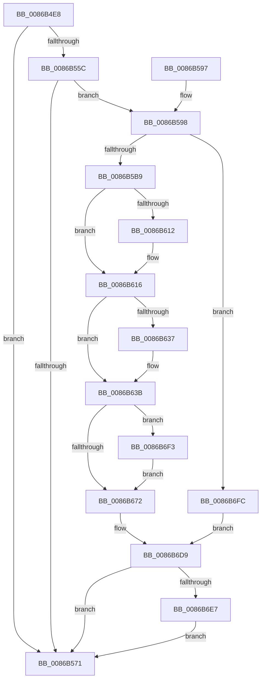

# SepAdtCloseObjectAuditAlarm

- RVA: `0x0086B4E8`–`0x0086B705` (길이 `541` bytes)
- VA: `0x000000014086B4E8`
- 실행 섹션: `PAGE`
- PDB 이름 있음: `예`; PDB Function 태그: `아니요`
- unwind 정보 RVA: `0x0006BFE4`
- 디코드: `130`개 명령, `541/541` bytes 표시
- 미해석 바이트: `0` (있으면 어셈블리에 `.byte`로 보존)

> 이 문서는 커널 이미지의 기계어와 PDB 기호를 분석해 생성했습니다. 4번과 5번은 함수 원형과 자료형을 바이너리 사용 방식에서 추정한 C 해석이며 원본 소스 복구 결과는 아닙니다.

## 1. Dependencies

- 직접 호출 지점: **10**; 고유 호출 대상: **10**
- 직접 호출자로 확인된 함수: **4**
- RIP 상대 이미지 참조: **2**

### Outgoing calls
- `0x0086B553` → [SepAdtAuditObjectAccessWithContext](SepAdtAuditObjectAccessWithContext_function_0086EEF0.md) (function, `0x0086EEF0`)
- `0x0086B568` → [SepAdtAuditThisEventWithContext](../87/SepAdtAuditThisEventWithContext_function_00870AC0.md) (function, `0x00870AC0`)
- `0x0086B57B` → [_security_check_cookie](../../text/6A/_security_check_cookie_function_006AC640.md) (function, `0x006AC640`)
- `0x0086B598` → [PsGetCurrentThreadProcess](../../text/47/PsGetCurrentThreadProcess_function_0047C7E0.md) (function, `0x0047C7E0`)
- `0x0086B5AC` → [PsGetAllocatedFullProcessImageNameEx](../91/PsGetAllocatedFullProcessImageNameEx_function_0091D6F0.md) (function, `0x0091D6F0`)
- `0x0086B5C6` → [memset](../../text/6C/memset_function_006C6C40.md) (function, `0x006C6C40`)
- `0x0086B699` → [ObNormalizeHandleValue](../91/ObNormalizeHandleValue_function_0091E6A8.md) (function, `0x0091E6A8`)
- `0x0086B6D4` → [SepAdtLogAuditRecord](../../text/22/SepAdtLogAuditRecord_function_00224B6C.md) (function, `0x00224B6C`)
- `0x0086B6E9` → [ExFreePoolWithTag](../../poolcode/B8/ExFreePoolWithTag_function_00B82870.md) (function, `0x00B82870`)
- `0x0086B6FE` → [SepAuditFailed](SepAuditFailed_function_0086EE20.md) (function, `0x0086EE20`)

### Direct callers
- [SeCloseObjectAuditAlarmForNonObObject](../7A/SeCloseObjectAuditAlarmForNonObObject_function_007A04D0.md) at `0x007A04E1`
- [ObCloseHandleTableEntry](ObCloseHandleTableEntry_function_00869E20.md) at `0x0086A063`
- [SeCloseObjectAuditAlarm](../A8/SeCloseObjectAuditAlarm_function_00A8DDE0.md) at `0x00A8DE22`
- [sub_00B379EA](../B3/Unknown_function_00B379EA.md) at `0x00B37A29`

### Static image references
- `0x0086B503` → RVA `0x00E0A740` (`.data`; read)
- `0x0086B5D0` → RVA `0x000013A8` (`.rdata`; read)

## 2. Other-region calls and transfers

- 다른 실행 섹션으로 향하는 call: **5**
  - `0x0086B57B` → [_security_check_cookie](../../text/6A/_security_check_cookie_function_006AC640.md) (`PAGE` → `.text`)
  - `0x0086B598` → [PsGetCurrentThreadProcess](../../text/47/PsGetCurrentThreadProcess_function_0047C7E0.md) (`PAGE` → `.text`)
  - `0x0086B5C6` → [memset](../../text/6C/memset_function_006C6C40.md) (`PAGE` → `.text`)
  - `0x0086B6D4` → [SepAdtLogAuditRecord](../../text/22/SepAdtLogAuditRecord_function_00224B6C.md) (`PAGE` → `.text`)
  - `0x0086B6E9` → [ExFreePoolWithTag](../../poolcode/B8/ExFreePoolWithTag_function_00B82870.md) (`PAGE` → `POOLCODE`)
- 별도 외부 분기/꼬리 이동을 확인하지 못했습니다.

## 3. Assembly (complete function range)

```asm
0086B4E8  48 89 5C 24 10                  mov qword ptr [rsp + 0x10], rbx
0086B4ED  55                              push rbp
0086B4EE  56                              push rsi
0086B4EF  57                              push rdi
0086B4F0  41 56                           push r14
0086B4F2  41 57                           push r15
0086B4F4  48 8D AC 24 80 FC FF FF         lea rbp, [rsp - 0x380]
0086B4FC  48 81 EC 80 04 00 00            sub rsp, 0x480
0086B503  48 8B 05 36 F2 59 00            mov rax, qword ptr [rip + 0x59f236]
0086B50A  48 33 C4                        xor rax, rsp
0086B50D  48 89 85 70 03 00 00            mov qword ptr [rbp + 0x370], rax
0086B514  48 8D 44 24 40                  lea rax, [rsp + 0x40]
0086B519  4D 8B D1                        mov r10, r9
0086B51C  48 89 44 24 30                  mov qword ptr [rsp + 0x30], rax
0086B521  49 8B D8                        mov rbx, r8
0086B524  8A 85 D0 03 00 00               mov al, byte ptr [rbp + 0x3d0]
0086B52A  4C 8B F2                        mov r14, rdx
0086B52D  48 8B F9                        mov rdi, rcx
0086B530  88 44 24 28                     mov byte ptr [rsp + 0x28], al
0086B534  45 33 FF                        xor r15d, r15d
0086B537  48 89 5C 24 20                  mov qword ptr [rsp + 0x20], rbx
0086B53C  48 8B D1                        mov rdx, rcx
0086B53F  4C 89 7C 24 48                  mov qword ptr [rsp + 0x48], r15
0086B544  45 33 C9                        xor r9d, r9d
0086B547  66 44 89 7C 24 40               mov word ptr [rsp + 0x40], r15w
0086B54D  41 B0 01                        mov r8b, 1
0086B550  49 8B CA                        mov rcx, r10
0086B553  E8 98 39 00 00                  call 0x14086eef0
0086B558  84 C0                           test al, al
0086B55A  74 15                           je 0x14086b571
0086B55C  4C 8B CB                        mov r9, rbx
0086B55F  41 8D 4F 7C                     lea ecx, [r15 + 0x7c]
0086B563  45 33 C0                        xor r8d, r8d
0086B566  B2 01                           mov dl, 1
0086B568  E8 53 55 00 00                  call 0x140870ac0
0086B56D  84 C0                           test al, al
0086B56F  75 27                           jne 0x14086b598
0086B571  48 8B 8D 70 03 00 00            mov rcx, qword ptr [rbp + 0x370]
0086B578  48 33 CC                        xor rcx, rsp
0086B57B  E8 C0 10 E4 FF                  call 0x1406ac640
0086B580  48 8B 9C 24 B8 04 00 00         mov rbx, qword ptr [rsp + 0x4b8]
0086B588  48 81 C4 80 04 00 00            add rsp, 0x480
0086B58F  41 5F                           pop r15
0086B591  41 5E                           pop r14
0086B593  5F                              pop rdi
0086B594  5E                              pop rsi
0086B595  5D                              pop rbp
0086B596  C3                              ret
0086B597  CC                              int3
0086B598  E8 43 12 C1 FF                  call 0x14047c7e0
0086B59D  48 8D 54 24 48                  lea rdx, [rsp + 0x48]
0086B5A2  48 8B C8                        mov rcx, rax
0086B5A5  48 8B B0 D0 01 00 00            mov rsi, qword ptr [rax + 0x1d0]
0086B5AC  E8 3F 21 0B 00                  call 0x14091d6f0
0086B5B1  85 C0                           test eax, eax
0086B5B3  0F 88 43 01 00 00               js 0x14086b6fc
0086B5B9  33 D2                           xor edx, edx
0086B5BB  48 8D 4C 24 50                  lea rcx, [rsp + 0x50]
0086B5C0  41 B8 18 04 00 00               mov r8d, 0x418
0086B5C6  E8 75 B6 E5 FF                  call 0x1406c6c40
0086B5CB  0F B7 44 24 40                  movzx eax, word ptr [rsp + 0x40]
0086B5D0  4C 8D 05 D1 5D 79 FF            lea r8, [rip - 0x86a22f]
0086B5D7  48 8B 13                        mov rdx, qword ptr [rbx]
0086B5DA  48 85 FF                        test rdi, rdi
0086B5DD  41 BA 08 00 00 00               mov r10d, 8
0086B5E3  66 89 44 24 60                  mov word ptr [rsp + 0x60], ax
0086B5E8  4C 0F 45 C7                     cmovne r8, rdi
0086B5EC  C7 44 24 50 03 00 00 00         mov dword ptr [rsp + 0x50], 3
0086B5F4  C7 44 24 54 32 12 00 00         mov dword ptr [rsp + 0x54], 0x1232
0086B5FC  48 8B C2                        mov rax, rdx
0086B5FF  66 44 89 54 24 62               mov word ptr [rsp + 0x62], r10w
0086B605  C7 44 24 68 04 00 00 00         mov dword ptr [rsp + 0x68], 4
0086B60D  48 85 D2                        test rdx, rdx
0086B610  75 04                           jne 0x14086b616
0086B612  48 8B 43 10                     mov rax, qword ptr [rbx + 0x10]
0086B616  48 8B 80 98 00 00 00            mov rax, qword ptr [rax + 0x98]
0086B61D  48 8B 08                        mov rcx, qword ptr [rax]
0086B620  0F B6 41 01                     movzx eax, byte ptr [rcx + 1]
0086B624  8D 04 85 08 00 00 00            lea eax, [rax*4 + 8]
0086B62B  89 44 24 6C                     mov dword ptr [rsp + 0x6c], eax
0086B62F  48 8B C2                        mov rax, rdx
0086B632  48 85 D2                        test rdx, rdx
0086B635  75 04                           jne 0x14086b63b
0086B637  48 8B 43 10                     mov rax, qword ptr [rbx + 0x10]
0086B63B  48 8B 80 98 00 00 00            mov rax, qword ptr [rax + 0x98]
0086B642  C7 45 88 01 00 00 00            mov dword ptr [rbp - 0x78], 1
0086B649  4C 89 45 A0                     mov qword ptr [rbp - 0x60], r8
0086B64D  C7 45 A8 05 00 00 00            mov dword ptr [rbp - 0x58], 5
0086B654  48 8B 08                        mov rcx, qword ptr [rax]
0086B657  48 89 4D 80                     mov qword ptr [rbp - 0x80], rcx
0086B65B  41 0F B7 08                     movzx ecx, word ptr [r8]
0086B65F  83 C1 10                        add ecx, 0x10
0086B662  44 89 55 AC                     mov dword ptr [rbp - 0x54], r10d
0086B666  89 4D 8C                        mov dword ptr [rbp - 0x74], ecx
0086B669  48 85 D2                        test rdx, rdx
0086B66C  0F 84 81 00 00 00               je 0x14086b6f3
0086B672  48 8B 42 18                     mov rax, qword ptr [rdx + 0x18]
0086B676  41 B9 0B 00 00 00               mov r9d, 0xb
0086B67C  89 4D CC                        mov dword ptr [rbp - 0x34], ecx
0086B67F  49 8B CE                        mov rcx, r14
0086B682  48 89 45 B0                     mov qword ptr [rbp - 0x50], rax
0086B686  44 89 4D E8                     mov dword ptr [rbp - 0x18], r9d
0086B68A  C7 45 C8 01 00 00 00            mov dword ptr [rbp - 0x38], 1
0086B691  4C 89 45 E0                     mov qword ptr [rbp - 0x20], r8
0086B695  44 89 55 EC                     mov dword ptr [rbp - 0x14], r10d
0086B699  E8 0A 30 0B 00                  call 0x14091e6a8
0086B69E  48 8B 4C 24 48                  mov rcx, qword ptr [rsp + 0x48]
0086B6A3  48 89 45 F0                     mov qword ptr [rbp - 0x10], rax
0086B6A7  48 89 4D 40                     mov qword ptr [rbp + 0x40], rcx
0086B6AB  44 89 4D 08                     mov dword ptr [rbp + 8], r9d
0086B6AF  0F B7 01                        movzx eax, word ptr [rcx]
0086B6B2  48 8D 4C 24 50                  lea rcx, [rsp + 0x50]
0086B6B7  83 C0 10                        add eax, 0x10
0086B6BA  44 89 55 0C                     mov dword ptr [rbp + 0xc], r10d
0086B6BE  89 45 2C                        mov dword ptr [rbp + 0x2c], eax
0086B6C1  48 89 75 10                     mov qword ptr [rbp + 0x10], rsi
0086B6C5  C7 45 28 02 00 00 00            mov dword ptr [rbp + 0x28], 2
0086B6CC  C7 44 24 58 07 00 00 00         mov dword ptr [rsp + 0x58], 7
0086B6D4  E8 93 94 9B FF                  call 0x140224b6c
0086B6D9  48 8B 4C 24 48                  mov rcx, qword ptr [rsp + 0x48]
0086B6DE  48 85 C9                        test rcx, rcx
0086B6E1  0F 84 8A FE FF FF               je 0x14086b571
0086B6E7  33 D2                           xor edx, edx
0086B6E9  E8 82 71 31 00                  call 0x140b82870
0086B6EE  E9 7E FE FF FF                  jmp 0x14086b571
0086B6F3  48 8B 53 10                     mov rdx, qword ptr [rbx + 0x10]
0086B6F7  E9 76 FF FF FF                  jmp 0x14086b672
0086B6FC  8B C8                           mov ecx, eax
0086B6FE  E8 1D 37 00 00                  call 0x14086ee20
0086B703  EB D4                           jmp 0x14086b6d9
```

## 4. C-style interpretation (structured pseudocode)

```c
__int64 __fastcall SepAdtCloseObjectAuditAlarm(__int64 a1, __int64 a2, __int64 a3, __int64 a4, unsigned __int8 a5)
{
    __int64 result;
    __int64 v_r15;
    __int64 v_rsp;
    unsigned __int64 v_stack_m368;
    unsigned int v_stack_m37C;
    unsigned __int64 v_stack_m38;
    unsigned int v_stack_m380;
    unsigned __int64 v_stack_m398;
    unsigned int v_stack_m39C;
    unsigned int v_stack_m3A0;
    unsigned __int64 v_stack_m3A8;
    unsigned __int64 v_stack_m3B8;
    unsigned int v_stack_m3BC;
    unsigned int v_stack_m3C0;
    unsigned __int64 v_stack_m3C8;
    unsigned int v_stack_m3DC;
    unsigned int v_stack_m3E0;
    unsigned __int64 v_stack_m3F8;
    unsigned int v_stack_m3FC;
    unsigned int v_stack_m400;
    unsigned __int64 v_stack_m408;
    unsigned int v_stack_m41C;
    unsigned int v_stack_m420;
    unsigned __int64 v_stack_m428;
    unsigned __int64 v_stack_m460;
    unsigned __int64 v_stack_m468;
    unsigned __int64 v_stack_m478;
    unsigned __int8 v_stack_m480;
    unsigned __int64 v_stack_m488;
    unsigned __int64 v_stack_p10;
    unsigned __int16 v_stack_p40;
    unsigned __int64 v_stack_p48;
    unsigned __int64 v_stack_p50;
    unsigned int v_stack_p54;
    unsigned int v_stack_p58;
    unsigned __int16 v_stack_p60;
    unsigned __int16 v_stack_p62;
    unsigned int v_stack_p68;
    unsigned int v_stack_p6C;

    v_stack_p10 = v_rbx;
    v_rsp = (v_rsp) - (0x480ULL);
    result = (*(unsigned __int64 *)(v_rip + 5894710)) ^ (v_rsp);
    v_stack_m38 = result;
    v_stack_m478 = v_stack_m468;
    v_stack_m480 = a5;
    v_r15 = 0;
    v_stack_m488 = a3;
    v_stack_m460 = 0;
    a4 = 0;
    v_stack_m468 = 0;
    result = SepAdtAuditObjectAccessWithContext(0, a1, 1, a4);
    if ((unsigned __int8)(result) == 0) goto loc_0086B571;
    a3 = 0;
    result = SepAdtAuditThisEventWithContext(v_r15 + 124, 1, a3, a3);
    if ((unsigned __int8)(result) != 0) goto loc_0086B598;
loc_0086B571:
    a1 = (v_stack_m38) ^ (v_rsp);
    result = _security_check_cookie(a1, 1, a3, a3);
    v_rsp = (v_rsp) + (0x480ULL);
    return result;
loc_0086B598:
    result = PsGetCurrentThreadProcess(a1, 1, a3, a3);
    result = PsGetAllocatedFullProcessImageNameEx(result, v_stack_p48, a3, a3);
    if (sign_flag) goto loc_0086B6FC;
    a2 = 0;
    result = memset(v_stack_p50, a2, (unsigned int)(0x418ULL), a3);
    v_stack_p60 = (unsigned __int16)(v_stack_p40);
    a3 = v_rip - 8823343;
    if (a1 != 0) { a3 = a1; }
    v_stack_p50 = 3;
    v_stack_p54 = 0x1232ULL;
    v_stack_p62 = 8;
    v_stack_p68 = 4;
    result = *(unsigned __int64 *)(v_stack_p10);
    if (*(unsigned __int64 *)(v_stack_p10) == 0) {
        result = *(unsigned __int64 *)(v_stack_p10 + 16);
    }
    v_stack_p6C = (unsigned int)(*(unsigned __int8 *)(*(unsigned __int64 *)(*(unsigned __int64 *)(result + 152)) + 1) * 4 + 8);
    result = *(unsigned __int64 *)(v_stack_p10);
    if (*(unsigned __int64 *)(v_stack_p10) == 0) {
        result = *(unsigned __int64 *)(v_stack_p10 + 16);
    }
    v_stack_m420 = 1;
    v_stack_m408 = a3;
    v_stack_m400 = 5;
    v_stack_m428 = *(unsigned __int64 *)(*(unsigned __int64 *)(result + 152));
    a1 = (unsigned int)((*(unsigned __int16 *)(a3)) + (16));
    v_stack_m3FC = 8;
    v_stack_m41C = (unsigned int)(a1);
    if (*(unsigned __int64 *)(v_stack_p10) == 0) goto loc_0086B6F3;
loc_0086B672:
    v_stack_m3DC = (unsigned int)(a1);
    v_stack_m3F8 = *(unsigned __int64 *)(*(unsigned __int64 *)(v_stack_p10) + 24);
    v_stack_m3C0 = 11;
    v_stack_m3E0 = 1;
    v_stack_m3C8 = a3;
    v_stack_m3BC = 8;
    result = ObNormalizeHandleValue(0, *(unsigned __int64 *)(v_stack_p10), a3, 11);
    v_stack_m3B8 = result;
    v_stack_m368 = v_stack_p48;
    v_stack_m3A0 = 11;
    result = (unsigned int)((*(unsigned __int16 *)(v_stack_p48)) + (16));
    v_stack_m39C = 8;
    v_stack_m37C = (unsigned int)(result);
    v_stack_m398 = *(unsigned __int64 *)(result + 464);
    v_stack_m380 = 2;
    v_stack_p58 = 7;
    result = SepAdtLogAuditRecord(v_stack_p50, *(unsigned __int64 *)(v_stack_p10), a3, 11);
loc_0086B6D9:
    if (v_stack_p48 == 0) goto loc_0086B571;
    a2 = 0;
    result = ExFreePoolWithTag(v_stack_p48, a2, a3, 11);
    goto loc_0086B571;
loc_0086B6F3:
    goto loc_0086B672;
loc_0086B6FC:
    result = SepAuditFailed((unsigned int)((unsigned int)(result)), *(unsigned __int64 *)(v_stack_p10 + 16), a3, 11);
    goto loc_0086B6D9;
}
```

## 5. (Beta) C Style

```c
int64_t SepAdtCloseObjectAuditAlarm(int64_t Arg1, int64_t Arg2, void *Arg3, int64_t Arg4, uint8_t Arg5)
{
    uint8_t *arg3 = (uint8_t *)Arg3;

    int64_t result;
    int64_t local_r15;
    int64_t local_rsp;
    uint64_t v_stack_m368;
    uint32_t v_stack_m37C;
    uint64_t v_stack_m38;
    uint32_t v_stack_m380;
    uint64_t v_stack_m398;
    uint32_t v_stack_m39C;
    uint32_t v_stack_m3A0;
    uint64_t v_stack_m3A8;
    uint64_t v_stack_m3B8;
    uint32_t v_stack_m3BC;
    uint32_t v_stack_m3C0;
    uint64_t v_stack_m3C8;
    uint32_t v_stack_m3DC;
    uint32_t v_stack_m3E0;
    uint64_t v_stack_m3F8;
    uint32_t v_stack_m3FC;
    uint32_t v_stack_m400;
    uint64_t v_stack_m408;
    uint32_t v_stack_m41C;
    uint32_t v_stack_m420;
    uint64_t v_stack_m428;
    uint64_t v_stack_m460;
    uint64_t v_stack_m468;
    uint64_t v_stack_m478;
    uint8_t v_stack_m480;
    uint64_t v_stack_m488;
    uint64_t v_stack_p10;
    uint16_t v_stack_p40;
    uint64_t v_stack_p48;
    uint64_t v_stack_p50;
    uint32_t v_stack_p54;
    uint32_t v_stack_p58;
    uint16_t v_stack_p60;
    uint16_t v_stack_p62;
    uint32_t v_stack_p68;
    uint32_t v_stack_p6C;

    v_stack_p10 = local_rbx;
    local_rsp = (local_rsp) - (0x480ULL);
    result = (*(uint64_t *)(v_rip + 0x59F236)) ^ (local_rsp);
    v_stack_m38 = result;
    v_stack_m478 = v_stack_m468;
    v_stack_m480 = Arg5;
    local_r15 = 0;
    v_stack_m488 = Arg3;
    v_stack_m460 = 0;
    Arg4 = 0;
    v_stack_m468 = 0;
    result = SepAdtAuditObjectAccessWithContext(0, Arg1, 1, Arg4);
    if ((uint8_t)(result) == 0) goto loc_0086B571;
    Arg3 = 0;
    result = SepAdtAuditThisEventWithContext(local_r15 + 124, 1, Arg3, Arg3);
    if ((uint8_t)(result) != 0) goto loc_0086B598;
loc_0086B571:
    Arg1 = (v_stack_m38) ^ (local_rsp);
    result = _security_check_cookie(Arg1, 1, Arg3, Arg3);
    local_rsp = (local_rsp) + (0x480ULL);
    return result;
loc_0086B598:
    result = PsGetCurrentThreadProcess(Arg1, 1, Arg3, Arg3);
    result = PsGetAllocatedFullProcessImageNameEx(result, v_stack_p48, Arg3, Arg3);
    if (sign_flag) goto loc_0086B6FC;
    Arg2 = 0;
    result = memset(v_stack_p50, Arg2, (uint32_t)(0x418ULL), Arg3);
    v_stack_p60 = (uint16_t)(v_stack_p40);
    Arg3 = v_rip - 8823343;
    if (Arg1 != 0) { Arg3 = Arg1; }
    v_stack_p50 = 3;
    v_stack_p54 = 0x1232ULL;
    v_stack_p62 = 8;
    v_stack_p68 = 4;
    result = *(uint64_t *)(v_stack_p10);
    if (*(uint64_t *)(v_stack_p10) == 0) {
        result = *(uint64_t *)(v_stack_p10 + 0x10);
    }
    v_stack_p6C = (uint32_t)(*(uint8_t *)(*(uint64_t *)(*(uint64_t *)(result + 0x98)) + 0x1) * 4 + 8);
    result = *(uint64_t *)(v_stack_p10);
    if (*(uint64_t *)(v_stack_p10) == 0) {
        result = *(uint64_t *)(v_stack_p10 + 0x10);
    }
    v_stack_m420 = 1;
    v_stack_m408 = Arg3;
    v_stack_m400 = 5;
    v_stack_m428 = *(uint64_t *)(*(uint64_t *)(result + 0x98));
    Arg1 = (uint32_t)((*(uint16_t *)(arg3)) + (16));
    v_stack_m3FC = 8;
    v_stack_m41C = (uint32_t)(Arg1);
    if (*(uint64_t *)(v_stack_p10) == 0) goto loc_0086B6F3;
loc_0086B672:
    v_stack_m3DC = (uint32_t)(Arg1);
    v_stack_m3F8 = *(uint64_t *)(*(uint64_t *)(v_stack_p10) + 0x18);
    v_stack_m3C0 = 11;
    v_stack_m3E0 = 1;
    v_stack_m3C8 = Arg3;
    v_stack_m3BC = 8;
    result = ObNormalizeHandleValue(0, *(uint64_t *)(v_stack_p10), Arg3, 11);
    v_stack_m3B8 = result;
    v_stack_m368 = v_stack_p48;
    v_stack_m3A0 = 11;
    result = (uint32_t)((*(uint16_t *)(v_stack_p48)) + (16));
    v_stack_m39C = 8;
    v_stack_m37C = (uint32_t)(result);
    v_stack_m398 = *(uint64_t *)(result + 0x1D0);
    v_stack_m380 = 2;
    v_stack_p58 = 7;
    result = SepAdtLogAuditRecord(v_stack_p50, *(uint64_t *)(v_stack_p10), Arg3, 11);
loc_0086B6D9:
    if (v_stack_p48 == 0) goto loc_0086B571;
    Arg2 = 0;
    result = ExFreePoolWithTag(v_stack_p48, Arg2, Arg3, 11);
    goto loc_0086B571;
loc_0086B6F3:
    goto loc_0086B672;
loc_0086B6FC:
    result = SepAuditFailed((uint32_t)((uint32_t)(result)), *(uint64_t *)(v_stack_p10 + 0x10), Arg3, 11);
    goto loc_0086B6D9;
}
```

### 관측된 메모리 오프셋

구조체 형식이 확인되지 않은 접근은 인자 기준의 오프셋으로만 기록했습니다.

| 기준 인자 | 오프셋 표현 | 폭 (bit) | 접근 |
|---|---:|---:|---|
| `Arg3` | `+ 0x0` | `64` | `R` |
| `Arg3` | `+ 0x10` | `64` | `R` |

## 6. Execution-region graph

[열기: 2D/3D 그래프와 함수 탐색 컨트롤 패널](../../../control-panel.html?section=page&rva=0x0086B4E8&view=graph)

- 2D 그래프는 위에서 아래로 흐르고, 3D 그래프는 빈 공간을 드래그해 회전합니다. Shift+드래그는 이동, 휠은 확대·축소, 함수 노드 선택은 대상 보고서 이동입니다.

### Static fallback


