# SepAdtPrivilegeObjectAuditAlarm

- RVA: `0x0086E3F0`–`0x0086E781` (길이 `913` bytes)
- VA: `0x000000014086E3F0`
- 실행 섹션: `PAGE`
- PDB 이름 있음: `예`; PDB Function 태그: `아니요`
- unwind 정보 RVA: `0x0006C0E8`
- 디코드: `206`개 명령, `913/913` bytes 표시
- 미해석 바이트: `0` (있으면 어셈블리에 `.byte`로 보존)

> 이 문서는 커널 이미지의 기계어와 PDB 기호를 분석해 생성했습니다. 4번과 5번은 함수 원형과 자료형을 바이너리 사용 방식에서 추정한 C 해석이며 원본 소스 복구 결과는 아닙니다.

## 1. Dependencies

- 직접 호출 지점: **13**; 고유 호출 대상: **12**
- 직접 호출자로 확인된 함수: **8**
- RIP 상대 이미지 참조: **3**

### Outgoing calls
- `0x0086E473` → [SepAdtAuditThisEventWithContext](../87/SepAdtAuditThisEventWithContext_function_00870AC0.md) (function, `0x00870AC0`)
- `0x0086E48A` → [SepAdtAuditThisEventWithContext](../87/SepAdtAuditThisEventWithContext_function_00870AC0.md) (function, `0x00870AC0`)
- `0x0086E4A7` → [_security_check_cookie](../../text/6A/_security_check_cookie_function_006AC640.md) (function, `0x006AC640`)
- `0x0086E4D3` → [SepFilterPrivilegeAudits](../97/SepFilterPrivilegeAudits_function_00974F90.md) (function, `0x00974F90`)
- `0x0086E4F6` → [SepAdtCheckPrivilegeForSensitivity](../../text/48/SepAdtCheckPrivilegeForSensitivity_function_0048ACD8.md) (function, `0x0048ACD8`)
- `0x0086E548` → [RtlEqualSid](../../text/40/RtlEqualSid_function_00400AD0.md) (function, `0x00400AD0`)
- `0x0086E555` → [PsGetCurrentThreadProcess](../../text/47/PsGetCurrentThreadProcess_function_0047C7E0.md) (function, `0x0047C7E0`)
- `0x0086E562` → [PsGetAllocatedFullProcessImageNameEx](../91/PsGetAllocatedFullProcessImageNameEx_function_0091D6F0.md) (function, `0x0091D6F0`)
- `0x0086E598` → [memset](../../text/6C/memset_function_006C6C40.md) (function, `0x006C6C40`)
- `0x0086E671` → [ObNormalizeHandleValue](../91/ObNormalizeHandleValue_function_0091E6A8.md) (function, `0x0091E6A8`)
- `0x0086E715` → [SepAdtLogAuditRecord](../../text/22/SepAdtLogAuditRecord_function_00224B6C.md) (function, `0x00224B6C`)
- `0x0086E721` → [ExFreePoolWithTag](../../poolcode/B8/ExFreePoolWithTag_function_00B82870.md) (function, `0x00B82870`)
- `0x0086E777` → [SepAuditFailed](SepAuditFailed_function_0086EE20.md) (function, `0x0086EE20`)

### Direct callers
- [ObpCreateHandle](ObpCreateHandle_function_0086B950.md) at `0x0086C26F`
- [ObpCreateHandle](ObpCreateHandle_function_0086B950.md) at `0x0086D419`
- [sub_0091F1C8](../91/Unknown_function_0091F1C8.md) at `0x0091F21A`
- [NtPrivilegeObjectAuditAlarm](../97/NtPrivilegeObjectAuditAlarm_function_00974170.md) at `0x0097439C`
- [NtOpenObjectAuditAlarm](../97/NtOpenObjectAuditAlarm_function_00974700.md) at `0x00974B9F`
- [SePrivilegeObjectAuditAlarm](../9F/SePrivilegeObjectAuditAlarm_function_009F63B0.md) at `0x009F63FA`
- [SepAccessCheckAndAuditAlarm](../A1/SepAccessCheckAndAuditAlarm_function_00A1AF4C.md) at `0x00A1D324`
- [PspCreateObjectHandle](../A1/PspCreateObjectHandle_function_00A1E51C.md) at `0x00A1E5B4`
- [sub_00B46176](../B4/Unknown_function_00B46176.md) at `0x00B46358`

### Static image references
- `0x0086E417` → RVA `0x00E0A740` (`.data`; read)
- `0x0086E539` → RVA `0x00E67D58` (`.data`; read)
- `0x0086E574` → RVA `0x000013A8` (`.rdata`; read)

## 2. Other-region calls and transfers

- 다른 실행 섹션으로 향하는 call: **7**
  - `0x0086E4A7` → [_security_check_cookie](../../text/6A/_security_check_cookie_function_006AC640.md) (`PAGE` → `.text`)
  - `0x0086E4F6` → [SepAdtCheckPrivilegeForSensitivity](../../text/48/SepAdtCheckPrivilegeForSensitivity_function_0048ACD8.md) (`PAGE` → `.text`)
  - `0x0086E548` → [RtlEqualSid](../../text/40/RtlEqualSid_function_00400AD0.md) (`PAGE` → `.text`)
  - `0x0086E555` → [PsGetCurrentThreadProcess](../../text/47/PsGetCurrentThreadProcess_function_0047C7E0.md) (`PAGE` → `.text`)
  - `0x0086E598` → [memset](../../text/6C/memset_function_006C6C40.md) (`PAGE` → `.text`)
  - `0x0086E715` → [SepAdtLogAuditRecord](../../text/22/SepAdtLogAuditRecord_function_00224B6C.md) (`PAGE` → `.text`)
  - `0x0086E721` → [ExFreePoolWithTag](../../poolcode/B8/ExFreePoolWithTag_function_00B82870.md) (`PAGE` → `POOLCODE`)
- 별도 외부 분기/꼬리 이동을 확인하지 못했습니다.

## 3. Assembly (complete function range)

```asm
0086E3F0  48 89 5C 24 08                  mov qword ptr [rsp + 8], rbx
0086E3F5  48 89 74 24 10                  mov qword ptr [rsp + 0x10], rsi
0086E3FA  48 89 7C 24 18                  mov qword ptr [rsp + 0x18], rdi
0086E3FF  55                              push rbp
0086E400  41 54                           push r12
0086E402  41 55                           push r13
0086E404  41 56                           push r14
0086E406  41 57                           push r15
0086E408  48 8D AC 24 80 FC FF FF         lea rbp, [rsp - 0x380]
0086E410  48 81 EC 80 04 00 00            sub rsp, 0x480
0086E417  48 8B 05 22 C3 59 00            mov rax, qword ptr [rip + 0x59c322]
0086E41E  48 33 C4                        xor rax, rsp
0086E421  48 89 85 70 03 00 00            mov qword ptr [rbp + 0x370], rax
0086E428  0F B6 BD F8 03 00 00            movzx edi, byte ptr [rbp + 0x3f8]
0086E42F  4D 8B E8                        mov r13, r8
0086E432  4C 8B BD F0 03 00 00            mov r15, qword ptr [rbp + 0x3f0]
0086E439  4C 8B E2                        mov r12, rdx
0086E43C  4C 89 4C 24 40                  mov qword ptr [rsp + 0x40], r9
0086E441  40 84 FF                        test dil, dil
0086E444  48 89 4C 24 30                  mov qword ptr [rsp + 0x30], rcx
0086E449  41 BE 83 00 00 00               mov r14d, 0x83
0086E44F  0F 94 C3                        sete bl
0086E452  48 C7 44 24 28 00 00 00 00      mov qword ptr [rsp + 0x28], 0
0086E45B  44 0F B6 C3                     movzx r8d, bl
0086E45F  C6 44 24 20 00                  mov byte ptr [rsp + 0x20], 0
0086E464  45 33 C9                        xor r9d, r9d
0086E467  C6 44 24 21 00                  mov byte ptr [rsp + 0x21], 0
0086E46C  40 0F B6 D7                     movzx edx, dil
0086E470  41 8B CE                        mov ecx, r14d
0086E473  E8 48 26 00 00                  call 0x140870ac0
0086E478  45 33 C9                        xor r9d, r9d
0086E47B  41 8D 4E 01                     lea ecx, [r14 + 1]
0086E47F  44 0F B6 C3                     movzx r8d, bl
0086E483  40 0F B6 D7                     movzx edx, dil
0086E487  0F B6 F0                        movzx esi, al
0086E48A  E8 31 26 00 00                  call 0x140870ac0
0086E48F  0F B6 D8                        movzx ebx, al
0086E492  40 84 F6                        test sil, sil
0086E495  75 37                           jne 0x14086e4ce
0086E497  84 C0                           test al, al
0086E499  75 33                           jne 0x14086e4ce
0086E49B  32 C0                           xor al, al
0086E49D  48 8B 8D 70 03 00 00            mov rcx, qword ptr [rbp + 0x370]
0086E4A4  48 33 CC                        xor rcx, rsp
0086E4A7  E8 94 E1 E3 FF                  call 0x1406ac640
0086E4AC  4C 8D 9C 24 80 04 00 00         lea r11, [rsp + 0x480]
0086E4B4  49 8B 5B 30                     mov rbx, qword ptr [r11 + 0x30]
0086E4B8  49 8B 73 38                     mov rsi, qword ptr [r11 + 0x38]
0086E4BC  49 8B 7B 40                     mov rdi, qword ptr [r11 + 0x40]
0086E4C0  49 8B E3                        mov rsp, r11
0086E4C3  41 5F                           pop r15
0086E4C5  41 5E                           pop r14
0086E4C7  41 5D                           pop r13
0086E4C9  41 5C                           pop r12
0086E4CB  5D                              pop rbp
0086E4CC  C3                              ret
0086E4CD  CC                              int3
0086E4CE  49 8B D7                        mov rdx, r15
0086E4D1  33 C9                           xor ecx, ecx
0086E4D3  E8 B8 6A 10 00                  call 0x140974f90
0086E4D8  84 C0                           test al, al
0086E4DA  74 BF                           je 0x14086e49b
0086E4DC  40 84 F6                        test sil, sil
0086E4DF  74 08                           je 0x14086e4e9
0086E4E1  84 DB                           test bl, bl
0086E4E3  0F 85 44 02 00 00               jne 0x14086e72d
0086E4E9  4C 8D 44 24 21                  lea r8, [rsp + 0x21]
0086E4EE  49 8B CF                        mov rcx, r15
0086E4F1  48 8D 54 24 20                  lea rdx, [rsp + 0x20]
0086E4F6  E8 DD C7 C1 FF                  call 0x14048acd8
0086E4FB  40 84 F6                        test sil, sil
0086E4FE  74 07                           je 0x14086e507
0086E500  80 7C 24 20 00                  cmp byte ptr [rsp + 0x20], 0
0086E505  75 11                           jne 0x14086e518
0086E507  84 DB                           test bl, bl
0086E509  74 90                           je 0x14086e49b
0086E50B  80 7C 24 21 00                  cmp byte ptr [rsp + 0x21], 0
0086E510  74 89                           je 0x14086e49b
0086E512  41 BE 84 00 00 00               mov r14d, 0x84
0086E518  48 8B B5 D0 03 00 00            mov rsi, qword ptr [rbp + 0x3d0]
0086E51F  48 8B 9D D8 03 00 00            mov rbx, qword ptr [rbp + 0x3d8]
0086E526  48 85 F6                        test rsi, rsi
0086E529  0F 85 16 02 00 00               jne 0x14086e745
0086E52F  48 8B 83 98 00 00 00            mov rax, qword ptr [rbx + 0x98]
0086E536  48 8B 00                        mov rax, qword ptr [rax]
0086E539  48 8B 0D 18 98 5F 00            mov rcx, qword ptr [rip + 0x5f9818]
0086E540  48 8B D0                        mov rdx, rax
0086E543  48 89 44 24 38                  mov qword ptr [rsp + 0x38], rax
0086E548  E8 83 25 B9 FF                  call 0x140400ad0
0086E54D  84 C0                           test al, al
0086E54F  0F 85 46 FF FF FF               jne 0x14086e49b
0086E555  E8 86 E2 C0 FF                  call 0x14047c7e0
0086E55A  48 8D 54 24 28                  lea rdx, [rsp + 0x28]
0086E55F  48 8B C8                        mov rcx, rax
0086E562  E8 89 F1 0A 00                  call 0x14091d6f0
0086E567  85 C0                           test eax, eax
0086E569  0F 88 06 02 00 00               js 0x14086e775
0086E56F  48 8B 44 24 30                  mov rax, qword ptr [rsp + 0x30]
0086E574  48 8D 0D 2D 2E 79 FF            lea rcx, [rip - 0x86d1d3]
0086E57B  48 8B 5B 18                     mov rbx, qword ptr [rbx + 0x18]
0086E57F  48 85 C0                        test rax, rax
0086E582  41 B8 18 04 00 00               mov r8d, 0x418
0086E588  48 0F 45 C8                     cmovne rcx, rax
0086E58C  33 D2                           xor edx, edx
0086E58E  48 89 4C 24 30                  mov qword ptr [rsp + 0x30], rcx
0086E593  48 8D 4C 24 50                  lea rcx, [rsp + 0x50]
0086E598  E8 A3 86 E5 FF                  call 0x1406c6c40
0086E59D  C7 44 24 50 04 00 00 00         mov dword ptr [rsp + 0x50], 4
0086E5A5  41 B9 08 00 00 00               mov r9d, 8
0086E5AB  66 44 89 74 24 60               mov word ptr [rsp + 0x60], r14w
0086E5B1  C7 44 24 54 42 12 00 00         mov dword ptr [rsp + 0x54], 0x1242
0086E5B9  40 84 FF                        test dil, dil
0086E5BC  0F 84 8F 01 00 00               je 0x14086e751
0086E5C2  66 44 89 4C 24 62               mov word ptr [rsp + 0x62], r9w
0086E5C8  48 8B 4C 24 38                  mov rcx, qword ptr [rsp + 0x38]
0086E5CD  C7 44 24 68 04 00 00 00         mov dword ptr [rsp + 0x68], 4
0086E5D5  0F B6 41 01                     movzx eax, byte ptr [rcx + 1]
0086E5D9  48 89 4D 80                     mov qword ptr [rbp - 0x80], rcx
0086E5DD  48 8B 4C 24 30                  mov rcx, qword ptr [rsp + 0x30]
0086E5E2  C7 45 88 01 00 00 00            mov dword ptr [rbp - 0x78], 1
0086E5E9  8D 04 85 08 00 00 00            lea eax, [rax*4 + 8]
0086E5F0  48 89 4D A0                     mov qword ptr [rbp - 0x60], rcx
0086E5F4  89 44 24 6C                     mov dword ptr [rsp + 0x6c], eax
0086E5F8  0F B7 11                        movzx edx, word ptr [rcx]
0086E5FB  83 C2 10                        add edx, 0x10
0086E5FE  C7 45 A8 05 00 00 00            mov dword ptr [rbp - 0x58], 5
0086E605  89 55 8C                        mov dword ptr [rbp - 0x74], edx
0086E608  44 89 4D AC                     mov dword ptr [rbp - 0x54], r9d
0086E60C  48 85 F6                        test rsi, rsi
0086E60F  0F 84 4B 01 00 00               je 0x14086e760
0086E615  48 8B 46 18                     mov rax, qword ptr [rsi + 0x18]
0086E619  48 89 45 B0                     mov qword ptr [rbp - 0x50], rax
0086E61D  C7 45 C8 01 00 00 00            mov dword ptr [rbp - 0x38], 1
0086E624  89 55 CC                        mov dword ptr [rbp - 0x34], edx
0086E627  48 89 4D E0                     mov qword ptr [rbp - 0x20], rcx
0086E62B  4D 85 E4                        test r12, r12
0086E62E  74 16                           je 0x14086e646
0086E630  41 0F B7 04 24                  movzx eax, word ptr [r12]
0086E635  83 C0 10                        add eax, 0x10
0086E638  C7 45 E8 01 00 00 00            mov dword ptr [rbp - 0x18], 1
0086E63F  89 45 EC                        mov dword ptr [rbp - 0x14], eax
0086E642  4C 89 65 00                     mov qword ptr [rbp], r12
0086E646  4D 85 ED                        test r13, r13
0086E649  74 16                           je 0x14086e661
0086E64B  41 0F B7 45 00                  movzx eax, word ptr [r13]
0086E650  83 C0 10                        add eax, 0x10
0086E653  C7 45 08 02 00 00 00            mov dword ptr [rbp + 8], 2
0086E65A  89 45 0C                        mov dword ptr [rbp + 0xc], eax
0086E65D  4C 89 6D 20                     mov qword ptr [rbp + 0x20], r13
0086E661  48 8B 4C 24 40                  mov rcx, qword ptr [rsp + 0x40]
0086E666  C7 45 28 0B 00 00 00            mov dword ptr [rbp + 0x28], 0xb
0086E66D  44 89 4D 2C                     mov dword ptr [rbp + 0x2c], r9d
0086E671  E8 32 00 0B 00                  call 0x14091e6a8
0086E676  48 89 45 30                     mov qword ptr [rbp + 0x30], rax
0086E67A  8B 85 E8 03 00 00               mov eax, dword ptr [rbp + 0x3e8]
0086E680  48 89 45 50                     mov qword ptr [rbp + 0x50], rax
0086E684  C7 45 4C 04 00 00 00            mov dword ptr [rbp + 0x4c], 4
0086E68B  4D 85 E4                        test r12, r12
0086E68E  0F 84 D5 00 00 00               je 0x14086e769
0086E694  C7 45 48 07 00 00 00            mov dword ptr [rbp + 0x48], 7
0086E69B  48 C7 45 58 04 00 00 00         mov qword ptr [rbp + 0x58], 4
0086E6A3  4D 85 FF                        test r15, r15
0086E6A6  74 1F                           je 0x14086e6c7
0086E6A8  41 8B 07                        mov eax, dword ptr [r15]
0086E6AB  85 C0                           test eax, eax
0086E6AD  74 18                           je 0x14086e6c7
0086E6AF  8D 04 40                        lea eax, [rax + rax*2]
0086E6B2  44 89 4D 68                     mov dword ptr [rbp + 0x68], r9d
0086E6B6  8D 04 85 08 00 00 00            lea eax, [rax*4 + 8]
0086E6BD  4C 89 BD 80 00 00 00            mov qword ptr [rbp + 0x80], r15
0086E6C4  89 45 6C                        mov dword ptr [rbp + 0x6c], eax
0086E6C7  48 8B 4C 24 28                  mov rcx, qword ptr [rsp + 0x28]
0086E6CC  48 8B 85 E0 03 00 00            mov rax, qword ptr [rbp + 0x3e0]
0086E6D3  48 89 85 90 00 00 00            mov qword ptr [rbp + 0x90], rax
0086E6DA  C7 85 88 00 00 00 0B 00 00 00   mov dword ptr [rbp + 0x88], 0xb
0086E6E4  44 89 8D 8C 00 00 00            mov dword ptr [rbp + 0x8c], r9d
0086E6EB  C7 85 A8 00 00 00 02 00 00 00   mov dword ptr [rbp + 0xa8], 2
0086E6F5  0F B7 01                        movzx eax, word ptr [rcx]
0086E6F8  83 C0 10                        add eax, 0x10
0086E6FB  48 89 8D C0 00 00 00            mov qword ptr [rbp + 0xc0], rcx
0086E702  48 8D 4C 24 50                  lea rcx, [rsp + 0x50]
0086E707  89 85 AC 00 00 00               mov dword ptr [rbp + 0xac], eax
0086E70D  C7 44 24 58 0B 00 00 00         mov dword ptr [rsp + 0x58], 0xb
0086E715  E8 52 64 9B FF                  call 0x140224b6c
0086E71A  48 8B 4C 24 28                  mov rcx, qword ptr [rsp + 0x28]
0086E71F  33 D2                           xor edx, edx
0086E721  E8 4A 41 31 00                  call 0x140b82870
0086E726  B0 01                           mov al, 1
0086E728  E9 70 FD FF FF                  jmp 0x14086e49d
0086E72D  4D 85 FF                        test r15, r15
0086E730  0F 84 B3 FD FF FF               je 0x14086e4e9
0086E736  41 83 3F 00                     cmp dword ptr [r15], 0
0086E73A  0F 84 A9 FD FF FF               je 0x14086e4e9
0086E740  E9 D3 FD FF FF                  jmp 0x14086e518
0086E745  48 8B 86 98 00 00 00            mov rax, qword ptr [rsi + 0x98]
0086E74C  E9 E5 FD FF FF                  jmp 0x14086e536
0086E751  B8 10 00 00 00                  mov eax, 0x10
0086E756  66 89 44 24 62                  mov word ptr [rsp + 0x62], ax
0086E75B  E9 68 FE FF FF                  jmp 0x14086e5c8
0086E760  48 89 5D B0                     mov qword ptr [rbp - 0x50], rbx
0086E764  E9 B4 FE FF FF                  jmp 0x14086e61d
0086E769  C7 45 48 03 00 00 00            mov dword ptr [rbp + 0x48], 3
0086E770  E9 2E FF FF FF                  jmp 0x14086e6a3
0086E775  8B C8                           mov ecx, eax
0086E777  E8 A4 06 00 00                  call 0x14086ee20
0086E77C  E9 1A FD FF FF                  jmp 0x14086e49b
```

## 4. C-style interpretation (structured pseudocode)

```c
__int64 __fastcall SepAdtPrivilegeObjectAuditAlarm(__int64 a1, __int64 a2, __int64 a3, __int64 a4, __int64 a5, __int64 a6, __int64 a7, unsigned int a8, __int64 a9, unsigned __int8 a10)
{
    __int64 result;
    __int64 v_rbx;
    __int64 v_rsp;
    unsigned __int64 v_stack_m28;
    unsigned __int64 v_stack_m2E8;
    unsigned int v_stack_m2FC;
    unsigned int v_stack_m300;
    unsigned __int64 v_stack_m318;
    unsigned int v_stack_m31C;
    unsigned int v_stack_m320;
    unsigned __int64 v_stack_m328;
    unsigned int v_stack_m33C;
    unsigned int v_stack_m340;
    unsigned __int64 v_stack_m350;
    unsigned __int64 v_stack_m358;
    unsigned int v_stack_m35C;
    unsigned int v_stack_m360;
    unsigned __int64 v_stack_m378;
    unsigned int v_stack_m37C;
    unsigned __int64 v_stack_m38;
    unsigned int v_stack_m380;
    unsigned __int64 v_stack_m388;
    unsigned int v_stack_m39C;
    unsigned int v_stack_m3A0;
    unsigned __int64 v_stack_m3A8;
    unsigned int v_stack_m3BC;
    unsigned int v_stack_m3C0;
    unsigned __int64 v_stack_m3C8;
    unsigned int v_stack_m3DC;
    unsigned int v_stack_m3E0;
    unsigned __int64 v_stack_m3F8;
    unsigned int v_stack_m3FC;
    unsigned int v_stack_m400;
    unsigned __int64 v_stack_m408;
    unsigned int v_stack_m414;
    unsigned int v_stack_m418;
    unsigned int v_stack_m41C;
    unsigned __int16 v_stack_m41E;
    unsigned __int16 v_stack_m420;
    unsigned __int64 v_stack_m428;
    unsigned int v_stack_m42C;
    unsigned __int64 v_stack_m430;
    unsigned __int64 v_stack_m440;
    unsigned __int64 v_stack_m448;
    unsigned __int64 v_stack_m450;
    unsigned __int64 v_stack_m458;
    unsigned __int64 v_stack_m45F;
    unsigned __int64 v_stack_m460;
    unsigned __int64 v_stack_m468;
    unsigned __int64 v_stack_m478;
    unsigned __int64 v_stack_m480;
    unsigned __int8 v_stack_m487;
    unsigned __int8 v_stack_m488;
    unsigned __int64 v_stack_p10;
    unsigned __int64 v_stack_p18;
    unsigned __int64 v_stack_p8;

    v_stack_p8 = v_rbx;
    v_stack_p10 = v_rsi;
    v_stack_p18 = v_rdi;
    v_rsp = (v_rsp) - (0x480ULL);
    result = (*(unsigned __int64 *)(v_rip + 5882658)) ^ (v_rsp);
    v_stack_m38 = result;
    v_stack_m468 = a4;
    v_stack_m478 = a1;
    v_rbx = (a10 == 0) ? 1 : 0;
    v_stack_m480 = 0;
    v_stack_m488 = 0;
    a4 = 0;
    v_stack_m487 = 0;
    result = SepAdtAuditThisEventWithContext(131, a10, (unsigned __int8)(v_rbx), a4);
    a4 = 0;
    result = SepAdtAuditThisEventWithContext(131 + 1, a10, (unsigned __int8)(v_rbx), a4);
    if ((unsigned __int8)((unsigned __int8)(result)) != 0) goto loc_0086E4CE;
    if ((unsigned __int8)(result) != 0) goto loc_0086E4CE;
loc_0086E49B:
    result = 0;
loc_0086E49D:
    a1 = (v_stack_m38) ^ (v_rsp);
    result = _security_check_cookie(a1, a10, (unsigned __int8)(v_rbx), a4);
    return result;
loc_0086E4CE:
    a1 = 0;
    result = SepFilterPrivilegeAudits(a1, a9, (unsigned __int8)(v_rbx), a4);
    if ((unsigned __int8)(result) == 0) goto loc_0086E49B;
    if ((unsigned __int8)(*(unsigned __int64 *)(v_stack_m28 + 56)) == 0) goto loc_0086E4E9;
    if ((unsigned __int8)(*(unsigned __int64 *)(v_stack_m28 + 48)) != 0) goto loc_0086E72D;
loc_0086E4E9:
    result = SepAdtCheckPrivilegeForSensitivity(a9, v_stack_m460, v_stack_m45F, a4);
    if ((unsigned __int8)(*(unsigned __int64 *)(v_stack_m28 + 56)) == 0) goto loc_0086E507;
    if (v_stack_m460 != 0) goto loc_0086E518;
loc_0086E507:
    if ((unsigned __int8)(*(unsigned __int64 *)(v_stack_m28 + 48)) == 0) goto loc_0086E49B;
    if (v_stack_m45F == 0) goto loc_0086E49B;
loc_0086E518:
    if (a5 != 0) goto loc_0086E745;
loc_0086E536:
    v_stack_m448 = *(unsigned __int64 *)(*(unsigned __int64 *)(a6 + 152));
    result = RtlEqualSid(*(unsigned __int64 *)(v_rip + 6264856), *(unsigned __int64 *)(*(unsigned __int64 *)(a6 + 152)), v_stack_m45F, a4);
    if ((unsigned __int8)(result) != 0) goto loc_0086E49B;
    result = PsGetCurrentThreadProcess(*(unsigned __int64 *)(v_rip + 6264856), *(unsigned __int64 *)(*(unsigned __int64 *)(a6 + 152)), v_stack_m45F, a4);
    result = PsGetAllocatedFullProcessImageNameEx(result, v_stack_m458, v_stack_m45F, a4);
    if (sign_flag) goto loc_0086E775;
    a1 = v_rip - 8835539;
    if (v_stack_m450 != 0) { a1 = v_stack_m450; }
    a2 = 0;
    v_stack_m450 = a1;
    result = memset(v_stack_m430, a2, (unsigned int)(0x418ULL), a4);
    v_stack_m430 = 4;
    v_stack_m420 = 132;
    v_stack_m42C = 0x1242ULL;
    if ((unsigned __int8)(*(unsigned __int64 *)(v_stack_m28 + 64)) == 0) goto loc_0086E751;
    v_stack_m41E = 8;
loc_0086E5C8:
    v_stack_m418 = 4;
    v_stack_m428 = v_stack_m448;
    v_stack_m420 = 1;
    v_stack_m408 = v_stack_m450;
    v_stack_m414 = (unsigned int)(*(unsigned __int8 *)(v_stack_m448 + 1) * 4 + 8);
    a2 = (unsigned int)((*(unsigned __int16 *)(v_stack_m450)) + (16));
    v_stack_m400 = 5;
    v_stack_m41C = (unsigned int)(a2);
    v_stack_m3FC = 8;
    if (a5 == 0) goto loc_0086E760;
    v_stack_m3F8 = *(unsigned __int64 *)(a5 + 24);
loc_0086E61D:
    v_stack_m3E0 = 1;
    v_stack_m3DC = (unsigned int)(a2);
    v_stack_m3C8 = v_stack_m450;
    result = *(unsigned __int64 *)(a5 + 24);
    if (a2 != 0) {
        result = *(unsigned __int16 *)(a2);
        result = (unsigned int)((result) + (16));
        v_stack_m3C0 = 1;
        v_stack_m3BC = (unsigned int)(result);
        v_stack_m3A8 = a2;
    }
    if (a3 != 0) {
        result = *(unsigned __int16 *)(a3);
        result = (unsigned int)((result) + (16));
        v_stack_m3A0 = 2;
        v_stack_m39C = (unsigned int)(result);
        v_stack_m388 = a3;
    }
    v_stack_m380 = 11;
    v_stack_m37C = 8;
    result = ObNormalizeHandleValue(v_stack_m440, a2, (unsigned int)(0x418ULL), 8);
    v_stack_m378 = result;
    v_stack_m358 = (unsigned int)(a8);
    v_stack_m35C = 4;
    if (a2 == 0) goto loc_0086E769;
    v_stack_m360 = 7;
    v_stack_m350 = 4;
loc_0086E6A3:
    if (a9 == 0) goto loc_0086E6C7;
    result = (unsigned int)(*(unsigned int *)(a9));
    if ((unsigned int)((unsigned int)(*(unsigned int *)(a9))) != 0) {
        result = (unsigned int)(*(unsigned int *)(a9)) + (unsigned int)(*(unsigned int *)(a9)) * 2;
        v_stack_m340 = 8;
        result = result * 4 + 8;
        v_stack_m328 = a9;
        v_stack_m33C = (unsigned int)(result);
    }
    v_stack_m318 = a7;
    v_stack_m320 = 11;
    v_stack_m31C = 8;
    v_stack_m300 = 2;
    result = (unsigned int)((*(unsigned __int16 *)(v_stack_m458)) + (16));
    v_stack_m2E8 = v_stack_m458;
    v_stack_m2FC = (unsigned int)(result);
    v_stack_m428 = 11;
    result = SepAdtLogAuditRecord(v_stack_m430, a2, (unsigned int)(0x418ULL), 8);
    a2 = 0;
    result = ExFreePoolWithTag(v_stack_m458, a2, (unsigned int)(0x418ULL), 8);
    goto loc_0086E49D;
loc_0086E72D:
    if (a9 == 0) goto loc_0086E4E9;
    if ((*(unsigned int *)(a9)) == 0) goto loc_0086E4E9;
    goto loc_0086E518;
loc_0086E745:
    goto loc_0086E536;
loc_0086E751:
    v_stack_m41E = 16;
    goto loc_0086E5C8;
loc_0086E760:
    v_stack_m3F8 = *(unsigned __int64 *)(a6 + 24);
    goto loc_0086E61D;
loc_0086E769:
    v_stack_m360 = 3;
    goto loc_0086E6A3;
loc_0086E775:
    result = SepAuditFailed(16, a2, (unsigned int)(0x418ULL), 8);
    goto loc_0086E49B;
}
```

## 5. (Beta) C Style

```c
int64_t SepAdtPrivilegeObjectAuditAlarm(int64_t Arg1, int64_t Arg2, int64_t Arg3, int64_t Arg4, int64_t Arg5, void *Arg6, int64_t Arg7, uint32_t Arg8, int64_t Arg9, uint8_t Arg10)
{
    uint8_t *arg6 = (uint8_t *)Arg6;

    int64_t result;
    int64_t local_rbx;
    int64_t local_rsp;
    uint64_t v_stack_m28;
    uint64_t v_stack_m2E8;
    uint32_t v_stack_m2FC;
    uint32_t v_stack_m300;
    uint64_t v_stack_m318;
    uint32_t v_stack_m31C;
    uint32_t v_stack_m320;
    uint64_t v_stack_m328;
    uint32_t v_stack_m33C;
    uint32_t v_stack_m340;
    uint64_t v_stack_m350;
    uint64_t v_stack_m358;
    uint32_t v_stack_m35C;
    uint32_t v_stack_m360;
    uint64_t v_stack_m378;
    uint32_t v_stack_m37C;
    uint64_t v_stack_m38;
    uint32_t v_stack_m380;
    uint64_t v_stack_m388;
    uint32_t v_stack_m39C;
    uint32_t v_stack_m3A0;
    uint64_t v_stack_m3A8;
    uint32_t v_stack_m3BC;
    uint32_t v_stack_m3C0;
    uint64_t v_stack_m3C8;
    uint32_t v_stack_m3DC;
    uint32_t v_stack_m3E0;
    uint64_t v_stack_m3F8;
    uint32_t v_stack_m3FC;
    uint32_t v_stack_m400;
    uint64_t v_stack_m408;
    uint32_t v_stack_m414;
    uint32_t v_stack_m418;
    uint32_t v_stack_m41C;
    uint16_t v_stack_m41E;
    uint16_t v_stack_m420;
    uint64_t v_stack_m428;
    uint32_t v_stack_m42C;
    uint64_t v_stack_m430;
    uint64_t v_stack_m440;
    uint64_t v_stack_m448;
    uint64_t v_stack_m450;
    uint64_t v_stack_m458;
    uint64_t v_stack_m45F;
    uint64_t v_stack_m460;
    uint64_t v_stack_m468;
    uint64_t v_stack_m478;
    uint64_t v_stack_m480;
    uint8_t v_stack_m487;
    uint8_t v_stack_m488;
    uint64_t v_stack_p10;
    uint64_t v_stack_p18;
    uint64_t v_stack_p8;

    v_stack_p8 = local_rbx;
    v_stack_p10 = local_rsi;
    v_stack_p18 = local_rdi;
    local_rsp = (local_rsp) - (0x480ULL);
    result = (*(uint64_t *)(v_rip + 0x59C322)) ^ (local_rsp);
    v_stack_m38 = result;
    v_stack_m468 = Arg4;
    v_stack_m478 = Arg1;
    local_rbx = (Arg10 == 0) ? 1 : 0;
    v_stack_m480 = 0;
    v_stack_m488 = 0;
    Arg4 = 0;
    v_stack_m487 = 0;
    result = SepAdtAuditThisEventWithContext(131, Arg10, (uint8_t)(local_rbx), Arg4);
    Arg4 = 0;
    result = SepAdtAuditThisEventWithContext(131 + 1, Arg10, (uint8_t)(local_rbx), Arg4);
    if ((uint8_t)((uint8_t)(result)) != 0) goto loc_0086E4CE;
    if ((uint8_t)(result) != 0) goto loc_0086E4CE;
loc_0086E49B:
    result = 0;
loc_0086E49D:
    Arg1 = (v_stack_m38) ^ (local_rsp);
    result = _security_check_cookie(Arg1, Arg10, (uint8_t)(local_rbx), Arg4);
    return result;
loc_0086E4CE:
    Arg1 = 0;
    result = SepFilterPrivilegeAudits(Arg1, Arg9, (uint8_t)(local_rbx), Arg4);
    if ((uint8_t)(result) == 0) goto loc_0086E49B;
    if ((uint8_t)(*(uint64_t *)(v_stack_m28 + 0x38)) == 0) goto loc_0086E4E9;
    if ((uint8_t)(*(uint64_t *)(v_stack_m28 + 0x30)) != 0) goto loc_0086E72D;
loc_0086E4E9:
    result = SepAdtCheckPrivilegeForSensitivity(Arg9, v_stack_m460, v_stack_m45F, Arg4);
    if ((uint8_t)(*(uint64_t *)(v_stack_m28 + 0x38)) == 0) goto loc_0086E507;
    if (v_stack_m460 != 0) goto loc_0086E518;
loc_0086E507:
    if ((uint8_t)(*(uint64_t *)(v_stack_m28 + 0x30)) == 0) goto loc_0086E49B;
    if (v_stack_m45F == 0) goto loc_0086E49B;
loc_0086E518:
    if (Arg5 != 0) goto loc_0086E745;
loc_0086E536:
    v_stack_m448 = *(uint64_t *)(*(uint64_t *)(arg6 + 0x98));
    result = RtlEqualSid(*(uint64_t *)(v_rip + 0x5F9818), *(uint64_t *)(*(uint64_t *)(arg6 + 0x98)), v_stack_m45F, Arg4);
    if ((uint8_t)(result) != 0) goto loc_0086E49B;
    result = PsGetCurrentThreadProcess(*(uint64_t *)(v_rip + 0x5F9818), *(uint64_t *)(*(uint64_t *)(arg6 + 0x98)), v_stack_m45F, Arg4);
    result = PsGetAllocatedFullProcessImageNameEx(result, v_stack_m458, v_stack_m45F, Arg4);
    if (sign_flag) goto loc_0086E775;
    Arg1 = v_rip - 8835539;
    if (v_stack_m450 != 0) { Arg1 = v_stack_m450; }
    Arg2 = 0;
    v_stack_m450 = Arg1;
    result = memset(v_stack_m430, Arg2, (uint32_t)(0x418ULL), Arg4);
    v_stack_m430 = 4;
    v_stack_m420 = 132;
    v_stack_m42C = 0x1242ULL;
    if ((uint8_t)(*(uint64_t *)(v_stack_m28 + 0x40)) == 0) goto loc_0086E751;
    v_stack_m41E = 8;
loc_0086E5C8:
    v_stack_m418 = 4;
    v_stack_m428 = v_stack_m448;
    v_stack_m420 = 1;
    v_stack_m408 = v_stack_m450;
    v_stack_m414 = (uint32_t)(*(uint8_t *)(v_stack_m448 + 0x1) * 4 + 8);
    Arg2 = (uint32_t)((*(uint16_t *)(v_stack_m450)) + (16));
    v_stack_m400 = 5;
    v_stack_m41C = (uint32_t)(Arg2);
    v_stack_m3FC = 8;
    if (Arg5 == 0) goto loc_0086E760;
    v_stack_m3F8 = *(uint64_t *)(Arg5 + 0x18);
loc_0086E61D:
    v_stack_m3E0 = 1;
    v_stack_m3DC = (uint32_t)(Arg2);
    v_stack_m3C8 = v_stack_m450;
    result = *(uint64_t *)(Arg5 + 0x18);
    if (Arg2 != 0) {
        result = *(uint16_t *)(Arg2);
        result = (uint32_t)((result) + (16));
        v_stack_m3C0 = 1;
        v_stack_m3BC = (uint32_t)(result);
        v_stack_m3A8 = Arg2;
    }
    if (Arg3 != 0) {
        result = *(uint16_t *)(Arg3);
        result = (uint32_t)((result) + (16));
        v_stack_m3A0 = 2;
        v_stack_m39C = (uint32_t)(result);
        v_stack_m388 = Arg3;
    }
    v_stack_m380 = 11;
    v_stack_m37C = 8;
    result = ObNormalizeHandleValue(v_stack_m440, Arg2, (uint32_t)(0x418ULL), 8);
    v_stack_m378 = result;
    v_stack_m358 = (uint32_t)(Arg8);
    v_stack_m35C = 4;
    if (Arg2 == 0) goto loc_0086E769;
    v_stack_m360 = 7;
    v_stack_m350 = 4;
loc_0086E6A3:
    if (Arg9 == 0) goto loc_0086E6C7;
    result = (uint32_t)(*(uint32_t *)(Arg9));
    if ((uint32_t)((uint32_t)(*(uint32_t *)(Arg9))) != 0) {
        result = (uint32_t)(*(uint32_t *)(Arg9)) + (uint32_t)(*(uint32_t *)(Arg9)) * 2;
        v_stack_m340 = 8;
        result = result * 4 + 8;
        v_stack_m328 = Arg9;
        v_stack_m33C = (uint32_t)(result);
    }
    v_stack_m318 = Arg7;
    v_stack_m320 = 11;
    v_stack_m31C = 8;
    v_stack_m300 = 2;
    result = (uint32_t)((*(uint16_t *)(v_stack_m458)) + (16));
    v_stack_m2E8 = v_stack_m458;
    v_stack_m2FC = (uint32_t)(result);
    v_stack_m428 = 11;
    result = SepAdtLogAuditRecord(v_stack_m430, Arg2, (uint32_t)(0x418ULL), 8);
    Arg2 = 0;
    result = ExFreePoolWithTag(v_stack_m458, Arg2, (uint32_t)(0x418ULL), 8);
    goto loc_0086E49D;
loc_0086E72D:
    if (Arg9 == 0) goto loc_0086E4E9;
    if ((*(uint32_t *)(Arg9)) == 0) goto loc_0086E4E9;
    goto loc_0086E518;
loc_0086E745:
    goto loc_0086E536;
loc_0086E751:
    v_stack_m41E = 16;
    goto loc_0086E5C8;
loc_0086E760:
    v_stack_m3F8 = *(uint64_t *)(arg6 + 0x18);
    goto loc_0086E61D;
loc_0086E769:
    v_stack_m360 = 3;
    goto loc_0086E6A3;
loc_0086E775:
    result = SepAuditFailed(16, Arg2, (uint32_t)(0x418ULL), 8);
    goto loc_0086E49B;
}
```

### 관측된 메모리 오프셋

구조체 형식이 확인되지 않은 접근은 인자 기준의 오프셋으로만 기록했습니다.

| 기준 인자 | 오프셋 표현 | 폭 (bit) | 접근 |
|---|---:|---:|---|
| `Arg6` | `+ 0x18` | `64` | `R` |
| `Arg6` | `+ 0x98` | `64` | `R` |

## 6. Execution-region graph

[열기: 2D/3D 그래프와 함수 탐색 컨트롤 패널](../../../control-panel.html?section=page&rva=0x0086E3F0&view=graph)

- 2D 그래프는 위에서 아래로 흐르고, 3D 그래프는 빈 공간을 드래그해 회전합니다. Shift+드래그는 이동, 휠은 확대·축소, 함수 노드 선택은 대상 보고서 이동입니다.

### Static fallback

```mermaid
flowchart TD
  bb_0086E3F0[BB_0086E3F0]
  bb_0086E497[BB_0086E497]
  bb_0086E49B[BB_0086E49B]
  bb_0086E49D[BB_0086E49D]
  bb_0086E4CD[BB_0086E4CD]
  bb_0086E4CE[BB_0086E4CE]
  bb_0086E4DC[BB_0086E4DC]
  bb_0086E4E1[BB_0086E4E1]
  bb_0086E4E9[BB_0086E4E9]
  bb_0086E500[BB_0086E500]
  bb_0086E507[BB_0086E507]
  bb_0086E50B[BB_0086E50B]
  bb_0086E512[BB_0086E512]
  bb_0086E518[BB_0086E518]
  bb_0086E52F[BB_0086E52F]
  bb_0086E536[BB_0086E536]
  bb_0086E555[BB_0086E555]
  bb_0086E56F[BB_0086E56F]
  bb_0086E5C2[BB_0086E5C2]
  bb_0086E5C8[BB_0086E5C8]
  bb_0086E615[BB_0086E615]
  bb_0086E61D[BB_0086E61D]
  bb_0086E630[BB_0086E630]
  bb_0086E646[BB_0086E646]
  bb_0086E64B[BB_0086E64B]
  bb_0086E661[BB_0086E661]
  bb_0086E694[BB_0086E694]
  bb_0086E6A3[BB_0086E6A3]
  bb_0086E6A8[BB_0086E6A8]
  bb_0086E6AF[BB_0086E6AF]
  bb_0086E6C7[BB_0086E6C7]
  bb_0086E72D[BB_0086E72D]
  bb_0086E736[BB_0086E736]
  bb_0086E740[BB_0086E740]
  bb_0086E745[BB_0086E745]
  bb_0086E751[BB_0086E751]
  bb_0086E760[BB_0086E760]
  bb_0086E769[BB_0086E769]
  bb_0086E775[BB_0086E775]
  bb_0086E3F0 -->|branch| bb_0086E4CE
  bb_0086E3F0 -->|fallthrough| bb_0086E497
  bb_0086E497 -->|branch| bb_0086E4CE
  bb_0086E497 -->|fallthrough| bb_0086E49B
  bb_0086E49B -->|flow| bb_0086E49D
  bb_0086E4CD -->|flow| bb_0086E4CE
  bb_0086E4CE -->|branch| bb_0086E49B
  bb_0086E4CE -->|fallthrough| bb_0086E4DC
  bb_0086E4DC -->|branch| bb_0086E4E9
  bb_0086E4DC -->|fallthrough| bb_0086E4E1
  bb_0086E4E1 -->|branch| bb_0086E72D
  bb_0086E4E1 -->|fallthrough| bb_0086E4E9
  bb_0086E4E9 -->|branch| bb_0086E507
  bb_0086E4E9 -->|fallthrough| bb_0086E500
  bb_0086E500 -->|branch| bb_0086E518
  bb_0086E500 -->|fallthrough| bb_0086E507
  bb_0086E507 -->|branch| bb_0086E49B
  bb_0086E507 -->|fallthrough| bb_0086E50B
  bb_0086E50B -->|branch| bb_0086E49B
  bb_0086E50B -->|fallthrough| bb_0086E512
  bb_0086E512 -->|flow| bb_0086E518
  bb_0086E518 -->|branch| bb_0086E745
  bb_0086E518 -->|fallthrough| bb_0086E52F
  bb_0086E52F -->|flow| bb_0086E536
  bb_0086E536 -->|branch| bb_0086E49B
  bb_0086E536 -->|fallthrough| bb_0086E555
  bb_0086E555 -->|branch| bb_0086E775
  bb_0086E555 -->|fallthrough| bb_0086E56F
  bb_0086E56F -->|branch| bb_0086E751
  bb_0086E56F -->|fallthrough| bb_0086E5C2
  bb_0086E5C2 -->|flow| bb_0086E5C8
  bb_0086E5C8 -->|branch| bb_0086E760
  bb_0086E5C8 -->|fallthrough| bb_0086E615
  bb_0086E615 -->|flow| bb_0086E61D
  bb_0086E61D -->|branch| bb_0086E646
  bb_0086E61D -->|fallthrough| bb_0086E630
  bb_0086E630 -->|flow| bb_0086E646
  bb_0086E646 -->|branch| bb_0086E661
  bb_0086E646 -->|fallthrough| bb_0086E64B
  bb_0086E64B -->|flow| bb_0086E661
  bb_0086E661 -->|branch| bb_0086E769
  bb_0086E661 -->|fallthrough| bb_0086E694
  bb_0086E694 -->|flow| bb_0086E6A3
  bb_0086E6A3 -->|branch| bb_0086E6C7
  bb_0086E6A3 -->|fallthrough| bb_0086E6A8
  bb_0086E6A8 -->|branch| bb_0086E6C7
  bb_0086E6A8 -->|fallthrough| bb_0086E6AF
  bb_0086E6AF -->|flow| bb_0086E6C7
  bb_0086E6C7 -->|branch| bb_0086E49D
  bb_0086E72D -->|branch| bb_0086E4E9
  bb_0086E72D -->|fallthrough| bb_0086E736
  bb_0086E736 -->|branch| bb_0086E4E9
  bb_0086E736 -->|fallthrough| bb_0086E740
  bb_0086E740 -->|branch| bb_0086E518
  bb_0086E745 -->|branch| bb_0086E536
  bb_0086E751 -->|branch| bb_0086E5C8
  bb_0086E760 -->|branch| bb_0086E61D
  bb_0086E769 -->|branch| bb_0086E6A3
  bb_0086E775 -->|branch| bb_0086E49B
```


