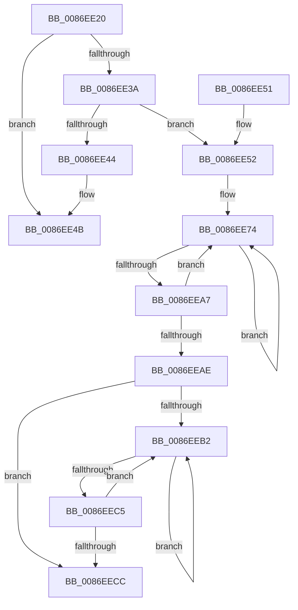

# SepAuditFailed

- RVA: `0x0086EE20`–`0x0086EEE6` (길이 `198` bytes)
- VA: `0x000000014086EE20`
- 실행 섹션: `PAGE`
- PDB 이름 있음: `예`; PDB Function 태그: `아니요`
- unwind 정보 RVA: `0x0006C178`
- 디코드: `48`개 명령, `198/198` bytes 표시
- 미해석 바이트: `0` (있으면 어셈블리에 `.byte`로 보존)

> 이 문서는 커널 이미지의 기계어와 PDB 기호를 분석해 생성했습니다. 4번과 5번은 함수 원형과 자료형을 바이너리 사용 방식에서 추정한 C 해석이며 원본 소스 복구 결과는 아닙니다.

## 1. Dependencies

- 직접 호출 지점: **5**; 고유 호출 대상: **5**
- 직접 호출자로 확인된 함수: **33**
- RIP 상대 이미지 참조: **4**

### Outgoing calls
- `0x0086EE56` → [SepAdtLogAuditFailureEvent](../79/SepAdtLogAuditFailureEvent_function_0079F084.md) (function, `0x0079F084`)
- `0x0086EE67` → [RtlInitUnicodeString](../../text/42/RtlInitUnicodeString_function_0042A780.md) (function, `0x0042A780`)
- `0x0086EE9B` → [ZwSetValueKey](../../text/6A/ZwSetValueKey_function_006ADCD0.md) (function, `0x006ADCD0`)
- `0x0086EEB9` → [ZwFlushKey](../../text/6A/ZwFlushKey_function_006AEF10.md) (function, `0x006AEF10`)
- `0x0086EEE0` → [KeBugCheckEx](../../text/4F/KeBugCheckEx_function_004FD660.md) (function, `0x004FD660`)

### Direct callers
- [SepRmCallLsa](../../text/22/SepRmCallLsa_function_00223630.md) at `0x00223936`
- [SepInitProcessAuditSd](../../text/60/SepInitProcessAuditSd_function_00606230.md) at `0x006062A0`
- [SepAuditFailedRaisedIrql](../../text/60/SepAuditFailedRaisedIrql_function_0060B894.md) at `0x0060B8AE`
- [sub_006D6A74](../../text/6D/Unknown_function_006D6A74.md) at `0x006D6A8D`
- [SeAdtRegistryValueChangedAuditAlarm](../79/SeAdtRegistryValueChangedAuditAlarm_function_0079DDD4.md) at `0x0079E2E7`
- [SeAuditFipsCryptoSelftests](../79/SeAuditFipsCryptoSelftests_function_0079E820.md) at `0x0079E9B1`
- [SeAuditProcessExit](../79/SeAuditProcessExit_function_0079EA08.md) at `0x0079EB47`
- [SeAuditSystemTimeChange](../79/SeAuditSystemTimeChange_function_0079EB8C.md) at `0x0079ECF5`
- [SepAdtObjectReferenceAuditAlarm](../79/SepAdtObjectReferenceAuditAlarm_function_0079F27C.md) at `0x0079F5AE`
- [SepAuditAssignPrimaryToken](../79/SepAuditAssignPrimaryToken_function_0079F828.md) at `0x0079FA0A`
- [NtDeleteObjectAuditAlarm](../7A/NtDeleteObjectAuditAlarm_function_007A03C0.md) at `0x007A04AB`
- [SepAdtCloseObjectAuditAlarm](SepAdtCloseObjectAuditAlarm_function_0086B4E8.md) at `0x0086B6FE`
- [SepAdtPrivilegeObjectAuditAlarm](SepAdtPrivilegeObjectAuditAlarm_function_0086E3F0.md) at `0x0086E777`
- [sub_0086E95E](Unknown_function_0086E95E.md) at `0x0086EC4B`
- [SepAdtAuditObjectAccessWithContext](SepAdtAuditObjectAccessWithContext_function_0086EEF0.md) at `0x0086F0CB`
- [sub_00870B7C](../87/Unknown_function_00870B7C.md) at `0x00870B8F`
- [SepAdtPrivilegedServiceAuditAlarm](../87/SepAdtPrivilegedServiceAuditAlarm_function_008714F0.md) at `0x00871660`
- [SepAdtSecurityDescriptorChangedAuditAlarm](../91/SepAdtSecurityDescriptorChangedAuditAlarm_function_0091E3E8.md) at `0x0091E696`
- [SepAdtDeleteObjectAuditAlarm](../91/SepAdtDeleteObjectAuditAlarm_function_0091E824.md) at `0x0091EA5F`
- [SeOperationAuditAlarm](../91/SeOperationAuditAlarm_function_0091EA78.md) at `0x0091EE71`
- [SepAdtOpenObjectAuditAlarm](../91/SepAdtOpenObjectAuditAlarm_function_0091F23C.md) at `0x0091F936`
- [SeSecurityDescriptorChangedAuditAlarm](../91/SeSecurityDescriptorChangedAuditAlarm_function_0091FC5C.md) at `0x00920120`
- [SeSecurityDescriptorChangedAuditAlarm](../91/SeSecurityDescriptorChangedAuditAlarm_function_0091FC5C.md) at `0x0092040F`
- [SeTokenDefaultDaclChangedAuditAlarm](../92/SeTokenDefaultDaclChangedAuditAlarm_function_00920570.md) at `0x00920774`
- [SeTokenDefaultDaclChangedAuditAlarm](../92/SeTokenDefaultDaclChangedAuditAlarm_function_00920570.md) at `0x00920783`
- [SeAuditProcessCreation](../94/SeAuditProcessCreation_function_00947624.md) at `0x00947770`
- [SeOpenObjectForDeleteAuditAlarmWithTransaction](../97/SeOpenObjectForDeleteAuditAlarmWithTransaction_function_00973EC0.md) at `0x00974159`
- [NtOpenObjectAuditAlarm](../97/NtOpenObjectAuditAlarm_function_00974700.md) at `0x00974A3D`
- [NtOpenObjectAuditAlarm](../97/NtOpenObjectAuditAlarm_function_00974700.md) at `0x00974CDD`
- [NtOpenObjectAuditAlarm](../97/NtOpenObjectAuditAlarm_function_00974700.md) at `0x00974D16`
- [sub_009A2A39](../9A/Unknown_function_009A2A39.md) at `0x009A2A3E`
- [SepAccessCheckAndAuditAlarm](../A1/SepAccessCheckAndAuditAlarm_function_00A1AF4C.md) at `0x00A1D82E`
- [SepRmCommandServerThread](../A6/SepRmCommandServerThread_function_00A6A8D0.md) at `0x00A6A976`
- [sub_00B21E9E](../B2/Unknown_function_00B21E9E.md) at `0x00B2228B`
- [sub_00B297AC](../B2/Unknown_function_00B297AC.md) at `0x00B297B1`
- [sub_00B297EE](../B2/Unknown_function_00B297EE.md) at `0x00B297F3`
- [sub_00B379EA](../B3/Unknown_function_00B379EA.md) at `0x00B37A55`

### Static image references
- `0x0086EE26` → RVA `0x00E67F1C` (`.data`; read)
- `0x0086EE3A` → RVA `0x00FD80A0` (`PAGEDATA`; read)
- `0x0086EE44` → RVA `0x00E67F1C` (`.data`; write)
- `0x0086EE5B` → RVA `0x00B06190` (` ?? ::NNGAKEGL::`string'`; read)

## 2. Other-region calls and transfers

- 다른 실행 섹션으로 향하는 call: **4**
  - `0x0086EE67` → [RtlInitUnicodeString](../../text/42/RtlInitUnicodeString_function_0042A780.md) (`PAGE` → `.text`)
  - `0x0086EE9B` → [ZwSetValueKey](../../text/6A/ZwSetValueKey_function_006ADCD0.md) (`PAGE` → `.text`)
  - `0x0086EEB9` → [ZwFlushKey](../../text/6A/ZwFlushKey_function_006AEF10.md) (`PAGE` → `.text`)
  - `0x0086EEE0` → [KeBugCheckEx](../../text/4F/KeBugCheckEx_function_004FD660.md) (`PAGE` → `.text`)
- 별도 외부 분기/꼬리 이동을 확인하지 못했습니다.

## 3. Assembly (complete function range)

```asm
0086EE20  40 53                           push rbx
0086EE22  48 83 EC 40                     sub rsp, 0x40
0086EE26  80 3D EF 90 5F 00 00            cmp byte ptr [rip + 0x5f90ef], 0
0086EE2D  0F 57 C0                        xorps xmm0, xmm0
0086EE30  0F 11 44 24 30                  movups xmmword ptr [rsp + 0x30], xmm0
0086EE35  48 63 D9                        movsxd rbx, ecx
0086EE38  74 11                           je 0x14086ee4b
0086EE3A  48 83 3D 5E 92 76 00 00         cmp qword ptr [rip + 0x76925e], 0
0086EE42  75 0E                           jne 0x14086ee52
0086EE44  C6 05 D1 90 5F 00 00            mov byte ptr [rip + 0x5f90d1], 0
0086EE4B  48 83 C4 40                     add rsp, 0x40
0086EE4F  5B                              pop rbx
0086EE50  C3                              ret
0086EE51  CC                              int3
0086EE52  B2 01                           mov dl, 1
0086EE54  8B CB                           mov ecx, ebx
0086EE56  E8 29 02 F3 FF                  call 0x14079f084
0086EE5B  48 8D 15 2E 73 29 00            lea rdx, [rip + 0x29732e]
0086EE62  48 8D 4C 24 30                  lea rcx, [rsp + 0x30]
0086EE67  E8 14 B9 BB FF                  call 0x14042a780
0086EE6C  C7 44 24 58 02 00 00 00         mov dword ptr [rsp + 0x58], 2
0086EE74  48 8B 0D 25 92 76 00            mov rcx, qword ptr [rip + 0x769225]
0086EE7B  48 8D 44 24 58                  lea rax, [rsp + 0x58]
0086EE80  C7 44 24 28 04 00 00 00         mov dword ptr [rsp + 0x28], 4
0086EE88  48 8D 54 24 30                  lea rdx, [rsp + 0x30]
0086EE8D  41 B9 04 00 00 00               mov r9d, 4
0086EE93  48 89 44 24 20                  mov qword ptr [rsp + 0x20], rax
0086EE98  45 33 C0                        xor r8d, r8d
0086EE9B  E8 30 EE E3 FF                  call 0x1406adcd0
0086EEA0  3D 9A 00 00 C0                  cmp eax, 0xc000009a
0086EEA5  74 CD                           je 0x14086ee74
0086EEA7  3D 17 00 00 C0                  cmp eax, 0xc0000017
0086EEAC  74 C6                           je 0x14086ee74
0086EEAE  85 C0                           test eax, eax
0086EEB0  78 1A                           js 0x14086eecc
0086EEB2  48 8B 0D E7 91 76 00            mov rcx, qword ptr [rip + 0x7691e7]
0086EEB9  E8 52 00 E4 FF                  call 0x1406aef10
0086EEBE  3D 9A 00 00 C0                  cmp eax, 0xc000009a
0086EEC3  74 ED                           je 0x14086eeb2
0086EEC5  3D 17 00 00 C0                  cmp eax, 0xc0000017
0086EECA  74 E6                           je 0x14086eeb2
0086EECC  48 83 64 24 20 00               and qword ptr [rsp + 0x20], 0
0086EED2  48 8B D3                        mov rdx, rbx
0086EED5  45 33 C9                        xor r9d, r9d
0086EED8  45 33 C0                        xor r8d, r8d
0086EEDB  B9 44 02 00 C0                  mov ecx, 0xc0000244
0086EEE0  E8 7B E7 C8 FF                  call 0x1404fd660
0086EEE5  CC                              int3
```

## 4. C-style interpretation (structured pseudocode)

```c
__int64 __fastcall SepAuditFailed(int a1, __int64 a2, int a3)
{
    __int64 result;
    __int64 v_rsp;
    unsigned __int64 v_stack_m18;
    unsigned __int64 v_stack_p20;
    unsigned int v_stack_p28;
    unsigned __int64 v_stack_p30;
    unsigned int v_stack_p58;

    v_rsp = (v_rsp) - (64);
    v_stack_m18 = v_xmm0;
    if ((*(unsigned __int8 *)(v_rip + 6263023)) == 0) goto loc_0086EE4B;
    if ((*(unsigned __int64 *)(v_rip + 7770718)) != 0) goto loc_0086EE52;
    *(unsigned __int8 *)(v_rip + 6262993) = 0;
loc_0086EE4B:
    v_rsp = (v_rsp) + (64);
    return result;
loc_0086EE52:
    result = SepAdtLogAuditFailureEvent((unsigned int)((unsigned int)((int)(a1))), 1, a3, a4);
    result = RtlInitUnicodeString(v_stack_p30, v_rip + 2716462, a3, a4);
    v_stack_p58 = 2;
loc_0086EE74:
    v_stack_p28 = 4;
    v_stack_p20 = v_stack_p58;
    a3 = 0;
    result = ZwSetValueKey(*(unsigned __int64 *)(v_rip + 7770661), v_stack_p30, a3, 4);
    if (((unsigned int)(result)) == 0xC000009AULL) goto loc_0086EE74;
    if (((unsigned int)(result)) == 0xC0000017ULL) goto loc_0086EE74;
    if (sign_flag) goto loc_0086EECC;
loc_0086EEB2:
    result = ZwFlushKey(*(unsigned __int64 *)(v_rip + 7770599), v_stack_p30, a3, 4);
    if (((unsigned int)(result)) == 0xC000009AULL) goto loc_0086EEB2;
    if (((unsigned int)(result)) == 0xC0000017ULL) goto loc_0086EEB2;
loc_0086EECC:
    a4 = 0;
    a3 = 0;
    result = KeBugCheckEx((unsigned int)(0xC0000244ULL), (int)(a1), a3, a4);
    return result;
}
```

## 5. (Beta) C Style

```c
int64_t SepAuditFailed(int32_t Arg1, int64_t Arg2, int32_t Arg3)
{
    int64_t result;
    int64_t local_rsp;
    uint64_t v_stack_m18;
    uint64_t v_stack_p20;
    uint32_t v_stack_p28;
    uint64_t v_stack_p30;
    uint32_t v_stack_p58;

    local_rsp = (local_rsp) - (64);
    v_stack_m18 = v_xmm0;
    if ((*(uint8_t *)(v_rip + 0x5F90EF)) == 0) goto loc_0086EE4B;
    if ((*(uint64_t *)(v_rip + 0x76925E)) != 0) goto loc_0086EE52;
    *(uint8_t *)(v_rip + 0x5F90D1) = 0;
loc_0086EE4B:
    local_rsp = (local_rsp) + (64);
    return result;
loc_0086EE52:
    result = SepAdtLogAuditFailureEvent((uint32_t)((uint32_t)((int32_t)(Arg1))), 1, Arg3, a4);
    result = RtlInitUnicodeString(v_stack_p30, v_rip + 2716462, Arg3, a4);
    v_stack_p58 = 2;
loc_0086EE74:
    v_stack_p28 = 4;
    v_stack_p20 = v_stack_p58;
    Arg3 = 0;
    result = ZwSetValueKey(*(uint64_t *)(v_rip + 0x769225), v_stack_p30, Arg3, 4);
    if (((uint32_t)(result)) == 0xC000009AULL) goto loc_0086EE74;
    if (((uint32_t)(result)) == 0xC0000017ULL) goto loc_0086EE74;
    if (sign_flag) goto loc_0086EECC;
loc_0086EEB2:
    result = ZwFlushKey(*(uint64_t *)(v_rip + 0x7691E7), v_stack_p30, Arg3, 4);
    if (((uint32_t)(result)) == 0xC000009AULL) goto loc_0086EEB2;
    if (((uint32_t)(result)) == 0xC0000017ULL) goto loc_0086EEB2;
loc_0086EECC:
    a4 = 0;
    Arg3 = 0;
    result = KeBugCheckEx((uint32_t)(0xC0000244ULL), (int32_t)(Arg1), Arg3, a4);
    return result;
}
```

## 6. Execution-region graph

[열기: 2D/3D 그래프와 함수 탐색 컨트롤 패널](../../../control-panel.html?section=page&rva=0x0086EE20&view=graph)

- 2D 그래프는 위에서 아래로 흐르고, 3D 그래프는 빈 공간을 드래그해 회전합니다. Shift+드래그는 이동, 휠은 확대·축소, 함수 노드 선택은 대상 보고서 이동입니다.

### Static fallback


