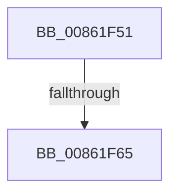

# sub_00861F51

- RVA: `0x00861F51`–`0x00861F68` (길이 `23` bytes)
- VA: `0x0000000140861F51`
- 실행 섹션: `PAGE`
- PDB 이름 있음: `아니요`; PDB Function 태그: `아니요`
- unwind 정보 RVA: `0x0006B500`
- 디코드: `5`개 명령, `23/23` bytes 표시
- 미해석 바이트: `0` (있으면 어셈블리에 `.byte`로 보존)

> 이 문서는 커널 이미지의 기계어와 PDB 기호를 분석해 생성했습니다. 4번과 5번은 함수 원형과 자료형을 바이너리 사용 방식에서 추정한 C 해석이며 원본 소스 복구 결과는 아닙니다.

## 1. Dependencies

- 직접 호출 지점: **0**; 고유 호출 대상: **0**
- 직접 호출자로 확인된 함수: **0**
- RIP 상대 이미지 참조: **1**

### Outgoing calls
- 직접 디코드된 call 명령이 없습니다.

### Direct callers
- 이 함수 시작 RVA로 연결되는 직접 call은 확인되지 않았습니다. 간접 호출은 완전히 역산할 수 없습니다.

### Static image references
- `0x00861F55` → RVA `0x00FD8008` (`PAGEDATA`; read)

## 2. Other-region calls and transfers

- 다른 실행 섹션으로 향하는 call: **0**
- call이 아닌 외부 분기/꼬리 이동: **1**
  - `0x00861F5F` → [sub_00861FEC](Unknown_function_00861FEC.md) (`tail-transfer`)

## 3. Assembly (complete function range)

```asm
00861F51  49 89 7B E0                     mov qword ptr [r11 - 0x20], rdi
00861F55  48 8B 3D AC 60 77 00            mov rdi, qword ptr [rip + 0x7760ac]
00861F5C  48 85 FF                        test rdi, rdi
00861F5F  0F 84 87 00 00 00               je 0x140861fec
00861F65  0F 57 C9                        xorps xmm1, xmm1
```

## 4. C-style interpretation (structured pseudocode)

```c
void __fastcall sub_00861F51(void)
{
    *(unsigned __int64 *)(v_r11 - 32) = v_rdi;
    return;
}
```

## 5. (Beta) C Style

```c
void sub_00861F51(void)
{
    *(uint64_t *)(local_r11 - 0x20) = local_rdi;
    return;
}
```

## 6. Execution-region graph

[열기: 2D/3D 그래프와 함수 탐색 컨트롤 패널](../../../control-panel.html?section=page&rva=0x00861F51&view=graph)

- 2D 그래프는 위에서 아래로 흐르고, 3D 그래프는 빈 공간을 드래그해 회전합니다. Shift+드래그는 이동, 휠은 확대·축소, 함수 노드 선택은 대상 보고서 이동입니다.

### Static fallback


