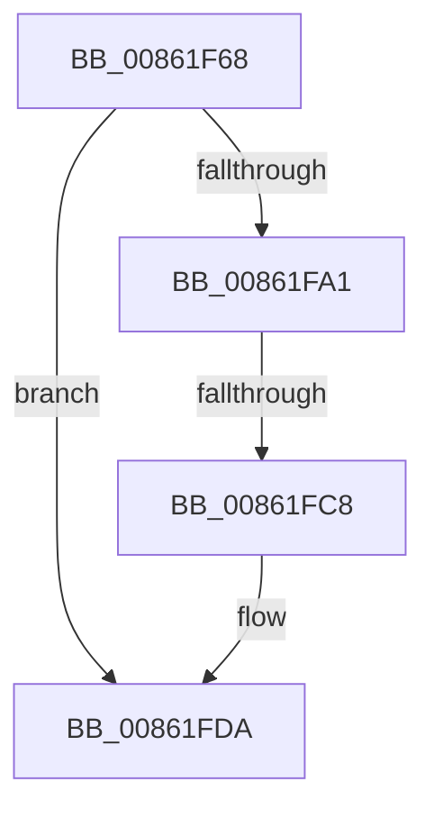

# sub_00861F68

- RVA: `0x00861F68`–`0x00861FEC` (길이 `132` bytes)
- VA: `0x0000000140861F68`
- 실행 섹션: `PAGE`
- PDB 이름 있음: `아니요`; PDB Function 태그: `아니요`
- unwind 정보 RVA: `0x0006B514`
- 디코드: `30`개 명령, `132/132` bytes 표시
- 미해석 바이트: `0` (있으면 어셈블리에 `.byte`로 보존)

> 이 문서는 커널 이미지의 기계어와 PDB 기호를 분석해 생성했습니다. 4번과 5번은 함수 원형과 자료형을 바이너리 사용 방식에서 추정한 C 해석이며 원본 소스 복구 결과는 아닙니다.

## 1. Dependencies

- 직접 호출 지점: **5**; 고유 호출 대상: **5**
- 직접 호출자로 확인된 함수: **0**
- RIP 상대 이미지 참조: **1**

### Outgoing calls
- `0x00861F8C` → [CmpAttachToRegistryProcess](../../pagecmrc/BC/CmpAttachToRegistryProcess_function_00BC98E0.md) (function, `0x00BC98E0`)
- `0x00861F94` → [CmpConstructName](../85/CmpConstructName_function_00856BE0.md) (function, `0x00856BE0`)
- `0x00861FC8` → [EtwpTraceRegistry](EtwpTraceRegistry_function_00862980.md) (function, `0x00862980`)
- `0x00861FD5` → [CmpFreePoolWithTag](../../text/44/CmpFreePoolWithTag_function_004489E0.md) (function, `0x004489E0`)
- `0x00861FDF` → [CmpDetachFromRegistryProcess](../../pagecmrc/BC/CmpDetachFromRegistryProcess_function_00BC9920.md) (function, `0x00BC9920`)

### Direct callers
- 이 함수 시작 RVA로 연결되는 직접 call은 확인되지 않았습니다. 간접 호출은 완전히 역산할 수 없습니다.

### Static image references
- `0x00861FA1` → RVA `0x00862980` (`EtwpTraceRegistry`; read)

## 2. Other-region calls and transfers

- 다른 실행 섹션으로 향하는 call: **3**
  - `0x00861F8C` → [CmpAttachToRegistryProcess](../../pagecmrc/BC/CmpAttachToRegistryProcess_function_00BC98E0.md) (`PAGE` → `PAGECMRC`)
  - `0x00861FD5` → [CmpFreePoolWithTag](../../text/44/CmpFreePoolWithTag_function_004489E0.md) (`PAGE` → `.text`)
  - `0x00861FDF` → [CmpDetachFromRegistryProcess](../../pagecmrc/BC/CmpDetachFromRegistryProcess_function_00BC9920.md) (`PAGE` → `PAGECMRC`)
- call이 아닌 외부 분기/꼬리 이동: **1**
  - `0x00861FC2` → [sub_00862322](Unknown_function_00862322.md) (`tail-transfer`)

## 3. Assembly (complete function range)

```asm
00861F68  49 89 6B 18                     mov qword ptr [r11 + 0x18], rbp
00861F6C  0F 57 C0                        xorps xmm0, xmm0
00861F6F  49 8D 4B 98                     lea rcx, [r11 - 0x68]
00861F73  0F 11 4C 24 60                  movups xmmword ptr [rsp + 0x60], xmm1
00861F78  0F 11 4C 24 70                  movups xmmword ptr [rsp + 0x70], xmm1
00861F7D  41 0F 11 4B B8                  movups xmmword ptr [r11 - 0x48], xmm1
00861F82  0F 11 44 24 40                  movups xmmword ptr [rsp + 0x40], xmm0
00861F87  0F 11 44 24 50                  movups xmmword ptr [rsp + 0x50], xmm0
00861F8C  E8 4F 79 36 00                  call 0x140bc98e0
00861F91  48 8B CB                        mov rcx, rbx
00861F94  E8 47 4C FF FF                  call 0x140856be0
00861F99  48 8B E8                        mov rbp, rax
00861F9C  48 85 C0                        test rax, rax
00861F9F  74 39                           je 0x140861fda
00861FA1  48 8D 05 D8 09 00 00            lea rax, [rip + 0x9d8]
00861FA8  48 89 6C 24 28                  mov qword ptr [rsp + 0x28], rbp
00861FAD  45 33 C9                        xor r9d, r9d
00861FB0  48 89 5C 24 20                  mov qword ptr [rsp + 0x20], rbx
00861FB5  45 33 C0                        xor r8d, r8d
00861FB8  48 8D 54 24 40                  lea rdx, [rsp + 0x40]
00861FBD  B1 17                           mov cl, 0x17
00861FBF  48 3B F8                        cmp rdi, rax
00861FC2  0F 85 5A 03 00 00               jne 0x140862322
00861FC8  E8 B3 09 00 00                  call 0x140862980
00861FCD  BA 43 4D 4E 62                  mov edx, 0x624e4d43
00861FD2  48 8B CD                        mov rcx, rbp
00861FD5  E8 06 6A BE FF                  call 0x1404489e0
00861FDA  48 8D 4C 24 60                  lea rcx, [rsp + 0x60]
00861FDF  E8 3C 79 36 00                  call 0x140bc9920
00861FE4  48 8B AC 24 E0 00 00 00         mov rbp, qword ptr [rsp + 0xe0]
```

## 4. C-style interpretation (structured pseudocode)

```c
__int64 __fastcall sub_00861F68(__int64 a1, __int64 a2, int a3, int a4, __int64 a5, __int64 a6, __int64 a7, __int64 a8, __int64 a9, __int64 a10, __int64 a11, __int64 a12, __int64 a13, __int64 a14, __int64 a15, __int64 a16, __int64 a17, __int64 a18, __int64 a19, __int64 a20, __int64 a21, __int64 a22, __int64 a23, __int64 a24, __int64 a25, __int64 a26, __int64 a27, __int64 a28)
{
    __int64 result;
    unsigned __int64 v_stack_p20;
    unsigned __int64 v_stack_p28;

    *(unsigned __int64 *)(v_r11 + 24) = v_rbp;
    a12 = v_xmm1;
    a14 = v_xmm1;
    *(unsigned __int64 *)(v_r11 - 72) = v_xmm1;
    a8 = v_xmm0;
    a10 = v_xmm0;
    result = CmpAttachToRegistryProcess(v_r11 - 104, a2, a3, a4);
    result = CmpConstructName(v_rbx, a2, a3, a4);
    if (result == 0) goto loc_00861FDA;
    v_stack_p28 = result;
    a4 = 0;
    v_stack_p20 = v_rbx;
    a3 = 0;
    result = EtwpTraceRegistry(23, a8, a3, a4);
    result = CmpFreePoolWithTag(result, (unsigned int)(0x624E4D43ULL), a3, a4);
loc_00861FDA:
    result = CmpDetachFromRegistryProcess(a12, (unsigned int)(0x624E4D43ULL), a3, a4);
    return result;
}
```

## 5. (Beta) C Style

```c
int64_t sub_00861F68(int64_t Arg1, int64_t Arg2, int32_t Arg3, int32_t Arg4, uint64_t Arg5, uint64_t Arg6, uint64_t Arg7, int64_t Arg8, uint64_t Arg9, int64_t Arg10, uint64_t Arg11, int64_t Arg12, uint64_t Arg13, int64_t Arg14, uint64_t Arg15, uint64_t Arg16, uint64_t Arg17, uint64_t Arg18, uint64_t Arg19, uint64_t Arg20, uint64_t Arg21, uint64_t Arg22, uint64_t Arg23, uint64_t Arg24, uint64_t Arg25, uint64_t Arg26, uint64_t Arg27, int64_t Arg28)
{
    int64_t result;
    uint64_t v_stack_p20;
    uint64_t v_stack_p28;

    *(uint64_t *)(local_r11 + 0x18) = local_rbp;
    Arg12 = v_xmm1;
    Arg14 = v_xmm1;
    *(uint64_t *)(local_r11 - 0x48) = v_xmm1;
    Arg8 = v_xmm0;
    Arg10 = v_xmm0;
    result = CmpAttachToRegistryProcess(local_r11 - 104, Arg2, Arg3, Arg4);
    result = CmpConstructName(local_rbx, Arg2, Arg3, Arg4);
    if (result == 0) goto loc_00861FDA;
    v_stack_p28 = result;
    Arg4 = 0;
    v_stack_p20 = local_rbx;
    Arg3 = 0;
    result = EtwpTraceRegistry(23, Arg8, Arg3, Arg4);
    result = CmpFreePoolWithTag(result, (uint32_t)(0x624E4D43ULL), Arg3, Arg4);
loc_00861FDA:
    result = CmpDetachFromRegistryProcess(Arg12, (uint32_t)(0x624E4D43ULL), Arg3, Arg4);
    return result;
}
```

## 6. Execution-region graph

[열기: 2D/3D 그래프와 함수 탐색 컨트롤 패널](../../../control-panel.html?section=page&rva=0x00861F68&view=graph)

- 2D 그래프는 위에서 아래로 흐르고, 3D 그래프는 빈 공간을 드래그해 회전합니다. Shift+드래그는 이동, 휠은 확대·축소, 함수 노드 선택은 대상 보고서 이동입니다.

### Static fallback


