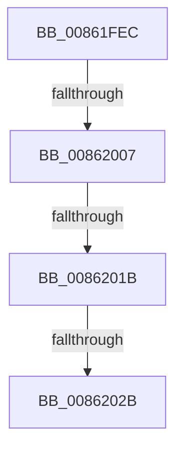

# sub_00861FEC

- RVA: `0x00861FEC`–`0x00862036` (길이 `74` bytes)
- VA: `0x0000000140861FEC`
- 실행 섹션: `PAGE`
- PDB 이름 있음: `아니요`; PDB Function 태그: `아니요`
- unwind 정보 RVA: `0x0006B528`
- 디코드: `17`개 명령, `74/74` bytes 표시
- 미해석 바이트: `0` (있으면 어셈블리에 `.byte`로 보존)

> 이 문서는 커널 이미지의 기계어와 PDB 기호를 분석해 생성했습니다. 4번과 5번은 함수 원형과 자료형을 바이너리 사용 방식에서 추정한 C 해석이며 원본 소스 복구 결과는 아닙니다.

## 1. Dependencies

- 직접 호출 지점: **1**; 고유 호출 대상: **1**
- 직접 호출자로 확인된 함수: **0**
- RIP 상대 이미지 참조: **0**

### Outgoing calls
- `0x0086200B` → [CmpDereferenceNameControlBlockWithLock](CmpDereferenceNameControlBlockWithLock_function_00862840.md) (function, `0x00862840`)

### Direct callers
- 이 함수 시작 RVA로 연결되는 직접 call은 확인되지 않았습니다. 간접 호출은 완전히 역산할 수 없습니다.

### Static image references
- 디코드된 RIP-relative 메모리 참조가 없습니다.

## 2. Other-region calls and transfers

- 다른 실행 섹션으로 향하는 call: **0**
- call이 아닌 외부 분기/꼬리 이동: **3**
  - `0x00862001` → [sub_008621C0 + 0x43](Unknown_function_008621C0.md) (`tail-transfer`)
  - `0x00862015` → [sub_0086232F](Unknown_function_0086232F.md) (`tail-transfer`)
  - `0x00862025` → [sub_008621C0 + 0xE5](Unknown_function_008621C0.md) (`tail-transfer`)

## 3. Assembly (complete function range)

```asm
00861FEC  0F B7 83 BA 00 00 00            movzx eax, word ptr [rbx + 0xba]
00861FF3  A8 40                           test al, 0x40
00861FF5  0F 94 C1                        sete cl
00861FF8  F6 43 08 08                     test byte ptr [rbx + 8], 8
00861FFC  0F 95 C0                        setne al
00861FFF  84 C8                           test al, cl
00862001  0F 85 FC 01 00 00               jne 0x140862203
00862007  48 8B 4B 50                     mov rcx, qword ptr [rbx + 0x50]
0086200B  E8 30 08 00 00                  call 0x140862840
00862010  8B 43 08                        mov eax, dword ptr [rbx + 8]
00862013  A8 04                           test al, 4
00862015  0F 85 14 03 00 00               jne 0x14086232f
0086201B  48 8B 8B C0 00 00 00            mov rcx, qword ptr [rbx + 0xc0]
00862022  48 85 C9                        test rcx, rcx
00862025  0F 85 7A 02 00 00               jne 0x1408622a5
0086202B  F7 43 08 00 00 02 00            test dword ptr [rbx + 8], 0x20000
00862032  48 8B 7B 48                     mov rdi, qword ptr [rbx + 0x48]
```

## 4. C-style interpretation (structured pseudocode)

```c
__int64 __fastcall sub_00861FEC(void)
{
    __int64 result;

    a1 = ((((unsigned __int8)(*(unsigned __int16 *)(v_rbx + 186))) & (64)) == 0) ? 1 : 0;
    result = (((*(unsigned __int8 *)(v_rbx + 8)) & (8)) != 0) ? 1 : 0;
    result = CmpDereferenceNameControlBlockWithLock(*(unsigned __int64 *)(v_rbx + 80), a2, a3, a4);
    return (unsigned int)(*(unsigned int *)(v_rbx + 8));
}
```

## 5. (Beta) C Style

```c
void sub_00861FEC(void)
{
    int64_t result;

    a1 = ((((uint8_t)(*(uint16_t *)(local_rbx + 0xBA))) & (64)) == 0) ? 1 : 0;
    result = (((*(uint8_t *)(local_rbx + 0x8)) & (8)) != 0) ? 1 : 0;
    result = CmpDereferenceNameControlBlockWithLock(*(uint64_t *)(local_rbx + 0x50), a2, a3, a4);
    return (uint32_t)(*(uint32_t *)(local_rbx + 0x8));
}
```

## 6. Execution-region graph

[열기: 2D/3D 그래프와 함수 탐색 컨트롤 패널](../../../control-panel.html?section=page&rva=0x00861FEC&view=graph)

- 2D 그래프는 위에서 아래로 흐르고, 3D 그래프는 빈 공간을 드래그해 회전합니다. Shift+드래그는 이동, 휠은 확대·축소, 함수 노드 선택은 대상 보고서 이동입니다.

### Static fallback


