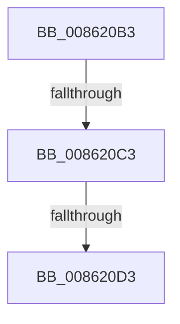

# sub_008620B3

- RVA: `0x008620B3`–`0x008620F2` (길이 `63` bytes)
- VA: `0x00000001408620B3`
- 실행 섹션: `PAGE`
- PDB 이름 있음: `아니요`; PDB Function 태그: `아니요`
- unwind 정보 RVA: `0x0006B54C`
- 디코드: `15`개 명령, `63/63` bytes 표시
- 미해석 바이트: `0` (있으면 어셈블리에 `.byte`로 보존)

> 이 문서는 커널 이미지의 기계어와 PDB 기호를 분석해 생성했습니다. 4번과 5번은 함수 원형과 자료형을 바이너리 사용 방식에서 추정한 C 해석이며 원본 소스 복구 결과는 아닙니다.

## 1. Dependencies

- 직접 호출 지점: **1**; 고유 호출 대상: **1**
- 직접 호출자로 확인된 함수: **0**
- RIP 상대 이미지 참조: **0**

### Outgoing calls
- `0x008620EC` → [KeBugCheckEx](../../text/4F/KeBugCheckEx_function_004FD660.md) (function, `0x004FD660`)

### Direct callers
- 이 함수 시작 RVA로 연결되는 직접 call은 확인되지 않았습니다. 간접 호출은 완전히 역산할 수 없습니다.

### Static image references
- 디코드된 RIP-relative 메모리 참조가 없습니다.

## 2. Other-region calls and transfers

- 다른 실행 섹션으로 향하는 call: **1**
  - `0x008620EC` → [KeBugCheckEx](../../text/4F/KeBugCheckEx_function_004FD660.md) (`PAGE` → `.text`)
- call이 아닌 외부 분기/꼬리 이동: **2**
  - `0x008620C1` → [sub_008620F8](Unknown_function_008620F8.md) (`tail-transfer`)
  - `0x008620CD` → [sub_008621C0 + 0x1F](Unknown_function_008621C0.md) (`tail-transfer`)

## 3. Assembly (complete function range)

```asm
008620B3  4C 8B 4E 20                     mov r9, qword ptr [rsi + 0x20]
008620B7  48 8B 0E                        mov rcx, qword ptr [rsi]
008620BA  4C 8B D1                        mov r10, rcx
008620BD  48 83 F9 01                     cmp rcx, 1
008620C1  77 35                           ja 0x1408620f8
008620C3  48 8D 86 E0 00 00 00            lea rax, [rsi + 0xe0]
008620CA  48 39 00                        cmp qword ptr [rax], rax
008620CD  0F 84 0C 01 00 00               je 0x1408621df
008620D3  41 B9 01 00 00 00               mov r9d, 1
008620D9  48 C7 44 24 20 00 00 00 00      mov qword ptr [rsp + 0x20], 0
008620E2  4C 8B C6                        mov r8, rsi
008620E5  41 8D 51 33                     lea edx, [r9 + 0x33]
008620E9  8D 4A 1D                        lea ecx, [rdx + 0x1d]
008620EC  E8 6F B5 C9 FF                  call 0x1404fd660
008620F1  CC                              int3
```

## 4. C-style interpretation (structured pseudocode)

```c
__int64 __fastcall sub_008620B3(void)
{
    __int64 result;
    unsigned __int64 v_stack_p20;

    v_stack_p20 = 0;
    result = KeBugCheckEx(1 + 51 + 29, 1 + 51, v_rsi, 1);
    return result;
}
```

## 5. (Beta) C Style

```c
void sub_008620B3(void)
{
    int64_t result;
    uint64_t v_stack_p20;

    v_stack_p20 = 0;
    result = KeBugCheckEx(1 + 51 + 29, 1 + 51, local_rsi, 1);
    return result;
}
```

## 6. Execution-region graph

[열기: 2D/3D 그래프와 함수 탐색 컨트롤 패널](../../../control-panel.html?section=page&rva=0x008620B3&view=graph)

- 2D 그래프는 위에서 아래로 흐르고, 3D 그래프는 빈 공간을 드래그해 회전합니다. Shift+드래그는 이동, 휠은 확대·축소, 함수 노드 선택은 대상 보고서 이동입니다.

### Static fallback


