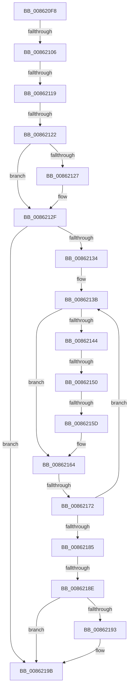

# sub_008620F8

- RVA: `0x008620F8`–`0x008621A3` (길이 `171` bytes)
- VA: `0x00000001408620F8`
- 실행 섹션: `PAGE`
- PDB 이름 있음: `아니요`; PDB Function 태그: `아니요`
- unwind 정보 RVA: `0x0006B570`
- 디코드: `46`개 명령, `171/171` bytes 표시
- 미해석 바이트: `0` (있으면 어셈블리에 `.byte`로 보존)

> 이 문서는 커널 이미지의 기계어와 PDB 기호를 분석해 생성했습니다. 4번과 5번은 함수 원형과 자료형을 바이너리 사용 방식에서 추정한 C 해석이며 원본 소스 복구 결과는 아닙니다.

## 1. Dependencies

- 직접 호출 지점: **2**; 고유 호출 대상: **1**
- 직접 호출자로 확인된 함수: **0**
- RIP 상대 이미지 참조: **0**

### Outgoing calls
- `0x0086212A` → [CmpDoQueueLateUnloadWorker](../84/CmpDoQueueLateUnloadWorker_function_0084FB18.md) (function, `0x0084FB18`)
- `0x00862196` → [CmpDoQueueLateUnloadWorker](../84/CmpDoQueueLateUnloadWorker_function_0084FB18.md) (function, `0x0084FB18`)

### Direct callers
- 이 함수 시작 RVA로 연결되는 직접 call은 확인되지 않았습니다. 간접 호출은 완전히 역산할 수 없습니다.

### Static image references
- 디코드된 RIP-relative 메모리 참조가 없습니다.

## 2. Other-region calls and transfers

- 다른 실행 섹션으로 향하는 call: **0**
- call이 아닌 외부 분기/꼬리 이동: **7**
  - `0x00862100` → [sub_008621C0 + 0xBF](Unknown_function_008621C0.md) (`tail-transfer`)
  - `0x00862117` → [sub_008620B3 + 0x7](Unknown_function_008620B3.md) (`tail-transfer`)
  - `0x0086211C` → [sub_008621C0 + 0x7D](Unknown_function_008621C0.md) (`tail-transfer`)
  - `0x0086214E` → [sub_008621C0](Unknown_function_008621C0.md) (`tail-transfer`)
  - `0x00862157` → [sub_0086230B](Unknown_function_0086230B.md) (`tail-transfer`)
  - `0x0086216C` → [sub_008621C0 + 0x99](Unknown_function_008621C0.md) (`tail-transfer`)
  - `0x00862188` → [sub_008621C0 + 0x61](Unknown_function_008621C0.md) (`tail-transfer`)

## 3. Assembly (complete function range)

```asm
008620F8  48 8D 51 FF                     lea rdx, [rcx - 1]
008620FC  48 83 FA 02                     cmp rdx, 2
00862100  0F 84 79 01 00 00               je 0x14086227f
00862106  45 32 C0                        xor r8b, r8b
00862109  48 8B C1                        mov rax, rcx
0086210C  F0 48 0F B1 16                  lock cmpxchg qword ptr [rsi], rdx
00862111  48 8B C8                        mov rcx, rax
00862114  49 3B C2                        cmp rax, r10
00862117  75 A1                           jne 0x1408620ba
00862119  48 3B C2                        cmp rax, rdx
0086211C  0F 82 1B 01 00 00               jb 0x14086223d
00862122  45 84 C0                        test r8b, r8b
00862125  74 08                           je 0x14086212f
00862127  49 8B C9                        mov rcx, r9
0086212A  E8 E9 D9 FE FF                  call 0x14084fb18
0086212F  48 85 FF                        test rdi, rdi
00862132  74 67                           je 0x14086219b
00862134  4C 8B 4F 20                     mov r9, qword ptr [rdi + 0x20]
00862138  48 8B 0F                        mov rcx, qword ptr [rdi]
0086213B  4C 8B D1                        mov r10, rcx
0086213E  48 83 F9 01                     cmp rcx, 1
00862142  77 20                           ja 0x140862164
00862144  48 8D 87 E0 00 00 00            lea rax, [rdi + 0xe0]
0086214B  48 39 00                        cmp qword ptr [rax], rax
0086214E  75 70                           jne 0x1408621c0
00862150  49 8B 4E 08                     mov rcx, qword ptr [r14 + 8]
00862154  4C 39 31                        cmp qword ptr [rcx], r14
00862157  0F 84 AE 01 00 00               je 0x14086230b
0086215D  B9 03 00 00 00                  mov ecx, 3
00862162  CD 29                           int 0x29
00862164  48 8D 51 FF                     lea rdx, [rcx - 1]
00862168  48 83 FA 02                     cmp rdx, 2
0086216C  0F 84 E7 00 00 00               je 0x140862259
00862172  45 32 C0                        xor r8b, r8b
00862175  48 8B C1                        mov rax, rcx
00862178  F0 48 0F B1 17                  lock cmpxchg qword ptr [rdi], rdx
0086217D  48 8B C8                        mov rcx, rax
00862180  49 3B C2                        cmp rax, r10
00862183  75 B6                           jne 0x14086213b
00862185  48 3B C2                        cmp rax, rdx
00862188  0F 82 93 00 00 00               jb 0x140862221
0086218E  45 84 C0                        test r8b, r8b
00862191  74 08                           je 0x14086219b
00862193  49 8B C9                        mov rcx, r9
00862196  E8 7D D9 FE FF                  call 0x14084fb18
0086219B  48 8B BC 24 A8 00 00 00         mov rdi, qword ptr [rsp + 0xa8]
```

## 4. C-style interpretation (structured pseudocode)

```c
__int64 __fastcall sub_008620F8(__int64 a1, __int64 a2, unsigned __int8 a3, __int64 a4, __int64 a5, __int64 a6, __int64 a7, __int64 a8, __int64 a9, __int64 a10, __int64 a11, __int64 a12, __int64 a13, __int64 a14, __int64 a15, __int64 a16, __int64 a17, __int64 a18, __int64 a19, __int64 a20, __int64 a21)
{
    __int64 result;

    a3 = 0;
    result = a1;
    if (0 != 0) {
        a1 = a4;
        result = CmpDoQueueLateUnloadWorker(a1, a1 - 1, a3, a4);
    }
    if (v_rdi == 0) goto loc_0086219B;
loc_0086213B:
    if ((*(unsigned __int64 *)(v_rdi)) > 1) goto loc_00862164;
loc_00862164:
    a3 = 0;
    if (3 != (*(unsigned __int64 *)(v_rdi))) goto loc_0086213B;
    result = 3;
    if (0 != 0) {
        a1 = *(unsigned __int64 *)(v_rdi + 32);
        result = CmpDoQueueLateUnloadWorker(a1, 3 - 1, a3, *(unsigned __int64 *)(v_rdi + 32));
    }
    return result;
}
```

## 5. (Beta) C Style

```c
int64_t sub_008620F8(void *Arg1, int64_t Arg2, uint8_t Arg3, int64_t Arg4, uint64_t Arg5, uint64_t Arg6, uint64_t Arg7, uint64_t Arg8, uint64_t Arg9, uint64_t Arg10, uint64_t Arg11, uint64_t Arg12, uint64_t Arg13, uint64_t Arg14, uint64_t Arg15, uint64_t Arg16, uint64_t Arg17, uint64_t Arg18, uint64_t Arg19, uint64_t Arg20, int64_t Arg21)
{
    uint8_t *arg1 = (uint8_t *)Arg1;

    int64_t result;

    Arg3 = 0;
    result = Arg1;
    if (0 != 0) {
        Arg1 = Arg4;
        result = CmpDoQueueLateUnloadWorker(Arg1, Arg1 - 1, Arg3, Arg4);
    }
    if (local_rdi == 0) goto loc_0086219B;
loc_0086213B:
    if ((*(uint64_t *)(local_rdi)) > 1) goto loc_00862164;
loc_00862164:
    Arg3 = 0;
    if (3 != (*(uint64_t *)(local_rdi))) goto loc_0086213B;
    result = 3;
    if (0 != 0) {
        Arg1 = *(uint64_t *)(local_rdi + 0x20);
        result = CmpDoQueueLateUnloadWorker(Arg1, 3 - 1, Arg3, *(uint64_t *)(local_rdi + 0x20));
    }
    return result;
}
```

### 관측된 메모리 오프셋

구조체 형식이 확인되지 않은 접근은 인자 기준의 오프셋으로만 기록했습니다.

| 기준 인자 | 오프셋 표현 | 폭 (bit) | 접근 |
|---|---:|---:|---|
| `Arg1` | `- 0x1` | `64` | `R` |

## 6. Execution-region graph

[열기: 2D/3D 그래프와 함수 탐색 컨트롤 패널](../../../control-panel.html?section=page&rva=0x008620F8&view=graph)

- 2D 그래프는 위에서 아래로 흐르고, 3D 그래프는 빈 공간을 드래그해 회전합니다. Shift+드래그는 이동, 휠은 확대·축소, 함수 노드 선택은 대상 보고서 이동입니다.

### Static fallback


