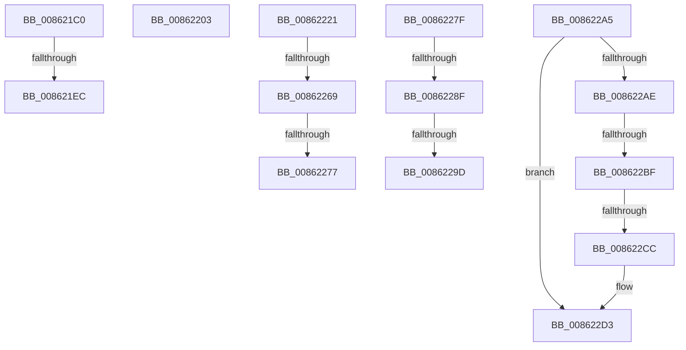

# sub_008621C0

- RVA: `0x008621C0`–`0x008622EA` (길이 `298` bytes)
- VA: `0x00000001408621C0`
- 실행 섹션: `PAGE`
- PDB 이름 있음: `아니요`; PDB Function 태그: `아니요`
- unwind 정보 RVA: `0x0006B594`
- 디코드: `65`개 명령, `298/298` bytes 표시
- 미해석 바이트: `0` (있으면 어셈블리에 `.byte`로 보존)

> 이 문서는 커널 이미지의 기계어와 PDB 기호를 분석해 생성했습니다. 4번과 5번은 함수 원형과 자료형을 바이너리 사용 방식에서 추정한 C 해석이며 원본 소스 복구 결과는 아닙니다.

## 1. Dependencies

- 직접 호출 지점: **5**; 고유 호출 대상: **3**
- 직접 호출자로 확인된 함수: **0**
- RIP 상대 이미지 참조: **0**

### Outgoing calls
- `0x008621D9` → [KeBugCheckEx](../../text/4F/KeBugCheckEx_function_004FD660.md) (function, `0x004FD660`)
- `0x0086220A` → [CmpDelayDerefKeyControlBlock](../84/CmpDelayDerefKeyControlBlock_function_0084FA50.md) (function, `0x0084FA50`)
- `0x00862237` → [KeBugCheckEx](../../text/4F/KeBugCheckEx_function_004FD660.md) (function, `0x004FD660`)
- `0x00862253` → [KeBugCheckEx](../../text/4F/KeBugCheckEx_function_004FD660.md) (function, `0x004FD660`)
- `0x008622D5` → [ExFreePoolWithTag](../../poolcode/B8/ExFreePoolWithTag_function_00B82870.md) (function, `0x00B82870`)

### Direct callers
- 이 함수 시작 RVA로 연결되는 직접 call은 확인되지 않았습니다. 간접 호출은 완전히 역산할 수 없습니다.

### Static image references
- 디코드된 RIP-relative 메모리 참조가 없습니다.

## 2. Other-region calls and transfers

- 다른 실행 섹션으로 향하는 call: **4**
  - `0x008621D9` → [KeBugCheckEx](../../text/4F/KeBugCheckEx_function_004FD660.md) (`PAGE` → `.text`)
  - `0x00862237` → [KeBugCheckEx](../../text/4F/KeBugCheckEx_function_004FD660.md) (`PAGE` → `.text`)
  - `0x00862253` → [KeBugCheckEx](../../text/4F/KeBugCheckEx_function_004FD660.md) (`PAGE` → `.text`)
  - `0x008622D5` → [ExFreePoolWithTag](../../poolcode/B8/ExFreePoolWithTag_function_00B82870.md) (`PAGE` → `POOLCODE`)
- call이 아닌 외부 분기/꼬리 이동: **12**
  - `0x008621E6` → [sub_008620F8 + 0x65](Unknown_function_008620F8.md) (`tail-transfer`)
  - `0x008621FE` → [sub_008620F8 + 0x37](Unknown_function_008620F8.md) (`tail-transfer`)
  - `0x0086221C` → [sub_00861FEC + 0x1B](Unknown_function_00861FEC.md) (`tail-transfer`)
  - `0x00862263` → [sub_008620F8 + 0x7A](Unknown_function_008620F8.md) (`tail-transfer`)
  - `0x00862271` → [sub_008620F8 + 0x7A](Unknown_function_008620F8.md) (`tail-transfer`)
  - `0x0086227A` → [sub_008620F8 + 0x7D](Unknown_function_008620F8.md) (`tail-transfer`)
  - `0x00862289` → [sub_008620F8 + 0xE](Unknown_function_008620F8.md) (`tail-transfer`)
  - `0x00862297` → [sub_008620F8 + 0xE](Unknown_function_008620F8.md) (`tail-transfer`)
  - `0x008622A0` → [sub_008620F8 + 0x11](Unknown_function_008620F8.md) (`tail-transfer`)
  - `0x008622B9` → [sub_008620F8 + 0x65](Unknown_function_008620F8.md) (`tail-transfer`)
  - `0x008622C6` → [sub_008620F8 + 0x65](Unknown_function_008620F8.md) (`tail-transfer`)
  - `0x008622E5` → [sub_00861FEC + 0x3F](Unknown_function_00861FEC.md) (`tail-transfer`)

## 3. Assembly (complete function range)

```asm
008621C0  41 B9 01 00 00 00               mov r9d, 1
008621C6  48 C7 44 24 20 00 00 00 00      mov qword ptr [rsp + 0x20], 0
008621CF  4C 8B C7                        mov r8, rdi
008621D2  41 8D 51 33                     lea edx, [r9 + 0x33]
008621D6  8D 4A 1D                        lea ecx, [rdx + 0x1d]
008621D9  E8 82 B4 C9 FF                  call 0x1404fd660
008621DE  CC                              int3
008621DF  49 8B 4E 08                     mov rcx, qword ptr [r14 + 8]
008621E3  4C 39 31                        cmp qword ptr [rcx], r14
008621E6  0F 85 71 FF FF FF               jne 0x14086215d
008621EC  4C 89 30                        mov qword ptr [rax], r14
008621EF  48 89 48 08                     mov qword ptr [rax + 8], rcx
008621F3  48 89 01                        mov qword ptr [rcx], rax
008621F6  49 89 46 08                     mov qword ptr [r14 + 8], rax
008621FA  80 4E 40 01                     or byte ptr [rsi + 0x40], 1
008621FE  E9 2C FF FF FF                  jmp 0x14086212f
00862203  48 8B 4B 68                     mov rcx, qword ptr [rbx + 0x68]
00862207  49 8B D6                        mov rdx, r14
0086220A  E8 41 D8 FE FF                  call 0x14084fa50
0086220F  B8 F7 FF 00 00                  mov eax, 0xfff7
00862214  48 89 73 68                     mov qword ptr [rbx + 0x68], rsi
00862218  66 21 43 08                     and word ptr [rbx + 8], ax
0086221C  E9 E6 FD FF FF                  jmp 0x140862007
00862221  45 33 C9                        xor r9d, r9d
00862224  48 C7 44 24 20 00 00 00 00      mov qword ptr [rsp + 0x20], 0
0086222D  4C 8B C7                        mov r8, rdi
00862230  41 8D 51 25                     lea edx, [r9 + 0x25]
00862234  8D 4A 2C                        lea ecx, [rdx + 0x2c]
00862237  E8 24 B4 C9 FF                  call 0x1404fd660
0086223C  CC                              int3
0086223D  45 33 C9                        xor r9d, r9d
00862240  48 C7 44 24 20 00 00 00 00      mov qword ptr [rsp + 0x20], 0
00862249  4C 8B C6                        mov r8, rsi
0086224C  41 8D 51 25                     lea edx, [r9 + 0x25]
00862250  8D 4A 2C                        lea ecx, [rdx + 0x2c]
00862253  E8 08 B4 C9 FF                  call 0x1404fd660
00862258  CC                              int3
00862259  F7 87 B8 00 00 00 00 00 04 00   test dword ptr [rdi + 0xb8], 0x40000
00862263  0F 84 09 FF FF FF               je 0x140862172
00862269  41 80 B9 80 0B 00 00 01         cmp byte ptr [r9 + 0xb80], 1
00862271  0F 85 FB FE FF FF               jne 0x140862172
00862277  41 B0 01                        mov r8b, 1
0086227A  E9 F6 FE FF FF                  jmp 0x140862175
0086227F  F7 86 B8 00 00 00 00 00 04 00   test dword ptr [rsi + 0xb8], 0x40000
00862289  0F 84 77 FE FF FF               je 0x140862106
0086228F  41 80 B9 80 0B 00 00 01         cmp byte ptr [r9 + 0xb80], 1
00862297  0F 85 69 FE FF FF               jne 0x140862106
0086229D  41 B0 01                        mov r8b, 1
008622A0  E9 64 FE FF FF                  jmp 0x140862109
008622A5  48 8B 41 18                     mov rax, qword ptr [rcx + 0x18]
008622A9  48 85 C0                        test rax, rax
008622AC  74 25                           je 0x1408622d3
008622AE  48 8B 11                        mov rdx, qword ptr [rcx]
008622B1  48 8B 70 10                     mov rsi, qword ptr [rax + 0x10]
008622B5  48 39 4A 08                     cmp qword ptr [rdx + 8], rcx
008622B9  0F 85 9E FE FF FF               jne 0x14086215d
008622BF  48 8B 41 08                     mov rax, qword ptr [rcx + 8]
008622C3  48 39 08                        cmp qword ptr [rax], rcx
008622C6  0F 85 91 FE FF FF               jne 0x14086215d
008622CC  48 89 10                        mov qword ptr [rax], rdx
008622CF  48 89 42 08                     mov qword ptr [rdx + 8], rax
008622D3  33 D2                           xor edx, edx
008622D5  E8 96 05 32 00                  call 0x140b82870
008622DA  48 C7 83 C0 00 00 00 00 00 00 00  mov qword ptr [rbx + 0xc0], 0
008622E5  E9 41 FD FF FF                  jmp 0x14086202b
```

## 4. C-style interpretation (structured pseudocode)

```c
__int64 __fastcall sub_008621C0(void)
{
    __int64 result;
    unsigned __int64 v_stack_p20;

    v_stack_p20 = 0;
    result = KeBugCheckEx(1 + 51 + 29, 1 + 51, v_rdi, 1);
    *(unsigned __int64 *)(result) = v_r14;
    *(unsigned __int64 *)(result + 8) = *(unsigned __int64 *)(v_r14 + 8);
    *(unsigned __int64 *)(*(unsigned __int64 *)(v_r14 + 8)) = result;
    *(unsigned __int64 *)(v_r14 + 8) = result;
}
```

## 5. (Beta) C Style

```c
void sub_008621C0(void)
{
    int64_t result;
    uint64_t v_stack_p20;

    v_stack_p20 = 0;
    result = KeBugCheckEx(1 + 51 + 29, 1 + 51, local_rdi, 1);
    *(uint64_t *)(result) = local_r14;
    *(uint64_t *)(result + 0x8) = *(uint64_t *)(local_r14 + 0x8);
    *(uint64_t *)(*(uint64_t *)(local_r14 + 0x8)) = result;
    *(uint64_t *)(local_r14 + 0x8) = result;
}
```

## 6. Execution-region graph

[열기: 2D/3D 그래프와 함수 탐색 컨트롤 패널](../../../control-panel.html?section=page&rva=0x008621C0&view=graph)

- 2D 그래프는 위에서 아래로 흐르고, 3D 그래프는 빈 공간을 드래그해 회전합니다. Shift+드래그는 이동, 휠은 확대·축소, 함수 노드 선택은 대상 보고서 이동입니다.

### Static fallback


