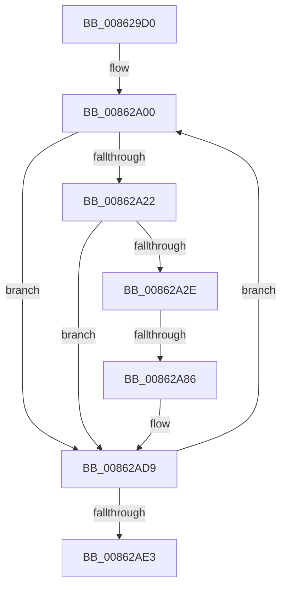

# sub_008629D0

- RVA: `0x008629D0`–`0x00862AF3` (길이 `291` bytes)
- VA: `0x00000001408629D0`
- 실행 섹션: `PAGE`
- PDB 이름 있음: `아니요`; PDB Function 태그: `아니요`
- unwind 정보 RVA: `0x0006B680`
- 디코드: `52`개 명령, `291/291` bytes 표시
- 미해석 바이트: `0` (있으면 어셈블리에 `.byte`로 보존)

> 이 문서는 커널 이미지의 기계어와 PDB 기호를 분석해 생성했습니다. 4번과 5번은 함수 원형과 자료형을 바이너리 사용 방식에서 추정한 C 해석이며 원본 소스 복구 결과는 아닙니다.

## 1. Dependencies

- 직접 호출 지점: **1**; 고유 호출 대상: **1**
- 직접 호출자로 확인된 함수: **0**
- RIP 상대 이미지 참조: **2**

### Outgoing calls
- `0x00862AC7` → [EtwpLogSystemEventUnsafe](../../text/2F/EtwpLogSystemEventUnsafe_function_002FBF10.md) (function, `0x002FBF10`)

### Direct callers
- 이 함수 시작 RVA로 연결되는 직접 call은 확인되지 않았습니다. 간접 호출은 완전히 역산할 수 없습니다.

### Static image references
- `0x008629E6` → RVA `0x000105E0` (`.rdata`; read)
- `0x00862A00` → RVA `0x00FC6AA8` (`ALMOSTRO`; read)

## 2. Other-region calls and transfers

- 다른 실행 섹션으로 향하는 call: **1**
  - `0x00862AC7` → [EtwpLogSystemEventUnsafe](../../text/2F/EtwpLogSystemEventUnsafe_function_002FBF10.md) (`PAGE` → `.text`)
- call이 아닌 외부 분기/꼬리 이동: **1**
  - `0x00862A80` → [sub_00862B1D](Unknown_function_00862B1D.md) (`tail-transfer`)

## 3. Assembly (complete function range)

```asm
008629D0  49 89 73 10                     mov qword ptr [r11 + 0x10], rsi
008629D4  41 B8 00 09 00 00               mov r8d, 0x900
008629DA  48 8B B4 24 F0 00 00 00         mov rsi, qword ptr [rsp + 0xf0]
008629E2  49 89 7B 18                     mov qword ptr [r11 + 0x18], rdi
008629E6  4C 8D 1D F3 DB 7A FF            lea r11, [rip - 0x85240d]
008629ED  48 8B BC 24 F8 00 00 00         mov rdi, qword ptr [rsp + 0xf8]
008629F5  66 66 66 0F 1F 84 00 00 00 00 00  nop word ptr [rax + rax]
00862A00  48 8B 15 A1 40 76 00            mov rdx, qword ptr [rip + 0x7640a1]
00862A07  8D 43 FF                        lea eax, [rbx - 1]
00862A0A  23 D8                           and ebx, eax
00862A0C  41 8B C2                        mov eax, r10d
00862A0F  48 C1 E0 05                     shl rax, 5
00862A13  48 05 CC 11 00 00               add rax, 0x11cc
00862A19  48 03 C2                        add rax, rdx
00862A1C  0F 84 B7 00 00 00               je 0x140862ad9
00862A22  F7 00 00 00 02 00               test dword ptr [rax], 0x20000
00862A28  0F 84 AB 00 00 00               je 0x140862ad9
00862A2E  42 0F B6 84 52 99 11 00 00      movzx eax, byte ptr [rdx + r10*2 + 0x1199]
00862A37  41 0F B7 CC                     movzx ecx, r12w
00862A3B  46 0F B6 8C 52 98 11 00 00      movzx r9d, byte ptr [rdx + r10*2 + 0x1198]
00862A44  66 41 0B C8                     or cx, r8w
00862A48  4C 89 6C 24 60                  mov qword ptr [rsp + 0x60], r13
00862A4D  BA 01 00 00 00                  mov edx, 1
00862A52  44 89 74 24 50                  mov dword ptr [rsp + 0x50], r14d
00862A57  49 8B 44 C7 F8                  mov rax, qword ptr [r15 + rax*8 - 8]
00862A5C  48 89 44 24 48                  mov qword ptr [rsp + 0x48], rax
00862A61  48 8D 44 24 48                  lea rax, [rsp + 0x48]
00862A66  48 89 44 24 68                  mov qword ptr [rsp + 0x68], rax
00862A6B  89 6C 24 54                     mov dword ptr [rsp + 0x54], ebp
00862A6F  48 89 74 24 58                  mov qword ptr [rsp + 0x58], rsi
00862A74  48 C7 44 24 70 18 00 00 00      mov qword ptr [rsp + 0x70], 0x18
00862A7D  48 85 FF                        test rdi, rdi
00862A80  0F 85 97 00 00 00               jne 0x140862b1d
00862A86  65 4C 8B 04 25 88 01 00 00      mov r8, qword ptr gs:[0x188]
00862A8F  8B C2                           mov eax, edx
00862A91  48 03 C0                        add rax, rax
00862A94  44 88 6C 24 38                  mov byte ptr [rsp + 0x38], r13b
00862A99  C7 44 24 30 02 19 60 00         mov dword ptr [rsp + 0x30], 0x601902
00862AA1  66 89 4C 24 28                  mov word ptr [rsp + 0x28], cx
00862AA6  48 8B 0D FB 3F 76 00            mov rcx, qword ptr [rip + 0x763ffb]
00862AAD  4C 89 5C C4 68                  mov qword ptr [rsp + rax*8 + 0x68], r11
00862AB2  48 C7 44 C4 70 02 00 00 00      mov qword ptr [rsp + rax*8 + 0x70], 2
00862ABB  8D 42 01                        lea eax, [rdx + 1]
00862ABE  48 8D 54 24 68                  lea rdx, [rsp + 0x68]
00862AC3  89 44 24 20                     mov dword ptr [rsp + 0x20], eax
00862AC7  E8 44 94 A9 FF                  call 0x1402fbf10
00862ACC  41 B8 00 09 00 00               mov r8d, 0x900
00862AD2  4C 8D 1D 07 DB 7A FF            lea r11, [rip - 0x8524f9]
00862AD9  44 0F BC D3                     bsf r10d, ebx
00862ADD  0F 85 1D FF FF FF               jne 0x140862a00
00862AE3  48 8B BC 24 E0 00 00 00         mov rdi, qword ptr [rsp + 0xe0]
00862AEB  48 8B B4 24 D8 00 00 00         mov rsi, qword ptr [rsp + 0xd8]
```

## 4. C-style interpretation (structured pseudocode)

```c
__int64 __fastcall sub_008629D0(__int64 a1, __int64 a2, __int64 a3, __int64 a4, __int64 a5, __int64 a6, __int64 a7, __int64 a8, __int64 a9, __int64 a10, __int64 a11, __int64 a12, __int64 a13, __int64 a14, __int64 a15, __int64 a16, __int64 a17, __int64 a18, __int64 a19, __int64 a20, __int64 a21, __int64 a22, __int64 a23, __int64 a24, __int64 a25, __int64 a26, __int64 a27, __int64 a28, __int64 a29, __int64 a30, __int64 a31)
{
    __int64 result;
    __int64 v_rbx;
    unsigned int v_stack_p20;
    unsigned __int16 v_stack_p28;
    unsigned int v_stack_p30;
    unsigned __int8 v_stack_p38;
    unsigned __int64 v_stack_p48;
    unsigned int v_stack_p50;
    unsigned int v_stack_p54;
    unsigned __int64 v_stack_p58;
    unsigned __int64 v_stack_p60;
    unsigned __int64 v_stack_p68;
    unsigned __int64 v_stack_p70;

    *(unsigned __int64 *)(v_r11 + 16) = v_rsi;
    *(unsigned __int64 *)(v_r11 + 24) = v_rdi;
loc_00862A00:
    v_rbx = (unsigned int)((v_rbx) & ((unsigned int)(v_rbx - 1)));
    result = ((unsigned int)((unsigned int)(v_r10))) << (5);
    result = (result) + (0x11CCULL);
    result = (result) + (*(unsigned __int64 *)(v_rip + 7749793));
    if (condition_is_equal) goto loc_00862AD9;
    if (((*(unsigned int *)(result)) & (0x20000ULL)) == 0) goto loc_00862AD9;
    a1 = (unsigned __int16)(((unsigned __int16)(v_r12)) | ((unsigned __int16)((unsigned int)(0x900ULL))));
    v_stack_p60 = v_r13;
    v_stack_p50 = (unsigned int)(v_r14);
    v_stack_p48 = *(unsigned __int64 *)(v_r15 + *(unsigned __int8 *)(*(unsigned __int64 *)(v_rip + 7749793) + v_r10 * 2 + 4505) * 8 - 8);
    v_stack_p68 = a9;
    v_stack_p54 = (unsigned int)(v_rbp);
    v_stack_p58 = a30;
    v_stack_p70 = 24;
    result = (1) + (1);
    v_stack_p38 = (unsigned __int8)(v_r13);
    v_stack_p30 = 0x601902ULL;
    v_stack_p28 = (unsigned __int16)(a1);
    *(unsigned __int64 *)(v_rsp + result * 8 + 104) = v_rip - 8725517;
    *(unsigned __int64 *)(v_rsp + result * 8 + 112) = 2;
    v_stack_p20 = (unsigned int)(1 + 1);
    result = EtwpLogSystemEventUnsafe(*(unsigned __int64 *)(v_rip + 7749627), a13, *(unsigned __int64 *)(gs_base + (0 + 392)), *(unsigned __int8 *)(*(unsigned __int64 *)(v_rip + 7749793) + v_r10 * 2 + 4504));
loc_00862AD9:
    if (condition_is_not_equal) goto loc_00862A00;
    return result;
}
```

## 5. (Beta) C Style

```c
int64_t sub_008629D0(int64_t Arg1, int64_t Arg2, int64_t Arg3, int64_t Arg4, uint64_t Arg5, uint64_t Arg6, uint64_t Arg7, uint64_t Arg8, int64_t Arg9, uint64_t Arg10, uint64_t Arg11, uint64_t Arg12, int64_t Arg13, uint64_t Arg14, uint64_t Arg15, uint64_t Arg16, uint64_t Arg17, uint64_t Arg18, uint64_t Arg19, uint64_t Arg20, uint64_t Arg21, uint64_t Arg22, uint64_t Arg23, uint64_t Arg24, uint64_t Arg25, uint64_t Arg26, int64_t Arg27, int64_t Arg28, uint64_t Arg29, int64_t Arg30, int64_t Arg31)
{
    int64_t result;
    int64_t local_rbx;
    uint32_t v_stack_p20;
    uint16_t v_stack_p28;
    uint32_t v_stack_p30;
    uint8_t v_stack_p38;
    uint64_t v_stack_p48;
    uint32_t v_stack_p50;
    uint32_t v_stack_p54;
    uint64_t v_stack_p58;
    uint64_t v_stack_p60;
    uint64_t v_stack_p68;
    uint64_t v_stack_p70;

    *(uint64_t *)(local_r11 + 0x10) = local_rsi;
    *(uint64_t *)(local_r11 + 0x18) = local_rdi;
loc_00862A00:
    local_rbx = (uint32_t)((local_rbx) & ((uint32_t)(local_rbx - 1)));
    result = ((uint32_t)((uint32_t)(local_r10))) << (5);
    result = (result) + (0x11CCULL);
    result = (result) + (*(uint64_t *)(v_rip + 0x7640A1));
    if (condition_is_equal) goto loc_00862AD9;
    if (((*(uint32_t *)(result)) & (0x20000ULL)) == 0) goto loc_00862AD9;
    Arg1 = (uint16_t)(((uint16_t)(local_r12)) | ((uint16_t)((uint32_t)(0x900ULL))));
    v_stack_p60 = local_r13;
    v_stack_p50 = (uint32_t)(local_r14);
    v_stack_p48 = *(uint64_t *)(local_r15 + *(uint8_t *)(*(uint64_t *)(v_rip + 0x7640A1) + local_r10 * 2 + 0x1199) * 8 - 0x8);
    v_stack_p68 = Arg9;
    v_stack_p54 = (uint32_t)(local_rbp);
    v_stack_p58 = Arg30;
    v_stack_p70 = 24;
    result = (1) + (1);
    v_stack_p38 = (uint8_t)(local_r13);
    v_stack_p30 = 0x601902ULL;
    v_stack_p28 = (uint16_t)(Arg1);
    *(uint64_t *)(local_rsp + result * 8 + 0x68) = v_rip - 8725517;
    *(uint64_t *)(local_rsp + result * 8 + 0x70) = 2;
    v_stack_p20 = (uint32_t)(1 + 1);
    result = EtwpLogSystemEventUnsafe(*(uint64_t *)(v_rip + 0x763FFB), Arg13, *(uint64_t *)(gs_base + (0 + 0x188)), *(uint8_t *)(*(uint64_t *)(v_rip + 0x7640A1) + local_r10 * 2 + 0x1198));
loc_00862AD9:
    if (condition_is_not_equal) goto loc_00862A00;
    return result;
}
```

## 6. Execution-region graph

[열기: 2D/3D 그래프와 함수 탐색 컨트롤 패널](../../../control-panel.html?section=page&rva=0x008629D0&view=graph)

- 2D 그래프는 위에서 아래로 흐르고, 3D 그래프는 빈 공간을 드래그해 회전합니다. Shift+드래그는 이동, 휠은 확대·축소, 함수 노드 선택은 대상 보고서 이동입니다.

### Static fallback


