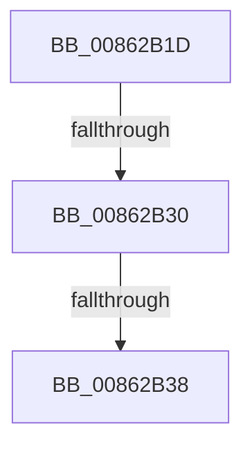

# sub_00862B1D

- RVA: `0x00862B1D`–`0x00862B56` (길이 `57` bytes)
- VA: `0x0000000140862B1D`
- 실행 섹션: `PAGE`
- PDB 이름 있음: `아니요`; PDB Function 태그: `아니요`
- unwind 정보 RVA: `0x0006B6AC`
- 디코드: `12`개 명령, `57/57` bytes 표시
- 미해석 바이트: `0` (있으면 어셈블리에 `.byte`로 보존)

> 이 문서는 커널 이미지의 기계어와 PDB 기호를 분석해 생성했습니다. 4번과 5번은 함수 원형과 자료형을 바이너리 사용 방식에서 추정한 C 해석이며 원본 소스 복구 결과는 아닙니다.

## 1. Dependencies

- 직접 호출 지점: **0**; 고유 호출 대상: **0**
- 직접 호출자로 확인된 함수: **0**
- RIP 상대 이미지 참조: **0**

### Outgoing calls
- 직접 디코드된 call 명령이 없습니다.

### Direct callers
- 이 함수 시작 RVA로 연결되는 직접 call은 확인되지 않았습니다. 간접 호출은 완전히 역산할 수 없습니다.

### Static image references
- 디코드된 RIP-relative 메모리 참조가 없습니다.

## 2. Other-region calls and transfers

- 다른 실행 섹션으로 향하는 call: **0**
- call이 아닌 외부 분기/꼬리 이동: **3**
  - `0x00862B2A` → [sub_008629D0 + 0xB6](Unknown_function_008629D0.md) (`tail-transfer`)
  - `0x00862B32` → [sub_008629D0 + 0xB6](Unknown_function_008629D0.md) (`tail-transfer`)
  - `0x00862B51` → [sub_008629D0 + 0xB6](Unknown_function_008629D0.md) (`tail-transfer`)

## 3. Assembly (complete function range)

```asm
00862B1D  0F B7 07                        movzx eax, word ptr [rdi]
00862B20  4C 8B 47 08                     mov r8, qword ptr [rdi + 8]
00862B24  83 E0 FE                        and eax, 0xfffffffe
00862B27  4D 85 C0                        test r8, r8
00862B2A  0F 84 56 FF FF FF               je 0x140862a86
00862B30  85 C0                           test eax, eax
00862B32  0F 84 4E FF FF FF               je 0x140862a86
00862B38  4C 89 44 24 78                  mov qword ptr [rsp + 0x78], r8
00862B3D  BA 02 00 00 00                  mov edx, 2
00862B42  89 84 24 80 00 00 00            mov dword ptr [rsp + 0x80], eax
00862B49  44 89 AC 24 84 00 00 00         mov dword ptr [rsp + 0x84], r13d
00862B51  E9 30 FF FF FF                  jmp 0x140862a86
```

## 4. C-style interpretation (structured pseudocode)

```c
__int64 __fastcall sub_00862B1D(void)
{
    __int64 result;
    unsigned __int64 v_stack_p78;
    unsigned int v_stack_p80;
    unsigned int v_stack_p84;

    result = (unsigned int)((*(unsigned __int16 *)(v_rdi)) & (0xFFFFFFFEULL));
    v_stack_p78 = *(unsigned __int64 *)(v_rdi + 8);
    v_stack_p80 = (unsigned int)(result);
    v_stack_p84 = (unsigned int)(v_r13);
}
```

## 5. (Beta) C Style

```c
void sub_00862B1D(void)
{
    int64_t result;
    uint64_t v_stack_p78;
    uint32_t v_stack_p80;
    uint32_t v_stack_p84;

    result = (uint32_t)((*(uint16_t *)(local_rdi)) & (0xFFFFFFFEULL));
    v_stack_p78 = *(uint64_t *)(local_rdi + 0x8);
    v_stack_p80 = (uint32_t)(result);
    v_stack_p84 = (uint32_t)(local_r13);
}
```

## 6. Execution-region graph

[열기: 2D/3D 그래프와 함수 탐색 컨트롤 패널](../../../control-panel.html?section=page&rva=0x00862B1D&view=graph)

- 2D 그래프는 위에서 아래로 흐르고, 3D 그래프는 빈 공간을 드래그해 회전합니다. Shift+드래그는 이동, 휠은 확대·축소, 함수 노드 선택은 대상 보고서 이동입니다.

### Static fallback


