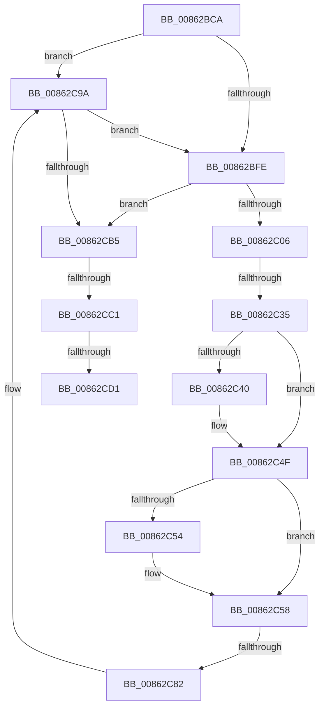

# sub_00862BCA

- RVA: `0x00862BCA`–`0x00862CD4` (길이 `266` bytes)
- VA: `0x0000000140862BCA`
- 실행 섹션: `PAGE`
- PDB 이름 있음: `아니요`; PDB Function 태그: `아니요`
- unwind 정보 RVA: `0x0006B6EC`
- 디코드: `62`개 명령, `266/266` bytes 표시
- 미해석 바이트: `0` (있으면 어셈블리에 `.byte`로 보존)

> 이 문서는 커널 이미지의 기계어와 PDB 기호를 분석해 생성했습니다. 4번과 5번은 함수 원형과 자료형을 바이너리 사용 방식에서 추정한 C 해석이며 원본 소스 복구 결과는 아닙니다.

## 1. Dependencies

- 직접 호출 지점: **3**; 고유 호출 대상: **3**
- 직접 호출자로 확인된 함수: **0**
- RIP 상대 이미지 참조: **7**

### Outgoing calls
- `0x00862C12` → [KeAbPreAcquire](../../text/21/KeAbPreAcquire_function_00210230.md) (function, `0x00210230`)
- `0x00862C4A` → [ExpAcquireFastMutexContended](../../text/45/ExpAcquireFastMutexContended_function_00450288.md) (function, `0x00450288`)
- `0x00862C94` → [KeBugCheckEx](../../text/4F/KeBugCheckEx_function_004FD660.md) (function, `0x004FD660`)

### Direct callers
- 이 함수 시작 RVA로 연결되는 직접 call은 확인되지 않았습니다. 간접 호출은 완전히 역산할 수 없습니다.

### Static image references
- `0x00862BF0` → RVA `0x00E0ECC0` (`.data`; read)
- `0x00862C09` → RVA `0x00EF5880` (`.data`; read)
- `0x00862C28` → RVA `0x00FC6D20` (`ALMOSTRO`; read)
- `0x00862C35` → RVA `0x00EF5880` (`.data`; read/write)
- `0x00862C61` → RVA `0x00EF5888` (`.data`; write)
- `0x00862C6C` → RVA `0x00EF58B0` (`.data`; write)
- `0x00862CC1` → RVA `0x00FD8008` (`PAGEDATA`; read)

## 2. Other-region calls and transfers

- 다른 실행 섹션으로 향하는 call: **3**
  - `0x00862C12` → [KeAbPreAcquire](../../text/21/KeAbPreAcquire_function_00210230.md) (`PAGE` → `.text`)
  - `0x00862C4A` → [ExpAcquireFastMutexContended](../../text/45/ExpAcquireFastMutexContended_function_00450288.md) (`PAGE` → `.text`)
  - `0x00862C94` → [KeBugCheckEx](../../text/4F/KeBugCheckEx_function_004FD660.md) (`PAGE` → `.text`)
- call이 아닌 외부 분기/꼬리 이동: **4**
  - `0x00862C2F` → [sub_00862E2B + 0x3B](Unknown_function_00862E2B.md) (`tail-transfer`)
  - `0x00862C7C` → [sub_0086303A + 0x131](Unknown_function_0086303A.md) (`tail-transfer`)
  - `0x00862CBB` → [sub_00862E81 + 0xA7](Unknown_function_00862E81.md) (`tail-transfer`)
  - `0x00862CCB` → [sub_00862D60](Unknown_function_00862D60.md) (`tail-transfer`)

## 3. Assembly (complete function range)

```asm
00862BCA  49 89 73 20                     mov qword ptr [r11 + 0x20], rsi
00862BCE  0F 94 C0                        sete al
00862BD1  4D 89 63 E0                     mov qword ptr [r11 - 0x20], r12
00862BD5  45 33 E4                        xor r12d, r12d
00862BD8  41 0F BA E0 11                  bt r8d, 0x11
00862BDD  41 8B CC                        mov ecx, r12d
00862BE0  41 8B D4                        mov edx, r12d
00862BE3  0F 43 C8                        cmovae ecx, eax
00862BE6  41 F6 C0 20                     test r8b, 0x20
00862BEA  0F B6 C1                        movzx eax, cl
00862BED  0F 44 D0                        cmove edx, eax
00862BF0  8B 05 CA C0 5A 00               mov eax, dword ptr [rip + 0x5ac0ca]
00862BF6  85 C0                           test eax, eax
00862BF8  0F 85 9C 00 00 00               jne 0x140862c9a
00862BFE  84 D2                           test dl, dl
00862C00  0F 84 AF 00 00 00               je 0x140862cb5
00862C06  45 33 C0                        xor r8d, r8d
00862C09  48 8D 0D 70 2C 69 00            lea rcx, [rip + 0x692c70]
00862C10  33 D2                           xor edx, edx
00862C12  E8 19 D6 9A FF                  call 0x140210230
00862C17  48 8B F8                        mov rdi, rax
00862C1A  44 0F 20 C6                     mov rsi, cr8
00862C1E  41 B9 01 00 00 00               mov r9d, 1
00862C24  45 0F 22 C1                     mov cr8, r9
00862C28  44 39 25 F1 40 76 00            cmp dword ptr [rip + 0x7640f1], r12d
00862C2F  0F 85 31 02 00 00               jne 0x140862e66
00862C35  F0 0F BA 35 42 2C 69 00 00      lock btr dword ptr [rip + 0x692c42], 0
00862C3E  72 0F                           jb 0x140862c4f
00862C40  48 8B D7                        mov rdx, rdi
00862C43  48 8D 0D 36 2C 69 00            lea rcx, [rip + 0x692c36]
00862C4A  E8 39 D6 BE FF                  call 0x140450288
00862C4F  48 85 FF                        test rdi, rdi
00862C52  74 04                           je 0x140862c58
00862C54  C6 47 0A 01                     mov byte ptr [rdi + 0xa], 1
00862C58  65 48 8B 04 25 88 01 00 00      mov rax, qword ptr gs:[0x188]
00862C61  48 89 05 20 2C 69 00            mov qword ptr [rip + 0x692c20], rax
00862C68  40 0F B6 C6                     movzx eax, sil
00862C6C  89 05 3E 2C 69 00               mov dword ptr [rip + 0x692c3e], eax
00862C72  48 8D 83 E0 00 00 00            lea rax, [rbx + 0xe0]
00862C79  48 39 00                        cmp qword ptr [rax], rax
00862C7C  0F 84 E9 04 00 00               je 0x14086316b
00862C82  45 33 C9                        xor r9d, r9d
00862C85  4C 89 64 24 20                  mov qword ptr [rsp + 0x20], r12
00862C8A  4C 8B C3                        mov r8, rbx
00862C8D  41 8D 51 34                     lea edx, [r9 + 0x34]
00862C91  8D 4A 1D                        lea ecx, [rdx + 0x1d]
00862C94  E8 C7 A9 C9 FF                  call 0x1404fd660
00862C99  CC                              int3
00862C9A  0F B7 83 BA 00 00 00            movzx eax, word ptr [rbx + 0xba]
00862CA1  A8 10                           test al, 0x10
00862CA3  0F 94 C1                        sete cl
00862CA6  F6 43 08 08                     test byte ptr [rbx + 8], 8
00862CAA  0F 94 C0                        sete al
00862CAD  84 C8                           test al, cl
00862CAF  0F 84 49 FF FF FF               je 0x140862bfe
00862CB5  49 8B F4                        mov rsi, r12
00862CB8  4C 39 23                        cmp qword ptr [rbx], r12
00862CBB  0F 85 67 02 00 00               jne 0x140862f28
00862CC1  48 8B 3D 40 53 77 00            mov rdi, qword ptr [rip + 0x775340]
00862CC8  48 85 FF                        test rdi, rdi
00862CCB  0F 84 8F 00 00 00               je 0x140862d60
00862CD1  0F 57 C9                        xorps xmm1, xmm1
```

## 4. C-style interpretation (structured pseudocode)

```c
__int64 __fastcall sub_00862BCA(__int64 a1, __int64 a2, int a3)
{
    __int64 result;
    __int64 v_r12;
    unsigned __int64 v_stack_p20;

    *(unsigned __int64 *)(v_r11 + 32) = v_rsi;
    result = (condition_is_equal) ? 1 : 0;
    *(unsigned __int64 *)(v_r11 - 32) = v_r12;
    v_r12 = 0;
    a1 = 0;
    if (condition_is_above_or_equal) { a1 = (unsigned int)(result); }
    a2 = 0;
    if ((((unsigned __int8)(a3)) & (32)) == 0) { a2 = (unsigned int)((unsigned __int8)(a1)); }
    if ((unsigned int)((unsigned int)(*(unsigned int *)(v_rip + 5947594))) != 0) goto loc_00862C9A;
loc_00862BFE:
    if ((unsigned __int8)(a2) == 0) goto loc_00862CB5;
    a3 = 0;
    a2 = 0;
    result = KeAbPreAcquire(v_rip + 6892656, a2, a3, a4);
    if ((*(unsigned int *)(v_rip + 7749873)) >= 0) {
        a2 = result;
        a1 = v_rip + 6892598;
        result = ExpAcquireFastMutexContended(a1, a2, a3, 1);
    }
    if (result != 0) {
        *(unsigned __int8 *)(result + 10) = 1;
    }
    *(unsigned __int64 *)(v_rip + 6892576) = *(unsigned __int64 *)(gs_base + (0 + 392));
    *(unsigned int *)(v_rip + 6892606) = (unsigned int)((unsigned __int8)(v_cr8));
    a4 = 0;
    v_stack_p20 = 0;
    result = KeBugCheckEx(a4 + 52 + 29, a4 + 52, v_rbx, a4);
loc_00862C9A:
    a1 = ((((unsigned __int8)(*(unsigned __int16 *)(v_rbx + 186))) & (16)) == 0) ? 1 : 0;
    result = (((*(unsigned __int8 *)(v_rbx + 8)) & (8)) == 0) ? 1 : 0;
    if ((((unsigned __int8)(result)) & ((unsigned __int8)(a1))) == 0) goto loc_00862BFE;
loc_00862CB5:
    return result;
}
```

## 5. (Beta) C Style

```c
int64_t sub_00862BCA(int64_t Arg1, int64_t Arg2, int32_t Arg3)
{
    int64_t result;
    int64_t local_r12;
    uint64_t v_stack_p20;

    *(uint64_t *)(local_r11 + 0x20) = local_rsi;
    result = (condition_is_equal) ? 1 : 0;
    *(uint64_t *)(local_r11 - 0x20) = local_r12;
    local_r12 = 0;
    Arg1 = 0;
    if (condition_is_above_or_equal) { Arg1 = (uint32_t)(result); }
    Arg2 = 0;
    if ((((uint8_t)(Arg3)) & (32)) == 0) { Arg2 = (uint32_t)((uint8_t)(Arg1)); }
    if ((uint32_t)((uint32_t)(*(uint32_t *)(v_rip + 0x5AC0CA))) != 0) goto loc_00862C9A;
loc_00862BFE:
    if ((uint8_t)(Arg2) == 0) goto loc_00862CB5;
    Arg3 = 0;
    Arg2 = 0;
    result = KeAbPreAcquire(v_rip + 6892656, Arg2, Arg3, a4);
    if ((*(uint32_t *)(v_rip + 0x7640F1)) >= 0) {
        Arg2 = result;
        Arg1 = v_rip + 6892598;
        result = ExpAcquireFastMutexContended(Arg1, Arg2, Arg3, 1);
    }
    if (result != 0) {
        *(uint8_t *)(result + 0xA) = 1;
    }
    *(uint64_t *)(v_rip + 0x692C20) = *(uint64_t *)(gs_base + (0 + 0x188));
    *(uint32_t *)(v_rip + 0x692C3E) = (uint32_t)((uint8_t)(v_cr8));
    a4 = 0;
    v_stack_p20 = 0;
    result = KeBugCheckEx(a4 + 52 + 29, a4 + 52, local_rbx, a4);
loc_00862C9A:
    Arg1 = ((((uint8_t)(*(uint16_t *)(local_rbx + 0xBA))) & (16)) == 0) ? 1 : 0;
    result = (((*(uint8_t *)(local_rbx + 0x8)) & (8)) == 0) ? 1 : 0;
    if ((((uint8_t)(result)) & ((uint8_t)(Arg1))) == 0) goto loc_00862BFE;
loc_00862CB5:
    return result;
}
```

## 6. Execution-region graph

[열기: 2D/3D 그래프와 함수 탐색 컨트롤 패널](../../../control-panel.html?section=page&rva=0x00862BCA&view=graph)

- 2D 그래프는 위에서 아래로 흐르고, 3D 그래프는 빈 공간을 드래그해 회전합니다. Shift+드래그는 이동, 휠은 확대·축소, 함수 노드 선택은 대상 보고서 이동입니다.

### Static fallback


