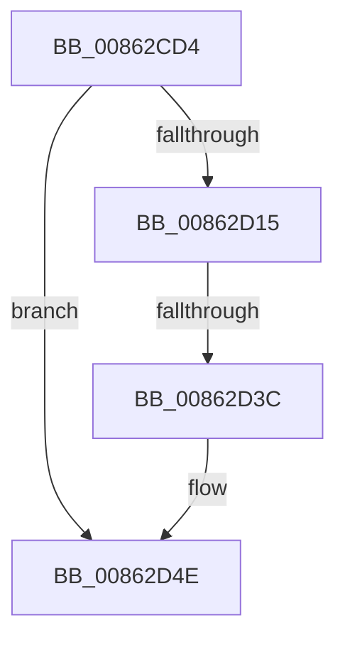

# sub_00862CD4

- RVA: `0x00862CD4`–`0x00862D60` (길이 `140` bytes)
- VA: `0x0000000140862CD4`
- 실행 섹션: `PAGE`
- PDB 이름 있음: `아니요`; PDB Function 태그: `아니요`
- unwind 정보 RVA: `0x0006B704`
- 디코드: `30`개 명령, `140/140` bytes 표시
- 미해석 바이트: `0` (있으면 어셈블리에 `.byte`로 보존)

> 이 문서는 커널 이미지의 기계어와 PDB 기호를 분석해 생성했습니다. 4번과 5번은 함수 원형과 자료형을 바이너리 사용 방식에서 추정한 C 해석이며 원본 소스 복구 결과는 아닙니다.

## 1. Dependencies

- 직접 호출 지점: **5**; 고유 호출 대상: **5**
- 직접 호출자로 확인된 함수: **0**
- RIP 상대 이미지 참조: **1**

### Outgoing calls
- `0x00862D00` → [CmpAttachToRegistryProcess](../../pagecmrc/BC/CmpAttachToRegistryProcess_function_00BC98E0.md) (function, `0x00BC98E0`)
- `0x00862D08` → [CmpConstructName](../85/CmpConstructName_function_00856BE0.md) (function, `0x00856BE0`)
- `0x00862D3C` → [EtwpTraceRegistry](EtwpTraceRegistry_function_00862980.md) (function, `0x00862980`)
- `0x00862D49` → [CmpFreePoolWithTag](../../text/44/CmpFreePoolWithTag_function_004489E0.md) (function, `0x004489E0`)
- `0x00862D53` → [CmpDetachFromRegistryProcess](../../pagecmrc/BC/CmpDetachFromRegistryProcess_function_00BC9920.md) (function, `0x00BC9920`)

### Direct callers
- 이 함수 시작 RVA로 연결되는 직접 call은 확인되지 않았습니다. 간접 호출은 완전히 역산할 수 없습니다.

### Static image references
- `0x00862D15` → RVA `0x00862980` (`EtwpTraceRegistry`; read)

## 2. Other-region calls and transfers

- 다른 실행 섹션으로 향하는 call: **3**
  - `0x00862D00` → [CmpAttachToRegistryProcess](../../pagecmrc/BC/CmpAttachToRegistryProcess_function_00BC98E0.md) (`PAGE` → `PAGECMRC`)
  - `0x00862D49` → [CmpFreePoolWithTag](../../text/44/CmpFreePoolWithTag_function_004489E0.md) (`PAGE` → `.text`)
  - `0x00862D53` → [CmpDetachFromRegistryProcess](../../pagecmrc/BC/CmpDetachFromRegistryProcess_function_00BC9920.md) (`PAGE` → `PAGECMRC`)
- call이 아닌 외부 분기/꼬리 이동: **1**
  - `0x00862D36` → [sub_00863251](Unknown_function_00863251.md) (`tail-transfer`)

## 3. Assembly (complete function range)

```asm
00862CD4  48 89 AC 24 E0 00 00 00         mov qword ptr [rsp + 0xe0], rbp
00862CDC  0F 57 C0                        xorps xmm0, xmm0
00862CDF  48 8D 4C 24 60                  lea rcx, [rsp + 0x60]
00862CE4  0F 11 44 24 40                  movups xmmword ptr [rsp + 0x40], xmm0
00862CE9  0F 11 44 24 50                  movups xmmword ptr [rsp + 0x50], xmm0
00862CEE  0F 11 4C 24 60                  movups xmmword ptr [rsp + 0x60], xmm1
00862CF3  0F 11 4C 24 70                  movups xmmword ptr [rsp + 0x70], xmm1
00862CF8  0F 11 8C 24 80 00 00 00         movups xmmword ptr [rsp + 0x80], xmm1
00862D00  E8 DB 6B 36 00                  call 0x140bc98e0
00862D05  48 8B CB                        mov rcx, rbx
00862D08  E8 D3 3E FF FF                  call 0x140856be0
00862D0D  48 8B E8                        mov rbp, rax
00862D10  48 85 C0                        test rax, rax
00862D13  74 39                           je 0x140862d4e
00862D15  48 8D 05 64 FC FF FF            lea rax, [rip - 0x39c]
00862D1C  48 89 6C 24 28                  mov qword ptr [rsp + 0x28], rbp
00862D21  45 33 C9                        xor r9d, r9d
00862D24  48 89 5C 24 20                  mov qword ptr [rsp + 0x20], rbx
00862D29  45 33 C0                        xor r8d, r8d
00862D2C  48 8D 54 24 40                  lea rdx, [rsp + 0x40]
00862D31  B1 17                           mov cl, 0x17
00862D33  48 3B F8                        cmp rdi, rax
00862D36  0F 85 15 05 00 00               jne 0x140863251
00862D3C  E8 3F FC FF FF                  call 0x140862980
00862D41  BA 43 4D 4E 62                  mov edx, 0x624e4d43
00862D46  48 8B CD                        mov rcx, rbp
00862D49  E8 92 5C BE FF                  call 0x1404489e0
00862D4E  48 8D 4C 24 60                  lea rcx, [rsp + 0x60]
00862D53  E8 C8 6B 36 00                  call 0x140bc9920
00862D58  48 8B AC 24 E0 00 00 00         mov rbp, qword ptr [rsp + 0xe0]
```

## 4. C-style interpretation (structured pseudocode)

```c
__int64 __fastcall sub_00862CD4(__int64 a1, __int64 a2, int a3, int a4, __int64 a5, __int64 a6, __int64 a7, __int64 a8, __int64 a9, __int64 a10, __int64 a11, __int64 a12, __int64 a13, __int64 a14, __int64 a15, __int64 a16, __int64 a17, __int64 a18, __int64 a19, __int64 a20, __int64 a21, __int64 a22, __int64 a23, __int64 a24, __int64 a25, __int64 a26, __int64 a27, __int64 a28)
{
    __int64 result;
    unsigned __int64 v_stack_p20;
    unsigned __int64 v_stack_p28;
    unsigned __int64 v_stack_pE0;

    v_stack_pE0 = v_rbp;
    a8 = v_xmm0;
    a10 = v_xmm0;
    a12 = v_xmm1;
    a14 = v_xmm1;
    a16 = v_xmm1;
    result = CmpAttachToRegistryProcess(a12, a2, a3, a4);
    result = CmpConstructName(v_rbx, a2, a3, a4);
    if (result == 0) goto loc_00862D4E;
    v_stack_p28 = result;
    a4 = 0;
    v_stack_p20 = v_rbx;
    a3 = 0;
    result = EtwpTraceRegistry(23, a8, a3, a4);
    result = CmpFreePoolWithTag(result, (unsigned int)(0x624E4D43ULL), a3, a4);
loc_00862D4E:
    result = CmpDetachFromRegistryProcess(a12, (unsigned int)(0x624E4D43ULL), a3, a4);
    return result;
}
```

## 5. (Beta) C Style

```c
int64_t sub_00862CD4(int64_t Arg1, int64_t Arg2, int32_t Arg3, int32_t Arg4, uint64_t Arg5, uint64_t Arg6, uint64_t Arg7, int64_t Arg8, uint64_t Arg9, int64_t Arg10, uint64_t Arg11, int64_t Arg12, uint64_t Arg13, int64_t Arg14, uint64_t Arg15, int64_t Arg16, uint64_t Arg17, uint64_t Arg18, uint64_t Arg19, uint64_t Arg20, uint64_t Arg21, uint64_t Arg22, uint64_t Arg23, uint64_t Arg24, uint64_t Arg25, uint64_t Arg26, uint64_t Arg27, int64_t Arg28)
{
    int64_t result;
    uint64_t v_stack_p20;
    uint64_t v_stack_p28;
    uint64_t v_stack_pE0;

    v_stack_pE0 = local_rbp;
    Arg8 = v_xmm0;
    Arg10 = v_xmm0;
    Arg12 = v_xmm1;
    Arg14 = v_xmm1;
    Arg16 = v_xmm1;
    result = CmpAttachToRegistryProcess(Arg12, Arg2, Arg3, Arg4);
    result = CmpConstructName(local_rbx, Arg2, Arg3, Arg4);
    if (result == 0) goto loc_00862D4E;
    v_stack_p28 = result;
    Arg4 = 0;
    v_stack_p20 = local_rbx;
    Arg3 = 0;
    result = EtwpTraceRegistry(23, Arg8, Arg3, Arg4);
    result = CmpFreePoolWithTag(result, (uint32_t)(0x624E4D43ULL), Arg3, Arg4);
loc_00862D4E:
    result = CmpDetachFromRegistryProcess(Arg12, (uint32_t)(0x624E4D43ULL), Arg3, Arg4);
    return result;
}
```

## 6. Execution-region graph

[열기: 2D/3D 그래프와 함수 탐색 컨트롤 패널](../../../control-panel.html?section=page&rva=0x00862CD4&view=graph)

- 2D 그래프는 위에서 아래로 흐르고, 3D 그래프는 빈 공간을 드래그해 회전합니다. Shift+드래그는 이동, 휠은 확대·축소, 함수 노드 선택은 대상 보고서 이동입니다.

### Static fallback


