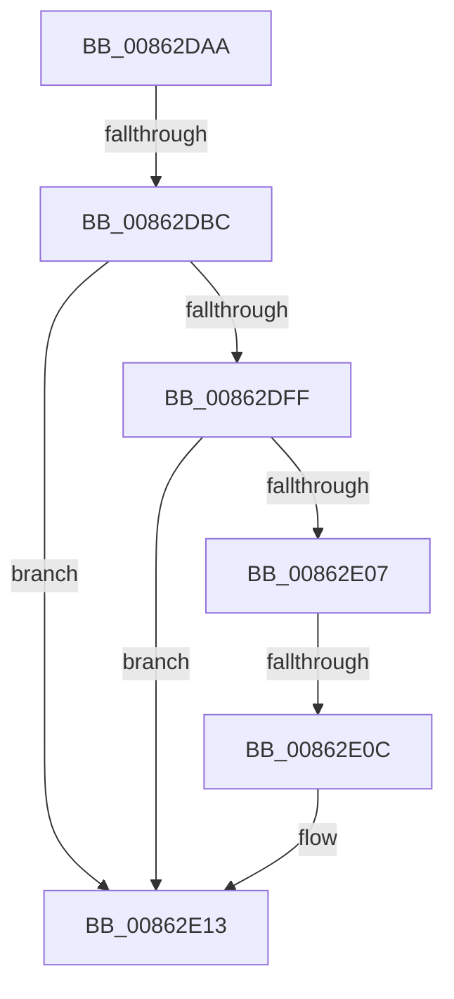

# sub_00862DAA

- RVA: `0x00862DAA`–`0x00862E2B` (길이 `129` bytes)
- VA: `0x0000000140862DAA`
- 실행 섹션: `PAGE`
- PDB 이름 있음: `아니요`; PDB Function 태그: `아니요`
- unwind 정보 RVA: `0x0006B728`
- 디코드: `33`개 명령, `129/129` bytes 표시
- 미해석 바이트: `0` (있으면 어셈블리에 `.byte`로 보존)

> 이 문서는 커널 이미지의 기계어와 PDB 기호를 분석해 생성했습니다. 4번과 5번은 함수 원형과 자료형을 바이너리 사용 방식에서 추정한 C 해석이며 원본 소스 복구 결과는 아닙니다.

## 1. Dependencies

- 직접 호출 지점: **0**; 고유 호출 대상: **0**
- 직접 호출자로 확인된 함수: **0**
- RIP 상대 이미지 참조: **0**

### Outgoing calls
- 직접 디코드된 call 명령이 없습니다.

### Direct callers
- 이 함수 시작 RVA로 연결되는 직접 call은 확인되지 않았습니다. 간접 호출은 완전히 역산할 수 없습니다.

### Static image references
- 디코드된 RIP-relative 메모리 참조가 없습니다.

## 2. Other-region calls and transfers

- 다른 실행 섹션으로 향하는 call: **0**
- call이 아닌 외부 분기/꼬리 이동: **3**
  - `0x00862DB6` → [sub_00863192](Unknown_function_00863192.md) (`tail-transfer`)
  - `0x00862E0A` → [sub_00862E78](Unknown_function_00862E78.md) (`tail-transfer`)
  - `0x00862E25` → [sub_00862E81 + 0x37](Unknown_function_00862E81.md) (`tail-transfer`)

## 3. Assembly (complete function range)

```asm
00862DAA  4C 89 B4 24 A0 00 00 00         mov qword ptr [rsp + 0xa0], r14
00862DB2  4C 8D 73 10                     lea r14, [rbx + 0x10]
00862DB6  0F 85 D6 03 00 00               jne 0x140863192
00862DBC  41 8B 06                        mov eax, dword ptr [r14]
00862DBF  8B C8                           mov ecx, eax
00862DC1  4C 8B 43 20                     mov r8, qword ptr [rbx + 0x20]
00862DC5  C1 E9 09                        shr ecx, 9
00862DC8  33 C8                           xor ecx, eax
00862DCA  69 C1 A3 8A 01 00               imul eax, ecx, 0x18aa3
00862DD0  8B C8                           mov ecx, eax
00862DD2  8B D0                           mov edx, eax
00862DD4  49 8B 80 70 06 00 00            mov rax, qword ptr [r8 + 0x670]
00862DDB  48 C1 EA 09                     shr rdx, 9
00862DDF  48 33 D1                        xor rdx, rcx
00862DE2  41 8B 88 78 06 00 00            mov ecx, dword ptr [r8 + 0x678]
00862DE9  FF C9                           dec ecx
00862DEB  48 23 D1                        and rdx, rcx
00862DEE  48 8D 14 52                     lea rdx, [rdx + rdx*2]
00862DF2  48 8D 52 02                     lea rdx, [rdx + 2]
00862DF6  48 8D 14 D0                     lea rdx, [rax + rdx*8]
00862DFA  48 85 D2                        test rdx, rdx
00862DFD  74 14                           je 0x140862e13
00862DFF  48 8B 02                        mov rax, qword ptr [rdx]
00862E02  48 85 C0                        test rax, rax
00862E05  74 0C                           je 0x140862e13
00862E07  49 3B C6                        cmp rax, r14
00862E0A  75 6C                           jne 0x140862e78
00862E0C  48 8B 40 08                     mov rax, qword ptr [rax + 8]
00862E10  48 89 02                        mov qword ptr [rdx], rax
00862E13  81 4B 08 00 00 08 00            or dword ptr [rbx + 8], 0x80000
00862E1A  4C 8B B4 24 A0 00 00 00         mov r14, qword ptr [rsp + 0xa0]
00862E22  48 85 F6                        test rsi, rsi
00862E25  0F 84 8D 00 00 00               je 0x140862eb8
```

## 4. C-style interpretation (structured pseudocode)

```c
__int64 __fastcall sub_00862DAA(__int64 a1, __int64 a2, __int64 a3, __int64 a4, __int64 a5, __int64 a6, __int64 a7, __int64 a8, __int64 a9, __int64 a10, __int64 a11, __int64 a12, __int64 a13, __int64 a14, __int64 a15, __int64 a16, __int64 a17, __int64 a18, __int64 a19, __int64 a20)
{
    __int64 result;
    unsigned __int64 v_stack_pA0;

    v_stack_pA0 = v_r14;
    a1 = (unsigned int)(((unsigned int)((unsigned int)((unsigned int)(*(unsigned int *)(v_rbx + 16))))) >> (9));
    a1 = (unsigned int)((a1) ^ ((unsigned int)((unsigned int)(*(unsigned int *)(v_rbx + 16)))));
    result = (unsigned int)(((unsigned int)(*(unsigned int *)(v_rbx + 16))) * ((unsigned int)(a1)));
    a2 = ((unsigned int)((unsigned int)(result))) >> (9);
    a2 = (a2) ^ ((unsigned int)((unsigned int)(result)));
    a1 = (unsigned int)(((unsigned int)(*(unsigned int *)(*(unsigned __int64 *)(v_rbx + 32) + 1656))) - 1);
    a2 = (a2) & (a1);
    if (*(unsigned __int64 *)(*(unsigned __int64 *)(v_rbx + 32) + 1648) + a2 + a2 * 2 + 2 * 8 == 0) goto loc_00862E13;
    if (*(unsigned __int64 *)(*(unsigned __int64 *)(*(unsigned __int64 *)(v_rbx + 32) + 1648) + a2 + a2 * 2 + 2 * 8) == 0) goto loc_00862E13;
    *(unsigned __int64 *)(*(unsigned __int64 *)(*(unsigned __int64 *)(v_rbx + 32) + 1648) + a2 + a2 * 2 + 2 * 8) = *(unsigned __int64 *)(*(unsigned __int64 *)(*(unsigned __int64 *)(*(unsigned __int64 *)(v_rbx + 32) + 1648) + a2 + a2 * 2 + 2 * 8) + 8);
loc_00862E13:
}
```

## 5. (Beta) C Style

```c
int64_t sub_00862DAA(int64_t Arg1, int64_t Arg2, int64_t Arg3, int64_t Arg4, uint64_t Arg5, uint64_t Arg6, uint64_t Arg7, uint64_t Arg8, uint64_t Arg9, uint64_t Arg10, uint64_t Arg11, uint64_t Arg12, uint64_t Arg13, uint64_t Arg14, uint64_t Arg15, uint64_t Arg16, uint64_t Arg17, uint64_t Arg18, uint64_t Arg19, int64_t Arg20)
{
    int64_t result;
    uint64_t v_stack_pA0;

    v_stack_pA0 = local_r14;
    Arg1 = (uint32_t)(((uint32_t)((uint32_t)((uint32_t)(*(uint32_t *)(local_rbx + 0x10))))) >> (9));
    Arg1 = (uint32_t)((Arg1) ^ ((uint32_t)((uint32_t)(*(uint32_t *)(local_rbx + 0x10)))));
    result = (uint32_t)(((uint32_t)(*(uint32_t *)(local_rbx + 0x10))) * ((uint32_t)(Arg1)));
    Arg2 = ((uint32_t)((uint32_t)(result))) >> (9);
    Arg2 = (Arg2) ^ ((uint32_t)((uint32_t)(result)));
    Arg1 = (uint32_t)(((uint32_t)(*(uint32_t *)(*(uint64_t *)(local_rbx + 0x20) + 0x678))) - 1);
    Arg2 = (Arg2) & (Arg1);
    if (*(uint64_t *)(*(uint64_t *)(local_rbx + 0x20) + 0x670) + Arg2 + Arg2 * 2 + 2 * 8 == 0) goto loc_00862E13;
    if (*(uint64_t *)(*(uint64_t *)(*(uint64_t *)(local_rbx + 0x20) + 0x670) + Arg2 + Arg2 * 2 + 0x2 * 8) == 0) goto loc_00862E13;
    *(uint64_t *)(*(uint64_t *)(*(uint64_t *)(local_rbx + 0x20) + 0x670) + Arg2 + Arg2 * 2 + 0x2 * 8) = *(uint64_t *)(*(uint64_t *)(*(uint64_t *)(*(uint64_t *)(local_rbx + 0x20) + 0x670) + Arg2 + Arg2 * 2 + 0x2 * 8) + 0x8);
loc_00862E13:
}
```

## 6. Execution-region graph

[열기: 2D/3D 그래프와 함수 탐색 컨트롤 패널](../../../control-panel.html?section=page&rva=0x00862DAA&view=graph)

- 2D 그래프는 위에서 아래로 흐르고, 3D 그래프는 빈 공간을 드래그해 회전합니다. Shift+드래그는 이동, 휠은 확대·축소, 함수 노드 선택은 대상 보고서 이동입니다.

### Static fallback


