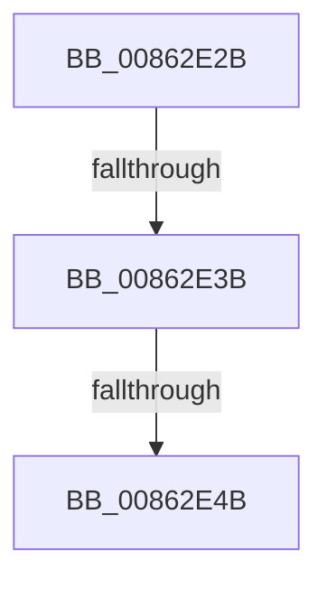

# sub_00862E2B

- RVA: `0x00862E2B`–`0x00862E78` (길이 `77` bytes)
- VA: `0x0000000140862E2B`
- 실행 섹션: `PAGE`
- PDB 이름 있음: `아니요`; PDB Function 태그: `아니요`
- unwind 정보 RVA: `0x0006B73C`
- 디코드: `19`개 명령, `77/77` bytes 표시
- 미해석 바이트: `0` (있으면 어셈블리에 `.byte`로 보존)

> 이 문서는 커널 이미지의 기계어와 PDB 기호를 분석해 생성했습니다. 4번과 5번은 함수 원형과 자료형을 바이너리 사용 방식에서 추정한 C 해석이며 원본 소스 복구 결과는 아닙니다.

## 1. Dependencies

- 직접 호출 지점: **2**; 고유 호출 대상: **2**
- 직접 호출자로 확인된 함수: **0**
- RIP 상대 이미지 참조: **0**

### Outgoing calls
- `0x00862E60` → [KeBugCheckEx](../../text/4F/KeBugCheckEx_function_004FD660.md) (function, `0x004FD660`)
- `0x00862E6E` → [KiRaiseIrqlProcessIrqlFlags](../../text/4F/KiRaiseIrqlProcessIrqlFlags_function_004F56FC.md) (function, `0x004F56FC`)

### Direct callers
- 이 함수 시작 RVA로 연결되는 직접 call은 확인되지 않았습니다. 간접 호출은 완전히 역산할 수 없습니다.

### Static image references
- 디코드된 RIP-relative 메모리 참조가 없습니다.

## 2. Other-region calls and transfers

- 다른 실행 섹션으로 향하는 call: **2**
  - `0x00862E60` → [KeBugCheckEx](../../text/4F/KeBugCheckEx_function_004FD660.md) (`PAGE` → `.text`)
  - `0x00862E6E` → [KiRaiseIrqlProcessIrqlFlags](../../text/4F/KiRaiseIrqlProcessIrqlFlags_function_004F56FC.md) (`PAGE` → `.text`)
- call이 아닌 외부 분기/꼬리 이동: **3**
  - `0x00862E39` → [sub_00862E81](Unknown_function_00862E81.md) (`tail-transfer`)
  - `0x00862E45` → [sub_0086303A + 0x33](Unknown_function_0086303A.md) (`tail-transfer`)
  - `0x00862E73` → [sub_00862BCA + 0x6B](Unknown_function_00862BCA.md) (`tail-transfer`)

## 3. Assembly (complete function range)

```asm
00862E2B  4C 8B 46 20                     mov r8, qword ptr [rsi + 0x20]
00862E2F  48 8B 0E                        mov rcx, qword ptr [rsi]
00862E32  48 8B D1                        mov rdx, rcx
00862E35  48 83 F9 01                     cmp rcx, 1
00862E39  77 46                           ja 0x140862e81
00862E3B  48 8D 86 E0 00 00 00            lea rax, [rsi + 0xe0]
00862E42  48 39 00                        cmp qword ptr [rax], rax
00862E45  0F 84 22 02 00 00               je 0x14086306d
00862E4B  41 B9 01 00 00 00               mov r9d, 1
00862E51  4C 89 64 24 20                  mov qword ptr [rsp + 0x20], r12
00862E56  4C 8B C6                        mov r8, rsi
00862E59  41 8D 51 33                     lea edx, [r9 + 0x33]
00862E5D  8D 4A 1D                        lea ecx, [rdx + 0x1d]
00862E60  E8 FB A7 C9 FF                  call 0x1404fd660
00862E65  CC                              int3
00862E66  41 0F B6 D1                     movzx edx, r9b
00862E6A  40 0F B6 CE                     movzx ecx, sil
00862E6E  E8 89 28 C9 FF                  call 0x1404f56fc
00862E73  E9 BD FD FF FF                  jmp 0x140862c35
```

## 4. C-style interpretation (structured pseudocode)

```c
__int64 __fastcall sub_00862E2B(void)
{
    __int64 result;
    unsigned __int64 v_stack_p20;

    v_stack_p20 = v_r12;
    result = KeBugCheckEx(1 + 51 + 29, 1 + 51, v_rsi, 1);
    result = KiRaiseIrqlProcessIrqlFlags((unsigned __int8)(v_rsi), 1, v_rsi, 1);
}
```

## 5. (Beta) C Style

```c
void sub_00862E2B(void)
{
    int64_t result;
    uint64_t v_stack_p20;

    v_stack_p20 = local_r12;
    result = KeBugCheckEx(1 + 51 + 29, 1 + 51, local_rsi, 1);
    result = KiRaiseIrqlProcessIrqlFlags((uint8_t)(local_rsi), 1, local_rsi, 1);
}
```

## 6. Execution-region graph

[열기: 2D/3D 그래프와 함수 탐색 컨트롤 패널](../../../control-panel.html?section=page&rva=0x00862E2B&view=graph)

- 2D 그래프는 위에서 아래로 흐르고, 3D 그래프는 빈 공간을 드래그해 회전합니다. Shift+드래그는 이동, 휠은 확대·축소, 함수 노드 선택은 대상 보고서 이동입니다.

### Static fallback


