# sub_00862E81

- RVA: `0x00862E81`–`0x00863016` (길이 `405` bytes)
- VA: `0x0000000140862E81`
- 실행 섹션: `PAGE`
- PDB 이름 있음: `아니요`; PDB Function 태그: `아니요`
- unwind 정보 RVA: `0x0006B760`
- 디코드: `89`개 명령, `405/405` bytes 표시
- 미해석 바이트: `0` (있으면 어셈블리에 `.byte`로 보존)

> 이 문서는 커널 이미지의 기계어와 PDB 기호를 분석해 생성했습니다. 4번과 5번은 함수 원형과 자료형을 바이너리 사용 방식에서 추정한 C 해석이며 원본 소스 복구 결과는 아닙니다.

## 1. Dependencies

- 직접 호출 지점: **6**; 고유 호출 대상: **5**
- 직접 호출자로 확인된 함수: **0**
- RIP 상대 이미지 참조: **9**

### Outgoing calls
- `0x00862EB3` → [CmpDoQueueLateUnloadWorker](../84/CmpDoQueueLateUnloadWorker_function_0084FB18.md) (function, `0x0084FB18`)
- `0x00862F23` → [CmpDoQueueLateUnloadWorker](../84/CmpDoQueueLateUnloadWorker_function_0084FB18.md) (function, `0x0084FB18`)
- `0x00862F95` → [CmpFreePoolWithTag](../../text/44/CmpFreePoolWithTag_function_004489E0.md) (function, `0x004489E0`)
- `0x00862FAF` → [ExFreeToLookasideListEx](../../text/38/ExFreeToLookasideListEx_function_0038ACC0.md) (function, `0x0038ACC0`)
- `0x00862FFC` → [ExReleaseFastMutex](../../text/25/ExReleaseFastMutex_function_002519C0.md) (function, `0x002519C0`)
- `0x00863001` → [CmpArmDelayedCloseTimer](../../text/46/CmpArmDelayedCloseTimer_function_00462DD0.md) (function, `0x00462DD0`)

### Direct callers
- 이 함수 시작 RVA로 연결되는 직접 call은 확인되지 않았습니다. 간접 호출은 완전히 역산할 수 없습니다.

### Static image references
- `0x00862F48` → RVA `0x00FDA430` (`PAGEDATA`; read/write)
- `0x00862FA1` → RVA `0x00E2CAC0` (`.data`; read)
- `0x00862FB4` → RVA `0x00FDA450` (`PAGEDATA`; read/write)
- `0x00862FC2` → RVA `0x00EF5880` (`.data`; read)
- `0x00862FD0` → RVA `0x00EF58E0` (`.data`; write)
- `0x00862FD7` → RVA `0x00EEFC30` (`.data`; read)
- `0x00862FE3` → RVA `0x00FDA438` (`PAGEDATA`; read/write)
- `0x00862FEA` → RVA `0x00E0ECA8` (`.data`; read)
- `0x00862FF0` → RVA `0x00EEFC30` (`.data`; write)

## 2. Other-region calls and transfers

- 다른 실행 섹션으로 향하는 call: **4**
  - `0x00862F95` → [CmpFreePoolWithTag](../../text/44/CmpFreePoolWithTag_function_004489E0.md) (`PAGE` → `.text`)
  - `0x00862FAF` → [ExFreeToLookasideListEx](../../text/38/ExFreeToLookasideListEx_function_0038ACC0.md) (`PAGE` → `.text`)
  - `0x00862FFC` → [ExReleaseFastMutex](../../text/25/ExReleaseFastMutex_function_002519C0.md) (`PAGE` → `.text`)
  - `0x00863001` → [CmpArmDelayedCloseTimer](../../text/46/CmpArmDelayedCloseTimer_function_00462DD0.md) (`PAGE` → `.text`)
- call이 아닌 외부 분기/꼬리 이동: **12**
  - `0x00862E89` → [sub_0086303A + 0xCA](Unknown_function_0086303A.md) (`tail-transfer`)
  - `0x00862EA0` → [sub_00862E2B + 0x7](Unknown_function_00862E2B.md) (`tail-transfer`)
  - `0x00862EA5` → [sub_0086303A + 0x8D](Unknown_function_0086303A.md) (`tail-transfer`)
  - `0x00862ED7` → [sub_0086303A + 0x18](Unknown_function_0086303A.md) (`tail-transfer`)
  - `0x00862EE4` → [sub_008631B3](Unknown_function_008631B3.md) (`tail-transfer`)
  - `0x00862EF9` → [sub_0086303A + 0xA5](Unknown_function_0086303A.md) (`tail-transfer`)
  - `0x00862F15` → [sub_0086303A + 0x75](Unknown_function_0086303A.md) (`tail-transfer`)
  - `0x00862F57` → [sub_0086303A](Unknown_function_0086303A.md) (`tail-transfer`)
  - `0x00862F64` → [sub_0086325E + 0x13](Unknown_function_0086325E.md) (`tail-transfer`)
  - `0x00862F75` → [sub_0086325E + 0x2E](Unknown_function_0086325E.md) (`tail-transfer`)
  - `0x00862F85` → [sub_0086325E + 0x3D](Unknown_function_0086325E.md) (`tail-transfer`)
  - `0x00862FF6` → [sub_0086303A + 0x14E](Unknown_function_0086303A.md) (`tail-transfer`)

## 3. Assembly (complete function range)

```asm
00862E81  4C 8D 49 FF                     lea r9, [rcx - 1]
00862E85  49 83 F9 02                     cmp r9, 2
00862E89  0F 84 75 02 00 00               je 0x140863104
00862E8F  45 32 D2                        xor r10b, r10b
00862E92  48 8B C1                        mov rax, rcx
00862E95  F0 4C 0F B1 0E                  lock cmpxchg qword ptr [rsi], r9
00862E9A  48 8B C8                        mov rcx, rax
00862E9D  48 3B C2                        cmp rax, rdx
00862EA0  75 90                           jne 0x140862e32
00862EA2  49 3B C1                        cmp rax, r9
00862EA5  0F 82 1C 02 00 00               jb 0x1408630c7
00862EAB  45 84 D2                        test r10b, r10b
00862EAE  74 08                           je 0x140862eb8
00862EB0  49 8B C8                        mov rcx, r8
00862EB3  E8 60 CC FE FF                  call 0x14084fb18
00862EB8  48 85 FF                        test rdi, rdi
00862EBB  74 6B                           je 0x140862f28
00862EBD  48 8B 57 20                     mov rdx, qword ptr [rdi + 0x20]
00862EC1  48 8B 0F                        mov rcx, qword ptr [rdi]
00862EC4  4C 8B C1                        mov r8, rcx
00862EC7  48 83 F9 01                     cmp rcx, 1
00862ECB  77 24                           ja 0x140862ef1
00862ECD  48 8D 87 E0 00 00 00            lea rax, [rdi + 0xe0]
00862ED4  48 39 00                        cmp qword ptr [rax], rax
00862ED7  0F 85 75 01 00 00               jne 0x140863052
00862EDD  49 8B 4F 08                     mov rcx, qword ptr [r15 + 8]
00862EE1  4C 39 39                        cmp qword ptr [rcx], r15
00862EE4  0F 84 C9 02 00 00               je 0x1408631b3
00862EEA  B9 03 00 00 00                  mov ecx, 3
00862EEF  CD 29                           int 0x29
00862EF1  4C 8D 49 FF                     lea r9, [rcx - 1]
00862EF5  49 83 F9 02                     cmp r9, 2
00862EF9  0F 84 E0 01 00 00               je 0x1408630df
00862EFF  45 32 D2                        xor r10b, r10b
00862F02  48 8B C1                        mov rax, rcx
00862F05  F0 4C 0F B1 0F                  lock cmpxchg qword ptr [rdi], r9
00862F0A  48 8B C8                        mov rcx, rax
00862F0D  49 3B C0                        cmp rax, r8
00862F10  75 B2                           jne 0x140862ec4
00862F12  49 3B C1                        cmp rax, r9
00862F15  0F 82 94 01 00 00               jb 0x1408630af
00862F1B  45 84 D2                        test r10b, r10b
00862F1E  74 08                           je 0x140862f28
00862F20  48 8B CA                        mov rcx, rdx
00862F23  E8 F0 CB FE FF                  call 0x14084fb18
00862F28  65 48 8B 04 25 88 01 00 00      mov rax, qword ptr gs:[0x188]
00862F31  48 39 43 38                     cmp qword ptr [rbx + 0x38], rax
00862F35  0F 84 CB 00 00 00               je 0x140863006
00862F3B  F7 43 08 00 00 08 00            test dword ptr [rbx + 8], 0x80000
00862F42  0F 84 BE 00 00 00               je 0x140863006
00862F48  F0 48 FF 0D E0 74 77 00         lock dec qword ptr [rip + 0x7774e0]
00862F50  48 8D 43 78                     lea rax, [rbx + 0x78]
00862F54  48 39 00                        cmp qword ptr [rax], rax
00862F57  0F 85 DD 00 00 00               jne 0x14086303a
00862F5D  F7 43 08 00 00 01 00            test dword ptr [rbx + 8], 0x10000
00862F64  0F 85 07 03 00 00               jne 0x140863271
00862F6A  48 8B 8B C8 00 00 00            mov rcx, qword ptr [rbx + 0xc8]
00862F71  48 83 F9 02                     cmp rcx, 2
00862F75  0F 83 11 03 00 00               jae 0x14086328c
00862F7B  48 8B 8B 28 01 00 00            mov rcx, qword ptr [rbx + 0x128]
00862F82  F6 C1 01                        test cl, 1
00862F85  0F 85 10 03 00 00               jne 0x14086329b
00862F8B  48 85 C9                        test rcx, rcx
00862F8E  74 0A                           je 0x140862f9a
00862F90  BA 43 4D 4E 62                  mov edx, 0x624e4d43
00862F95  E8 46 5A BE FF                  call 0x1404489e0
00862F9A  81 4B 08 00 00 01 00            or dword ptr [rbx + 8], 0x10000
00862FA1  48 8D 0D 18 9B 5C 00            lea rcx, [rip + 0x5c9b18]
00862FA8  48 8B D3                        mov rdx, rbx
00862FAB  4C 89 63 20                     mov qword ptr [rbx + 0x20], r12
00862FAF  E8 0C 7D B2 FF                  call 0x14038acc0
00862FB4  F0 48 FF 0D 94 74 77 00         lock dec qword ptr [rip + 0x777494]
00862FBC  EB 48                           jmp 0x140863006
00862FBE  48 89 48 08                     mov qword ptr [rax + 8], rcx
00862FC2  48 8D 0D B7 28 69 00            lea rcx, [rip + 0x6928b7]
00862FC9  48 89 10                        mov qword ptr [rax], rdx
00862FCC  48 89 42 08                     mov qword ptr [rdx + 8], rax
00862FD0  48 89 05 09 29 69 00            mov qword ptr [rip + 0x692909], rax
00862FD7  8B 05 53 CC 68 00               mov eax, dword ptr [rip + 0x68cc53]
00862FDD  80 4B 40 02                     or byte ptr [rbx + 0x40], 2
00862FE1  FF C0                           inc eax
00862FE3  48 FF 05 4E 74 77 00            inc qword ptr [rip + 0x77744e]
00862FEA  3B 05 B8 BC 5A 00               cmp eax, dword ptr [rip + 0x5abcb8]
00862FF0  89 05 3A CC 68 00               mov dword ptr [rip + 0x68cc3a], eax
00862FF6  0F 86 8C 01 00 00               jbe 0x140863188
00862FFC  E8 BF E9 9E FF                  call 0x1402519c0
00863001  E8 CA FD BF FF                  call 0x140462dd0
00863006  48 8B B4 24 E8 00 00 00         mov rsi, qword ptr [rsp + 0xe8]
0086300E  4C 8B A4 24 A8 00 00 00         mov r12, qword ptr [rsp + 0xa8]
```

## 4. C-style interpretation (structured pseudocode)

```c
__int64 __fastcall sub_00862E81(__int64 a1, __int64 a2, __int64 a3, __int64 a4, __int64 a5, __int64 a6, __int64 a7, __int64 a8, __int64 a9, __int64 a10, __int64 a11, __int64 a12, __int64 a13, __int64 a14, __int64 a15, __int64 a16, __int64 a17, __int64 a18, __int64 a19, __int64 a20, __int64 a21, __int64 a22, __int64 a23, __int64 a24, __int64 a25, __int64 a26, __int64 a27, __int64 a28, __int64 a29)
{
    __int64 result;
    __int64 v_r10;

    v_r10 = 0;
    result = a1;
    if (0 != 0) {
        a1 = a3;
        result = CmpDoQueueLateUnloadWorker(a1, a2, a3, a1 - 1);
    }
    if (v_rdi == 0) goto loc_00862F28;
loc_00862EC4:
    if ((*(unsigned __int64 *)(v_rdi)) > 1) goto loc_00862EF1;
loc_00862EF1:
    v_r10 = 0;
    if (3 != (*(unsigned __int64 *)(v_rdi))) goto loc_00862EC4;
    result = 3;
    if (0 != 0) {
        a1 = *(unsigned __int64 *)(v_rdi + 32);
        result = CmpDoQueueLateUnloadWorker(a1, *(unsigned __int64 *)(v_rdi + 32), *(unsigned __int64 *)(v_rdi), 3 - 1);
    }
    if ((*(unsigned __int64 *)(v_rbx + 56)) == (*(unsigned __int64 *)(gs_base + (0 + 392)))) goto loc_00863006;
    if (((*(unsigned int *)(v_rbx + 8)) & (0x80000ULL)) == 0) goto loc_00863006;
    result = v_rbx + 120;
    if (*(unsigned __int64 *)(v_rbx + 296) != 0) {
        a2 = 0x624E4D43ULL;
        result = CmpFreePoolWithTag(*(unsigned __int64 *)(v_rbx + 296), a2, *(unsigned __int64 *)(v_rdi), 3 - 1);
    }
    *(unsigned __int64 *)(v_rbx + 32) = v_r12;
    result = ExFreeToLookasideListEx(v_rip + 6069016, v_rbx, *(unsigned __int64 *)(v_rdi), 3 - 1);
    goto loc_00863006;
loc_00863006:
    return result;
}
```

## 5. (Beta) C Style

```c
int64_t sub_00862E81(void *Arg1, int64_t Arg2, int64_t Arg3, int64_t Arg4, uint64_t Arg5, uint64_t Arg6, uint64_t Arg7, uint64_t Arg8, uint64_t Arg9, uint64_t Arg10, uint64_t Arg11, uint64_t Arg12, uint64_t Arg13, uint64_t Arg14, uint64_t Arg15, uint64_t Arg16, uint64_t Arg17, uint64_t Arg18, uint64_t Arg19, uint64_t Arg20, int64_t Arg21, uint64_t Arg22, uint64_t Arg23, uint64_t Arg24, uint64_t Arg25, uint64_t Arg26, uint64_t Arg27, uint64_t Arg28, int64_t Arg29)
{
    uint8_t *arg1 = (uint8_t *)Arg1;

    int64_t result;
    int64_t local_r10;

    local_r10 = 0;
    result = Arg1;
    if (0 != 0) {
        Arg1 = Arg3;
        result = CmpDoQueueLateUnloadWorker(Arg1, Arg2, Arg3, Arg1 - 1);
    }
    if (local_rdi == 0) goto loc_00862F28;
loc_00862EC4:
    if ((*(uint64_t *)(local_rdi)) > 1) goto loc_00862EF1;
loc_00862EF1:
    local_r10 = 0;
    if (3 != (*(uint64_t *)(local_rdi))) goto loc_00862EC4;
    result = 3;
    if (0 != 0) {
        Arg1 = *(uint64_t *)(local_rdi + 0x20);
        result = CmpDoQueueLateUnloadWorker(Arg1, *(uint64_t *)(local_rdi + 0x20), *(uint64_t *)(local_rdi), 3 - 1);
    }
    if ((*(uint64_t *)(local_rbx + 0x38)) == (*(uint64_t *)(gs_base + (0 + 0x188)))) goto loc_00863006;
    if (((*(uint32_t *)(local_rbx + 0x8)) & (0x80000ULL)) == 0) goto loc_00863006;
    result = local_rbx + 120;
    if (*(uint64_t *)(local_rbx + 0x128) != 0) {
        Arg2 = 0x624E4D43ULL;
        result = CmpFreePoolWithTag(*(uint64_t *)(local_rbx + 0x128), Arg2, *(uint64_t *)(local_rdi), 3 - 1);
    }
    *(uint64_t *)(local_rbx + 0x20) = local_r12;
    result = ExFreeToLookasideListEx(v_rip + 6069016, local_rbx, *(uint64_t *)(local_rdi), 3 - 1);
    goto loc_00863006;
loc_00863006:
    return result;
}
```

### 관측된 메모리 오프셋

구조체 형식이 확인되지 않은 접근은 인자 기준의 오프셋으로만 기록했습니다.

| 기준 인자 | 오프셋 표현 | 폭 (bit) | 접근 |
|---|---:|---:|---|
| `Arg1` | `- 0x1` | `64` | `R` |

## 6. Execution-region graph

[열기: 2D/3D 그래프와 함수 탐색 컨트롤 패널](../../../control-panel.html?section=page&rva=0x00862E81&view=graph)

- 2D 그래프는 위에서 아래로 흐르고, 3D 그래프는 빈 공간을 드래그해 회전합니다. Shift+드래그는 이동, 휠은 확대·축소, 함수 노드 선택은 대상 보고서 이동입니다.

### Static fallback

```mermaid
flowchart TD
  bb_00862E81[BB_00862E81]
  bb_00862E8F[BB_00862E8F]
  bb_00862EA2[BB_00862EA2]
  bb_00862EAB[BB_00862EAB]
  bb_00862EB0[BB_00862EB0]
  bb_00862EB8[BB_00862EB8]
  bb_00862EBD[BB_00862EBD]
  bb_00862EC4[BB_00862EC4]
  bb_00862ECD[BB_00862ECD]
  bb_00862EDD[BB_00862EDD]
  bb_00862EEA[BB_00862EEA]
  bb_00862EF1[BB_00862EF1]
  bb_00862EFF[BB_00862EFF]
  bb_00862F12[BB_00862F12]
  bb_00862F1B[BB_00862F1B]
  bb_00862F20[BB_00862F20]
  bb_00862F28[BB_00862F28]
  bb_00862F3B[BB_00862F3B]
  bb_00862F48[BB_00862F48]
  bb_00862F5D[BB_00862F5D]
  bb_00862F6A[BB_00862F6A]
  bb_00862F7B[BB_00862F7B]
  bb_00862F8B[BB_00862F8B]
  bb_00862F90[BB_00862F90]
  bb_00862F9A[BB_00862F9A]
  bb_00862FBE[BB_00862FBE]
  bb_00862FFC[BB_00862FFC]
  bb_00863006[BB_00863006]
  bb_00862E81 -->|fallthrough| bb_00862E8F
  bb_00862E8F -->|fallthrough| bb_00862EA2
  bb_00862EA2 -->|fallthrough| bb_00862EAB
  bb_00862EAB -->|branch| bb_00862EB8
  bb_00862EAB -->|fallthrough| bb_00862EB0
  bb_00862EB0 -->|flow| bb_00862EB8
  bb_00862EB8 -->|branch| bb_00862F28
  bb_00862EB8 -->|fallthrough| bb_00862EBD
  bb_00862EBD -->|flow| bb_00862EC4
  bb_00862EC4 -->|branch| bb_00862EF1
  bb_00862EC4 -->|fallthrough| bb_00862ECD
  bb_00862ECD -->|fallthrough| bb_00862EDD
  bb_00862EDD -->|fallthrough| bb_00862EEA
  bb_00862EEA -->|flow| bb_00862EF1
  bb_00862EF1 -->|fallthrough| bb_00862EFF
  bb_00862EFF -->|branch| bb_00862EC4
  bb_00862EFF -->|fallthrough| bb_00862F12
  bb_00862F12 -->|fallthrough| bb_00862F1B
  bb_00862F1B -->|branch| bb_00862F28
  bb_00862F1B -->|fallthrough| bb_00862F20
  bb_00862F20 -->|flow| bb_00862F28
  bb_00862F28 -->|branch| bb_00863006
  bb_00862F28 -->|fallthrough| bb_00862F3B
  bb_00862F3B -->|branch| bb_00863006
  bb_00862F3B -->|fallthrough| bb_00862F48
  bb_00862F48 -->|fallthrough| bb_00862F5D
  bb_00862F5D -->|fallthrough| bb_00862F6A
  bb_00862F6A -->|fallthrough| bb_00862F7B
  bb_00862F7B -->|fallthrough| bb_00862F8B
  bb_00862F8B -->|branch| bb_00862F9A
  bb_00862F8B -->|fallthrough| bb_00862F90
  bb_00862F90 -->|flow| bb_00862F9A
  bb_00862F9A -->|branch| bb_00863006
  bb_00862FBE -->|fallthrough| bb_00862FFC
  bb_00862FFC -->|flow| bb_00863006
```


