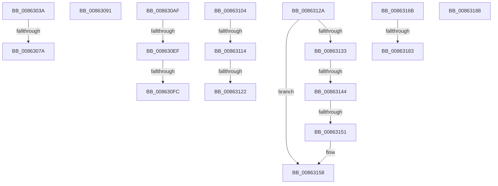

# sub_0086303A

- RVA: `0x0086303A`–`0x00863192` (길이 `344` bytes)
- VA: `0x000000014086303A`
- 실행 섹션: `PAGE`
- PDB 이름 있음: `아니요`; PDB Function 태그: `아니요`
- unwind 정보 RVA: `0x0006B794`
- 디코드: `79`개 명령, `344/344` bytes 표시
- 미해석 바이트: `0` (있으면 어셈블리에 `.byte`로 보존)

> 이 문서는 커널 이미지의 기계어와 PDB 기호를 분석해 생성했습니다. 4번과 5번은 함수 원형과 자료형을 바이너리 사용 방식에서 추정한 C 해석이며 원본 소스 복구 결과는 아닙니다.

## 1. Dependencies

- 직접 호출 지점: **7**; 고유 호출 대상: **4**
- 직접 호출자로 확인된 함수: **0**
- RIP 상대 이미지 참조: **1**

### Outgoing calls
- `0x0086304C` → [KeBugCheckEx](../../text/4F/KeBugCheckEx_function_004FD660.md) (function, `0x004FD660`)
- `0x00863067` → [KeBugCheckEx](../../text/4F/KeBugCheckEx_function_004FD660.md) (function, `0x004FD660`)
- `0x00863098` → [CmpDelayDerefKeyControlBlock](../84/CmpDelayDerefKeyControlBlock_function_0084FA50.md) (function, `0x0084FA50`)
- `0x008630C1` → [KeBugCheckEx](../../text/4F/KeBugCheckEx_function_004FD660.md) (function, `0x004FD660`)
- `0x008630D9` → [KeBugCheckEx](../../text/4F/KeBugCheckEx_function_004FD660.md) (function, `0x004FD660`)
- `0x0086315A` → [ExFreePoolWithTag](../../poolcode/B8/ExFreePoolWithTag_function_00B82870.md) (function, `0x00B82870`)
- `0x00863188` → [ExReleaseFastMutex](../../text/25/ExReleaseFastMutex_function_002519C0.md) (function, `0x002519C0`)

### Direct callers
- 이 함수 시작 RVA로 연결되는 직접 call은 확인되지 않았습니다. 간접 호출은 완전히 역산할 수 없습니다.

### Static image references
- `0x0086316B` → RVA `0x00EF58E0` (`.data`; read)

## 2. Other-region calls and transfers

- 다른 실행 섹션으로 향하는 call: **6**
  - `0x0086304C` → [KeBugCheckEx](../../text/4F/KeBugCheckEx_function_004FD660.md) (`PAGE` → `.text`)
  - `0x00863067` → [KeBugCheckEx](../../text/4F/KeBugCheckEx_function_004FD660.md) (`PAGE` → `.text`)
  - `0x008630C1` → [KeBugCheckEx](../../text/4F/KeBugCheckEx_function_004FD660.md) (`PAGE` → `.text`)
  - `0x008630D9` → [KeBugCheckEx](../../text/4F/KeBugCheckEx_function_004FD660.md) (`PAGE` → `.text`)
  - `0x0086315A` → [ExFreePoolWithTag](../../poolcode/B8/ExFreePoolWithTag_function_00B82870.md) (`PAGE` → `POOLCODE`)
  - `0x00863188` → [ExReleaseFastMutex](../../text/25/ExReleaseFastMutex_function_002519C0.md) (`PAGE` → `.text`)
- call이 아닌 외부 분기/꼬리 이동: **15**
  - `0x00863074` → [sub_00862E81 + 0x69](Unknown_function_00862E81.md) (`tail-transfer`)
  - `0x0086308C` → [sub_00862E81 + 0x37](Unknown_function_00862E81.md) (`tail-transfer`)
  - `0x008630AA` → [sub_00862D60 + 0x1B](Unknown_function_00862D60.md) (`tail-transfer`)
  - `0x008630E9` → [sub_00862E81 + 0x7E](Unknown_function_00862E81.md) (`tail-transfer`)
  - `0x008630F6` → [sub_00862E81 + 0x7E](Unknown_function_00862E81.md) (`tail-transfer`)
  - `0x008630FF` → [sub_00862E81 + 0x81](Unknown_function_00862E81.md) (`tail-transfer`)
  - `0x0086310E` → [sub_00862E81 + 0xE](Unknown_function_00862E81.md) (`tail-transfer`)
  - `0x0086311C` → [sub_00862E81 + 0xE](Unknown_function_00862E81.md) (`tail-transfer`)
  - `0x00863125` → [sub_00862E81 + 0x11](Unknown_function_00862E81.md) (`tail-transfer`)
  - `0x0086313E` → [sub_00862E81 + 0x69](Unknown_function_00862E81.md) (`tail-transfer`)
  - `0x0086314B` → [sub_00862E81 + 0x69](Unknown_function_00862E81.md) (`tail-transfer`)
  - `0x00863166` → [sub_00862D60 + 0x3F](Unknown_function_00862D60.md) (`tail-transfer`)
  - `0x0086317D` → [sub_00862E81 + 0x69](Unknown_function_00862E81.md) (`tail-transfer`)
  - `0x00863183` → [sub_00862E81 + 0x13D](Unknown_function_00862E81.md) (`tail-transfer`)
  - `0x0086318D` → [sub_00862E81 + 0x185](Unknown_function_00862E81.md) (`tail-transfer`)

## 3. Assembly (complete function range)

```asm
0086303A  45 33 C9                        xor r9d, r9d
0086303D  4C 89 64 24 20                  mov qword ptr [rsp + 0x20], r12
00863042  4C 8B C3                        mov r8, rbx
00863045  41 8D 51 11                     lea edx, [r9 + 0x11]
00863049  8D 4A 40                        lea ecx, [rdx + 0x40]
0086304C  E8 0F A6 C9 FF                  call 0x1404fd660
00863051  CC                              int3
00863052  41 B9 01 00 00 00               mov r9d, 1
00863058  4C 89 64 24 20                  mov qword ptr [rsp + 0x20], r12
0086305D  4C 8B C7                        mov r8, rdi
00863060  41 8D 51 33                     lea edx, [r9 + 0x33]
00863064  8D 4A 1D                        lea ecx, [rdx + 0x1d]
00863067  E8 F4 A5 C9 FF                  call 0x1404fd660
0086306C  CC                              int3
0086306D  49 8B 4F 08                     mov rcx, qword ptr [r15 + 8]
00863071  4C 39 39                        cmp qword ptr [rcx], r15
00863074  0F 85 70 FE FF FF               jne 0x140862eea
0086307A  4C 89 38                        mov qword ptr [rax], r15
0086307D  48 89 48 08                     mov qword ptr [rax + 8], rcx
00863081  48 89 01                        mov qword ptr [rcx], rax
00863084  49 89 47 08                     mov qword ptr [r15 + 8], rax
00863088  80 4E 40 01                     or byte ptr [rsi + 0x40], 1
0086308C  E9 27 FE FF FF                  jmp 0x140862eb8
00863091  48 8B 4B 68                     mov rcx, qword ptr [rbx + 0x68]
00863095  49 8B D7                        mov rdx, r15
00863098  E8 B3 C9 FE FF                  call 0x14084fa50
0086309D  B9 F7 FF 00 00                  mov ecx, 0xfff7
008630A2  4C 89 63 68                     mov qword ptr [rbx + 0x68], r12
008630A6  66 21 4B 08                     and word ptr [rbx + 8], cx
008630AA  E9 CC FC FF FF                  jmp 0x140862d7b
008630AF  45 33 C9                        xor r9d, r9d
008630B2  4C 89 64 24 20                  mov qword ptr [rsp + 0x20], r12
008630B7  4C 8B C7                        mov r8, rdi
008630BA  41 8D 51 25                     lea edx, [r9 + 0x25]
008630BE  8D 4A 2C                        lea ecx, [rdx + 0x2c]
008630C1  E8 9A A5 C9 FF                  call 0x1404fd660
008630C6  CC                              int3
008630C7  45 33 C9                        xor r9d, r9d
008630CA  4C 89 64 24 20                  mov qword ptr [rsp + 0x20], r12
008630CF  4C 8B C6                        mov r8, rsi
008630D2  41 8D 51 25                     lea edx, [r9 + 0x25]
008630D6  8D 4A 2C                        lea ecx, [rdx + 0x2c]
008630D9  E8 82 A5 C9 FF                  call 0x1404fd660
008630DE  CC                              int3
008630DF  F7 87 B8 00 00 00 00 00 04 00   test dword ptr [rdi + 0xb8], 0x40000
008630E9  0F 84 10 FE FF FF               je 0x140862eff
008630EF  80 BA 80 0B 00 00 01            cmp byte ptr [rdx + 0xb80], 1
008630F6  0F 85 03 FE FF FF               jne 0x140862eff
008630FC  41 B2 01                        mov r10b, 1
008630FF  E9 FE FD FF FF                  jmp 0x140862f02
00863104  F7 86 B8 00 00 00 00 00 04 00   test dword ptr [rsi + 0xb8], 0x40000
0086310E  0F 84 7B FD FF FF               je 0x140862e8f
00863114  41 80 B8 80 0B 00 00 01         cmp byte ptr [r8 + 0xb80], 1
0086311C  0F 85 6D FD FF FF               jne 0x140862e8f
00863122  41 B2 01                        mov r10b, 1
00863125  E9 68 FD FF FF                  jmp 0x140862e92
0086312A  48 8B 41 18                     mov rax, qword ptr [rcx + 0x18]
0086312E  48 85 C0                        test rax, rax
00863131  74 25                           je 0x140863158
00863133  48 8B 11                        mov rdx, qword ptr [rcx]
00863136  48 8B 70 10                     mov rsi, qword ptr [rax + 0x10]
0086313A  48 39 4A 08                     cmp qword ptr [rdx + 8], rcx
0086313E  0F 85 A6 FD FF FF               jne 0x140862eea
00863144  48 8B 41 08                     mov rax, qword ptr [rcx + 8]
00863148  48 39 08                        cmp qword ptr [rax], rcx
0086314B  0F 85 99 FD FF FF               jne 0x140862eea
00863151  48 89 10                        mov qword ptr [rax], rdx
00863154  48 89 42 08                     mov qword ptr [rdx + 8], rax
00863158  33 D2                           xor edx, edx
0086315A  E8 11 F7 31 00                  call 0x140b82870
0086315F  4C 89 A3 C0 00 00 00            mov qword ptr [rbx + 0xc0], r12
00863166  E9 34 FC FF FF                  jmp 0x140862d9f
0086316B  48 8B 15 6E 27 69 00            mov rdx, qword ptr [rip + 0x69276e]
00863172  48 8D 0D 67 27 69 00            lea rcx, [rip + 0x692767]
00863179  48 39 4A 08                     cmp qword ptr [rdx + 8], rcx
0086317D  0F 85 67 FD FF FF               jne 0x140862eea
00863183  E9 36 FE FF FF                  jmp 0x140862fbe
00863188  E8 33 E8 9E FF                  call 0x1402519c0
0086318D  E9 74 FE FF FF                  jmp 0x140863006
```

## 4. C-style interpretation (structured pseudocode)

```c
__int64 __fastcall sub_0086303A(__int64 a1, __int64 a2, __int64 a3, int a4)
{
    __int64 result;
    unsigned __int64 v_stack_p20;

    a4 = 0;
    v_stack_p20 = v_r12;
    result = KeBugCheckEx(a4 + 17 + 64, a4 + 17, v_rbx, a4);
    v_stack_p20 = v_r12;
    result = KeBugCheckEx(1 + 51 + 29, 1 + 51, v_rdi, 1);
    *(unsigned __int64 *)(result) = v_r15;
    *(unsigned __int64 *)(result + 8) = *(unsigned __int64 *)(v_r15 + 8);
    *(unsigned __int64 *)(*(unsigned __int64 *)(v_r15 + 8)) = result;
    *(unsigned __int64 *)(v_r15 + 8) = result;
}
```

## 5. (Beta) C Style

```c
int64_t sub_0086303A(int64_t Arg1, int64_t Arg2, int64_t Arg3, int32_t Arg4)
{
    int64_t result;
    uint64_t v_stack_p20;

    Arg4 = 0;
    v_stack_p20 = local_r12;
    result = KeBugCheckEx(Arg4 + 17 + 64, Arg4 + 17, local_rbx, Arg4);
    v_stack_p20 = local_r12;
    result = KeBugCheckEx(1 + 51 + 29, 1 + 51, local_rdi, 1);
    *(uint64_t *)(result) = local_r15;
    *(uint64_t *)(result + 0x8) = *(uint64_t *)(local_r15 + 0x8);
    *(uint64_t *)(*(uint64_t *)(local_r15 + 0x8)) = result;
    *(uint64_t *)(local_r15 + 0x8) = result;
}
```

## 6. Execution-region graph

[열기: 2D/3D 그래프와 함수 탐색 컨트롤 패널](../../../control-panel.html?section=page&rva=0x0086303A&view=graph)

- 2D 그래프는 위에서 아래로 흐르고, 3D 그래프는 빈 공간을 드래그해 회전합니다. Shift+드래그는 이동, 휠은 확대·축소, 함수 노드 선택은 대상 보고서 이동입니다.

### Static fallback


