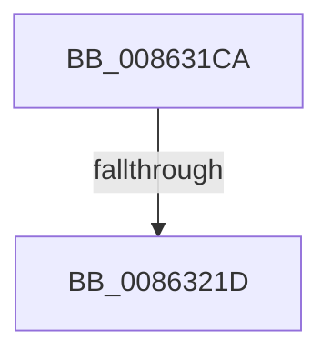

# sub_008631CA

- RVA: `0x008631CA`–`0x0086322A` (길이 `96` bytes)
- VA: `0x00000001408631CA`
- 실행 섹션: `PAGE`
- PDB 이름 있음: `아니요`; PDB Function 태그: `아니요`
- unwind 정보 RVA: `0x0006B7EC`
- 디코드: `16`개 명령, `96/96` bytes 표시
- 미해석 바이트: `0` (있으면 어셈블리에 `.byte`로 보존)

> 이 문서는 커널 이미지의 기계어와 PDB 기호를 분석해 생성했습니다. 4번과 5번은 함수 원형과 자료형을 바이너리 사용 방식에서 추정한 C 해석이며 원본 소스 복구 결과는 아닙니다.

## 1. Dependencies

- 직접 호출 지점: **2**; 고유 호출 대상: **2**
- 직접 호출자로 확인된 함수: **0**
- RIP 상대 이미지 참조: **0**

### Outgoing calls
- `0x008631D1` → [CmpCleanUpKcbCacheWithLock](CmpCleanUpKcbCacheWithLock_function_00861F20.md) (function, `0x00861F20`)
- `0x00863220` → [CmpDereferenceHive](CmpDereferenceHive_function_008632B0.md) (function, `0x008632B0`)

### Direct callers
- 이 함수 시작 RVA로 연결되는 직접 call은 확인되지 않았습니다. 간접 호출은 완전히 역산할 수 없습니다.

### Static image references
- 디코드된 RIP-relative 메모리 참조가 없습니다.

## 2. Other-region calls and transfers

- 다른 실행 섹션으로 향하는 call: **0**
- call이 아닌 외부 분기/꼬리 이동: **2**
  - `0x00863217` → [sub_00863016](Unknown_function_00863016.md) (`tail-transfer`)
  - `0x00863225` → [sub_00863016](Unknown_function_00863016.md) (`tail-transfer`)

## 3. Assembly (complete function range)

```asm
008631CA  48 8B 7B 20                     mov rdi, qword ptr [rbx + 0x20]
008631CE  48 8B CB                        mov rcx, rbx
008631D1  E8 4A ED FF FF                  call 0x140861f20
008631D6  65 48 8B 04 25 88 01 00 00      mov rax, qword ptr gs:[0x188]
008631DF  41 B9 01 00 00 00               mov r9d, 1
008631E5  81 8F A0 00 00 00 80 00 00 00   or dword ptr [rdi + 0xa0], 0x80
008631EF  48 89 87 50 10 00 00            mov qword ptr [rdi + 0x1050], rax
008631F6  F0 44 0F C1 8F 8C 10 00 00      lock xadd dword ptr [rdi + 0x108c], r9d
008631FF  41 83 E1 7F                     and r9d, 0x7f
00863203  42 C7 84 8F 90 10 00 00 1F 00 00 00  mov dword ptr [rdi + r9*4 + 0x1090], 0x1f
0086320F  8B 87 A0 00 00 00               mov eax, dword ptr [rdi + 0xa0]
00863215  A8 20                           test al, 0x20
00863217  0F 85 F9 FD FF FF               jne 0x140863016
0086321D  48 8B CF                        mov rcx, rdi
00863220  E8 8B 00 00 00                  call 0x1408632b0
00863225  E9 EC FD FF FF                  jmp 0x140863016
```

## 4. C-style interpretation (structured pseudocode)

```c
__int64 __fastcall sub_008631CA(void)
{
    __int64 result;

    result = CmpCleanUpKcbCacheWithLock(v_rbx, a2, a3, a4);
    *(unsigned __int64 *)(*(unsigned __int64 *)(v_rbx + 32) + 4176) = *(unsigned __int64 *)(gs_base + (0 + 392));
    a4 = (unsigned int)((1) & (127));
    *(unsigned int *)(*(unsigned __int64 *)(v_rbx + 32) + a4 * 4 + 4240) = 31;
    result = CmpDereferenceHive(*(unsigned __int64 *)(v_rbx + 32), a2, a3, a4);
}
```

## 5. (Beta) C Style

```c
void sub_008631CA(void)
{
    int64_t result;

    result = CmpCleanUpKcbCacheWithLock(local_rbx, a2, a3, a4);
    *(uint64_t *)(*(uint64_t *)(local_rbx + 0x20) + 0x1050) = *(uint64_t *)(gs_base + (0 + 0x188));
    a4 = (uint32_t)((1) & (127));
    *(uint32_t *)(*(uint64_t *)(local_rbx + 0x20) + a4 * 4 + 0x1090) = 31;
    result = CmpDereferenceHive(*(uint64_t *)(local_rbx + 0x20), a2, a3, a4);
}
```

## 6. Execution-region graph

[열기: 2D/3D 그래프와 함수 탐색 컨트롤 패널](../../../control-panel.html?section=page&rva=0x008631CA&view=graph)

- 2D 그래프는 위에서 아래로 흐르고, 3D 그래프는 빈 공간을 드래그해 회전합니다. Shift+드래그는 이동, 휠은 확대·축소, 함수 노드 선택은 대상 보고서 이동입니다.

### Static fallback


