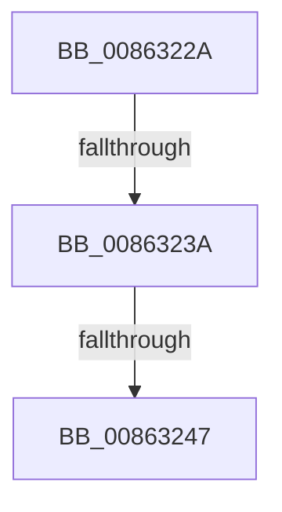

# sub_0086322A

- RVA: `0x0086322A`–`0x00863251` (길이 `39` bytes)
- VA: `0x000000014086322A`
- 실행 섹션: `PAGE`
- PDB 이름 있음: `아니요`; PDB Function 태그: `아니요`
- unwind 정보 RVA: `0x0006B800`
- 디코드: `6`개 명령, `39/39` bytes 표시
- 미해석 바이트: `0` (있으면 어셈블리에 `.byte`로 보존)

> 이 문서는 커널 이미지의 기계어와 PDB 기호를 분석해 생성했습니다. 4번과 5번은 함수 원형과 자료형을 바이너리 사용 방식에서 추정한 C 해석이며 원본 소스 복구 결과는 아닙니다.

## 1. Dependencies

- 직접 호출 지점: **1**; 고유 호출 대상: **1**
- 직접 호출자로 확인된 함수: **0**
- RIP 상대 이미지 참조: **0**

### Outgoing calls
- `0x00863247` → [CmpDoQueueLateUnloadWorker](../84/CmpDoQueueLateUnloadWorker_function_0084FB18.md) (function, `0x0084FB18`)

### Direct callers
- 이 함수 시작 RVA로 연결되는 직접 call은 확인되지 않았습니다. 간접 호출은 완전히 역산할 수 없습니다.

### Static image references
- 디코드된 RIP-relative 메모리 참조가 없습니다.

## 2. Other-region calls and transfers

- 다른 실행 섹션으로 향하는 call: **0**
- call이 아닌 외부 분기/꼬리 이동: **3**
  - `0x00863234` → [sub_0086301E](Unknown_function_0086301E.md) (`tail-transfer`)
  - `0x00863241` → [sub_0086301E](Unknown_function_0086301E.md) (`tail-transfer`)
  - `0x0086324C` → [sub_0086301E](Unknown_function_0086301E.md) (`tail-transfer`)

## 3. Assembly (complete function range)

```asm
0086322A  F7 83 B8 00 00 00 00 00 04 00   test dword ptr [rbx + 0xb8], 0x40000
00863234  0F 84 E4 FD FF FF               je 0x14086301e
0086323A  80 B9 80 0B 00 00 01            cmp byte ptr [rcx + 0xb80], 1
00863241  0F 85 D7 FD FF FF               jne 0x14086301e
00863247  E8 CC C8 FE FF                  call 0x14084fb18
0086324C  E9 CD FD FF FF                  jmp 0x14086301e
```

## 4. C-style interpretation (structured pseudocode)

```c
__int64 __fastcall sub_0086322A(__int64 a1)
{
    __int64 result;

    result = CmpDoQueueLateUnloadWorker(a1, a2, a3, a4);
}
```

## 5. (Beta) C Style

```c
int64_t sub_0086322A(void *Arg1)
{
    uint8_t *arg1 = (uint8_t *)Arg1;

    int64_t result;

    result = CmpDoQueueLateUnloadWorker(Arg1, a2, a3, a4);
}
```

### 관측된 메모리 오프셋

구조체 형식이 확인되지 않은 접근은 인자 기준의 오프셋으로만 기록했습니다.

| 기준 인자 | 오프셋 표현 | 폭 (bit) | 접근 |
|---|---:|---:|---|
| `Arg1` | `+ 0xB80` | `8` | `R` |

## 6. Execution-region graph

[열기: 2D/3D 그래프와 함수 탐색 컨트롤 패널](../../../control-panel.html?section=page&rva=0x0086322A&view=graph)

- 2D 그래프는 위에서 아래로 흐르고, 3D 그래프는 빈 공간을 드래그해 회전합니다. Shift+드래그는 이동, 휠은 확대·축소, 함수 노드 선택은 대상 보고서 이동입니다.

### Static fallback


