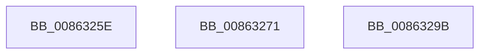

# sub_0086325E

- RVA: `0x0086325E`–`0x008632A4` (길이 `70` bytes)
- VA: `0x000000014086325E`
- 실행 섹션: `PAGE`
- PDB 이름 있음: `아니요`; PDB Function 태그: `아니요`
- unwind 정보 RVA: `0x0006B830`
- 디코드: `16`개 명령, `70/70` bytes 표시
- 미해석 바이트: `0` (있으면 어셈블리에 `.byte`로 보존)

> 이 문서는 커널 이미지의 기계어와 PDB 기호를 분석해 생성했습니다. 4번과 5번은 함수 원형과 자료형을 바이너리 사용 방식에서 추정한 C 해석이며 원본 소스 복구 결과는 아닙니다.

## 1. Dependencies

- 직접 호출 지점: **3**; 고유 호출 대상: **2**
- 직접 호출자로 확인된 함수: **0**
- RIP 상대 이미지 참조: **0**

### Outgoing calls
- `0x00863267` → [ExFreePoolWithTag](../../poolcode/B8/ExFreePoolWithTag_function_00B82870.md) (function, `0x00B82870`)
- `0x00863286` → [KeBugCheckEx](../../text/4F/KeBugCheckEx_function_004FD660.md) (function, `0x004FD660`)
- `0x00863291` → [ExFreePoolWithTag](../../poolcode/B8/ExFreePoolWithTag_function_00B82870.md) (function, `0x00B82870`)

### Direct callers
- 이 함수 시작 RVA로 연결되는 직접 call은 확인되지 않았습니다. 간접 호출은 완전히 역산할 수 없습니다.

### Static image references
- 디코드된 RIP-relative 메모리 참조가 없습니다.

## 2. Other-region calls and transfers

- 다른 실행 섹션으로 향하는 call: **3**
  - `0x00863267` → [ExFreePoolWithTag](../../poolcode/B8/ExFreePoolWithTag_function_00B82870.md) (`PAGE` → `POOLCODE`)
  - `0x00863286` → [KeBugCheckEx](../../text/4F/KeBugCheckEx_function_004FD660.md) (`PAGE` → `.text`)
  - `0x00863291` → [ExFreePoolWithTag](../../poolcode/B8/ExFreePoolWithTag_function_00B82870.md) (`PAGE` → `POOLCODE`)
- call이 아닌 외부 분기/꼬리 이동: **3**
  - `0x0086326C` → [sub_00862D60 + 0x2F](Unknown_function_00862D60.md) (`tail-transfer`)
  - `0x00863296` → [sub_00862E81 + 0xFA](Unknown_function_00862E81.md) (`tail-transfer`)
  - `0x0086329F` → [sub_00862E81 + 0x10A](Unknown_function_00862E81.md) (`tail-transfer`)

## 3. Assembly (complete function range)

```asm
0086325E  48 8B 4B 70                     mov rcx, qword ptr [rbx + 0x70]
00863262  BA 43 4D 49 6E                  mov edx, 0x6e494d43
00863267  E8 04 F6 31 00                  call 0x140b82870
0086326C  E9 1E FB FF FF                  jmp 0x140862d8f
00863271  41 B9 01 00 00 00               mov r9d, 1
00863277  4C 89 64 24 20                  mov qword ptr [rsp + 0x20], r12
0086327C  4C 8B C3                        mov r8, rbx
0086327F  41 8D 51 10                     lea edx, [r9 + 0x10]
00863283  8D 4A 40                        lea ecx, [rdx + 0x40]
00863286  E8 D5 A3 C9 FF                  call 0x1404fd660
0086328B  CC                              int3
0086328C  BA 43 4D 4E 62                  mov edx, 0x624e4d43
00863291  E8 DA F5 31 00                  call 0x140b82870
00863296  E9 E0 FC FF FF                  jmp 0x140862f7b
0086329B  48 83 E1 FE                     and rcx, 0xfffffffffffffffe
0086329F  E9 E7 FC FF FF                  jmp 0x140862f8b
```

## 4. C-style interpretation (structured pseudocode)

```c
__int64 __fastcall sub_0086325E(void)
{
    __int64 result;
    unsigned __int64 v_stack_p20;

    result = ExFreePoolWithTag(*(unsigned __int64 *)(v_rbx + 112), (unsigned int)(0x6E494D43ULL), a3, a4);
}
```

## 5. (Beta) C Style

```c
void sub_0086325E(void)
{
    int64_t result;
    uint64_t v_stack_p20;

    result = ExFreePoolWithTag(*(uint64_t *)(local_rbx + 0x70), (uint32_t)(0x6E494D43ULL), a3, a4);
}
```

## 6. Execution-region graph

[열기: 2D/3D 그래프와 함수 탐색 컨트롤 패널](../../../control-panel.html?section=page&rva=0x0086325E&view=graph)

- 2D 그래프는 위에서 아래로 흐르고, 3D 그래프는 빈 공간을 드래그해 회전합니다. Shift+드래그는 이동, 휠은 확대·축소, 함수 노드 선택은 대상 보고서 이동입니다.

### Static fallback


