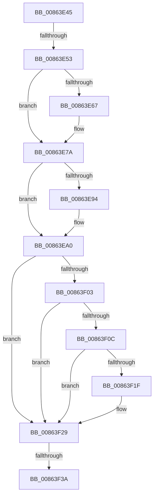

# sub_00863E45

- RVA: `0x00863E45`–`0x00863F57` (길이 `274` bytes)
- VA: `0x0000000140863E45`
- 실행 섹션: `PAGE`
- PDB 이름 있음: `아니요`; PDB Function 태그: `아니요`
- unwind 정보 RVA: `0x0006B8BC`
- 디코드: `62`개 명령, `274/274` bytes 표시
- 미해석 바이트: `0` (있으면 어셈블리에 `.byte`로 보존)

> 이 문서는 커널 이미지의 기계어와 PDB 기호를 분석해 생성했습니다. 4번과 5번은 함수 원형과 자료형을 바이너리 사용 방식에서 추정한 C 해석이며 원본 소스 복구 결과는 아닙니다.

## 1. Dependencies

- 직접 호출 지점: **9**; 고유 호출 대상: **9**
- 직접 호출자로 확인된 함수: **0**
- RIP 상대 이미지 참조: **0**

### Outgoing calls
- `0x00863E56` → [IoGetRelatedDeviceObject](../../text/29/IoGetRelatedDeviceObject_function_0029B120.md) (function, `0x0029B120`)
- `0x00863E75` → [IopCloseFile](IopCloseFile_function_008640C0.md) (function, `0x008640C0`)
- `0x00863E86` → [KeInitializeEvent](../../text/40/KeInitializeEvent_function_0040DD10.md) (function, `0x0040DD10`)
- `0x00863E9B` → [KeResetEvent](../../text/24/KeResetEvent_function_00248350.md) (function, `0x00248350`)
- `0x00863EA7` → [IopAllocateIrpMustSucceed](../../text/20/IopAllocateIrpMustSucceed_function_002076C0.md) (function, `0x002076C0`)
- `0x00863EF5` → [IopQueueThreadIrp](../../text/20/IopQueueThreadIrp_function_002075C0.md) (function, `0x002075C0`)
- `0x00863F11` → [IopDecrementVpbRefCount](../../text/40/IopDecrementVpbRefCount_function_0040EAB0.md) (function, `0x0040EAB0`)
- `0x00863F24` → [IopIncrementDeviceObjectRefCount](../../text/41/IopIncrementDeviceObjectRefCount_function_0041B1D0.md) (function, `0x0041B1D0`)
- `0x00863F43` → [IofCallDriver](../../text/29/IofCallDriver_function_0029B4B0.md) (function, `0x0029B4B0`)

### Direct callers
- 이 함수 시작 RVA로 연결되는 직접 call은 확인되지 않았습니다. 간접 호출은 완전히 역산할 수 없습니다.

### Static image references
- 디코드된 RIP-relative 메모리 참조가 없습니다.

## 2. Other-region calls and transfers

- 다른 실행 섹션으로 향하는 call: **8**
  - `0x00863E56` → [IoGetRelatedDeviceObject](../../text/29/IoGetRelatedDeviceObject_function_0029B120.md) (`PAGE` → `.text`)
  - `0x00863E86` → [KeInitializeEvent](../../text/40/KeInitializeEvent_function_0040DD10.md) (`PAGE` → `.text`)
  - `0x00863E9B` → [KeResetEvent](../../text/24/KeResetEvent_function_00248350.md) (`PAGE` → `.text`)
  - `0x00863EA7` → [IopAllocateIrpMustSucceed](../../text/20/IopAllocateIrpMustSucceed_function_002076C0.md) (`PAGE` → `.text`)
  - `0x00863EF5` → [IopQueueThreadIrp](../../text/20/IopQueueThreadIrp_function_002075C0.md) (`PAGE` → `.text`)
  - `0x00863F11` → [IopDecrementVpbRefCount](../../text/40/IopDecrementVpbRefCount_function_0040EAB0.md) (`PAGE` → `.text`)
  - `0x00863F24` → [IopIncrementDeviceObjectRefCount](../../text/41/IopIncrementDeviceObjectRefCount_function_0041B1D0.md) (`PAGE` → `.text`)
  - `0x00863F43` → [IofCallDriver](../../text/29/IofCallDriver_function_0029B4B0.md) (`PAGE` → `.text`)
- call이 아닌 외부 분기/꼬리 이동: **3**
  - `0x00863E4D` → [sub_0086405D](Unknown_function_0086405D.md) (`tail-transfer`)
  - `0x00863F34` → [sub_0086408B](Unknown_function_0086408B.md) (`tail-transfer`)
  - `0x00863F55` → [sub_00863F57 + 0x17](Unknown_function_00863F57.md) (`tail-transfer`)

## 3. Assembly (complete function range)

```asm
00863E45  48 89 B4 24 98 00 00 00         mov qword ptr [rsp + 0x98], rsi
00863E4D  0F 85 0A 02 00 00               jne 0x14086405d
00863E53  48 8B CB                        mov rcx, rbx
00863E56  E8 C5 72 A3 FF                  call 0x14029b120
00863E5B  F7 43 50 00 00 24 00            test dword ptr [rbx + 0x50], 0x240000
00863E62  48 8B F0                        mov rsi, rax
00863E65  75 13                           jne 0x140863e7a
00863E67  41 B9 01 00 00 00               mov r9d, 1
00863E6D  48 8B D3                        mov rdx, rbx
00863E70  45 8B C1                        mov r8d, r9d
00863E73  33 C9                           xor ecx, ecx
00863E75  E8 46 02 00 00                  call 0x1408640c0
00863E7A  45 33 C0                        xor r8d, r8d
00863E7D  48 8D 4C 24 40                  lea rcx, [rsp + 0x40]
00863E82  41 8D 50 01                     lea edx, [r8 + 1]
00863E86  E8 85 9E BA FF                  call 0x14040dd10
00863E8B  F7 43 50 00 00 00 04            test dword ptr [rbx + 0x50], 0x4000000
00863E92  75 0C                           jne 0x140863ea0
00863E94  48 8D 8B 98 00 00 00            lea rcx, [rbx + 0x98]
00863E9B  E8 B0 44 9E FF                  call 0x140248350
00863EA0  0F B6 56 4C                     movzx edx, byte ptr [rsi + 0x4c]
00863EA4  48 8B CE                        mov rcx, rsi
00863EA7  E8 14 38 9A FF                  call 0x1402076c0
00863EAC  48 8B F8                        mov rdi, rax
00863EAF  48 8B 88 B8 00 00 00            mov rcx, qword ptr [rax + 0xb8]
00863EB6  48 8D 44 24 30                  lea rax, [rsp + 0x30]
00863EBB  C6 41 B8 02                     mov byte ptr [rcx - 0x48], 2
00863EBF  48 89 59 E8                     mov qword ptr [rcx - 0x18], rbx
00863EC3  48 89 47 48                     mov qword ptr [rdi + 0x48], rax
00863EC7  48 8D 44 24 40                  lea rax, [rsp + 0x40]
00863ECC  48 89 47 50                     mov qword ptr [rdi + 0x50], rax
00863ED0  48 89 9F C0 00 00 00            mov qword ptr [rdi + 0xc0], rbx
00863ED7  65 48 8B 0C 25 88 01 00 00      mov rcx, qword ptr gs:[0x188]
00863EE0  48 89 8F 98 00 00 00            mov qword ptr [rdi + 0x98], rcx
00863EE7  48 8B CF                        mov rcx, rdi
00863EEA  4C 89 67 18                     mov qword ptr [rdi + 0x18], r12
00863EEE  C7 47 10 04 04 00 00            mov dword ptr [rdi + 0x10], 0x404
00863EF5  E8 C6 36 9A FF                  call 0x1402075c0
00863EFA  4C 8B 7B 10                     mov r15, qword ptr [rbx + 0x10]
00863EFE  4D 85 FF                        test r15, r15
00863F01  74 26                           je 0x140863f29
00863F03  F7 43 50 00 08 00 00            test dword ptr [rbx + 0x50], 0x800
00863F0A  75 1D                           jne 0x140863f29
00863F0C  B2 01                           mov dl, 1
00863F0E  49 8B CF                        mov rcx, r15
00863F11  E8 9A AB BA FF                  call 0x14040eab0
00863F16  4D 8B 77 08                     mov r14, qword ptr [r15 + 8]
00863F1A  4D 85 F6                        test r14, r14
00863F1D  74 0A                           je 0x140863f29
00863F1F  B2 01                           mov dl, 1
00863F21  49 8B CE                        mov rcx, r14
00863F24  E8 A7 72 BB FF                  call 0x14041b1d0
00863F29  48 8B 4B 08                     mov rcx, qword ptr [rbx + 8]
00863F2D  F7 41 30 00 04 00 00            test dword ptr [rcx + 0x30], 0x400
00863F34  0F 85 51 01 00 00               jne 0x14086408b
00863F3A  40 32 ED                        xor bpl, bpl
00863F3D  48 8B D7                        mov rdx, rdi
00863F40  48 8B CE                        mov rcx, rsi
00863F43  E8 68 75 A3 FF                  call 0x14029b4b0
00863F48  48 8B B4 24 98 00 00 00         mov rsi, qword ptr [rsp + 0x98]
00863F50  3D 03 01 00 00                  cmp eax, 0x103
00863F55  75 17                           jne 0x140863f6e
```

## 4. C-style interpretation (structured pseudocode)

```c
__int64 __fastcall sub_00863E45(__int64 a1, __int64 a2, __int64 a3, __int64 a4, __int64 a5, __int64 a6, __int64 a7, __int64 a8, __int64 a9, __int64 a10, __int64 a11, __int64 a12, __int64 a13, __int64 a14, __int64 a15, __int64 a16, __int64 a17, __int64 a18, __int64 a19)
{
    __int64 result;
    __int64 v_rbp;
    unsigned __int64 v_stack_p98;

    v_stack_p98 = v_rsi;
    result = IoGetRelatedDeviceObject(v_rbx, a2, a3, a4);
    if (((*(unsigned int *)(v_rbx + 80)) & (0x240000ULL)) == 0) {
        a4 = 1;
        a2 = v_rbx;
        a3 = (unsigned int)(a4);
        a1 = 0;
        result = IopCloseFile(a1, a2, a3, a4);
    }
    a3 = 0;
    result = KeInitializeEvent(a8, a3 + 1, a3, a4);
    if (((*(unsigned int *)(v_rbx + 80)) & (0x4000000ULL)) == 0) {
        a1 = v_rbx + 152;
        result = KeResetEvent(a1, a3 + 1, a3, a4);
    }
    result = IopAllocateIrpMustSucceed(result, *(unsigned __int8 *)(result + 76), a3, a4);
    *(unsigned __int8 *)(*(unsigned __int64 *)(result + 184) - 72) = 2;
    *(unsigned __int64 *)(*(unsigned __int64 *)(result + 184) - 24) = v_rbx;
    *(unsigned __int64 *)(result + 72) = a6;
    *(unsigned __int64 *)(result + 80) = a8;
    *(unsigned __int64 *)(result + 192) = v_rbx;
    *(unsigned __int64 *)(result + 152) = *(unsigned __int64 *)(gs_base + (0 + 392));
    *(unsigned __int64 *)(result + 24) = v_r12;
    *(unsigned int *)(result + 16) = 0x404ULL;
    result = IopQueueThreadIrp(result, *(unsigned __int8 *)(result + 76), a3, a4);
    if (*(unsigned __int64 *)(v_rbx + 16) == 0) goto loc_00863F29;
    if (((*(unsigned int *)(v_rbx + 80)) & (0x800ULL)) != 0) goto loc_00863F29;
    result = IopDecrementVpbRefCount(*(unsigned __int64 *)(v_rbx + 16), 1, a3, a4);
    if (*(unsigned __int64 *)(*(unsigned __int64 *)(v_rbx + 16) + 8) != 0) {
        a2 = 1;
        a1 = *(unsigned __int64 *)(*(unsigned __int64 *)(v_rbx + 16) + 8);
        result = IopIncrementDeviceObjectRefCount(a1, a2, a3, a4);
    }
    v_rbp = 0;
    result = IofCallDriver(result, result, a3, a4);
}
```

## 5. (Beta) C Style

```c
int64_t sub_00863E45(int64_t Arg1, int64_t Arg2, int64_t Arg3, int64_t Arg4, uint64_t Arg5, int64_t Arg6, uint64_t Arg7, int64_t Arg8, uint64_t Arg9, uint64_t Arg10, uint64_t Arg11, uint64_t Arg12, uint64_t Arg13, uint64_t Arg14, uint64_t Arg15, uint64_t Arg16, uint64_t Arg17, uint64_t Arg18, int64_t Arg19)
{
    int64_t result;
    int64_t local_rbp;
    uint64_t v_stack_p98;

    v_stack_p98 = local_rsi;
    result = IoGetRelatedDeviceObject(local_rbx, Arg2, Arg3, Arg4);
    if (((*(uint32_t *)(local_rbx + 0x50)) & (0x240000ULL)) == 0) {
        Arg4 = 1;
        Arg2 = local_rbx;
        Arg3 = (uint32_t)(Arg4);
        Arg1 = 0;
        result = IopCloseFile(Arg1, Arg2, Arg3, Arg4);
    }
    Arg3 = 0;
    result = KeInitializeEvent(Arg8, Arg3 + 1, Arg3, Arg4);
    if (((*(uint32_t *)(local_rbx + 0x50)) & (0x4000000ULL)) == 0) {
        Arg1 = local_rbx + 152;
        result = KeResetEvent(Arg1, Arg3 + 1, Arg3, Arg4);
    }
    result = IopAllocateIrpMustSucceed(result, *(uint8_t *)(result + 0x4C), Arg3, Arg4);
    *(uint8_t *)(*(uint64_t *)(result + 0xB8) - 0x48) = 2;
    *(uint64_t *)(*(uint64_t *)(result + 0xB8) - 0x18) = local_rbx;
    *(uint64_t *)(result + 0x48) = Arg6;
    *(uint64_t *)(result + 0x50) = Arg8;
    *(uint64_t *)(result + 0xC0) = local_rbx;
    *(uint64_t *)(result + 0x98) = *(uint64_t *)(gs_base + (0 + 0x188));
    *(uint64_t *)(result + 0x18) = local_r12;
    *(uint32_t *)(result + 0x10) = 0x404ULL;
    result = IopQueueThreadIrp(result, *(uint8_t *)(result + 0x4C), Arg3, Arg4);
    if (*(uint64_t *)(local_rbx + 0x10) == 0) goto loc_00863F29;
    if (((*(uint32_t *)(local_rbx + 0x50)) & (0x800ULL)) != 0) goto loc_00863F29;
    result = IopDecrementVpbRefCount(*(uint64_t *)(local_rbx + 0x10), 1, Arg3, Arg4);
    if (*(uint64_t *)(*(uint64_t *)(local_rbx + 0x10) + 0x8) != 0) {
        Arg2 = 1;
        Arg1 = *(uint64_t *)(*(uint64_t *)(local_rbx + 0x10) + 0x8);
        result = IopIncrementDeviceObjectRefCount(Arg1, Arg2, Arg3, Arg4);
    }
    local_rbp = 0;
    result = IofCallDriver(result, result, Arg3, Arg4);
}
```

## 6. Execution-region graph

[열기: 2D/3D 그래프와 함수 탐색 컨트롤 패널](../../../control-panel.html?section=page&rva=0x00863E45&view=graph)

- 2D 그래프는 위에서 아래로 흐르고, 3D 그래프는 빈 공간을 드래그해 회전합니다. Shift+드래그는 이동, 휠은 확대·축소, 함수 노드 선택은 대상 보고서 이동입니다.

### Static fallback


