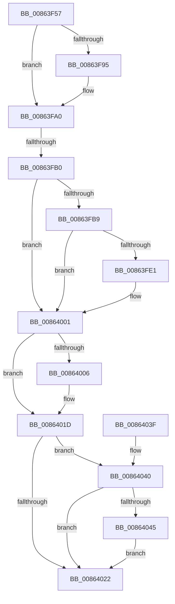

# sub_00863F57

- RVA: `0x00863F57`–`0x0086405D` (길이 `262` bytes)
- VA: `0x0000000140863F57`
- 실행 섹션: `PAGE`
- PDB 이름 있음: `아니요`; PDB Function 태그: `아니요`
- unwind 정보 RVA: `0x0006B8D0`
- 디코드: `69`개 명령, `262/262` bytes 표시
- 미해석 바이트: `0` (있으면 어셈블리에 `.byte`로 보존)

> 이 문서는 커널 이미지의 기계어와 PDB 기호를 분석해 생성했습니다. 4번과 5번은 함수 원형과 자료형을 바이너리 사용 방식에서 추정한 C 해석이며 원본 소스 복구 결과는 아닙니다.

## 1. Dependencies

- 직접 호출 지점: **11**; 고유 호출 대상: **9**
- 직접 호출자로 확인된 함수: **0**
- RIP 상대 이미지 참조: **0**

### Outgoing calls
- `0x00863F69` → [KeWaitForSingleObject](../../text/20/KeWaitForSingleObject_function_0020E6B0.md) (function, `0x0020E6B0`)
- `0x00863F81` → [IopDequeueIrpFromThread](../../text/20/IopDequeueIrpFromThread_function_00207B20.md) (function, `0x00207B20`)
- `0x00863F89` → [IoFreeIrp](../../text/24/IoFreeIrp_function_0024DF70.md) (function, `0x0024DF70`)
- `0x00863F9B` → [ExFreePoolWithTag](../../poolcode/B8/ExFreePoolWithTag_function_00B82870.md) (function, `0x00B82870`)
- `0x00863FCF` → [IoGetFileObjectFilterContext](../../text/41/IoGetFileObjectFilterContext_function_00418F30.md) (function, `0x00418F30`)
- `0x00863FEA` → [IoChangeFileObjectFilterContext](../../text/44/IoChangeFileObjectFilterContext_function_00449A60.md) (function, `0x00449A60`)
- `0x00863FF2` → [ExCleanupAutoExpandPushLock](../../text/43/ExCleanupAutoExpandPushLock_function_0043FAA0.md) (function, `0x0043FAA0`)
- `0x00863FFC` → [ExFreePoolWithTag](../../poolcode/B8/ExFreePoolWithTag_function_00B82870.md) (function, `0x00B82870`)
- `0x00864018` → [IopDecrementDeviceObjectRef](../../text/27/IopDecrementDeviceObjectRef_function_00270970.md) (function, `0x00270970`)
- `0x00864025` → [IopDeleteFileObjectExtension](../../text/38/IopDeleteFileObjectExtension_function_0038C4F0.md) (function, `0x0038C4F0`)
- `0x00864056` → [IopDecrementDeviceObjectRef](../../text/27/IopDecrementDeviceObjectRef_function_00270970.md) (function, `0x00270970`)

### Direct callers
- 이 함수 시작 RVA로 연결되는 직접 call은 확인되지 않았습니다. 간접 호출은 완전히 역산할 수 없습니다.

### Static image references
- 디코드된 RIP-relative 메모리 참조가 없습니다.

## 2. Other-region calls and transfers

- 다른 실행 섹션으로 향하는 call: **11**
  - `0x00863F69` → [KeWaitForSingleObject](../../text/20/KeWaitForSingleObject_function_0020E6B0.md) (`PAGE` → `.text`)
  - `0x00863F81` → [IopDequeueIrpFromThread](../../text/20/IopDequeueIrpFromThread_function_00207B20.md) (`PAGE` → `.text`)
  - `0x00863F89` → [IoFreeIrp](../../text/24/IoFreeIrp_function_0024DF70.md) (`PAGE` → `.text`)
  - `0x00863F9B` → [ExFreePoolWithTag](../../poolcode/B8/ExFreePoolWithTag_function_00B82870.md) (`PAGE` → `POOLCODE`)
  - `0x00863FCF` → [IoGetFileObjectFilterContext](../../text/41/IoGetFileObjectFilterContext_function_00418F30.md) (`PAGE` → `.text`)
  - `0x00863FEA` → [IoChangeFileObjectFilterContext](../../text/44/IoChangeFileObjectFilterContext_function_00449A60.md) (`PAGE` → `.text`)
  - `0x00863FF2` → [ExCleanupAutoExpandPushLock](../../text/43/ExCleanupAutoExpandPushLock_function_0043FAA0.md) (`PAGE` → `.text`)
  - `0x00863FFC` → [ExFreePoolWithTag](../../poolcode/B8/ExFreePoolWithTag_function_00B82870.md) (`PAGE` → `POOLCODE`)
  - `0x00864018` → [IopDecrementDeviceObjectRef](../../text/27/IopDecrementDeviceObjectRef_function_00270970.md) (`PAGE` → `.text`)
  - `0x00864025` → [IopDeleteFileObjectExtension](../../text/38/IopDeleteFileObjectExtension_function_0038C4F0.md) (`PAGE` → `.text`)
  - `0x00864056` → [IopDecrementDeviceObjectRef](../../text/27/IopDecrementDeviceObjectRef_function_00270970.md) (`PAGE` → `.text`)
- call이 아닌 외부 분기/꼬리 이동: **1**
  - `0x00863FAA` → [sub_00864067](Unknown_function_00864067.md) (`tail-transfer`)

## 3. Assembly (complete function range)

```asm
00863F57  45 33 C9                        xor r9d, r9d
00863F5A  4C 89 64 24 20                  mov qword ptr [rsp + 0x20], r12
00863F5F  45 33 C0                        xor r8d, r8d
00863F62  48 8D 4C 24 40                  lea rcx, [rsp + 0x40]
00863F67  33 D2                           xor edx, edx
00863F69  E8 42 A7 9A FF                  call 0x14020e6b0
00863F6E  65 48 8B 04 25 88 01 00 00      mov rax, qword ptr gs:[0x188]
00863F77  48 8B CF                        mov rcx, rdi
00863F7A  48 89 87 98 00 00 00            mov qword ptr [rdi + 0x98], rax
00863F81  E8 9A 3B 9A FF                  call 0x140207b20
00863F86  48 8B CF                        mov rcx, rdi
00863F89  E8 E2 9F 9E FF                  call 0x14024df70
00863F8E  66 44 39 63 58                  cmp word ptr [rbx + 0x58], r12w
00863F93  74 0B                           je 0x140863fa0
00863F95  48 8B 4B 60                     mov rcx, qword ptr [rbx + 0x60]
00863F99  33 D2                           xor edx, edx
00863F9B  E8 D0 E8 31 00                  call 0x140b82870
00863FA0  48 8B 8B B0 00 00 00            mov rcx, qword ptr [rbx + 0xb0]
00863FA7  48 85 C9                        test rcx, rcx
00863FAA  0F 85 B7 00 00 00               jne 0x140864067
00863FB0  4C 39 A3 D0 00 00 00            cmp qword ptr [rbx + 0xd0], r12
00863FB7  74 48                           je 0x140864001
00863FB9  45 33 C0                        xor r8d, r8d
00863FBC  4C 89 A4 24 90 00 00 00         mov qword ptr [rsp + 0x90], r12
00863FC4  48 8D 94 24 90 00 00 00         lea rdx, [rsp + 0x90]
00863FCC  48 8B CB                        mov rcx, rbx
00863FCF  E8 5C 4F BB FF                  call 0x140418f30
00863FD4  48 8B BC 24 90 00 00 00         mov rdi, qword ptr [rsp + 0x90]
00863FDC  48 85 FF                        test rdi, rdi
00863FDF  74 20                           je 0x140864001
00863FE1  45 33 C0                        xor r8d, r8d
00863FE4  48 8B D7                        mov rdx, rdi
00863FE7  48 8B CB                        mov rcx, rbx
00863FEA  E8 71 5A BE FF                  call 0x140449a60
00863FEF  48 8B CF                        mov rcx, rdi
00863FF2  E8 A9 BA BD FF                  call 0x14043faa0
00863FF7  33 D2                           xor edx, edx
00863FF9  48 8B CF                        mov rcx, rdi
00863FFC  E8 6F E8 31 00                  call 0x140b82870
00864001  40 84 ED                        test bpl, bpl
00864004  75 17                           jne 0x14086401d
00864006  44 0F B6 43 EB                  movzx r8d, byte ptr [rbx - 0x15]
0086400B  33 D2                           xor edx, edx
0086400D  48 8B 4B 08                     mov rcx, qword ptr [rbx + 8]
00864011  41 F6 D0                        not r8b
00864014  41 C0 E8 07                     shr r8b, 7
00864018  E8 53 C9 A0 FF                  call 0x140270970
0086401D  4D 85 F6                        test r14, r14
00864020  75 1E                           jne 0x140864040
00864022  48 8B CB                        mov rcx, rbx
00864025  E8 C6 84 B2 FF                  call 0x14038c4f0
0086402A  48 8B 9C 24 A0 00 00 00         mov rbx, qword ptr [rsp + 0xa0]
00864032  48 83 C4 60                     add rsp, 0x60
00864036  41 5F                           pop r15
00864038  41 5E                           pop r14
0086403A  41 5C                           pop r12
0086403C  5F                              pop rdi
0086403D  5D                              pop rbp
0086403E  C3                              ret
0086403F  CC                              int3
00864040  4D 85 FF                        test r15, r15
00864043  74 DD                           je 0x140864022
00864045  44 0F B6 43 EB                  movzx r8d, byte ptr [rbx - 0x15]
0086404A  33 D2                           xor edx, edx
0086404C  41 F6 D0                        not r8b
0086404F  49 8B CE                        mov rcx, r14
00864052  41 C0 E8 07                     shr r8b, 7
00864056  E8 15 C9 A0 FF                  call 0x140270970
0086405B  EB C5                           jmp 0x140864022
```

## 4. C-style interpretation (structured pseudocode)

```c
__int64 __fastcall sub_00863F57(__int64 a1, int a2, int a3, int a4, __int64 a5, __int64 a6, __int64 a7, __int64 a8, __int64 a9, __int64 a10, __int64 a11, __int64 a12, __int64 a13, __int64 a14, __int64 a15, __int64 a16, __int64 a17, __int64 a18, __int64 a19, __int64 a20)
{
    __int64 result;
    __int64 v_rsp;
    unsigned __int64 v_stack_p20;
    unsigned __int64 v_stack_p90;

    a4 = 0;
    v_stack_p20 = v_r12;
    a3 = 0;
    a2 = 0;
    result = KeWaitForSingleObject(a8, a2, a3, a4);
    *(unsigned __int64 *)(v_rdi + 152) = *(unsigned __int64 *)(gs_base + (0 + 392));
    result = IopDequeueIrpFromThread(v_rdi, a2, a3, a4);
    result = IoFreeIrp(v_rdi, a2, a3, a4);
    if ((*(unsigned __int16 *)(v_rbx + 88)) != ((unsigned __int16)(v_r12))) {
        a1 = *(unsigned __int64 *)(v_rbx + 96);
        a2 = 0;
        result = ExFreePoolWithTag(a1, a2, a3, a4);
    }
    if ((*(unsigned __int64 *)(v_rbx + 208)) == v_r12) goto loc_00864001;
    a3 = 0;
    v_stack_p90 = v_r12;
    result = IoGetFileObjectFilterContext(v_rbx, a18, a3, a4);
    if (a18 != 0) {
        a3 = 0;
        a2 = a18;
        a1 = v_rbx;
        result = IoChangeFileObjectFilterContext(a1, a2, a3, a4);
        a1 = a18;
        result = ExCleanupAutoExpandPushLock(a1, a2, a3, a4);
        a2 = 0;
        a1 = a18;
        result = ExFreePoolWithTag(a1, a2, a3, a4);
    }
    if ((unsigned __int8)(v_rbp) == 0) {
        a3 = *(unsigned __int8 *)(v_rbx - 21);
        a2 = 0;
        a1 = *(unsigned __int64 *)(v_rbx + 8);
        a3 = (unsigned __int8)(~(a3));
        a3 = (unsigned __int8)((a3) >> (7));
        result = IopDecrementDeviceObjectRef(a1, a2, a3, a4);
    }
    if (v_r14 != 0) goto loc_00864040;
loc_00864022:
    result = IopDeleteFileObjectExtension(v_rbx, a2, a3, a4);
    v_rsp = (v_rsp) + (96);
    return result;
loc_00864040:
    if (v_r15 == 0) goto loc_00864022;
    a2 = 0;
    a3 = (unsigned __int8)(~(*(unsigned __int8 *)(a20 - 21)));
    a3 = (unsigned __int8)((a3) >> (7));
    result = IopDecrementDeviceObjectRef(v_r14, a2, a3, a4);
    goto loc_00864022;
}
```

## 5. (Beta) C Style

```c
int64_t sub_00863F57(int64_t Arg1, int32_t Arg2, int32_t Arg3, int32_t Arg4, uint64_t Arg5, uint64_t Arg6, uint64_t Arg7, int64_t Arg8, uint64_t Arg9, uint64_t Arg10, uint64_t Arg11, uint64_t Arg12, uint64_t Arg13, uint64_t Arg14, uint64_t Arg15, uint64_t Arg16, uint64_t Arg17, int64_t Arg18, uint64_t Arg19, int64_t Arg20)
{
    int64_t result;
    int64_t local_rsp;
    uint64_t v_stack_p20;
    uint64_t v_stack_p90;

    Arg4 = 0;
    v_stack_p20 = local_r12;
    Arg3 = 0;
    Arg2 = 0;
    result = KeWaitForSingleObject(Arg8, Arg2, Arg3, Arg4);
    *(uint64_t *)(local_rdi + 0x98) = *(uint64_t *)(gs_base + (0 + 0x188));
    result = IopDequeueIrpFromThread(local_rdi, Arg2, Arg3, Arg4);
    result = IoFreeIrp(local_rdi, Arg2, Arg3, Arg4);
    if ((*(uint16_t *)(local_rbx + 0x58)) != ((uint16_t)(local_r12))) {
        Arg1 = *(uint64_t *)(local_rbx + 0x60);
        Arg2 = 0;
        result = ExFreePoolWithTag(Arg1, Arg2, Arg3, Arg4);
    }
    if ((*(uint64_t *)(local_rbx + 0xD0)) == local_r12) goto loc_00864001;
    Arg3 = 0;
    v_stack_p90 = local_r12;
    result = IoGetFileObjectFilterContext(local_rbx, Arg18, Arg3, Arg4);
    if (Arg18 != 0) {
        Arg3 = 0;
        Arg2 = Arg18;
        Arg1 = local_rbx;
        result = IoChangeFileObjectFilterContext(Arg1, Arg2, Arg3, Arg4);
        Arg1 = Arg18;
        result = ExCleanupAutoExpandPushLock(Arg1, Arg2, Arg3, Arg4);
        Arg2 = 0;
        Arg1 = Arg18;
        result = ExFreePoolWithTag(Arg1, Arg2, Arg3, Arg4);
    }
    if ((uint8_t)(local_rbp) == 0) {
        Arg3 = *(uint8_t *)(local_rbx - 0x15);
        Arg2 = 0;
        Arg1 = *(uint64_t *)(local_rbx + 0x8);
        Arg3 = (uint8_t)(~(Arg3));
        Arg3 = (uint8_t)((Arg3) >> (7));
        result = IopDecrementDeviceObjectRef(Arg1, Arg2, Arg3, Arg4);
    }
    if (local_r14 != 0) goto loc_00864040;
loc_00864022:
    result = IopDeleteFileObjectExtension(local_rbx, Arg2, Arg3, Arg4);
    local_rsp = (local_rsp) + (96);
    return result;
loc_00864040:
    if (local_r15 == 0) goto loc_00864022;
    Arg2 = 0;
    Arg3 = (uint8_t)(~(*(uint8_t *)(Arg20 - 0x15)));
    Arg3 = (uint8_t)((Arg3) >> (7));
    result = IopDecrementDeviceObjectRef(local_r14, Arg2, Arg3, Arg4);
    goto loc_00864022;
}
```

## 6. Execution-region graph

[열기: 2D/3D 그래프와 함수 탐색 컨트롤 패널](../../../control-panel.html?section=page&rva=0x00863F57&view=graph)

- 2D 그래프는 위에서 아래로 흐르고, 3D 그래프는 빈 공간을 드래그해 회전합니다. Shift+드래그는 이동, 휠은 확대·축소, 함수 노드 선택은 대상 보고서 이동입니다.

### Static fallback


