# sub_00864C3A

- RVA: `0x00864C3A`–`0x00864DF7` (길이 `445` bytes)
- VA: `0x0000000140864C3A`
- 실행 섹션: `PAGE`
- PDB 이름 있음: `아니요`; PDB Function 태그: `아니요`
- unwind 정보 RVA: `0x0006B9FC`
- 디코드: `113`개 명령, `445/445` bytes 표시
- 미해석 바이트: `0` (있으면 어셈블리에 `.byte`로 보존)

> 이 문서는 커널 이미지의 기계어와 PDB 기호를 분석해 생성했습니다. 4번과 5번은 함수 원형과 자료형을 바이너리 사용 방식에서 추정한 C 해석이며 원본 소스 복구 결과는 아닙니다.

## 1. Dependencies

- 직접 호출 지점: **4**; 고유 호출 대상: **2**
- 직접 호출자로 확인된 함수: **0**
- RIP 상대 이미지 참조: **1**

### Outgoing calls
- `0x00864D16` → [PspReturnQuota](../../text/39/PspReturnQuota_function_00390C40.md) (function, `0x00390C40`)
- `0x00864D5D` → [PspReturnQuota](../../text/39/PspReturnQuota_function_00390C40.md) (function, `0x00390C40`)
- `0x00864D77` → [PspReturnQuota](../../text/39/PspReturnQuota_function_00390C40.md) (function, `0x00390C40`)
- `0x00864DD7` → [ExFreePoolWithTag](../../poolcode/B8/ExFreePoolWithTag_function_00B82870.md) (function, `0x00B82870`)

### Direct callers
- 이 함수 시작 RVA로 연결되는 직접 call은 확인되지 않았습니다. 간접 호출은 완전히 역산할 수 없습니다.

### Static image references
- `0x00864C9C` → RVA `0x00FC6E4C` (`ALMOSTRO`; read)

## 2. Other-region calls and transfers

- 다른 실행 섹션으로 향하는 call: **4**
  - `0x00864D16` → [PspReturnQuota](../../text/39/PspReturnQuota_function_00390C40.md) (`PAGE` → `.text`)
  - `0x00864D5D` → [PspReturnQuota](../../text/39/PspReturnQuota_function_00390C40.md) (`PAGE` → `.text`)
  - `0x00864D77` → [PspReturnQuota](../../text/39/PspReturnQuota_function_00390C40.md) (`PAGE` → `.text`)
  - `0x00864DD7` → [ExFreePoolWithTag](../../poolcode/B8/ExFreePoolWithTag_function_00B82870.md) (`PAGE` → `POOLCODE`)
- call이 아닌 외부 분기/꼬리 이동: **14**
  - `0x00864C42` → [sub_00864EDE](Unknown_function_00864EDE.md) (`tail-transfer`)
  - `0x00864C66` → [sub_00864EE6 + 0x11](Unknown_function_00864EE6.md) (`tail-transfer`)
  - `0x00864CB4` → [sub_00864E32 + 0x82](Unknown_function_00864E32.md) (`tail-transfer`)
  - `0x00864CC6` → [sub_00864E32 + 0x26](Unknown_function_00864E32.md) (`tail-transfer`)
  - `0x00864CCF` → [sub_00864E32 + 0x1E](Unknown_function_00864E32.md) (`tail-transfer`)
  - `0x00864CD8` → [sub_00864EE6](Unknown_function_00864EE6.md) (`tail-transfer`)
  - `0x00864CF4` → [sub_00864EE6 + 0xE1](Unknown_function_00864EE6.md) (`tail-transfer`)
  - `0x00864D02` → [sub_00864EE6 + 0xE1](Unknown_function_00864EE6.md) (`tail-transfer`)
  - `0x00864D30` → [sub_00864EE6 + 0x312](Unknown_function_00864EE6.md) (`tail-transfer`)
  - `0x00864D89` → [sub_00864EE6 + 0x142](Unknown_function_00864EE6.md) (`tail-transfer`)
  - `0x00864D99` → [sub_00864E32](Unknown_function_00864E32.md) (`tail-transfer`)
  - `0x00864DA7` → [sub_00864EE6 + 0x9D](Unknown_function_00864EE6.md) (`tail-transfer`)
  - `0x00864DB0` → [sub_00864EE6 + 0xBA](Unknown_function_00864EE6.md) (`tail-transfer`)
  - `0x00864DC8` → [sub_00864EE6 + 0x130](Unknown_function_00864EE6.md) (`tail-transfer`)

## 3. Assembly (complete function range)

```asm
00864C3A  4C 89 7C 24 20                  mov qword ptr [rsp + 0x20], r15
00864C3F  F6 C1 08                        test cl, 8
00864C42  0F 84 96 02 00 00               je 0x140864ede
00864C48  48 8B C2                        mov rax, rdx
00864C4B  4C 8B FB                        mov r15, rbx
00864C4E  83 E0 0F                        and eax, 0xf
00864C51  0F B6 84 28 80 FF F0 00         movzx eax, byte ptr [rax + rbp + 0xf0ff80]
00864C59  4C 2B F8                        sub r15, rax
00864C5C  33 C0                           xor eax, eax
00864C5E  4C 89 6C 24 28                  mov qword ptr [rsp + 0x28], r13
00864C63  F6 C1 20                        test cl, 0x20
00864C66  0F 85 8B 02 00 00               jne 0x140864ef7
00864C6C  4C 8B E8                        mov r13, rax
00864C6F  0F B6 84 2A 80 FF F0 00         movzx eax, byte ptr [rdx + rbp + 0xf0ff80]
00864C77  48 8B F3                        mov rsi, rbx
00864C7A  48 2B F0                        sub rsi, rax
00864C7D  84 C9                           test cl, cl
00864C7F  79 0D                           jns 0x140864c8e
00864C81  8B 06                           mov eax, dword ptr [rsi]
00864C83  B9 04 00 00 00                  mov ecx, 4
00864C88  48 2B C8                        sub rcx, rax
00864C8B  48 03 F1                        add rsi, rcx
00864C8E  0F B6 4B 18                     movzx ecx, byte ptr [rbx + 0x18]
00864C92  48 8B C3                        mov rax, rbx
00864C95  48 C1 E8 08                     shr rax, 8
00864C99  0F B6 F8                        movzx edi, al
00864C9C  0F B6 05 A9 21 76 00            movzx eax, byte ptr [rip + 0x7621a9]
00864CA3  48 33 CF                        xor rcx, rdi
00864CA6  48 33 C8                        xor rcx, rax
00864CA9  48 8B AC CD 00 78 FC 00         mov rbp, qword ptr [rbp + rcx*8 + 0xfc7800]
00864CB1  4D 85 F6                        test r14, r14
00864CB4  0F 85 FA 01 00 00               jne 0x140864eb4
00864CBA  F0 FF 4D 2C                     lock dec dword ptr [rbp + 0x2c]
00864CBE  F6 43 1B 01                     test byte ptr [rbx + 0x1b], 1
00864CC2  48 8B 53 20                     mov rdx, qword ptr [rbx + 0x20]
00864CC6  0F 85 8C 01 00 00               jne 0x140864e58
00864CCC  48 85 D2                        test rdx, rdx
00864CCF  0F 84 7B 01 00 00               je 0x140864e50
00864CD5  4D 85 FF                        test r15, r15
00864CD8  0F 84 08 02 00 00               je 0x140864ee6
00864CDE  4D 8B 77 10                     mov r14, qword ptr [r15 + 0x10]
00864CE2  41 8B 07                        mov eax, dword ptr [r15]
00864CE5  41 8B 4F 04                     mov ecx, dword ptr [r15 + 4]
00864CE9  89 44 24 60                     mov dword ptr [rsp + 0x60], eax
00864CED  89 4C 24 68                     mov dword ptr [rsp + 0x68], ecx
00864CF1  4D 85 F6                        test r14, r14
00864CF4  0F 84 CD 02 00 00               je 0x140864fc7
00864CFA  45 8B 4F 08                     mov r9d, dword ptr [r15 + 8]
00864CFE  49 83 FE 01                     cmp r14, 1
00864D02  0F 84 BF 02 00 00               je 0x140864fc7
00864D08  4D 85 C9                        test r9, r9
00864D0B  74 0E                           je 0x140864d1b
00864D0D  33 D2                           xor edx, edx
00864D0F  49 8B CE                        mov rcx, r14
00864D12  44 8D 42 01                     lea r8d, [rdx + 1]
00864D16  E8 25 BF B2 FF                  call 0x140390c40
00864D1B  41 BF FF FF FF FF               mov r15d, 0xffffffff
00864D21  41 8B C7                        mov eax, r15d
00864D24  F0 41 0F C1 86 00 02 00 00      lock xadd dword ptr [r14 + 0x200], eax
00864D2D  83 F8 01                        cmp eax, 1
00864D30  0F 84 C2 04 00 00               je 0x1408651f8
00864D36  8B 4C 24 60                     mov ecx, dword ptr [rsp + 0x60]
00864D3A  8B 44 24 68                     mov eax, dword ptr [rsp + 0x68]
00864D3E  4C 8B 73 20                     mov r14, qword ptr [rbx + 0x20]
00864D42  48 89 44 24 60                  mov qword ptr [rsp + 0x60], rax
00864D47  44 8B C9                        mov r9d, ecx
00864D4A  49 83 FE 01                     cmp r14, 1
00864D4E  74 3F                           je 0x140864d8f
00864D50  85 C9                           test ecx, ecx
00864D52  74 13                           je 0x140864d67
00864D54  33 D2                           xor edx, edx
00864D56  49 8B CE                        mov rcx, r14
00864D59  44 8D 42 01                     lea r8d, [rdx + 1]
00864D5D  E8 DE BE B2 FF                  call 0x140390c40
00864D62  48 8B 44 24 60                  mov rax, qword ptr [rsp + 0x60]
00864D67  48 85 C0                        test rax, rax
00864D6A  74 10                           je 0x140864d7c
00864D6C  4C 8B C8                        mov r9, rax
00864D6F  45 33 C0                        xor r8d, r8d
00864D72  33 D2                           xor edx, edx
00864D74  49 8B CE                        mov rcx, r14
00864D77  E8 C4 BE B2 FF                  call 0x140390c40
00864D7C  F0 45 0F C1 BE 00 02 00 00      lock xadd dword ptr [r14 + 0x200], r15d
00864D85  41 83 FF 01                     cmp r15d, 1
00864D89  0F 84 99 02 00 00               je 0x140865028
00864D8F  45 33 FF                        xor r15d, r15d
00864D92  4C 89 7B 20                     mov qword ptr [rbx + 0x20], r15
00864D96  4D 85 E4                        test r12, r12
00864D99  0F 85 93 00 00 00               jne 0x140864e32
00864D9F  4C 8B 74 24 70                  mov r14, qword ptr [rsp + 0x70]
00864DA4  4D 85 F6                        test r14, r14
00864DA7  0F 85 D6 01 00 00               jne 0x140864f83
00864DAD  4D 85 ED                        test r13, r13
00864DB0  0F 85 EA 01 00 00               jne 0x140864fa0
00864DB6  40 32 3D 8F 20 76 00            xor dil, byte ptr [rip + 0x76208f]
00864DBD  40 80 F7 01                     xor dil, 1
00864DC1  40 88 7B 18                     mov byte ptr [rbx + 0x18], dil
00864DC5  48 85 ED                        test rbp, rbp
00864DC8  0F 84 48 02 00 00               je 0x140865016
00864DCE  8B 95 C0 00 00 00               mov edx, dword ptr [rbp + 0xc0]
00864DD4  48 8B CE                        mov rcx, rsi
00864DD7  E8 94 DA 31 00                  call 0x140b82870
00864DDC  4C 8B 7C 24 20                  mov r15, qword ptr [rsp + 0x20]
00864DE1  4C 8B 6C 24 28                  mov r13, qword ptr [rsp + 0x28]
00864DE6  4C 8B 64 24 78                  mov r12, qword ptr [rsp + 0x78]
00864DEB  48 83 C4 30                     add rsp, 0x30
00864DEF  41 5E                           pop r14
00864DF1  5F                              pop rdi
00864DF2  5E                              pop rsi
00864DF3  5D                              pop rbp
00864DF4  5B                              pop rbx
00864DF5  C3                              ret
00864DF6  CC                              int3
```

## 4. C-style interpretation (structured pseudocode)

```c
__int64 __fastcall sub_00864C3A(unsigned __int8 a1, __int64 a2, __int64 a3, __int64 a4, __int64 a5, __int64 a6, __int64 a7, __int64 a8, __int64 a9, __int64 a10, __int64 a11, unsigned int a12, unsigned int a13, __int64 a14, __int64 a15)
{
    __int64 result;
    __int64 v_r15;
    __int64 v_rdi;
    __int64 v_rsi;
    __int64 v_rsp;
    unsigned __int64 v_stack_p20;
    unsigned __int64 v_stack_p28;
    unsigned int v_stack_p60;
    unsigned int v_stack_p68;

    v_stack_p20 = v_r15;
    result = (unsigned int)((a2) & (15));
    v_r15 = (v_rbx) - (*(unsigned __int8 *)(result + v_rbp * 1 + 15794048));
    result = 0;
    v_stack_p28 = v_r13;
    v_rsi = (v_rbx) - (*(unsigned __int8 *)(a2 + v_rbp * 1 + 15794048));
    result = *(unsigned __int8 *)(a2 + v_rbp * 1 + 15794048);
    if (sign_flag) {
        result = *(unsigned int *)(v_rsi);
        a1 = 4;
        a1 = (a1) - (result);
        v_rsi = (v_rsi) + (a1);
    }
    result = (v_rbx) >> (8);
    a1 = (*(unsigned __int8 *)(v_rbx + 24)) ^ ((unsigned __int8)(result));
    a1 = (a1) ^ (*(unsigned __int8 *)(v_rip + 7741865));
    v_stack_p60 = (unsigned int)((unsigned int)(*(unsigned int *)(v_r15)));
    v_stack_p68 = (unsigned int)((unsigned int)(*(unsigned int *)(v_r15 + 4)));
    result = (unsigned int)(*(unsigned int *)(v_r15));
    if ((unsigned int)(*(unsigned int *)(v_r15 + 8)) != 0) {
        a2 = 0;
        a1 = *(unsigned __int64 *)(v_r15 + 16);
        a3 = a2 + 1;
        result = PspReturnQuota(a1, a2, a3, (unsigned int)(*(unsigned int *)(v_r15 + 8)));
    }
    v_stack_p60 = (unsigned int)(a13);
    if ((*(unsigned __int64 *)(v_rbx + 32)) == 1) goto loc_00864D8F;
    result = (unsigned int)(a13);
    if ((unsigned int)((unsigned int)(a12)) != 0) {
        a2 = 0;
        a1 = *(unsigned __int64 *)(v_rbx + 32);
        a3 = a2 + 1;
        result = PspReturnQuota(a1, a2, a3, (unsigned int)((unsigned int)((unsigned int)(a12))));
        result = a12;
    }
    if (result != 0) {
        a4 = result;
        a3 = 0;
        a2 = 0;
        a1 = *(unsigned __int64 *)(v_rbx + 32);
        result = PspReturnQuota(a1, a2, a3, a4);
    }
loc_00864D8F:
    v_r15 = 0;
    *(unsigned __int64 *)(v_rbx + 32) = 0;
    v_rdi = (unsigned __int8)(((unsigned __int8)(result)) ^ (*(unsigned __int8 *)(v_rip + 7741583)));
    v_rdi = (unsigned __int8)((v_rdi) ^ (1));
    *(unsigned __int8 *)(v_rbx + 24) = (unsigned __int8)(v_rdi);
    result = ExFreePoolWithTag(v_rsi, (unsigned int)(*(unsigned int *)(*(unsigned __int64 *)(v_rbp + a1 * 8 + 16545792) + 192)), a3, a4);
    v_rsp = (v_rsp) + (48);
    return result;
}
```

## 5. (Beta) C Style

```c
int64_t sub_00864C3A(uint8_t Arg1, void *Arg2, int64_t Arg3, int64_t Arg4, int64_t Arg5, uint64_t Arg6, uint64_t Arg7, uint64_t Arg8, uint64_t Arg9, uint64_t Arg10, uint64_t Arg11, uint32_t Arg12, uint32_t Arg13, int64_t Arg14, int64_t Arg15)
{
    uint8_t *arg2 = (uint8_t *)Arg2;

    int64_t result;
    int64_t local_r15;
    int64_t local_rdi;
    int64_t local_rsi;
    int64_t local_rsp;
    uint64_t v_stack_p20;
    uint64_t v_stack_p28;
    uint32_t v_stack_p60;
    uint32_t v_stack_p68;

    v_stack_p20 = local_r15;
    result = (uint32_t)((Arg2) & (15));
    local_r15 = (local_rbx) - (*(uint8_t *)(result + local_rbp * 1 + 0xF0FF80));
    result = 0;
    v_stack_p28 = local_r13;
    local_rsi = (local_rbx) - (*(uint8_t *)(arg2 + local_rbp * 1 + 0xF0FF80));
    result = *(uint8_t *)(arg2 + local_rbp * 1 + 0xF0FF80);
    if (sign_flag) {
        result = *(uint32_t *)(local_rsi);
        Arg1 = 4;
        Arg1 = (Arg1) - (result);
        local_rsi = (local_rsi) + (Arg1);
    }
    result = (local_rbx) >> (8);
    Arg1 = (*(uint8_t *)(local_rbx + 0x18)) ^ ((uint8_t)(result));
    Arg1 = (Arg1) ^ (*(uint8_t *)(v_rip + 0x7621A9));
    v_stack_p60 = (uint32_t)((uint32_t)(*(uint32_t *)(local_r15)));
    v_stack_p68 = (uint32_t)((uint32_t)(*(uint32_t *)(local_r15 + 0x4)));
    result = (uint32_t)(*(uint32_t *)(local_r15));
    if ((uint32_t)(*(uint32_t *)(local_r15 + 0x8)) != 0) {
        Arg2 = 0;
        Arg1 = *(uint64_t *)(local_r15 + 0x10);
        Arg3 = Arg2 + 1;
        result = PspReturnQuota(Arg1, Arg2, Arg3, (uint32_t)(*(uint32_t *)(local_r15 + 0x8)));
    }
    v_stack_p60 = (uint32_t)(Arg13);
    if ((*(uint64_t *)(local_rbx + 0x20)) == 1) goto loc_00864D8F;
    result = (uint32_t)(Arg13);
    if ((uint32_t)((uint32_t)(Arg12)) != 0) {
        Arg2 = 0;
        Arg1 = *(uint64_t *)(local_rbx + 0x20);
        Arg3 = Arg2 + 1;
        result = PspReturnQuota(Arg1, Arg2, Arg3, (uint32_t)((uint32_t)((uint32_t)(Arg12))));
        result = Arg12;
    }
    if (result != 0) {
        Arg4 = result;
        Arg3 = 0;
        Arg2 = 0;
        Arg1 = *(uint64_t *)(local_rbx + 0x20);
        result = PspReturnQuota(Arg1, Arg2, Arg3, Arg4);
    }
loc_00864D8F:
    local_r15 = 0;
    *(uint64_t *)(local_rbx + 0x20) = 0;
    local_rdi = (uint8_t)(((uint8_t)(result)) ^ (*(uint8_t *)(v_rip + 0x76208F)));
    local_rdi = (uint8_t)((local_rdi) ^ (1));
    *(uint8_t *)(local_rbx + 0x18) = (uint8_t)(local_rdi);
    result = ExFreePoolWithTag(local_rsi, (uint32_t)(*(uint32_t *)(*(uint64_t *)(local_rbp + Arg1 * 8 + 0xFC7800) + 0xC0)), Arg3, Arg4);
    local_rsp = (local_rsp) + (48);
    return result;
}
```

### 관측된 메모리 오프셋

구조체 형식이 확인되지 않은 접근은 인자 기준의 오프셋으로만 기록했습니다.

| 기준 인자 | 오프셋 표현 | 폭 (bit) | 접근 |
|---|---:|---:|---|
| `Arg2` | `+ 0xF0FF80 + rbp*1` | `8` | `R` |

## 6. Execution-region graph

[열기: 2D/3D 그래프와 함수 탐색 컨트롤 패널](../../../control-panel.html?section=page&rva=0x00864C3A&view=graph)

- 2D 그래프는 위에서 아래로 흐르고, 3D 그래프는 빈 공간을 드래그해 회전합니다. Shift+드래그는 이동, 휠은 확대·축소, 함수 노드 선택은 대상 보고서 이동입니다.

### Static fallback

```mermaid
flowchart TD
  bb_00864C3A[BB_00864C3A]
  bb_00864C48[BB_00864C48]
  bb_00864C6C[BB_00864C6C]
  bb_00864C81[BB_00864C81]
  bb_00864C8E[BB_00864C8E]
  bb_00864CBA[BB_00864CBA]
  bb_00864CCC[BB_00864CCC]
  bb_00864CD5[BB_00864CD5]
  bb_00864CDE[BB_00864CDE]
  bb_00864CFA[BB_00864CFA]
  bb_00864D08[BB_00864D08]
  bb_00864D0D[BB_00864D0D]
  bb_00864D1B[BB_00864D1B]
  bb_00864D36[BB_00864D36]
  bb_00864D50[BB_00864D50]
  bb_00864D54[BB_00864D54]
  bb_00864D67[BB_00864D67]
  bb_00864D6C[BB_00864D6C]
  bb_00864D7C[BB_00864D7C]
  bb_00864D8F[BB_00864D8F]
  bb_00864D9F[BB_00864D9F]
  bb_00864DAD[BB_00864DAD]
  bb_00864DB6[BB_00864DB6]
  bb_00864DCE[BB_00864DCE]
  bb_00864DF6[BB_00864DF6]
  bb_00864C3A -->|fallthrough| bb_00864C48
  bb_00864C48 -->|fallthrough| bb_00864C6C
  bb_00864C6C -->|branch| bb_00864C8E
  bb_00864C6C -->|fallthrough| bb_00864C81
  bb_00864C81 -->|flow| bb_00864C8E
  bb_00864C8E -->|fallthrough| bb_00864CBA
  bb_00864CBA -->|fallthrough| bb_00864CCC
  bb_00864CCC -->|fallthrough| bb_00864CD5
  bb_00864CD5 -->|fallthrough| bb_00864CDE
  bb_00864CDE -->|fallthrough| bb_00864CFA
  bb_00864CFA -->|fallthrough| bb_00864D08
  bb_00864D08 -->|branch| bb_00864D1B
  bb_00864D08 -->|fallthrough| bb_00864D0D
  bb_00864D0D -->|flow| bb_00864D1B
  bb_00864D1B -->|fallthrough| bb_00864D36
  bb_00864D36 -->|branch| bb_00864D8F
  bb_00864D36 -->|fallthrough| bb_00864D50
  bb_00864D50 -->|branch| bb_00864D67
  bb_00864D50 -->|fallthrough| bb_00864D54
  bb_00864D54 -->|flow| bb_00864D67
  bb_00864D67 -->|branch| bb_00864D7C
  bb_00864D67 -->|fallthrough| bb_00864D6C
  bb_00864D6C -->|flow| bb_00864D7C
  bb_00864D7C -->|fallthrough| bb_00864D8F
  bb_00864D8F -->|fallthrough| bb_00864D9F
  bb_00864D9F -->|fallthrough| bb_00864DAD
  bb_00864DAD -->|fallthrough| bb_00864DB6
  bb_00864DB6 -->|fallthrough| bb_00864DCE
```


