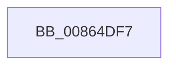

# sub_00864DF7

- RVA: `0x00864DF7`–`0x00864E12` (길이 `27` bytes)
- VA: `0x0000000140864DF7`
- 실행 섹션: `PAGE`
- PDB 이름 있음: `아니요`; PDB Function 태그: `아니요`
- unwind 정보 RVA: `0x0006BA18`
- 디코드: `7`개 명령, `27/27` bytes 표시
- 미해석 바이트: `0` (있으면 어셈블리에 `.byte`로 보존)

> 이 문서는 커널 이미지의 기계어와 PDB 기호를 분석해 생성했습니다. 4번과 5번은 함수 원형과 자료형을 바이너리 사용 방식에서 추정한 C 해석이며 원본 소스 복구 결과는 아닙니다.

## 1. Dependencies

- 직접 호출 지점: **0**; 고유 호출 대상: **0**
- 직접 호출자로 확인된 함수: **0**
- RIP 상대 이미지 참조: **0**

### Outgoing calls
- 직접 디코드된 call 명령이 없습니다.

### Direct callers
- 이 함수 시작 RVA로 연결되는 직접 call은 확인되지 않았습니다. 간접 호출은 완전히 역산할 수 없습니다.

### Static image references
- 디코드된 RIP-relative 메모리 참조가 없습니다.

## 2. Other-region calls and transfers

- 다른 실행 섹션으로 향하는 call: **0**
- call이 아닌 외부 분기/꼬리 이동: **1**
  - `0x00864E0D` → [sub_00864C3A](Unknown_function_00864C3A.md) (`tail-transfer`)

## 3. Assembly (complete function range)

```asm
00864DF7  48 8B C2                        mov rax, rdx
00864DFA  4C 8B E3                        mov r12, rbx
00864DFD  83 E0 07                        and eax, 7
00864E00  0F B6 84 28 80 FF F0 00         movzx eax, byte ptr [rax + rbp + 0xf0ff80]
00864E08  4C 2B E0                        sub r12, rax
00864E0B  33 C0                           xor eax, eax
00864E0D  E9 28 FE FF FF                  jmp 0x140864c3a
```

## 4. C-style interpretation (structured pseudocode)

```c
__int64 __fastcall sub_00864DF7(__int64 a1, __int64 a2)
{
    __int64 result;
    __int64 v_r12;

    result = (unsigned int)((a2) & (7));
    v_r12 = (v_rbx) - (*(unsigned __int8 *)(result + v_rbp * 1 + 15794048));
    result = 0;
}
```

## 5. (Beta) C Style

```c
int64_t sub_00864DF7(int64_t Arg1, void *Arg2)
{
    uint8_t *arg2 = (uint8_t *)Arg2;

    int64_t result;
    int64_t local_r12;

    result = (uint32_t)((Arg2) & (7));
    local_r12 = (local_rbx) - (*(uint8_t *)(result + local_rbp * 1 + 0xF0FF80));
    result = 0;
}
```

### 관측된 메모리 오프셋

구조체 형식이 확인되지 않은 접근은 인자 기준의 오프셋으로만 기록했습니다.

| 기준 인자 | 오프셋 표현 | 폭 (bit) | 접근 |
|---|---:|---:|---|
| `Arg2` | `+ 0xF0FF80 + rbp*1` | `8` | `R` |

## 6. Execution-region graph

[열기: 2D/3D 그래프와 함수 탐색 컨트롤 패널](../../../control-panel.html?section=page&rva=0x00864DF7&view=graph)

- 2D 그래프는 위에서 아래로 흐르고, 3D 그래프는 빈 공간을 드래그해 회전합니다. Shift+드래그는 이동, 휠은 확대·축소, 함수 노드 선택은 대상 보고서 이동입니다.

### Static fallback


