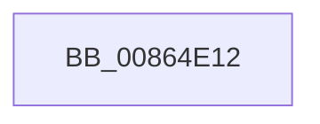

# sub_00864E12

- RVA: `0x00864E12`–`0x00864E32` (길이 `32` bytes)
- VA: `0x0000000140864E12`
- 실행 섹션: `PAGE`
- PDB 이름 있음: `아니요`; PDB Function 태그: `아니요`
- unwind 정보 RVA: `0x0006BA28`
- 디코드: `8`개 명령, `32/32` bytes 표시
- 미해석 바이트: `0` (있으면 어셈블리에 `.byte`로 보존)

> 이 문서는 커널 이미지의 기계어와 PDB 기호를 분석해 생성했습니다. 4번과 5번은 함수 원형과 자료형을 바이너리 사용 방식에서 추정한 C 해석이며 원본 소스 복구 결과는 아닙니다.

## 1. Dependencies

- 직접 호출 지점: **0**; 고유 호출 대상: **0**
- 직접 호출자로 확인된 함수: **0**
- RIP 상대 이미지 참조: **0**

### Outgoing calls
- 직접 디코드된 call 명령이 없습니다.

### Direct callers
- 이 함수 시작 RVA로 연결되는 직접 call은 확인되지 않았습니다. 간접 호출은 완전히 역산할 수 없습니다.

### Static image references
- 디코드된 RIP-relative 메모리 참조가 없습니다.

## 2. Other-region calls and transfers

- 다른 실행 섹션으로 향하는 call: **0**
- call이 아닌 외부 분기/꼬리 이동: **1**
  - `0x00864E2D` → [sub_00864C29](Unknown_function_00864C29.md) (`tail-transfer`)

## 3. Assembly (complete function range)

```asm
00864E12  48 8B C1                        mov rax, rcx
00864E15  4C 8B C3                        mov r8, rbx
00864E18  83 E0 03                        and eax, 3
00864E1B  0F B6 84 28 80 FF F0 00         movzx eax, byte ptr [rax + rbp + 0xf0ff80]
00864E23  4C 2B C0                        sub r8, rax
00864E26  4C 89 44 24 70                  mov qword ptr [rsp + 0x70], r8
00864E2B  33 C0                           xor eax, eax
00864E2D  E9 F7 FD FF FF                  jmp 0x140864c29
```

## 4. C-style interpretation (structured pseudocode)

```c
__int64 __fastcall sub_00864E12(__int64 a1)
{
    __int64 result;
    unsigned __int64 v_stack_p70;

    result = (unsigned int)((a1) & (3));
    a3 = (v_rbx) - (*(unsigned __int8 *)(result + v_rbp * 1 + 15794048));
    v_stack_p70 = a3;
    result = 0;
}
```

## 5. (Beta) C Style

```c
int64_t sub_00864E12(void *Arg1)
{
    uint8_t *arg1 = (uint8_t *)Arg1;

    int64_t result;
    uint64_t v_stack_p70;

    result = (uint32_t)((Arg1) & (3));
    a3 = (local_rbx) - (*(uint8_t *)(result + local_rbp * 1 + 0xF0FF80));
    v_stack_p70 = a3;
    result = 0;
}
```

### 관측된 메모리 오프셋

구조체 형식이 확인되지 않은 접근은 인자 기준의 오프셋으로만 기록했습니다.

| 기준 인자 | 오프셋 표현 | 폭 (bit) | 접근 |
|---|---:|---:|---|
| `Arg1` | `+ 0xF0FF80 + rbp*1` | `8` | `R` |

## 6. Execution-region graph

[열기: 2D/3D 그래프와 함수 탐색 컨트롤 패널](../../../control-panel.html?section=page&rva=0x00864E12&view=graph)

- 2D 그래프는 위에서 아래로 흐르고, 3D 그래프는 빈 공간을 드래그해 회전합니다. Shift+드래그는 이동, 휠은 확대·축소, 함수 노드 선택은 대상 보고서 이동입니다.

### Static fallback


